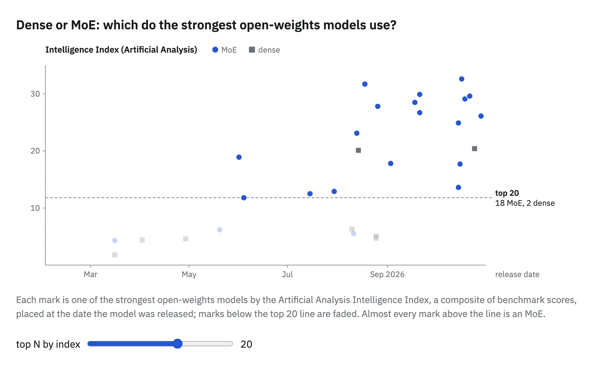
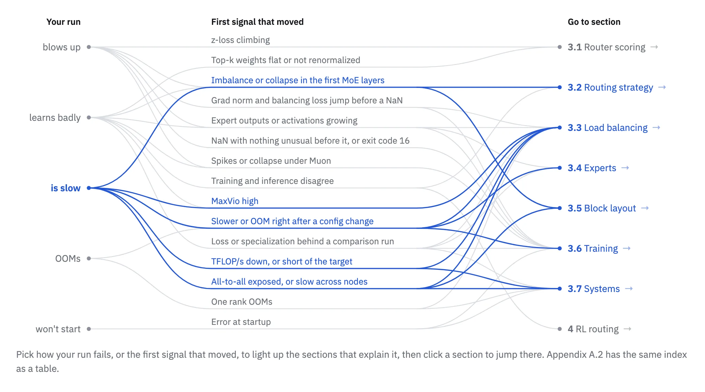
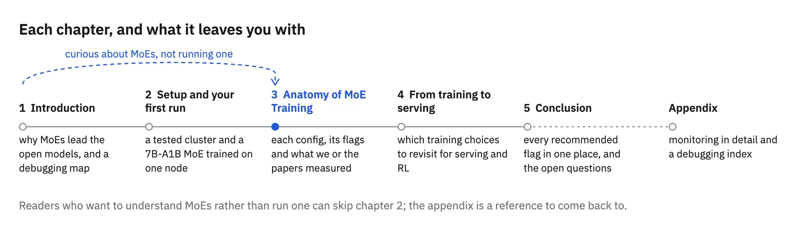

> Source: [Hugging Face handbook](https://huggingface.co/spaces/huggingface/moe-blogpost/blob/ef70726e6f8b99d74298a16a4894340f288a58c2/app/src/content/chapters/1-introduction.mdx), revision `ef70726e6f8b99d74298a16a4894340f288a58c2`.

## 1\. Introduction

The frontier is sparse. Reading time: 1-2 days. For the best reading experience, we recommend not using a mobile phone.  On the [Artificial Analysis index](https://artificialanalysis.ai/models/open-source), 18 of the 20 highest-scoring open-weights models are mixtures of experts (the two exceptions, Nanbeige4.3-33B and Qwen3.8 27B at twelfth and thirteenth place, are dense)[1](A-appendix.md#ref-src-aa-open-top) [evidence](../citation-evidence.md#aa-open-top). They include the top model of each of the five leading labs: DeepSeek V4.1 Flash 1017, GLM-5.3, MiMo-V2.6-Pro, Ling 3.1 Flash 1019 and MiniMax-M3.1-Flash[1](A-appendix.md#ref-src-aa-open-top) [evidence](../citation-evidence.md#aa-open-top).

**Figure 1.1**

[Figure explanation, controls and captured states](../figures/active-vs-release.md) · [Interactive original](../upstream/app/public/viz/index.html?c=active-vs-release)

What an MoE offers lies in how it spends its inference compute. Each token runs through only a few of its experts, so the model can hold many more parameters than it uses on any one token: the small MoE you will train in chapter 2 has 6.86B parameters, of which 1.22B are active per token. Turning that inference saving into faster training is the hard part.

Our previous deep dive on training, the [Smol Training Playbook](https://huggingface.co/spaces/HuggingFaceTB/smol-training-playbook), covered training a dense model but only touched on MoE design. Because the star of that book, SmolLM3, was a dense transformer, its training needed no technique specific to MoE, like [expert parallelism](https://huggingface.co/spaces/nanotron/ultrascale-playbook?section=expert_parallelism). Still, we glanced at MoE in the playbook's "Going Sparse: MoE" section to cover its high-level design choices: sparsity, granularity, shared experts and load balancing. That section named the main reasons distributed MoE training is complex: expert placement, load balancing and all-to-all communication, but without diving into the particulars[2](A-appendix.md#ref-doc-0) [evidence](../citation-evidence.md#stp-dense). This handbook starts from that list.

Going from a dense model to an MoE gives you three new challenges to manage: a router that decides which experts each token uses, a load that has to stay balanced across the experts, and, once the experts are split across GPUs, an [exchange of tokens](https://github.com/NVIDIA/Megatron-LM/blob/d6316eb45bf1bfbb6f1f848c0b56e55166564d80/megatron/core/transformer/moe/token_dispatcher.py#L708-L727) between those GPUs in every MoE layer. Each aspect brings settings a dense run never had and new ways for a run to fail. The chapters that follow take those settings one at a time and examine them in detail, with code you can run and, in most cases, direct results and data from our own cluster experiments.

A run that goes south will give you a symptom but not the reason behind it. The map below is a high-level view to help you go back to the source: start from how a run fails, find the first signal of bad behavior (the canary in the coal mine), and go read the part of the post that explains the possible cause. You can keep this map at hand for the day a run goes wrong.

**Figure 1.2**

[Figure explanation, controls and captured states](../figures/triage-flowchart.md) · [Interactive original](../upstream/app/public/viz/index.html?c=triage-flowchart)

Now, before we start, a quick note on the intended audience. Who is this handbook for? You will benefit from it if you have trained a dense model on a GPU cluster and want to train an MoE next. Chapter 2 sets up what you need and has you train that small MoE on a single node. If you are more curious about how MoEs work and what frontier models choose than about running one, skip ahead to chapter 3, Anatomy of MoE Training.

**Figure 1.3**

[Figure explanation, controls and captured states](../figures/roadmap-strip.md) · [Interactive original](../upstream/app/public/viz/index.html?c=roadmap-strip)

Once the experts sit on different GPUs, every MoE layer exchanges tokens between them, a pattern our dense run never used. Can you trust your cluster's links with it before you change a single line of the model?
