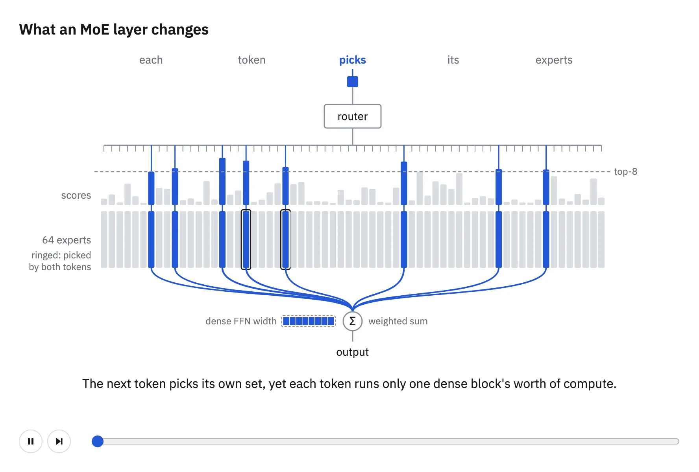
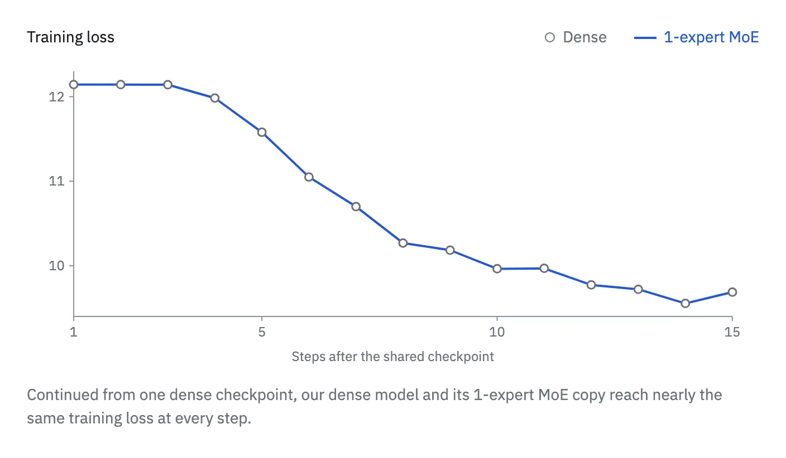
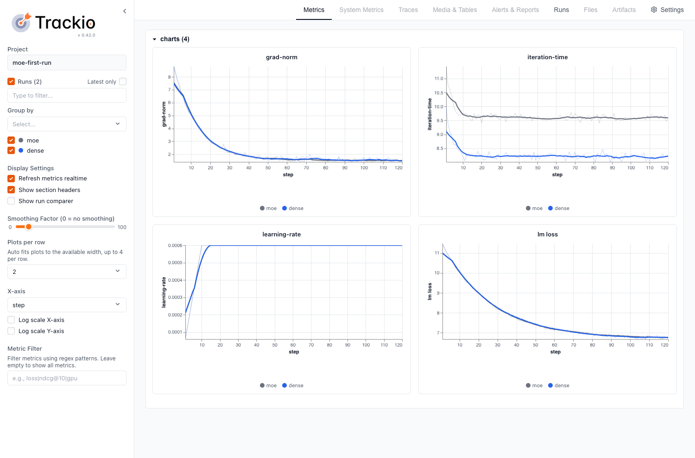

> Source: [Hugging Face handbook](https://huggingface.co/spaces/huggingface/moe-blogpost/blob/ef70726e6f8b99d74298a16a4894340f288a58c2/app/src/content/chapters/2-setup-and-your-first-run.mdx), revision `ef70726e6f8b99d74298a16a4894340f288a58c2`.


<a id="s-2"></a>

## 2\. Setup and your first run

<a id="s-2-0"></a>

### 2.0 What you need

Every command in this chapter was written for one kind of machine, so that everyone runs the same environment: a Slurm cluster of eight-GPU nodes. This section describes that setup, how much of the post you can follow with one GPU or none, and how to rent an eight-GPU node on Hugging Face Jobs. If your machines differ, you can still follow the explanations and adapt the commands.

<a id="s-2-0-the-cluster-the-commands-assume"></a>

#### The cluster the commands assume

The commands expect a [Slurm](https://slurm.schedmd.com/) cluster whose GPU nodes hold eight GPUs each. Containers start through [Enroot](https://github.com/NVIDIA/enroot) and [Pyxis](https://github.com/NVIDIA/pyxis), which let `srun` launch a task inside an image.[3,4](A-appendix.md#ref-doc-9) [evidence](../citation-evidence.md#pyxis-readme) [evidence](../citation-evidence.md#enroot-readme) The per-node readiness check in [2.1](2-setup-and-your-first-run.md#s-2-1) uses NVIDIA's [DCGM diagnostics](https://docs.nvidia.com/datacenter/dcgm/latest/user-guide/dcgm-diagnostics.html). Our runs used AWS P5 nodes connected by Elastic Fabric Adapter (EFA), each with eight H100 GPUs of 80 GB.

Most of the chapter fits on one node. The dense baseline and the first MoE each request a single node with eight GPUs of about 80 GB. Only the network checks need more: the all-to-all tests in [2.1](2-setup-and-your-first-run.md#s-2-1) run on two, four and eight nodes, and the EFA image in [2.2](2-setup-and-your-first-run.md#s-2-2) is verified on two.

The software comes from two pinned sources. The first is the [NGC PyTorch](https://catalog.ngc.nvidia.com/orgs/nvidia/containers/pytorch) image `26.06-py3`, which [2.2](2-setup-and-your-first-run.md#s-2-2) imports and extends with the cluster's network libraries. The second is a [Megatron](https://github.com/NVIDIA/Megatron-LM) checkout at commit `d6316eb45`, which you mount into the container rather than build into it. You also need a filesystem that the CPU workers and the GPU nodes can both read, because [2.3](2-setup-and-your-first-run.md#s-2-3) tokenizes the data on a CPU partition and the training jobs read the result from there.

<a id="s-2-0-reading-with-one-gpu-or-none"></a>

#### Reading with one GPU, or none

You can get most of the post without a cluster. Chapter 3 takes the MoE layer apart: what each part does, what frontier models choose for it and the evidence behind each choice. You can read it end to end without running anything, and save its flags for when you have the hardware. Chapter 4 carries the same choices past pretraining, into serving and reinforcement learning.

In this chapter, the tokenization in [2.3](2-setup-and-your-first-run.md#s-2-3) runs on CPUs. Its small sample runs on a single machine without Slurm, so you can produce and inspect the same files the training runs read. The training recipes in [2.4](2-setup-and-your-first-run.md#s-2-4) and [2.5](2-setup-and-your-first-run.md#s-2-5) assume eight GPUs of about 80 GB, and the MoE spreads its experts across all eight. With fewer GPUs, read them for the method: what stays fixed between the two runs, how the expert width is chosen and what to compare. The all-to-all tests in [2.1](2-setup-and-your-first-run.md#s-2-1) and the EFA setup in [2.2](2-setup-and-your-first-run.md#s-2-2) need several nodes to run as written.

<a id="s-2-0-renting-a-node-on-hugging-face-jobs"></a>

#### Renting a node on Hugging Face Jobs

If you want to run the single-node parts without owning the hardware, [Hugging Face Jobs](https://huggingface.co/docs/hub/jobs) runs a Docker image and a command on Hugging Face's machines, billed by the minute. It is open to any user or organization with a positive credit balance, and the monthly credits of a PRO, Team or Enterprise subscription can pay for jobs.[5](A-appendix.md#ref-src-hf-jobs-pricing) [evidence](../citation-evidence.md#hf-jobs-pricing) The largest hardware options that `hf jobs hardware` lists have eight GPUs, as many as [2.4](2-setup-and-your-first-run.md#s-2-4) and [2.5](2-setup-and-your-first-run.md#s-2-5) use; `h200x8`, for example, holds eight H200s of 141 GB each.[6](A-appendix.md#ref-src-hf-jobs-hardware) [evidence](../citation-evidence.md#hf-jobs-hardware)

A job is defined by a Docker image from Docker Hub or a Hugging Face Space, a command and a hardware option, so running this chapter there means packaging the image from [2.2](2-setup-and-your-first-run.md#s-2-2) as a Docker image and replacing the Slurm launcher with a Jobs command. A job stops after 30 minutes unless you set a different timeout.[7](A-appendix.md#ref-src-hf-jobs-guide) [evidence](../citation-evidence.md#hf-jobs-guide) A first command only checks that the job sees all eight GPUs:

```
hf jobs run --flavor h200x8 --timeout 10m \
    pytorch/pytorch:2.6.0-cuda12.4-cudnn9-devel \
    python -c "import torch; print(torch.cuda.device_count())"
```

Whether you run the recipes on your own cluster or on a rented node, the machines you were given may not perform the way their specification says. How would you notice a GPU or a link that quietly underperforms?

<a id="s-2-1"></a>

### 2.1 Test your hardware

Before you start tuning a model, establish what the machines can do. With [Megatron](https://github.com/NVIDIA/Megatron-LM)'s `alltoall` dispatcher, each MoE layer sends tokens to the GPUs that hold their experts and returns the results through another all-to-all. The links between GPUs are therefore part of the work you need to test: a healthy [all-reduce](https://huggingface.co/spaces/nanotron/ultrascale-playbook?section=reduce_%26_allreduce) result alone does not tell you how quickly those token exchanges will run.

Run the checks below inside your job allocation, before launching training. With [Pyxis](https://github.com/NVIDIA/pyxis), `srun --container-image` starts a container; the next section explains how to prepare the training image.[3](A-appendix.md#ref-doc-9) [evidence](../citation-evidence.md#pyxis-readme)

<a id="s-2-1-check-each-node"></a>

#### Check each node

Start with a readiness check on every allocated node. NVIDIA's [DCGM](https://docs.nvidia.com/datacenter/dcgm/latest/user-guide/dcgm-diagnostics.html) provides several diagnostic levels, with level 1 intended for readiness checks and the higher levels adding tests that help investigate failures. The command below runs one task per node so you can inspect each result before starting training.[8](A-appendix.md#ref-doc-7) [evidence](../citation-evidence.md#dcgm-levels)

```
NNODES=$SLURM_JOB_NUM_NODES
srun --nodes="$NNODES" --ntasks="$NNODES" --ntasks-per-node=1 \
    dcgmi diag -r 1 --fail-early
```

If every node passes, proceed to the communication test. If a node fails, keep its diagnostic output and investigate it before proceeding. For example, a level 2 diagnostic reported thermal violations alongside failed PCIe and memory tests on three GPUs in one of our nodes.

Longer diagnostics belong in a separate maintenance window. NVIDIA describes levels 3 and 4 as administrator post-mortem tests, whereas level 1 is a readiness check.[8](A-appendix.md#ref-doc-7) [evidence](../citation-evidence.md#dcgm-levels)

<a id="s-2-1-prepare-the-diagnostic-image"></a>

#### Prepare the diagnostic image

If your cluster already provides an `nccl-tests` image, set `NCCL_TESTS_IMAGE` to its path. Otherwise, on AWS with EFA you can import the public image maintained with the [AWS NCCL test recipes](https://github.com/awslabs/awsome-distributed-ai/tree/main/micro-benchmarks/nccl-tests). Choose a destination on a filesystem accessible to the allocated nodes:[9](A-appendix.md#ref-doc-12) [evidence](../citation-evidence.md#aws-nccl-image)

```
NCCL_TESTS_IMAGE=/shared/images/nccl-tests.sqsh
mkdir -p "$(dirname "$NCCL_TESTS_IMAGE")"
enroot import -o "$NCCL_TESTS_IMAGE" \
    'docker://public.ecr.aws#hpc-cloud/nccl-tests:latest'
```

Keep the imported SquashFS file with your baseline, since importing `latest` again can give you a different image. For a repeatable import, select a versioned tag from the AWS recipe in place of `latest`.[10,9](A-appendix.md#ref-doc-10) [evidence](../citation-evidence.md#enroot-import) [evidence](../citation-evidence.md#aws-nccl-image)

The AWS recipe also provides a Dockerfile if you need to build the image. For another fabric, use its supported CUDA, [NCCL](https://huggingface.co/spaces/nanotron/ultrascale-playbook?section=nccl), MPI and network-plugin stack; NVIDIA's [nccl-tests build instructions](https://github.com/NVIDIA/nccl-tests#build) explain how to select those library paths. Multi-node tests require a build with `MPI=1`. The benchmark below assumes that MPI can launch through Slurm's PMIx integration, so match the image to the cluster's MPI setup.[11](A-appendix.md#ref-doc-11) [evidence](../citation-evidence.md#nccl-tests-build)

<a id="s-2-1-measure-the-collective-you-will-use"></a>

#### Measure the collective you will use

Once the nodes pass, measure all-to-all bandwidth across the allocation. The command below launches one rank per GPU and exchanges an 8 GiB buffer per rank, matching the large-message test used for our baseline. Use the `NCCL_TESTS_IMAGE` path prepared above, adjusting the executable path if your image installs `nccl-tests` elsewhere.

```
srun --nodes="$NNODES" --ntasks="$((8 * NNODES))" \
    --ntasks-per-node=8 --gres=gpu:8 --mpi=pmix --cpu-bind=none \
    --container-image="$NCCL_TESTS_IMAGE" --no-container-mount-home \
    /opt/nccl-tests/build/alltoall_perf \
    -b 8G -e 8G -g 1 -c 1 -n 20
```

Check the rank listing before reading the result: an allocation of two eight-GPU nodes should list 16 ranks. Then inspect the `busbw` and `#wrong` columns for the tested size. Here is the out-of-place result from our two-node baseline, with the other columns omitted:

```
size (B)      busbw (GB/s)    #wrong
8589934592    77.14           0
```

The zero in `#wrong` means the correctness check passed for that result. The bandwidth gives you a reference for subsequent allocations with the same node count, GPUs per node and test settings. Keep the node list with it so that a later slow result can be traced back to the machines involved. In a separate two-node allocation, run with NCCL tuning variables set, the same message size reached 39.84 GB/s, so record which nodes and settings produced each baseline.

All-reduce remains useful as a comparison, but the two collectives can behave very differently on the same machines. That slower two-node test delivered 398.52 GB/s for all-reduce alongside its 39.84 GB/s all-to-all result. For an MoE that exchanges tokens across those nodes, the second measurement is the one that tests the relevant communication pattern.

<a id="s-2-1-choose-a-baseline-for-each-allocation-size"></a>

#### Choose a baseline for each allocation size

As you add nodes, more of an all-to-all exchange crosses the inter-node network. Our multi-node sweep shows why the baseline must depend on node count: it reached 77.14 GB/s on two nodes, 39.25 GB/s on four, and 30.91 GB/s on eight. Compare each allocation with a baseline at its own node count, using the same message size and the same result column.

Before choosing a reference, repeat the check on a known-good configuration with the hardware, software and test settings held fixed. Use the resulting range to decide whether a new allocation is ready for training. A practical starting policy is to require 90% of the baseline bandwidth and a passing correctness check. With the two-node result above, the bandwidth threshold would be about 69 GB/s. Adjust the threshold to your cluster's observed variability. A fixed 33 GB/s threshold, for example, would accept the slow two-node result while rejecting the eight-node sweep result.

Keep this baseline unchanged while you investigate a slow allocation. If you also want to try NCCL tuning variables, compare the settings on the same nodes with the same test parameters. Our default and tuned runs used different node pairs, so their bandwidth difference cannot identify the effect of those variables.

<a id="s-2-1-check-for-changes-during-training"></a>

#### Check for changes during training

For periodic hardware checks during training, use Megatron's `--gpu-sniff-test-interval <n>`. It runs before training and every `n` iterations ([`training.py#L4850-L4852`](https://github.com/NVIDIA/Megatron-LM/blob/d6316eb45bf1bfbb6f1f848c0b56e55166564d80/megatron/training/training.py#L4850-L4852), [`training.py#L4484-L4489`](https://github.com/NVIDIA/Megatron-LM/blob/d6316eb45bf1bfbb6f1f848c0b56e55166564d80/megatron/training/training.py#L4484-L4489)), including an all-to-all over the expert-parallel group ([`gpu_sniff_test.py#L5-L21`](https://github.com/NVIDIA/Megatron-LM/blob/d6316eb45bf1bfbb6f1f848c0b56e55166564d80/megatron/training/gpu_sniff_test.py#L5-L21)). Its outlier warnings identify ranks to investigate when a slowdown appears ([`gpu_sniff_test.py#L104-L118`](https://github.com/NVIDIA/Megatron-LM/blob/d6316eb45bf1bfbb6f1f848c0b56e55166564d80/megatron/training/gpu_sniff_test.py#L104-L118)).

The diagnostic image has let you test the GPUs and their links. Your training image needs access to the same hardware, so let's prepare it and check its network libraries.

<a id="s-2-2"></a>

### 2.2 Build your image

A training environment has two parts to get right: the libraries that run GPU computations, and the network libraries that connect those GPUs across nodes. We start from an NVIDIA PyTorch container for the first part, then add the network support required by the cluster. Keeping [Megatron](https://github.com/NVIDIA/Megatron-LM) in a separate checkout lets you change the training code while retaining the same image.

The examples here use [Enroot](https://github.com/NVIDIA/enroot) and [Pyxis](https://github.com/NVIDIA/pyxis) on [Slurm](https://slurm.schedmd.com/). The base image is [NGC PyTorch](https://catalog.ngc.nvidia.com/orgs/nvidia/containers/pytorch) `26.06-py3`; the network-specific instructions apply to our AWS P5 nodes with EFA. On another cluster, use its supported network stack for that part of the image.[3,4](A-appendix.md#ref-doc-9) [evidence](../citation-evidence.md#pyxis-readme) [evidence](../citation-evidence.md#enroot-readme)

<a id="s-2-2-import-the-base-image"></a>

#### Import the base image

Enroot imports a container image into a SquashFS file that Pyxis can launch through `srun`. Choose an output path accessible from your compute nodes, then import the base image:[4](A-appendix.md#ref-doc-10) [evidence](../citation-evidence.md#enroot-readme)

```
IMAGE=/path/to/images/pytorch-26.06.sqsh
enroot import -o "$IMAGE" docker://nvcr.io#nvidia/pytorch:26.06-py3
```

Keep the Megatron checkout outside this image and mount it into the container when you launch training. The flags in this post target commit `d6316eb45`; checking it out explicitly makes the code you read alongside the examples match the code you run. The source notes list the image and commit used for each measurement.

Put this checkout, and later the data and tokenizer, on a filesystem that both the CPU workers and GPU nodes can read. In the commands below, `SHARED_ROOT` is that directory and `PROJECT_DIR` is your project directory, with the [companion scripts](https://gist.github.com/nmntz/5de952d686f66d7bce5bce8cba9d7139) cloned into its `scripts/` folder.

```
export SHARED_ROOT=/path/to/shared/work
export PROJECT_DIR="$SHARED_ROOT/moe-blogpost"
git clone https://gist.github.com/nmntz/5de952d686f66d7bce5bce8cba9d7139.git "$PROJECT_DIR/scripts"
git clone https://github.com/NVIDIA/Megatron-LM.git "$SHARED_ROOT/Megatron-LM"
cd "$SHARED_ROOT/Megatron-LM"
git checkout d6316eb45bf1bfbb6f1f848c0b56e55166564d80
```

<a id="s-2-2-verify-gpu-access"></a>

#### Verify GPU access

Before adding the cluster's network libraries, check that the base image can import PyTorch and [Transformer Engine](https://github.com/NVIDIA/TransformerEngine) and see the GPUs. Run this inside an allocated eight-GPU node, using the `IMAGE` path from above:

```
srun --nodes=1 --ntasks=1 --gres=gpu:8 \
    --container-image="$IMAGE" --no-container-mount-home \
    python -c '
import torch, transformer_engine
print("torch", torch.__version__)
print("transformer_engine", transformer_engine.__version__)
print("device_count", torch.cuda.device_count())
x = torch.randn(8).cuda().sum()
print("cuda sum ok", x.item())
'
```

The stock image reported the following versions and device count. The final line of the command also prints a sum computed on the GPU, so inspect that result along with the imports before proceeding.

```
torch 2.13.0a0+8145d630e8.nv26.06
transformer_engine 2.16.0+4220403e
device_count 8
```

The CUDA result checks execution on the GPU within this node. For EFA communication across nodes, add the network plugin and its dependencies described below.

<a id="s-2-2-add-efa-support"></a>

#### Add EFA support

On our AWS nodes, the network layer consists of the EFA userspace libraries and the `aws-ofi-nccl` plugin built against the NCCL inside the image. The build used EFA installer `1.49.0` and `aws-ofi-nccl` `v1.19.2`. Record both versions alongside the base image in your build recipe.

The [EFA image build script](https://gist.github.com/nmntz/5de952d686f66d7bce5bce8cba9d7139#file-build_efa_image-sh) creates a writable Enroot container from the base image, installs the EFA userspace libraries with `--skip-kmod`, and compiles the plugin against the image's NCCL. It then exports a new SquashFS image and removes the temporary container. Run it on an allocated compute node with Enroot and GPU access, choosing a new output path:

```
EFA_IMAGE=/path/to/images/pytorch-26.06-efa.sqsh
bash "$PROJECT_DIR/scripts/build_efa_image.sh" "$IMAGE" "$EFA_IMAGE"
```

Use `EFA_IMAGE` as the `--container-image` path for subsequent training launches. The script prepares the network layer; keep the following environment settings with that image so the job can find and select its libraries.

Here, the library paths refer to the copies installed inside the container, and `NCCL_NET_PLUGIN=ofi` selects the plugin by name. Passing a filesystem path as the plugin value caused NCCL to construct an invalid library name in our setup.

```
export LD_LIBRARY_PATH=/opt/amazon/ofi-nccl/lib:/opt/amazon/efa/lib:${LD_LIBRARY_PATH:-}
export NCCL_NET_PLUGIN=ofi
export FI_PROVIDER=efa
export FI_EFA_USE_DEVICE_RDMA=1
export NCCL_SOCKET_IFNAME='^lo,docker0,veth_def_agent'
export NCCL_DEBUG=INFO
```

The socket interface exclusion addresses the initial connection NCCL uses to set up communication. On our nodes, NCCL selected `veth_def_agent`, tried to connect to its link-local address, and failed with `Connection refused`. Excluding that interface allowed the launch to proceed. Adapt the exclusion list to your cluster's interfaces before reusing it.

<a id="s-2-2-verify-the-network-path"></a>

#### Verify the network path

On your first multi-node training launch, inspect the NCCL initialization log before interpreting training performance. This checks the network path from the training image itself. For the EFA image described here, the line to look for is:

```
NCCL INFO Using network Libfabric
```

If you see `Using network Socket` instead, read the plugin-loading messages immediately above it. An invalid plugin name or a missing library version can leave NCCL using sockets. For example, the `EFA_1.4` error identifies a missing library version to resolve before trying again.

The log confirms which transport the job selected; measuring its bandwidth remains a separate check. Record the training image and network settings alongside the diagnostic result from [2.1](2-setup-and-your-first-run.md#s-2-1), keeping the two environments explicit when comparing their performance.

With the hardware checked and the image prepared, we can turn to the first training run. It starts with the data: turning raw text into token sequences and storing them in the format Megatron expects.

<a id="s-2-3"></a>

### 2.3 Tokenize

[Megatron](https://github.com/NVIDIA/Megatron-LM) reads training text from pairs of indexed files. The `.bin` file stores token IDs, while the `.idx` file tells the loader where each sequence begins and ends. Preparing these files once lets the dense and MoE runs read the same tokens, so changing the model does not also change the data.

We will use [FineWeb-Edu](https://huggingface.co/datasets/HuggingFaceFW/fineweb-edu) and the [Llama 3.2 tokenizer](https://huggingface.co/meta-llama/Llama-3.2-1B). [Datatrove](https://github.com/huggingface/datatrove)'s `MegatronDocumentTokenizer` writes the format directly; the remaining work is to choose an output directory, check a small sample, and submit the larger tokenization job.

Megatron's indexed token files

Two documents share one binary token file. Document zero has three int32 tokens and starts at byte zero; document one has four tokens and starts at byte twelve. The index records those lengths and byte offsets. Each document ends with token 128001\.

.bin

Document 0

Document 1

17

42

128001

9

81

6

128001

.idx

Offset: 0 bytes

Length: 3 tokens

Offset: 12 bytes

Length: 4 tokens

**Figure 2.3.1**: Two illustrative documents stored as token IDs, each ending with an end-of-document token

<a id="s-2-3-prepare-the-tokenizer"></a>

#### Prepare the tokenizer

Keep the data and tokenizer under `SHARED_ROOT`, the shared directory from [2.2](2-setup-and-your-first-run.md#s-2-2). The [tokenization script](https://gist.github.com/nmntz/5de952d686f66d7bce5bce8cba9d7139#file-tokenize_first_run-py) runs locally for the sample and submits a [Slurm](https://slurm.schedmd.com/) array for the larger job.

```
export TOKENIZER_DIR="$SHARED_ROOT/tokenizer"
python3.11 -m venv "$SHARED_ROOT/tokenize-venv"
source "$SHARED_ROOT/tokenize-venv/bin/activate"
python -m pip install \
    'datatrove @ git+https://github.com/huggingface/datatrove.git@2c895af7a95010a96fa53e2dc77cc0ce92799e3f' \
    pyarrow tokenizers huggingface_hub
```

The original tokenizer repository, `meta-llama/Llama-3.2-1B`, requires access approval. If your account has access, run `hf auth login` and use that repository in the download command. Otherwise, `unsloth/Llama-3.2-1B` provides an ungated copy: our comparison found matching vocabulary and token IDs. Both tokenization and training will read the same downloaded tokenizer files.[12](A-appendix.md#ref-src-hub-gated) [evidence](../citation-evidence.md#hub-gated)

```
TOKENIZER_REPO=unsloth/Llama-3.2-1B
hf download "$TOKENIZER_REPO" \
    --include 'tokenizer*' --include 'special_tokens_map.json' --include 'config.json' \
    --local-dir "$TOKENIZER_DIR"
```

Datatrove reads `tokenizer.json` from this directory and appends `<|end_of_text|>` after each document. Megatron later receives the directory through `--tokenizer-model`, which also gives it the tokenizer's configuration.

<a id="s-2-3-check-a-small-shard"></a>

#### Check a small shard

Tokenize a small sample on a CPU compute node before submitting the full array. This command reads up to 1,000 documents and keeps them all, writing the result to a separate directory so the sample cannot be mistaken for the training corpus.

```
python "$PROJECT_DIR/scripts/tokenize_first_run.py" \
    --tokenizer "$TOKENIZER_DIR/tokenizer.json" \
    --output "$SHARED_ROOT/data-smoke" --limit 1000
```

The output prefix is `fineweb-edu_00000_tokens`. Check it with Megatron's own reader inside the training image from [2.2](2-setup-and-your-first-run.md#s-2-2), using an allocation where [Pyxis](https://github.com/NVIDIA/pyxis) can launch the container. Deactivate the tokenization environment first so its Python does not override the image's interpreter. Set `TRAIN_IMAGE` to `EFA_IMAGE` on the EFA setup, or to the prepared training image for your cluster.

```
deactivate
export TRAIN_IMAGE="$EFA_IMAGE"
export MEGATRON_PATH="$SHARED_ROOT/Megatron-LM"
srun --nodes=1 --ntasks=1 \
    --container-image="$TRAIN_IMAGE" \
    --container-mounts="$SHARED_ROOT:$SHARED_ROOT" \
    --container-workdir="$MEGATRON_PATH" --no-container-mount-home \
    env PYTHONPATH="$MEGATRON_PATH" python -c '
import sys
from megatron.core.datasets.indexed_dataset import IndexedDataset
data = IndexedDataset(sys.argv[1])
assert len(data) > 0
print("sequences", len(data))
for i in range(min(3, len(data))):
    tokens = data[i]
    assert len(tokens) and tokens[-1] == 128001
    print("length", len(tokens), "last token", int(tokens[-1]))
' "$SHARED_ROOT/data-smoke/fineweb-edu_00000_tokens"
```

You should see a nonzero sequence count and `last token 128001` for each inspected sequence. That final token is the document boundary we asked the tokenizer to append. Reading the shard through Megatron also checks that Megatron can parse the index and read the first sequences from the token file before GPU training starts.

<a id="s-2-3-submit-the-tokenization-job"></a>

#### Submit the tokenization job

The sample checks the file format; the larger job prepares a corpus to reuse as your training runs grow. Submit it from the login node with the same virtual environment activated. Set `CPU_PARTITION` to your cluster's CPU partition; add `--qos` if the scheduler requires one. The script requests 12 CPUs and 24 GB of memory per task, and the virtual environment must be accessible at the same path on those workers.

```
source "$SHARED_ROOT/tokenize-venv/bin/activate"
export OUT_DIR="$SHARED_ROOT/data/fineweb-edu"
CPU_PARTITION=your_cpu_partition
python "$PROJECT_DIR/scripts/tokenize_first_run.py" \
    --tokenizer "$TOKENIZER_DIR/tokenizer.json" --output "$OUT_DIR" \
    --tasks 100 --limit -1 --sample-rate 0.074 --partition "$CPU_PARTITION"
```

Datatrove prints the submitted job ID. Use that ID with `squeue -j <job-id>` to follow the array, and inspect failed tasks under `$OUT_DIR/logs` before relaunching the same command.

Each task reads a share of the input files and keeps a random 7.4% of the documents before tokenizing them. Because documents have different lengths, this fraction does not fix the number of tokens in the output. Keep the task count, sampling rate and output directory unchanged when restarting an interrupted job. Datatrove uses completion markers under the logging directory to skip finished tasks.[13](A-appendix.md#ref-src-datatrove-skip) [evidence](../citation-evidence.md#datatrove-skip)

<a id="s-2-3-pass-the-shards-to-megatron"></a>

#### Pass the shards to Megatron

Wait for the array to finish before building the training manifest. The following check requires all 100 task-completion markers and expected shard pairs and writes the shard prefixes to `data-args.txt`, one per line. Each prefix names both files, so neither `.bin` nor `.idx` belongs in the manifest.

```
export DATA_ARGS="$OUT_DIR/data-args.txt"
python - <<'PY'
import os
from pathlib import Path
root = Path(os.environ["OUT_DIR"])
prefixes = [root / f"fineweb-edu_{rank:05d}_tokens" for rank in range(100)]
for rank, prefix in enumerate(prefixes):
    assert (root / "logs/completions" / f"{rank:05d}").is_file(), rank
    for suffix in (".bin", ".idx"):
        path = Path(str(prefix) + suffix)
        assert path.is_file() and path.stat().st_size > 0, path
Path(os.environ["DATA_ARGS"]).write_text("\n".join(map(str, prefixes)) + "\n")
print(f"wrote {len(prefixes)} prefixes")
PY
deactivate
```

Training will read this file through `--data-args-path`. That option supplies the same list as `--data-path`, but keeps a long set of shards out of the launch command. The launcher also sets `--data-cache-path` to a persistent directory for Megatron's sample indices, allowing later runs with the same dataset configuration to reuse them.

For the first runs we use `--split 100,0,0`, assigning the data to training. Reserve a held-out split before using the run to compare model quality.

With a readable dataset and a manifest pointing to its shards, you can launch the dense baseline. Its loss, gradient norms and step times will establish a reference before we introduce experts.

<a id="s-2-4"></a>

### 2.4 Dense baseline

A dense run gives you something concrete to compare with when the MoE behaves unexpectedly. Both models will use the same data, batch size and optimizer, so a loss spike or a slow step can first be checked against the simpler model. This baseline also exercises the training image and data loader together before routing enters the picture.

The model has 16 transformer layers, a hidden size of 2,048 and an 8,192-wide feed-forward network. With the 128,256-entry vocabulary, it contains about 1.22 billion parameters. The recipe targets one node with eight GPUs with roughly 80 GB of memory each. We will reuse the launch script for the MoE.

<a id="s-2-4-launch-on-one-node"></a>

#### Launch on one node

We will use [Trackio](https://huggingface.co/docs/trackio) to record the training metrics. Trackio is a lightweight, open-source experiment tracker from Hugging Face. Its API mirrors `wandb`, so `import trackio as wandb` is usually the only change existing code needs. Runs are logged to a local database you own, and you can browse them in a local dashboard or sync them to a Hugging Face Space to share live curves with your team, with no account or paid plan required.[14](A-appendix.md#ref-src-trackio-readme) [evidence](../citation-evidence.md#trackio-readme)

First, create a Python environment on shared storage from inside the training image. It inherits the image's GPU libraries and adds the pinned tracking package:

```
srun --nodes=1 --ntasks=1 \
    --container-image="$TRAIN_IMAGE" \
    --container-mounts="$SHARED_ROOT:$SHARED_ROOT" --no-container-mount-home \
    bash -c 'python -m venv --system-site-packages "$1/train-venv" &&
        "$1/train-venv/bin/python" -m pip install "trackio==0.42.0"' _ "$SHARED_ROOT"
export TRACKIO_PROJECT=moe-first-run
```

The launcher uses the [Trackio entry point](https://gist.github.com/nmntz/5de952d686f66d7bce5bce8cba9d7139#file-pretrain_trackio-py) to send [Megatron](https://github.com/NVIDIA/Megatron-LM)'s scalar metrics to one run per job. Both runs share the project above, with their data stored under `$SHARED_ROOT/trackio`. The adapter uses Megatron's existing scalar-logging hooks, so flags such as `--log-memory-to-tensorboard` control which metrics reach Trackio.

The [first-run script](https://gist.github.com/nmntz/5de952d686f66d7bce5bce8cba9d7139#file-first_run-sbatch) groups the training flags into Bash arrays. It uses the training image, pinned Megatron checkout, tokenizer directory and data manifest prepared in the previous sections. Keep the mounted paths under `SHARED_ROOT` and set `TRAIN_IMAGE` to the prepared SquashFS image.

From the shared blog checkout, submit the dense job to your GPU partition. Keep the variables from [2.3](2-setup-and-your-first-run.md#s-2-3) exported when you submit the job. The script records the image path, Megatron commit and data manifest with its output.

```
cd "$PROJECT_DIR"
GPU_PARTITION=your_gpu_partition
sbatch --partition="$GPU_PARTITION" scripts/first_run.sbatch dense
```

[Slurm](https://slurm.schedmd.com/) reserves one eight-GPU node. Inside it, a single `srun` task starts `torchrun`, which launches one training process per GPU. Look for the run output under `$SHARED_ROOT/runs/dense-<job-id>` and the training log at `first-run-<job-id>.out` in the submission directory.

The initial run stops after 120 iterations. Checkpoint saving and validation are disabled for this setup check. Keep the log and Trackio data when you move on to the MoE; they are the reference for the next section.

To inspect the curves, run the dashboard on a machine that can read the saved directory, after installing `trackio==0.42.0` there. Select the dense and MoE runs in the project to compare them.

```
TRACKIO_DIR="$SHARED_ROOT/trackio" trackio show --project "$TRACKIO_PROJECT"
```

<a id="s-2-4-understand-the-configuration"></a>

#### Understand the configuration

With tensor and [pipeline parallelism](https://huggingface.co/spaces/nanotron/ultrascale-playbook?section=pipeline_parallelism) both set to one, each GPU holds a copy of the dense model. Data parallelism distributes the batch across the eight GPUs, while the distributed optimizer and communication overlaps are enabled in both runs.

```
--tensor-model-parallel-size 1 --pipeline-model-parallel-size 1
--expert-model-parallel-size 1 --context-parallel-size 1
--use-distributed-optimizer --overlap-grad-reduce --overlap-param-gather
--micro-batch-size 8 --global-batch-size 512
```

A micro-batch contains eight sequences per GPU. Across eight GPUs, each micro-batch processes 64 sequences; eight [gradient accumulation](https://huggingface.co/spaces/nanotron/ultrascale-playbook?section=gradient_accumulation) steps produce a [global batch](https://huggingface.co/spaces/nanotron/ultrascale-playbook?section=revisiting_global_batch_size) of 512\. At a sequence length of 4,096, each optimizer step consumes 2,097,152 tokens. Keeping these quantities fixed will make dense and MoE step times directly comparable.

The learning rate follows a warmup, stable, decay schedule, selected by `--lr-decay-style WSD`. It warms up to `5e-4`, holds that learning rate, then decays near the end of the configured token budget. The 120-iteration run ends during the stable phase; its stop condition does not shorten the learning-rate schedule.

Full [activation recomputation](https://huggingface.co/spaces/nanotron/ultrascale-playbook?section=activation_recomputation) keeps the starting configuration within the memory budget used for our baseline. With micro-batch size eight and the native cross-entropy implementation, the corresponding run without recomputation exhausted memory in the loss calculation. We keep recomputation in both models so that the first comparison does not mix a model change with a memory-saving change.

```
--recompute-granularity full --recompute-method uniform --recompute-num-layers 1
--cross-entropy-loss-fusion --cross-entropy-fusion-impl native
```

Keep the dense run's loss, gradient norm and step time in Trackio as your reference. When you replace the feed-forward layers with experts, these measurements will help you see how the change affects training.

<a id="s-2-5"></a>

### 2.5 Your first MoE

The dense model applies the same feed-forward network to every token. In the MoE, a router chooses eight of 64 smaller experts for each token, allowing the model to hold more parameters than it uses on any one token. We choose the expert width so that the eight selected experts contain the same number of feed-forward parameters as the dense layer they replace.

This gives us a 6.86-billion-parameter model with about 1.22 billion active parameters per token. The extra capacity comes with a new cost: the tokens have to reach their selected experts, and the expert outputs have to return to the processes that need them.


**Figure 2.5.1**



[Figure explanation, controls and captured states](../figures/hero-dense-to-moe.md) · [Interactive original](../upstream/app/public/viz/index.html?c=hero-dense-to-moe)


<a id="s-2-5-replace-the-feed-forward-layers"></a>

#### Replace the feed-forward layers

The launcher selects the MoE configuration when you pass `moe`. Submit it using the same exported paths and GPU partition as the dense run, keeping the image, checkout, tokenizer and data manifest unchanged:

```
sbatch --partition="$GPU_PARTITION" scripts/first_run.sbatch moe
```

[Expert parallelism](https://huggingface.co/spaces/nanotron/ultrascale-playbook?section=expert_parallelism) increases from one to eight, distributing the 64 experts across the node's eight GPUs. Each GPU holds eight experts, while the router selects eight experts per token from the full set.

```
--expert-model-parallel-size 8 --expert-tensor-parallel-size 1
--num-experts 64 --moe-ffn-hidden-size 1024 --moe-router-topk 8
--moe-token-dispatcher-type alltoall --moe-grouped-gemm
--moe-router-load-balancing-type aux_loss --moe-aux-loss-coeff 1e-3
--moe-router-dtype fp32 --moe-per-layer-logging
```

`alltoall` moves the routed tokens between GPUs, and grouped GEMM executes the local experts' matrix multiplications. The auxiliary loss encourages the router to distribute work across experts, with a coefficient of `1e-3`. We also compute router logits in fp32 and enable per-layer logging, giving us the initial settings and measurements that chapter 3 will examine.

Everything else stays in the common configuration, including full activation recomputation. In particular, the dense `--ffn-hidden-size 8192` setting remains in the script, while `--moe-ffn-hidden-size 1024` supplies the width of each expert.

<a id="s-2-5-count-active-and-total-parameters"></a>

#### Count active and total parameters

A bias-free SwiGLU expert has three weight matrices. With hidden size 2,048 and expert width 1,024, their combined size is `3 × 2048 × 1024 = 6,291,456` parameters. Selecting eight experts therefore uses 50,331,648 feed-forward parameters per token, matching the dense layer's `3 × 2048 × 8192` parameters.

Dense feed-forward layer versus 64 experts with top-8 routing

The dense layer is one feed-forward block 8,192 wide: 3 × 2,048 × 8,192 \= 50.3 million parameters. The MoE layer stores 64 experts, each 1,024 wide, drawn at the same scale as an 8 by 8 grid: 402.7 million parameters, eight times the dense layer. A token uses eight of them; placed end to end they are exactly as wide as the dense layer, so the token uses the same 50.3 million parameters.

Dense FFN

every token

width 8,192

3 × 2,048 × 8,192 \= 50.3M parameters, all used

MoE layer

64 experts

1,024 wide each

64 × 3 × 2,048 × 1,024 \= 402.7M parameters stored, 8× the dense layer

Top-8

one token

1,024

1,024

1,024

1,024

1,024

1,024

1,024

1,024

8 × 3 × 2,048 × 1,024 \= 50.3M parameters used, same as dense

**Figure 2.5.2**: The dense feed-forward layer and the 64 experts drawn to the same scale. A token's eight experts, placed end to end, are exactly as wide as the dense layer: the same active parameters, out of eight times as many stored

All 64 experts together contain eight times as many feed-forward parameters. The whole model grows by a smaller factor because attention, embeddings and the other non-expert parameters stay the same size, and each layer gains a small router matrix. Summing those components across 16 layers gives 6.86 billion total parameters and 1.221 billion active parameters, compared with 1.219 billion in the dense model.

The result is about 5.6 times as many total parameters at nearly the same active parameter count. Matching active parameter counts does not guarantee equal step time: distributing tokens among experts changes how the GPU work is organized and introduces communication.

<a id="s-2-5-keep-a-dense-reference"></a>

#### Keep a dense reference

An MoE with one expert and top-1 routing computes the same function as the dense model it came from, so it should train like it. In our run, a 1-expert MoE upcycled from a dense checkpoint and continued beside the dense run stayed within 0.00087 of it over 15 aligned steps. Start the MoE from its own initialization instead and the comparison says little, since the two runs sit 2.72 apart at iteration 4\. The MoE side also logs a load-balancing loss of exactly 1 and about 32,770 zeros in its gradient against at most 17 for the dense run: the router weights, which get no gradient with a single expert. The parity run upcycles the dense checkpoint, a path [3.6](3-anatomy-of-moe-training.md#s-3-6) returns to.


**Figure 2.5.3**



[Figure explanation, controls and captured states](../figures/sanity-checks.md) · [Interactive original](../upstream/app/public/viz/index.html?c=sanity-checks)


At the pin, that upcycling path ran for us only with two local fixes to `training.py`. The first passes the dense model to the checkpoint loader under the keyword `model` ([`training.py#L3074-L3078`](https://github.com/NVIDIA/Megatron-LM/blob/d6316eb45bf1bfbb6f1f848c0b56e55166564d80/megatron/training/training.py#L3074-L3078)), while [`load_checkpoint`](https://github.com/NVIDIA/Megatron-LM/blob/d6316eb45bf1bfbb6f1f848c0b56e55166564d80/megatron/training/checkpointing.py#L2632-L2634) names that parameter `ddp_model`. The second concerns the dense model built for the load: the upcycling code switches the dense shape on in `args` ([`training.py#L3056-L3062`](https://github.com/NVIDIA/Megatron-LM/blob/d6316eb45bf1bfbb6f1f848c0b56e55166564d80/megatron/training/training.py#L3056-L3062)), but the model builder reads the model configuration stored at startup ([`training.py#L2917-L2926`](https://github.com/NVIDIA/Megatron-LM/blob/d6316eb45bf1bfbb6f1f848c0b56e55166564d80/megatron/training/training.py#L2917-L2926)), so that model keeps the MoE layer layout and the load stops on a missing `pre_mlp_layernorm` key.

Deterministic mode makes a run repeatable, so that a gap between two runs means something. At the pin, `--deterministic-mode` requires cross-entropy loss fusion, TP communication overlap and the fused aux-loss kernel to be off ([`determinism.py#L28-L37`](https://github.com/NVIDIA/Megatron-LM/blob/d6316eb45bf1bfbb6f1f848c0b56e55166564d80/megatron/training/determinism.py#L28-L37), [`determinism.py#L195-L210`](https://github.com/NVIDIA/Megatron-LM/blob/d6316eb45bf1bfbb6f1f848c0b56e55166564d80/megatron/training/determinism.py#L195-L210)), and accepts `NVTE_ALLOW_NONDETERMINISTIC_ALGO` only at `0` ([`determinism.py#L85-L90`](https://github.com/NVIDIA/Megatron-LM/blob/d6316eb45bf1bfbb6f1f848c0b56e55166564d80/megatron/training/determinism.py#L85-L90)); it sets `NCCL_ALGO=Ring`, `NCCL_EP_HT_EM_AG_SCAN_MODE=1`, `NVTE_ALLOW_NONDETERMINISTIC_ALGO=0` and `CUBLAS_WORKSPACE_CONFIG=:4096:8` itself when they are unset ([`determinism.py#L40-L50`](https://github.com/NVIDIA/Megatron-LM/blob/d6316eb45bf1bfbb6f1f848c0b56e55166564d80/megatron/training/determinism.py#L40-L50)). The [2.4](2-setup-and-your-first-run.md#s-2-4) launcher passes `--cross-entropy-loss-fusion` and exports `NVTE_ALLOW_NONDETERMINISTIC_ALGO=1`, so drop both before adding the flag. With these settings, two runs of this MoE shrunk to micro-batch 2, global batch 64 and 12 iterations printed the same lm loss, load-balancing loss, grad norm and gradient zeros at every iteration; without them the lm loss differed from the first iteration on, by up to 0.00063.

Switch on deterministic mode before you compare two runs or chase a NaN.

Keep the dense run and its configuration as a reference as you develop the MoE. Whenever a change makes training slower or the loss stops improving, return to the dense run in [Trackio](https://huggingface.co/docs/trackio) and compare step time, loss and gradient norm at the same batch size and sequence length. A problem that appears in both runs points you toward their shared setup; one that appears only in the MoE gives you a reason to investigate routing and expert execution.



**Figure 2.5.4**: Trackio with synthetic dense and MoE runs. These curves illustrate the interface, not measured training performance

The dense reference helps you decide where to begin an investigation. Chapter 3 opens the MoE layer piece by piece, introducing the measurements you need to understand its behavior.
