> Source: [Hugging Face handbook](https://huggingface.co/spaces/huggingface/moe-blogpost/blob/ef70726e6f8b99d74298a16a4894340f288a58c2/app/src/content/chapters/3-anatomy-of-moe-training.mdx), revision `ef70726e6f8b99d74298a16a4894340f288a58c2`.


<a id="s-3"></a>

## 3\. Anatomy of MoE Training

The MoE from [2.5](2-setup-and-your-first-run.md#s-2-5) added parts the dense run never had: a router that picks eight experts for each token, experts that can end up with very different amounts of work, and an all-to-all that moves tokens between GPUs. Each of them can slow training or hurt the loss, and a gap against the dense reference does not, on its own, tell you which part caused it.

The figure below draws one MoE layer at a smaller scale than ours, with 16 experts and top-4 instead of 64 and top-8, plus a shared expert that ours does not have. It shows the tokens of a batch, the router, the experts and the sum that combines their outputs. Each section then opens on its own view of the same drawing, zoomed onto the part it covers, so you can skip to the part you need. A few views also carry a result from their section, such as the rogue experts that Step [3.5](3-anatomy-of-moe-training.md#s-3-5) Flash's training loss did not reveal ([3.6](3-anatomy-of-moe-training.md#s-3-6))[15](A-appendix.md#ref-2602.10604) [evidence](../citation-evidence.md#step35-f4).


**Figure 3**

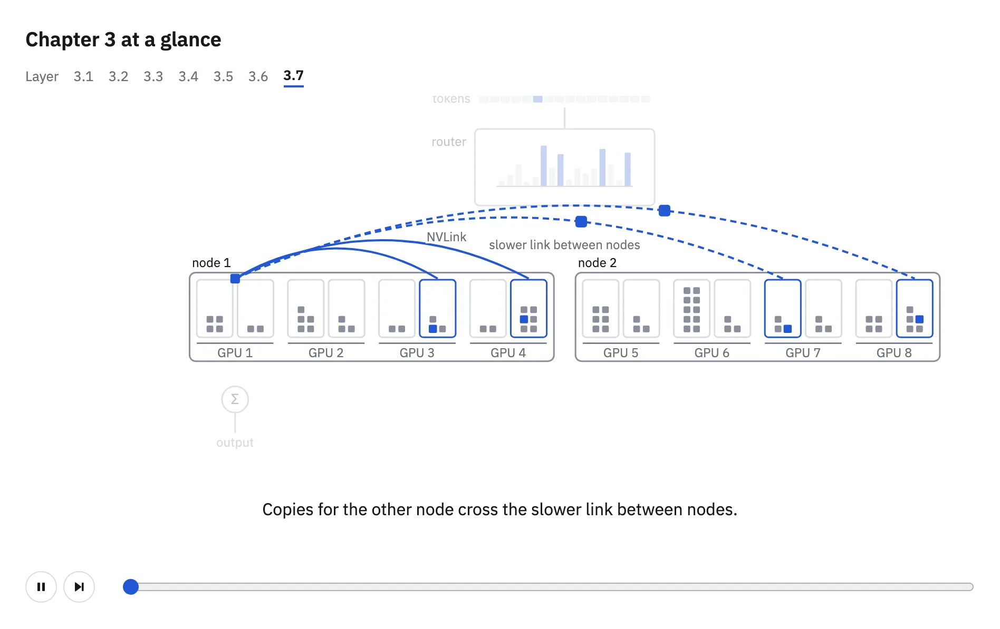

[Figure explanation, controls and captured states](../figures/hero-anatomy-zoom.md) · [Interactive original](../upstream/app/public/viz/index.html?c=hero-anatomy-zoom)


After the monitoring setup in [3.0](3-anatomy-of-moe-training.md#s-3-0), we start inside the router, with how its scores become the weights of the chosen experts and whether tokens choose experts or experts choose tokens. Then come uneven load across experts, how many experts to use and how large, which layers get experts at all, and how to start a run and keep it stable. We end with where a training step spends its time on the GPUs.

<a id="s-3-0"></a>

### 3.0 Monitoring: turn it on once

Before changing any setting, turn on what tells you whether it worked. You do not need to know what every number means yet: each section introduces a metric when it first needs it (z-loss in [3.1](3-anatomy-of-moe-training.md#s-3-1), MaxVio in [3.2](3-anatomy-of-moe-training.md#s-3-2), timings and memory in [3.7](3-anatomy-of-moe-training.md#s-3-7)). Appendix [A.1](A-appendix.md#s-a-1) gives the capture commands, calculations and limits of each measurement.

<a id="s-3-0-what-to-turn-on"></a>

#### What to turn on

The [2.5](2-setup-and-your-first-run.md#s-2-5) run already logs the router losses per layer (`--moe-per-layer-logging`), so you can see which layer misbehaves ([3.1](3-anatomy-of-moe-training.md#s-3-1), [3.3](3-anatomy-of-moe-training.md#s-3-3), [A.1](A-appendix.md#s-a-1)). Keep the [Trackio](https://huggingface.co/docs/trackio) launcher from [2.4](2-setup-and-your-first-run.md#s-2-4) and add these flags to the [2.5](2-setup-and-your-first-run.md#s-2-5) flags:

```
--save <dir> --save-interval <m>
--save-tokens-per-expert-interval <n>
--log-throughput --log-params-norm
--log-num-zeros-in-grad --log-max-attention-logit
```

Megatron writes the token counts and the activation dump below under `--save` ([`training.py#L3398-L3401`](https://github.com/NVIDIA/Megatron-LM/blob/d6316eb45bf1bfbb6f1f848c0b56e55166564d80/megatron/training/training.py#L3398-L3401)) and asks for `--save-interval` beside it ([`arguments.py#L1321-L1323`](https://github.com/NVIDIA/Megatron-LM/blob/d6316eb45bf1bfbb6f1f848c0b56e55166564d80/megatron/training/arguments.py#L1321-L1323)), so the run also saves checkpoints there. The next flag records how many tokens each expert received ([3.3](3-anatomy-of-moe-training.md#s-3-3), [A.1](A-appendix.md#s-a-1)). The other four track the run's health: throughput, the parameter norm, the zeros in the gradient and the largest attention logit ([3.6](3-anatomy-of-moe-training.md#s-3-6), [A.1](A-appendix.md#s-a-1)). The scalar metrics appear in the same Trackio project as your baseline, while routing captures stay in their own files. The NaN check is already on ([`arguments.py#L2825-L2827`](https://github.com/NVIDIA/Megatron-LM/blob/d6316eb45bf1bfbb6f1f848c0b56e55166564d80/megatron/training/arguments.py#L2825-L2827)).

<a id="s-3-0-what-to-capture-when-you-need-it"></a>

#### What to capture when you need it

Two more measurements are bounded captures: run them when a question calls for them.

The routing trace records which experts each token picked ([3.1](3-anatomy-of-moe-training.md#s-3-1), [3.3](3-anatomy-of-moe-training.md#s-3-3), [A.1](A-appendix.md#s-a-1)). Its hooks on the routers do not fire under CUDA graph replay ([`router_trace.py#L23`](https://github.com/NVIDIA/Megatron-LM/blob/d6316eb45bf1bfbb6f1f848c0b56e55166564d80/megatron/core/transformer/moe/router_trace.py#L23)), and by default it traces every iteration ([`training_config.py#L363-L367`](https://github.com/NVIDIA/Megatron-LM/blob/d6316eb45bf1bfbb6f1f848c0b56e55166564d80/megatron/training/config/training_config.py#L363-L367)), so turn graphs off and bound it:

```
--moe-routing-trace-path <dir> --moe-routing-trace-max-training-iters <n>
--cuda-graph-impl none
```

The activation dump saves the experts' activations under the same `--save` directory, so you can compute per-expert activation norms offline ([3.4](3-anatomy-of-moe-training.md#s-3-4), [A.1](A-appendix.md#s-a-1)):

```
--save-activations-interval <n>
```

With monitoring on, let's start where every token starts: the router. It picks the experts, but how much does each one count in the token's output?

<a id="s-3-1"></a>

### 3.1 Router scoring: how logits become weights


**hero-anatomy-zoom**


[Figure explanation, controls and captured states](../figures/hero-anatomy-zoom.md) · [Interactive original](../upstream/app/public/viz/index.html?c=hero-anatomy-zoom&stage=2&mini=1)


The router turns each token into one logit per expert, and in plain top-k routing the top-k logits pick the experts the token goes to. Between those logits and the weights that mix the experts' outputs sit four choices. The gating function, the output scale (a constant multiplied onto the weighted sum of the chosen experts' outputs) and the sharpness (how peaked the router's scores are, so how much the top expert dominates) change how much each chosen expert counts in the token's output, and how large that output is. In plain top-k routing, for a given token's logits, none of them changes which experts win: each keeps the experts in the same order, or applies after the top-k.

Precision is the exception. A [bf16](https://huggingface.co/spaces/nanotron/ultrascale-playbook?section=fp16_and_bf16_training) router can round two close logits to the same value and so change the winners, which makes an fp32 router the one setting to always use here.

The table below shows what ten current open MoEs chose for each of the four, one row per model.

how current open MoEs set up their routers, one column per part of this section. Values come from each model's `config.json` and modeling code, training precision from its tech report; √k is computed, and shown wherever the weights sum to 1\.

| Model | Gating function | Output scale | Sharpness | Router precision: in training; in inference code |
| --- | --- | --- | --- | --- |
| DeepSeek-V4.1-Flash | sqrt(softplus) | renormalized, 1.5 at k \= 6 (√k \= 2.45) | a temperature setting, left at 1.0[16](A-appendix.md#ref-src-hub-dsv41) [evidence](../citation-evidence.md#hub-dsv41) | not stated; fp32[16](A-appendix.md#ref-src-hub-dsv41) [evidence](../citation-evidence.md#hub-dsv41) |
| Gemma 4 26B-A4B | softmax | renormalized, then a learned per-expert scale, k \= 8 of 128 (√k \= 2.83)[17](A-appendix.md#ref-src-tf-gemma4) [evidence](../citation-evidence.md#tf-gemma4) | normalized router input: RMSNorm, a learned scale and 1/√d[17](A-appendix.md#ref-src-tf-gemma4) [evidence](../citation-evidence.md#tf-gemma4) | not stated; bf16, softmax in fp32[17](A-appendix.md#ref-src-tf-gemma4) [evidence](../citation-evidence.md#tf-gemma4) |
| GLM-5.3 | sigmoid | renormalized, [2.5](2-setup-and-your-first-run.md#s-2-5) at k \= 8 (√k \= 2.83) | none | not stated; fp32[18](A-appendix.md#ref-src-tf-glm-moe-dsa) [evidence](../citation-evidence.md#tf-glm-moe-dsa) |
| Inkling | sigmoid, normalized jointly over the top-6 and its 2 shared experts[19](A-appendix.md#ref-src-tf-inkling) [evidence](../citation-evidence.md#tf-inkling) | 8.0 times a learned global scale, over 6 routed plus 2 shared (√8 \= 2.83)[19](A-appendix.md#ref-src-tf-inkling) [evidence](../citation-evidence.md#tf-inkling) | none | not stated; bf16[19](A-appendix.md#ref-src-tf-inkling) [evidence](../citation-evidence.md#tf-inkling) |
| Kimi K3 | sigmoid | renormalized, 1.0 at k \= 16 of 896 (√k \= 4\)[20](A-appendix.md#ref-src-hub-kimi-k3) [evidence](../citation-evidence.md#hub-kimi-k3) | none | above MXFP4 in post-training QAT[21](A-appendix.md#ref-doc-5) [evidence](../citation-evidence.md#k3-qat); fp32[20](A-appendix.md#ref-src-hub-kimi-k3) [evidence](../citation-evidence.md#hub-kimi-k3) |
| MiMo-V2.6-Pro-RL | sigmoid | renormalized, no factor at k \= 8 (√k \= 2.83) | none | not stated; fp32[22](A-appendix.md#ref-src-hub-mimo26) [evidence](../citation-evidence.md#hub-mimo26) |
| North-Mini-Code | sigmoid | not renormalized: the weights are the raw scores, k \= 8 of 128[23](A-appendix.md#ref-src-tf-cohere2-moe) [evidence](../citation-evidence.md#tf-cohere2-moe) | none | not stated; bf16[23](A-appendix.md#ref-src-tf-cohere2-moe) [evidence](../citation-evidence.md#tf-cohere2-moe) |
| Qwen3.8-Flash-Next | softmax[24](A-appendix.md#ref-src-tf-qwen4-exp) [evidence](../citation-evidence.md#tf-qwen4-exp) | renormalized, no factor at k \= 10 (√k \= 3.16)[24](A-appendix.md#ref-src-tf-qwen4-exp) [evidence](../citation-evidence.md#tf-qwen4-exp) | none | not stated; bf16, softmax in fp32[24](A-appendix.md#ref-src-tf-qwen4-exp) [evidence](../citation-evidence.md#tf-qwen4-exp) |
| Step-5-Preview | sigmoid[25](A-appendix.md#ref-src-hub-step5-router) [evidence](../citation-evidence.md#hub-step5-router) | renormalized, [3.0](3-anatomy-of-moe-training.md#s-3-0) at k \= 8 of 352 (√k \= 2.83)[25](A-appendix.md#ref-src-hub-step5-router) [evidence](../citation-evidence.md#hub-step5-router) | none | not stated; fp32[25](A-appendix.md#ref-src-hub-step5-router) [evidence](../citation-evidence.md#hub-step5-router) |
| ZAYA1-8B | softmax over an MLP router's logits[26](A-appendix.md#ref-src-tf-zaya) [evidence](../citation-evidence.md#tf-zaya) | not renormalized, top-1 of 16 plus a skip expert[26](A-appendix.md#ref-src-tf-zaya) [evidence](../citation-evidence.md#tf-zaya) | none | softmax in fp32 during RL; bf16[26](A-appendix.md#ref-src-tf-zaya) [evidence](../citation-evidence.md#tf-zaya) |

Let's start with the gating function. If it never changes the winners, what does it change?

<a id="s-3-1-gating-function"></a>

#### Gating function

Softmax, sigmoid and sqrt(softplus) rank the experts the same way, so what differs is the weight each chosen expert gets. The figure below raises one token's logits from an unsure router to a confident one: softmax makes the top expert count more and more, while sigmoid saturates at large logits, so confident experts end up with equal weights. Gating functions keep the ranking when selection uses their scores alone. The expert bias of [3.3](3-anatomy-of-moe-training.md#s-3-3) is added to the gated scores before selection ([`moe_utils.py#L936-L938`](https://github.com/NVIDIA/Megatron-LM/blob/d6316eb45bf1bfbb6f1f848c0b56e55166564d80/megatron/core/transformer/moe/moe_utils.py#L936-L938)), so how far it moves an expert depends on the size of the scores, and a different gating function can change the top-k. Group-limited routing ([3.7](3-anatomy-of-moe-training.md#s-3-7)) can too, because it picks groups by summing their best scores ([`moe_utils.py#L712-L715`](https://github.com/NVIDIA/Megatron-LM/blob/d6316eb45bf1bfbb6f1f848c0b56e55166564d80/megatron/core/transformer/moe/moe_utils.py#L712-L715)).


**Figure 3.1.1**

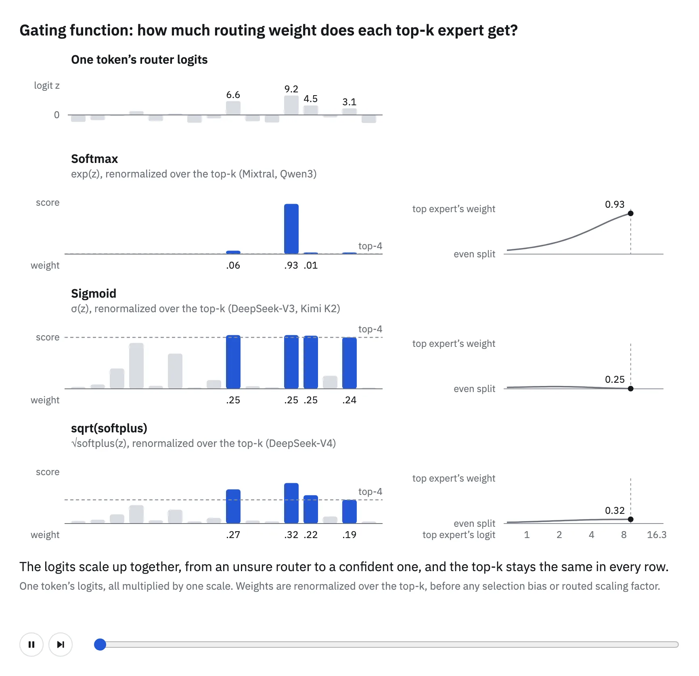

[Figure explanation, controls and captured states](../figures/router-score-shape.md) · [Interactive original](../upstream/app/public/viz/index.html?c=router-score-shape)


In the figure, sqrt(softplus) lands between softmax and sigmoid: for positive logits, the ratio of two weights tends to the square root of the ratio of their logits as the scale grows. DeepSeek-V4 switched to sqrt(softplus) from sigmoid[27](A-appendix.md#ref-2606.19348) [evidence](../citation-evidence.md#dsv4-sqrtsp). In [Megatron](https://github.com/NVIDIA/Megatron-LM), the expert bias of [3.3](3-anatomy-of-moe-training.md#s-3-3) needs sigmoid or sqrt(softplus): it refuses the bias with softmax at startup ([`transformer_config.py#L3139-L3147`](https://github.com/NVIDIA/Megatron-LM/blob/d6316eb45bf1bfbb6f1f848c0b56e55166564d80/megatron/core/transformer/transformer_config.py#L3139-L3147)), and its softmax path never adds it. Wang et al., who proposed the bias[28](A-appendix.md#ref-2408.15664) [evidence](../citation-evidence.md#lossfree-softmax), explain why it fits softmax badly: softmax's normalization makes the gap between two experts depend on every other expert's score, so the bias is harder to tune. They still balanced a softmax router with it[28](A-appendix.md#ref-2408.15664) [evidence](../citation-evidence.md#lossfree-softmax). The auxiliary loss works with all three ([`moe_utils.py#L998-L1014`](https://github.com/NVIDIA/Megatron-LM/blob/d6316eb45bf1bfbb6f1f848c0b56e55166564d80/megatron/core/transformer/moe/moe_utils.py#L998-L1014)).

**Megatron source**

**[`moe_utils.py#L913-L927`](https://github.com/NVIDIA/Megatron-LM/blob/d6316eb45bf1bfbb6f1f848c0b56e55166564d80/megatron/core/transformer/moe/moe_utils.py#L913-L927) (softmax, before or after top-k)**

```
if score_function == "softmax":
    if use_pre_softmax:
        scores = torch.softmax(logits, dim=-1, dtype=torch.float32)
        if precomputed_indices is not None:
            top_indices = precomputed_indices
            probs = torch.gather(scores, dim=1, index=top_indices)
        else:
            probs, top_indices = compute_topk(scores, topk, num_groups, group_topk)
    else:
        if precomputed_indices is not None:
            top_indices = precomputed_indices
            scores = torch.gather(logits, dim=1, index=top_indices)
        else:
            scores, top_indices = compute_topk(logits, topk, num_groups, group_topk)
        probs = torch.softmax(scores, dim=-1, dtype=torch.float32)
```

**[`moe_utils.py#L928-L941`](https://github.com/NVIDIA/Megatron-LM/blob/d6316eb45bf1bfbb6f1f848c0b56e55166564d80/megatron/core/transformer/moe/moe_utils.py#L928-L941)**

```
elif score_function in ("sigmoid", "sqrtsoftplus"):
    if score_function == "sigmoid":
        scores = torch.sigmoid(logits.float())
    else:
        scores = torch.nn.functional.softplus(logits.float()).sqrt()
    if precomputed_indices is not None:
        top_indices = precomputed_indices
        scores = torch.gather(scores, dim=1, index=top_indices)
    elif expert_bias is not None:
        scores_for_routing = scores + expert_bias.float()
        _, top_indices = compute_topk(scores_for_routing, topk, num_groups, group_topk)
        scores = torch.gather(scores, dim=1, index=top_indices)
    else:
        scores, top_indices = compute_topk(scores, topk, num_groups, group_topk)
```

(sigmoid, sqrt(softplus), bias only selects),

**[`transformer_config.py#L3139-L3147`](https://github.com/NVIDIA/Megatron-LM/blob/d6316eb45bf1bfbb6f1f848c0b56e55166564d80/megatron/core/transformer/transformer_config.py#L3139-L3147) (the bias refused with softmax)**

```
if self.moe_router_enable_expert_bias and self.moe_router_score_function not in (
    "sigmoid",
    "sqrtsoftplus",
):
    raise ValueError(
        "Expert bias for aux-loss-free routing only supports 'sigmoid' and 'sqrtsoftplus' "
        "score functions. Please set --moe-router-score-function to 'sigmoid' or "
        "'sqrtsoftplus', or unset --moe-router-enable-expert-bias."
    )
```

Sigmoid gives the chosen experts equal weights once all their logits are large and positive, which is where the simulation's scaled-up token ends: a confident router with the flat gate that Sharpness returns to. To see whether a run's router gets there, record the routing trace with its logits on ([A.1](A-appendix.md#s-a-1)) and follow two numbers per layer: the top expert's weight, and the routing entropy, which is low when one expert takes most of the weight and high when the weights are spread.

Use sigmoid (or sqrt(softplus)) when you balance with the expert bias ([3.3](3-anatomy-of-moe-training.md#s-3-3)), since Megatron refuses the bias with softmax. Otherwise use softmax, Megatron's default.

The router's weights do two jobs. They pick the experts, and they are also the numbers that mix the experts' outputs: the layer returns each chosen expert's output times its weight, summed. The gating function decides how much each chosen expert counts against the others. It does not decide how much they count together: with softmax, the top-k weights sum to less than 1, by a different amount for each token, so the size of the layer's output moves with them. So how big should that combined output be?

<a id="s-3-1-output-scale"></a>

#### Output scale

Two settings decide how big the experts' combined output is. The first is renormalization: rescale the k chosen weights so they sum to 1, and the output's size no longer moves with their sum. In Krajewski et al. renormalizing lowered validation loss from 2.219 to 2.183 at granularity 8 Granularity 8: experts 8 times smaller, 8 times as many, and 8 times as many chosen per token, so parameters and compute stay the same; [3.4](3-anatomy-of-moe-training.md#s-3-4) compares granularities. [29](A-appendix.md#ref-2506.02890) [evidence](../citation-evidence.md#krajewski25-t6). Megatron renormalizes by default ([`moe_utils.py#L913-L942`](https://github.com/NVIDIA/Megatron-LM/blob/d6316eb45bf1bfbb6f1f848c0b56e55166564d80/megatron/core/transformer/moe/moe_utils.py#L913-L942)), and `--moe-router-pre-softmax` turns renormalization off. Softmax at top-1 requires that flag: with one expert chosen, softmax over its single logit is always 1, so the router gets no gradient ([`transformer_config.py#L3213-L3221`](https://github.com/NVIDIA/Megatron-LM/blob/d6316eb45bf1bfbb6f1f848c0b56e55166564d80/megatron/core/transformer/transformer_config.py#L3213-L3221)).


**Figure 3.1.2**

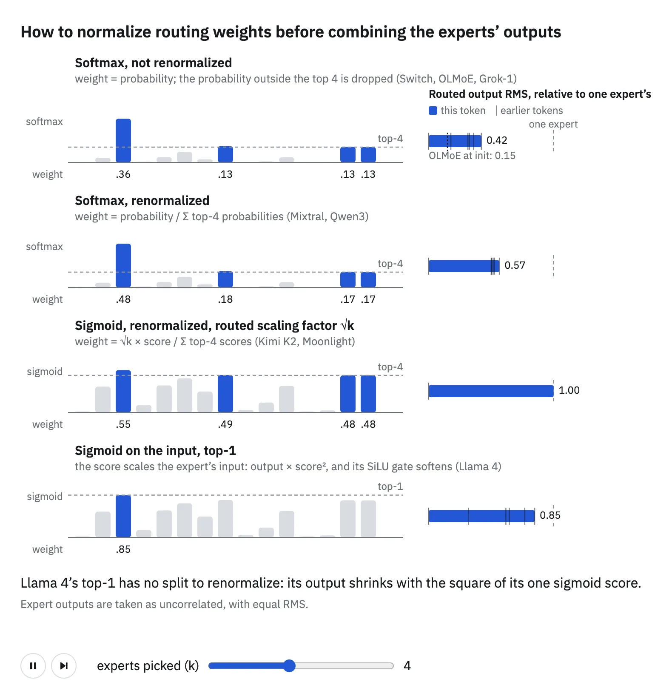

[Figure explanation, controls and captured states](../figures/router-gate-gain.md) · [Interactive original](../upstream/app/public/viz/index.html?c=router-gate-gain)


The simulation sweeps toy tokens from an unsure router to a confident one, with uncorrelated experts of equal RMS: without renormalization the routed output's size follows the top-k probability mass, and renormalizing keeps it between 1/√k of one expert's RMS and one expert's RMS.

The second setting is the routed scaling factor, the constant multiplied onto the result. It is needed because, even renormalized, the size of the routed output depends on how much each expert counts. With all the weight on one expert, the output has that expert's root mean square (RMS). With equal weights on k uncorrelated experts of equal RMS, it drops to 1/√k of that, and a routed scaling factor near √k restores it. DeepSeek-V3 uses [2.5](2-setup-and-your-first-run.md#s-2-5) at k \= 8[30](A-appendix.md#ref-src-cfg-dsv3) [evidence](../citation-evidence.md#cfg-dsv3), and Kimi K2 2.827 ≈ √8. Shipped models disagree on its value: in the table above only GLM-5.3 and Step-5-Preview stay near √k, and Kimi went from √8 in K2 to 1.0 at k \= 16 in K3[20](A-appendix.md#ref-src-hub-kimi-k3) [evidence](../citation-evidence.md#hub-kimi-k3). Scaling the routed output also changes its weight against the shared expert's output ([3.4](3-anatomy-of-moe-training.md#s-3-4)).

The figure's last row scales the expert's input instead of its output: Llama 4 sends each token to one expert and multiplies the token by that expert's sigmoid score before the expert runs[31](A-appendix.md#ref-src-tf-llama4) [evidence](../citation-evidence.md#tf-llama4). Its SwiGLU experts have no biases, so the output shrinks roughly as the score squared, and the score also softens the SiLU gate.

**Megatron source**

**[`moe_utils.py#L942-L947`](https://github.com/NVIDIA/Megatron-LM/blob/d6316eb45bf1bfbb6f1f848c0b56e55166564d80/megatron/core/transformer/moe/moe_utils.py#L942-L947) (renormalize, then scale)**

```
    probs = scores / (scores.sum(dim=-1, keepdim=True) + 1e-20) if topk > 1 else scores
else:
    raise ValueError(f"Invalid score_function: {score_function}")

if scaling_factor:
    probs = probs * scaling_factor
```

**[`transformer_config.py#L3213-L3221`](https://github.com/NVIDIA/Megatron-LM/blob/d6316eb45bf1bfbb6f1f848c0b56e55166564d80/megatron/core/transformer/transformer_config.py#L3213-L3221) (top-1 needs pre-softmax: softmax over one logit gives a zero gradient)**

```
if (
    self.moe_router_topk == 1
    and self.moe_router_score_function == "softmax"
    and not self.moe_router_pre_softmax
    and self.moe_router_load_balancing_type != "sinkhorn"
):
    # Requires applying softmax before selecting the top-k when k is 1,
    # since softmax on a [num_tokens, 1] would yield a zero gradient.
    raise ValueError("Please use --moe-router-pre-softmax when topk is 1.")
```

Without renormalization, the size of the routed output follows the top-k probability mass from token to token, the setting that gave the higher loss above, so the number to watch is how large the routed output is for each token, the root of the sum of its squared weights. Compute it offline from the routing trace ([A.1](A-appendix.md#s-a-1)).

Keep renormalization on at top-k \> 1, and use `--moe-router-pre-softmax` for softmax at top-1, or the router gets no gradient. The routed scaling factor has no settled value: √k restores the routed output's RMS only for equal weights on uncorrelated experts, and shipped models disagree on its value.

Both the weights and the output's size depend on how peaked the logits are. A router can get too sharp, with one expert taking all the weight, or too flat, averaging its top-k. What sets how peaked it is?

<a id="s-3-1-sharpness"></a>

#### Sharpness

With softmax, a linear router gets sharper as the token's norm or the router's weights grow: the logits spread apart, and the top expert takes more of the weight. The figure below compares three ways to control that against the linear router. Logit soft-capping compresses mostly the logits near its cap. Normalizing the router input removes the part that comes from the token's norm. Gating logit normalization standardizes the logits across experts[32](A-appendix.md#ref-2406.06563) [evidence](../citation-evidence.md#skywork-eq6), which sets their spread to a chosen scale.


**Figure 3.1.3**

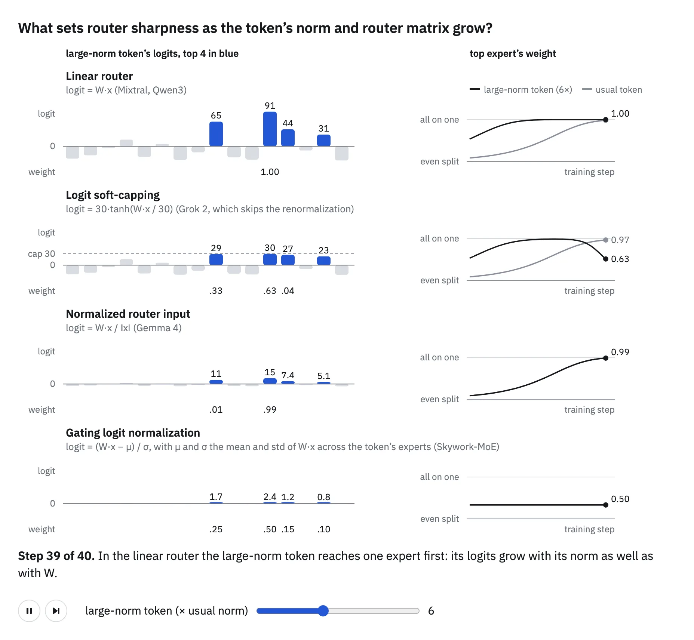

[Figure explanation, controls and captured states](../figures/router-temperature.md) · [Interactive original](../upstream/app/public/viz/index.html?c=router-temperature)


The plain linear router in the figure sharpens as the token's norm or the router matrix grows, and soft-capping, which Grok 2 applies at 30 without renormalizing[33](A-appendix.md#ref-src-grok2-softcap) [evidence](../citation-evidence.md#grok2-softcap), pulls the large-norm token's top weight back only once its logits near the cap. Normalizing the input, as Gemma 4 does[17](A-appendix.md#ref-src-tf-gemma4) [evidence](../citation-evidence.md#tf-gemma4), routes both tokens alike but still sharpens as the matrix grows, and gating logit normalization is unaffected by both. Skywork-MoE used gating logit normalization against a gate so flat that the layer averages its top-k experts[34](A-appendix.md#ref-2406.06563) [evidence](../citation-evidence.md#skywork-f2). With it, training loss came out moderately lower[35](A-appendix.md#ref-2406.06563) [evidence](../citation-evidence.md#skywork-f3). Normalizing the router input was ablated only together with the expert embeddings[36](A-appendix.md#ref-2204.09179) [evidence](../citation-evidence.md#xmoe-t3).

**Megatron source**

**[`router.py#L1150-L1152`](https://github.com/NVIDIA/Megatron-LM/blob/d6316eb45bf1bfbb6f1f848c0b56e55166564d80/megatron/core/transformer/moe/router.py#L1150-L1152) (jitter, then plain linear gate)**

```
# Apply input jitter
input = self.apply_input_jitter(input)
logits = self.gating(input)
```

**[`router.py#L824-L831`](https://github.com/NVIDIA/Megatron-LM/blob/d6316eb45bf1bfbb6f1f848c0b56e55166564d80/megatron/core/transformer/moe/router.py#L824-L831) (multiplicative input jitter)**

```
if self.config.moe_input_jitter_eps is not None:
    eps = self.config.moe_input_jitter_eps
    if self.input_jitter is None:
        self.input_jitter = torch.distributions.uniform.Uniform(
            torch.tensor(1.0 - eps, dtype=input.dtype, device=input.device),
            torch.tensor(1.0 + eps, dtype=input.dtype, device=input.device),
        ).rsample
    return input * self.input_jitter(input.shape)
```

A flat gate, one that averages its top-k experts and makes the model learn worse, shows up as Max1/Max2, the top expert's weight over the second's, falling toward 1, as it did in Skywork-MoE without normalization[35](A-appendix.md#ref-2406.06563) [evidence](../citation-evidence.md#skywork-f3). Follow it per layer together with the top expert's weight, both from the routing trace ([A.1](A-appendix.md#s-a-1)).

If the gate goes flat, gating logit normalization fixed it in Skywork-MoE. On the router input, Megatron offers Switch-style multiplicative input jitter, `--moe-input-jitter-eps`.

Sharpness lives in the gaps between logits, and softmax ignores a shift shared by all of them. bf16 does not: if every logit drifts upward together, the values bf16 can represent get farther apart, and close experts can tie. Do those ties change which experts win?

<a id="s-3-1-precision"></a>

#### Precision

Top-k orders tied experts in a way PyTorch does not specify[37](A-appendix.md#ref-src-torch-topk) [evidence](../citation-evidence.md#torch-topk). The figure below simulates routing the same tokens with 64 experts and top-8 through a bf16 router, with and without z-loss, a penalty on the logits' logsumexp. Its simulated logits drift up by one shared offset, and it counts the tokens whose experts differ from what an fp32 router picks.


**Figure 3.1.4**

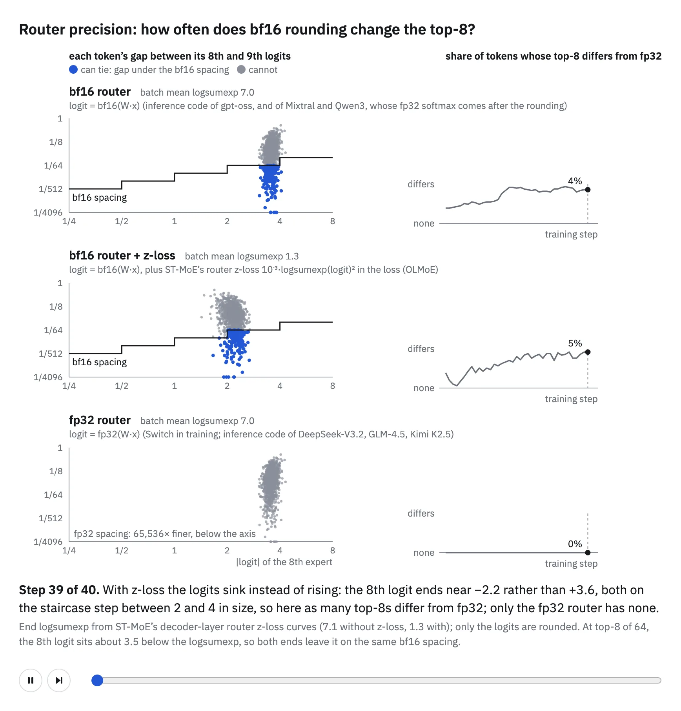

[Figure explanation, controls and captured states](../figures/router-precision.md) · [Interactive original](../upstream/app/public/viz/index.html?c=router-precision)


As the simulated offset rises, the bf16 router's logits land on a coarser grid and more tokens get different experts than under fp32. Z-loss lowers the logsumexp by pushing the logits negative. At top-8 of 64 the 8th logit sits about [3.5](3-anatomy-of-moe-training.md#s-3-5) below the logsumexp, so in the simulation it ends near −[2.2](2-setup-and-your-first-run.md#s-2-2) with z-loss and \+[3.6](3-anatomy-of-moe-training.md#s-3-6) without, two sizes bf16 rounds in steps of the same length, and about as many tokens change experts; only the fp32 router has no flips, since fp32 rounds 65,536 times more finely than bf16[38](A-appendix.md#ref-2202.08906) [evidence](../citation-evidence.md#stmoe-s34). DeepSeek-V3.2, GLM-4.5 and Kimi K2.5 compute the router in fp32 in their inference code[39](A-appendix.md#ref-src-fp32-router-code) [evidence](../citation-evidence.md#fp32-router-code). The case for fp32 rests on the training evidence, which is about stability. In Switch Transformers, a bf16 router diverged while an fp32 router trained at bf16 speed[40](A-appendix.md#ref-2101.03961) [evidence](../citation-evidence.md#switch-t2). In ST-MoE, the router z-loss kept every run stable[41](A-appendix.md#ref-2202.08906) [evidence](../citation-evidence.md#stmoe-t4). Labs rarely say what precision they train the router in: in the table above, 2 of the 10 reports mention it, and 5 of the 10 run the router's matrix multiply in bf16 in their inference code. How far below bf16 the rest of the layer can go, while the router keeps its precision, is the question [3.7 Precision](3-anatomy-of-moe-training.md#s-3-7-precision) returns to.

**Megatron source**

**[`router.py#L124-L130`](https://github.com/NVIDIA/Megatron-LM/blob/d6316eb45bf1bfbb6f1f848c0b56e55166564d80/megatron/core/transformer/moe/router.py#L124-L130) (router dtype)**

```
# Convert to specified datatype for routing computation if enabled
router_dtype = input.dtype
if self.config.moe_router_dtype == 'fp32':
    router_dtype = torch.float32
elif self.config.moe_router_dtype == 'fp64':
    router_dtype = torch.float64
logits = router_gating_linear(input, self.weight, self.bias, router_dtype)
```

**[`moe_utils.py#L1424-L1435`](https://github.com/NVIDIA/Megatron-LM/blob/d6316eb45bf1bfbb6f1f848c0b56e55166564d80/megatron/core/transformer/moe/moe_utils.py#L1424-L1435) (bf16 operands, fp32 logits)**

```
if te_general_gemm is not None and router_dtype != torch.float64:
    # cuBLASLt's non-FP8 bias epilogue expects bias and output to have the same
    # dtype. Router parameters may be BF16 while router logits are FP32, so cast the
    # small bias vector before passing it to TE.
    gemm_bias = bias.to(router_dtype) if bias is not None else None
    output = te_general_gemm(weight, inp, router_dtype, layout="TN", bias=gemm_bias)[0]
elif bias is None:
    output = torch.mm(inp.to(router_dtype), weight.to(router_dtype).t())
else:
    output = torch.addmm(
        bias.to(router_dtype), inp.to(router_dtype), weight.to(router_dtype).t()
    )
```

**[`moe_utils.py#L171-L184`](https://github.com/NVIDIA/Megatron-LM/blob/d6316eb45bf1bfbb6f1f848c0b56e55166564d80/megatron/core/transformer/moe/moe_utils.py#L171-L184) (z-loss)**

```
logsum = torch.logsumexp(logits, dim=-1)
z_loss_values = torch.square(logsum)

if padding_mask is not None:
    # Invert padding_mask: True (padding) -> 0, False (valid) -> 1
    valid_mask = ~padding_mask
    # Only compute z_loss for valid (non-padding) tokens
    z_loss_values = z_loss_values * valid_mask
    # Compute mean over valid tokens only
    num_valid_tokens = valid_mask.sum()
    z_loss = z_loss_values.sum() / torch.clamp(num_valid_tokens, min=1.0) * z_loss_coeff
else:
    z_loss = torch.mean(z_loss_values) * z_loss_coeff
return z_loss
```

**[`router.py#L761-L764`](https://github.com/NVIDIA/Megatron-LM/blob/d6316eb45bf1bfbb6f1f848c0b56e55166564d80/megatron/core/transformer/moe/router.py#L761-L764) (z-loss coefficient over TP×CP)**

```
if self.config.moe_z_loss_coeff is not None and self.training and torch.is_grad_enabled():
    # Skip Z loss calculations when using torch.no_grad() or checkpointing.
    moe_z_loss_coeff = self.config.moe_z_loss_coeff / self.tp_cp_group.size()
    z_loss = z_loss_func(logits, moe_z_loss_coeff, padding_mask=padding_mask)
```

A bf16 router can make training diverge, as it did in Switch Transformers, so two signals are worth following: the z-loss, which tracks how far the logits drift up, and the flip rate, the share of tokens whose experts change when the router is recomputed in fp32. Megatron logs the z-loss when `--moe-z-loss-coeff` is set, already divided by the coefficient ([`router.py#L805-L807`](https://github.com/NVIDIA/Megatron-LM/blob/d6316eb45bf1bfbb6f1f848c0b56e55166564d80/megatron/core/transformer/moe/router.py#L805-L807)), so its square root is the RMS logsumexp: our run logged 20.9, an RMS logsumexp of about 4.6. The flip rate needs a matched capture of the same inputs and current router state; [A.1](A-appendix.md#s-a-1) provides a bounded live hook, since the trace's initial weight snapshot does not track later training updates.

Always set `--moe-router-dtype fp32`. Add `--moe-z-loss-coeff 1e-3`, ST-MoE's value, to a softmax router whose logits drift up. DeepSeek-V3's report never mentions z-loss for its sigmoid router[42](A-appendix.md#ref-2412.19437) [evidence](../citation-evidence.md#dsv3-noz).

#### What to watch

| Part | Symptom | Signal to watch |
| --- | --- | --- |
| Gating function |  | The top expert's weight and the routing entropy, per layer, from the routing trace with logits on ([A.1](A-appendix.md#s-a-1)). |
| Output scale | `learns badly`: without renormalization, the routed output scales with the top-k probability mass. Renormalizing lowered the loss[29](A-appendix.md#ref-2506.02890) [evidence](../citation-evidence.md#krajewski25-t6). | How large each token's routed output is, √(Σ w²), from the routing trace ([A.1](A-appendix.md#s-a-1)). |
| Sharpness | `learns badly`: when the gate is flat, the layer averages its top-k experts[35](A-appendix.md#ref-2406.06563) [evidence](../citation-evidence.md#skywork-f3). | The top expert's weight and Max1/Max2, its weight over the second expert's[35](A-appendix.md#ref-2406.06563) [evidence](../citation-evidence.md#skywork-f3), per layer, from the routing trace ([A.1](A-appendix.md#s-a-1)). |
| Precision | `blows up`: a bf16 router diverged in Switch Transformers[40](A-appendix.md#ref-2101.03961) [evidence](../citation-evidence.md#switch-t2). | The logged z-loss is divided by its coefficient, so its square root gives RMS logsumexp: 20.9 corresponds to about 4.6. Measure fp32 routing flips with [A.1](A-appendix.md#s-a-1)'s matched live hook using the same inputs and current router state; the trace's initial weight snapshot cannot replay later training forwards exactly. |

So far we have shaped how a token's logits become weights. The gating function sets how much each chosen expert counts, renormalization and the scaling factor set how big their combined output is, and sharpness and precision set how peaked and how exact the scores are. All of it assumed one setup: a learned router, and the token picking its top k. Both can change: experts can pick their tokens instead, and a fixed table can replace the learned choice. Who should make the choice, the token or the expert, and does the choice need to be learned at all?

<a id="s-3-2"></a>

### 3.2 Routing strategy: who selects, and how


**hero-anatomy-zoom**


[Figure explanation, controls and captured states](../figures/hero-anatomy-zoom.md) · [Interactive original](../upstream/app/public/viz/index.html?c=hero-anatomy-zoom&stage=3&mini=1)


Token-choice top-k is the default: each token scores every expert and keeps its k best. This section looks at two ways to change that. The expert can pick its tokens instead of the token picking its experts, or a fixed hash can pick, with no learned router at all.

How current open MoEs pick their experts, and which ones look up a table by token id, with Zhou et al.'s research model as an expert-choice comparison. Current-model settings come from their `config.json` and modeling code; the expert-choice row comes from the paper[43](A-appendix.md#ref-2202.09368) [evidence](../citation-evidence.md#zhou22-ec).

| Model | Who selects | Token-id lookup |
| --- | --- | --- |
| DeepSeek-V4-Pro | token choice | hash routing in the first 3 MoE layers[44](A-appendix.md#ref-src-hub-dsv4pro-route) [evidence](../citation-evidence.md#hub-dsv4pro-route) |
| DeepSeek-V4.1-Flash | token choice | Engram n-gram memory (2- to 4-grams) at layers 1 and 14; no hash routing[45](A-appendix.md#ref-src-hub-v41-engram) [evidence](../citation-evidence.md#hub-v41-engram) |
| EC-CF2 8B/64E (Zhou et al.)[43](A-appendix.md#ref-2202.09368) [evidence](../citation-evidence.md#zhou22-ec) | expert choice | none |
| GLM-5.3 | token choice | none |
| Kimi K3 | token choice | none |
| Llama 4 Maverick | token choice | none[46](A-appendix.md#ref-src-hub-llama4-route) [evidence](../citation-evidence.md#hub-llama4-route) |
| MiMo-V2.6-Pro-RL | token choice | none |
| Qwen3.8-Flash-Next | token choice | n-gram embedding (2- and 3-grams) at layer 1[47](A-appendix.md#ref-src-hub-q38-ngram) [evidence](../citation-evidence.md#hub-q38-ngram) |
| Step-5-Preview | token choice | none[48](A-appendix.md#ref-src-hub-step5-route) [evidence](../citation-evidence.md#hub-step5-route) |

Before asking whether the choice needs a learned router, we have to settle who makes it, because with token choice many tokens can want the same experts and loads skew. Should each token keep picking its experts, or should each expert pick its tokens instead?

<a id="s-3-2-who-selects"></a>

#### Who selects

With token choice, many tokens can want the same experts, so loads skew. Expert choice flips the roles: each expert takes its best tokens, so every expert gets the same load[43](A-appendix.md#ref-2202.09368) [evidence](../citation-evidence.md#zhou22-ec). The catch is future token leakage[49](A-appendix.md#ref-2408.15664) [evidence](../citation-evidence.md#lossfree-s52): whether a token gets an expert depends on the tokens after it. At inference those tokens do not exist yet, so routing differs from training[50](A-appendix.md#ref-2603.11535) [evidence](../citation-evidence.md#et-ec-causal).

Expert threshold, the third rule in the figure below, keeps loads near even without looking at future tokens[50](A-appendix.md#ref-2603.11535) [evidence](../citation-evidence.md#et-ec-causal). In exchange, each token gets a variable number of experts. In a 575M-parameter model it reached a lower loss than token choice, with or without balancing (2.844 against about 2.89)[51](A-appendix.md#ref-2603.11535) [evidence](../citation-evidence.md#et-t1).


**Figure 3.2.1**

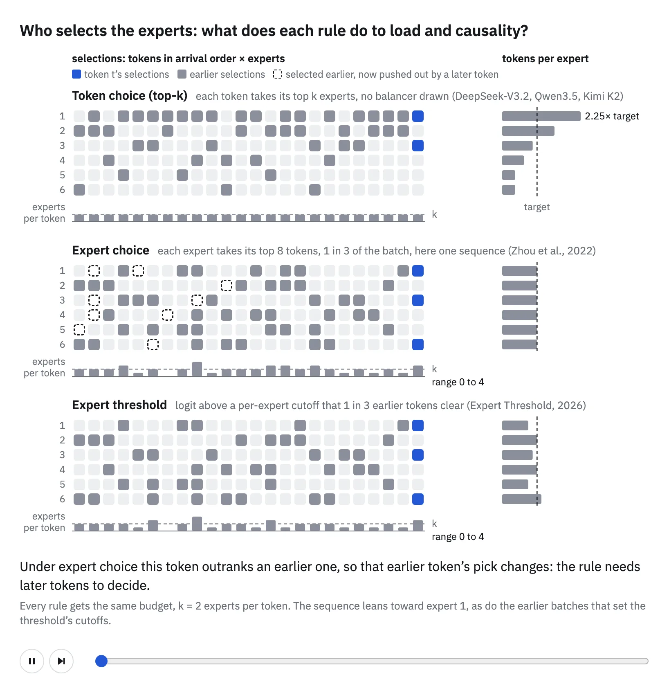

[Figure explanation, controls and captured states](../figures/who-picks.md) · [Interactive original](../upstream/app/public/viz/index.html?c=who-picks)


In the figure, the sequence leans toward expert 1, and token choice, drawn with no balancer, overloads it. Expert choice balances the loads, but later tokens push out earlier selections, while expert threshold, whose cutoffs come from earlier batches that lean the same way, keeps the loads near the target without revising any selection, at the price of a varying number of experts per token.

**Megatron source**

**[`moe_utils.py#L891-L897`](https://github.com/NVIDIA/Megatron-LM/blob/d6316eb45bf1bfbb6f1f848c0b56e55166564d80/megatron/core/transformer/moe/moe_utils.py#L891-L897) (per-token top-k, token choice only)**

```
# Sorting top-k turned off during inference
return torch.topk(
    scores,
    k=topk,
    dim=1,
    sorted=torch.is_grad_enabled() or is_batch_invariant_mode_enabled(),
)
```

The skew token choice leaves behind makes the step slow. It shows in the token counts, tokens per expert per layer, which `--save-tokens-per-expert-interval` logs ([A.1](A-appendix.md#s-a-1)) and which read best as MaxVio, how far the busiest expert's load sits above the mean MaxVio, short for maximal violation: (busiest expert's load minus the mean load) divided by the mean load. 0 is perfectly even; 1 means the busiest expert gets twice the average. Wang et al., who proposed the expert bias of [3.3](3-anatomy-of-moe-training.md#s-3-3), define it. [52](A-appendix.md#ref-2408.15664) [evidence](../citation-evidence.md#lossfree-maxvio).

Use token choice, the routing [Megatron](https://github.com/NVIDIA/Megatron-LM) trains, with `--moe-router-topk` setting k.

Whether the token or the expert does the picking, the choice so far always comes from a learned router, so the routing itself has to be trained. Does routing really need to be learned, or could a simpler rule pick the experts?

<a id="s-3-2-hash-layers"></a>

#### Hash layers

In DeepSeek-V4's first 3 MoE layers, a fixed table maps each token id to its experts[53](A-appendix.md#ref-2606.19348) [evidence](../citation-evidence.md#dsv4-s41), and the router is kept only for the weights[54](A-appendix.md#ref-src-dsv4-gate-code) [evidence](../citation-evidence.md#dsv4-gate-code). The table is a fixed hash of the token id[27](A-appendix.md#ref-2606.19348) [evidence](../citation-evidence.md#dsv4-s21), and in our probe it spreads frequent tokens no better than a random table. There is nothing to learn for the selection, and hash layers matched Switch and BASE layers Lewis et al.'s balanced assignment of experts, which routes by solving a linear assignment that gives every expert an equal number of tokens.  in models up to 4.5B[55](A-appendix.md#ref-2106.04426) [evidence](../citation-evidence.md#roller-s52). The figure below puts learned and hash routing side by side, above a third lookup by token id: Engram, which hashes each token's last 2 to 4 tokens into tables of embeddings and adds the rows it reads to the hidden state[56](A-appendix.md#ref-src-engram-s23) [evidence](../citation-evidence.md#engram-s23). DeepSeek-V4.1-Flash keeps Engram at two layers, but picks every layer's experts with its learned router[57,58](A-appendix.md#ref-2609.19969) [evidence](../citation-evidence.md#dsv41-s242) [evidence](../citation-evidence.md#dsv41-engram).


**Figure 3.2.2**

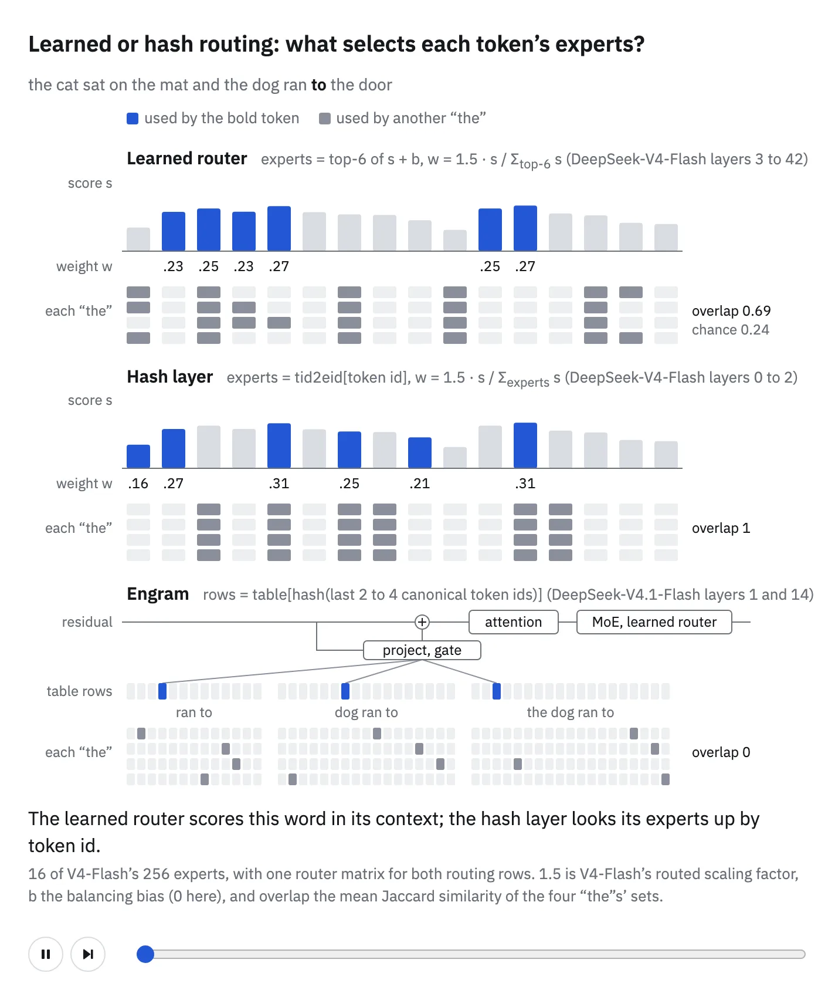

[Figure explanation, controls and captured states](../figures/router-authority.md) · [Interactive original](../upstream/app/public/viz/index.html?c=router-authority)


The figure's two routers treat the word "the" differently: the learned router selects each one by its context, while the hash layer sends every "the" to the six experts its table row names, even past an expert with a higher score. Both rows weight their six experts to sum to V4-Flash's routed scaling factor of 1.5[59](A-appendix.md#ref-src-cfg-v4flash-rs) [evidence](../citation-evidence.md#cfg-v4flash-rs), and the figure measures how alike the four "the"s' expert sets are by their mean Jaccard similarity. What the hash layer gives up is context: the same token id always selects the same experts, whatever surrounds it. It also scales worse than learned routing. Clark et al. varied how many of a model's layers are MoE layers. With a single MoE layer, hash routing reached the lowest loss of the routing methods they compared, but as more layers became MoE layers it stopped improving, while their learned router kept getting better[60](A-appendix.md#ref-2202.01169) [evidence](../citation-evidence.md#clark-appd). And no bias can rebalance it[54](A-appendix.md#ref-src-dsv4-gate-code) [evidence](../citation-evidence.md#dsv4-gate-code): frequent tokens can overload their assigned experts, and nothing moves them. V4.1-Flash dropped hash layers and kept only Engram, which picks no experts[45](A-appendix.md#ref-src-hub-v41-engram) [evidence](../citation-evidence.md#hub-v41-engram).

In Megatron, `--moe-num-hash-layers` makes the first MoE layers hash layers ([`router.py#L304-L308`](https://github.com/NVIDIA/Megatron-LM/blob/d6316eb45bf1bfbb6f1f848c0b56e55166564d80/megatron/core/transformer/moe/router.py#L304-L308)). They read each token's experts from a token-to-expert table (`tid2eid`) with one row per vocabulary entry, and if you do not load one, Megatron fills it with a round-robin placeholder ([`router.py#L313-L329`](https://github.com/NVIDIA/Megatron-LM/blob/d6316eb45bf1bfbb6f1f848c0b56e55166564d80/megatron/core/transformer/moe/router.py#L313-L329)). Since the expert bias is off in these layers, nothing corrects a bad table during training, so the table matters. Roller et al. compared ways to build it: a random table and one that greedily spreads the most frequent tokens over the emptiest experts reached about the same perplexity, with the second better balanced, while grouping similar tokens by clustering their embeddings did clearly worse[61](A-appendix.md#ref-2106.04426) [evidence](../citation-evidence.md#roller-hashfn).

**Megatron source**

**[`router.py#L304-L308`](https://github.com/NVIDIA/Megatron-LM/blob/d6316eb45bf1bfbb6f1f848c0b56e55166564d80/megatron/core/transformer/moe/router.py#L304-L308) (first N layers hashed)**

```
self.is_hash_layer = (
    not self.is_mtp_layer
    and hash_moe_layer_threshold > 0
    and layer_number <= hash_moe_layer_threshold
)
```

**[`router.py#L322-L326`](https://github.com/NVIDIA/Megatron-LM/blob/d6316eb45bf1bfbb6f1f848c0b56e55166564d80/megatron/core/transformer/moe/router.py#L322-L326) (placeholder round-robin table)**

```
token_ids = torch.arange(self.config.hash_moe_vocab_size, device=self.weight.device)
expert_offsets = torch.arange(self.topk, device=token_ids.device)
self.tid2eid = ((token_ids[:, None] + expert_offsets) % self.num_experts).to(
    torch.int32
)
```

**[`router.py#L898-L905`](https://github.com/NVIDIA/Megatron-LM/blob/d6316eb45bf1bfbb6f1f848c0b56e55166564d80/megatron/core/transformer/moe/router.py#L898-L905) (experts looked up by token id)**

```
flat_ids = input_ids.T.reshape(-1)
assert flat_ids.numel() == logits.shape[0], (
    f"input_ids contains {flat_ids.numel()} tokens, but router logits contain "
    f"{logits.shape[0]}."
)
# Token IDs address the real tokenizer vocabulary; reject out-of-range IDs,
# including negative IDs, without clamping them to another token's experts.
default_top_indices = self.tid2eid.index_select(0, flat_ids).long()
```

**[`router.py#L914-L916`](https://github.com/NVIDIA/Megatron-LM/blob/d6316eb45bf1bfbb6f1f848c0b56e55166564d80/megatron/core/transformer/moe/router.py#L914-L916) (weights still from the gate)**

```
def _compute_hash_topk(scores, topk, num_groups=None, group_topk=None):
    del topk, num_groups, group_topk
    return scores.gather(1, default_top_indices), default_top_indices
```

plus a few lines that load V4-Flash's `layers.0.ffn.gate.tid2eid` from the Hub and count tokens per expert

A table that overloads some experts makes the step slow, and since nothing rebalances it during training, check it early in the run by comparing the tokens per expert in the hash layers with those in the learned layers, from the token counts that `--save-tokens-per-expert-interval` writes ([A.1](A-appendix.md#s-a-1)).

Use it only to reproduce DeepSeek-V4's first layers. Load a fixed hash table as V4 does[27](A-appendix.md#ref-2606.19348) [evidence](../citation-evidence.md#dsv4-s21), or a frequency-balanced one, instead of Megatron's round-robin placeholder.

#### What to watch

| Part | Symptom | Signal to watch |
| --- | --- | --- |
| Who selects | `slow`: with token choice, some experts get more tokens than others. `learns badly`: with expert choice, routing at inference differs from routing in training. | MaxVio per layer[52](A-appendix.md#ref-2408.15664) [evidence](../citation-evidence.md#lossfree-maxvio), how far the busiest expert's load sits above the mean, from the token counts ([A.1](A-appendix.md#s-a-1)). |
| Hash layers | `slow`: frequent tokens can overload the experts their hash assigns them, and no bias can move them. | Tokens per expert in the hash layers, compared with the learned layers, from the token counts ([A.1](A-appendix.md#s-a-1)). |

Expert choice and expert threshold keep the load even or close to it, and no bias can move a hash table's load. Megatron trains learned token choice, where nothing so far stops many tokens from crowding onto the same few experts. Crowded experts are the first real failure mode of an MoE, so how do we keep tokens spread evenly over the experts while the router keeps learning?

<a id="s-3-3"></a>

### 3.3 Load balancing


**hero-anatomy-zoom**


[Figure explanation, controls and captured states](../figures/hero-anatomy-zoom.md) · [Interactive original](../upstream/app/public/viz/index.html?c=hero-anatomy-zoom&stage=4&mini=1)


When many tokens pick the same experts, two things go wrong. The GPU holding the busiest experts has the most work, so the other GPUs wait for it and it sets the step time, and if the router keeps sending tokens to the same few experts, the others get few tokens and their parameters go mostly unused. The first cost is the easier one to measure: with routing forced even, the same model ran 1.5x faster at init.

Forcing the routing even only shows the speed to aim for, since it throws away what the router learned. To get close to it while the router keeps learning, there are two families of fixes, an auxiliary loss and a loss-free bias, and they balance the load in different ways. The aux loss adds a term that rewards an even load, so the router's gradient pushes its probabilities toward spreading tokens, at the price of a gradient that competes with the LM loss. The bias changes only which experts are selected. Whichever you pick, the scope it balances over (a sequence, a micro-batch or the global batch) decides what "balanced" means.

Balancing recipes reported by model authors. Auxiliary losses and selection biases can be used together. Scope describes the tokens whose loads are balanced; the MiMo row concerns RL rather than pretraining.

| Model | Auxiliary loss | Scope | Selection bias | Quantile balancing |
| --- | --- | --- | --- | --- |
| DeepSeek-V3[62](A-appendix.md#ref-2412.19437) [evidence](../citation-evidence.md#dsv3-alpha) | Small sequence-wise loss, coefficient 0.0001 | Batch-wide bias plus sequence-wise loss | Fixed-step expert bias | No, fixed-step updates |
| DeepSeek-V4.1-Flash[63](A-appendix.md#ref-2609.19969) [evidence](../citation-evidence.md#balance-dsv41) | Small sequence-wise loss, coefficient 0.0001 | Text and image loads balanced separately, plus sequence-wise loss | Separate biases per modality, update speed 0.001 | Uses the auxiliary-loss-free bias strategy |
| Kimi K3[64](A-appendix.md#ref-2607.24653) [evidence](../citation-evidence.md#balance-k3) | Described as auxiliary-loss-free | Global batch | Bias derived from score margins, applied next step | Yes, global-batch histogram estimation |
| LongCat-Flash[65](A-appendix.md#ref-2509.01322) [evidence](../citation-evidence.md#balance-longcat) | Device-level balance loss | Global-batch FFN targets plus device-level balance within sequences | PID-controlled expert bias; identity experts excluded from bias updates | No, PID updates |
| MiMo-V2.6-Pro-RL[66](A-appendix.md#ref-2610.11959) [evidence](../citation-evidence.md#balance-mimo26) | Router frozen during RL | Preserves the pre-RL router | Report evaluates freezing rather than a new bias update rule | No new balancing update reported for RL |
| Qwen3 MoE[67](A-appendix.md#ref-2505.09388) [evidence](../citation-evidence.md#balance-qwen3) | Global-batch balancing loss | Global batch | No selection bias in the published router[68](A-appendix.md#ref-src-hf-qwen3moe) [evidence](../citation-evidence.md#hf-qwen3moe) | No, auxiliary-loss approach |

Before comparing balancers, we need to know how much speed an uneven load costs us, since every balancer below should be judged against the throughput of routing that is forced to be even. Where does that 1.5x come from, and how do we measure it on our own setup?

<a id="s-3-3-cost-of-imbalance"></a>

#### Cost of imbalance

To see what imbalance costs, we routed the same model three ways. Forced-even routing, [Megatron](https://github.com/NVIDIA/Megatron-LM)'s `--moe-router-force-load-balancing`, replaces the router's logits with random ones so that every expert gets about the same load, which makes it the best case, at 149.4 TFLOP/s.

Forced-biased routing, `--moe-router-force-biased`, adds a shared random bias of growing size to those random logits, so a few experts get more and more of the tokens: a dial for how uneven the load is. At the far end of the dial throughput falls to 100.5 TFLOP/s, and a replay of that routing, whose aux loss matches the logged one, has the busiest expert receive every token, a MaxVio of 7, as uneven as top-8 routing over 64 experts can get. It can get worse: in the replay the busiest experts are spread over several GPUs, so the busiest GPU holds only about twice the mean load, and had they all sat on one GPU, that GPU would have done most of the expert work.

The learned router, the one you would train with, starts far from that best case: a freshly initialised router ran its first 40 iterations as slowly as the worst forced case. The figure below compares the three. Training has to close that gap without forcing the router's choices, and the rest of this section compares the balancing methods by how close they bring a learned router to forced-even throughput.


**Figure 3.3.1**

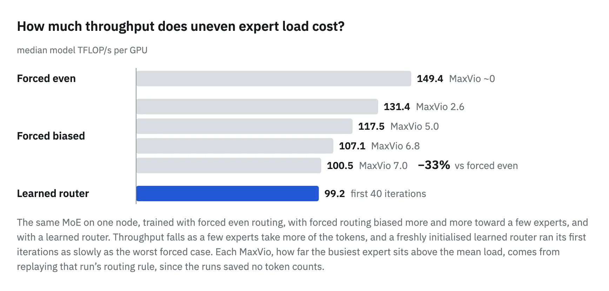

[Figure explanation, controls and captured states](../figures/forced-balance-ab.md) · [Interactive original](../upstream/app/public/viz/index.html?c=forced-balance-ab)


In the figure, throughput falls with each larger forced bias, as a few experts take more of the tokens, and the learned router starts at the level of the most uneven forced run. The busiest experts set the step because the all-to-all hands each GPU every token routed to its local experts, 8 of 64 in our runs, and the next all-to-all waits for the slowest GPU. A GPU's load is the sum over its local experts, so it can be more balanced than the per-expert load. That is why a balance loss can also work per GPU rather than per expert: DeepSeekMoE's device-level balance loss pools each GPU's experts into one term[69](A-appendix.md#ref-2401.06066) [evidence](../citation-evidence.md#dsmoe-device), and the figure that follows compares it with the expert-level loss.


**Figure 3.3.2**

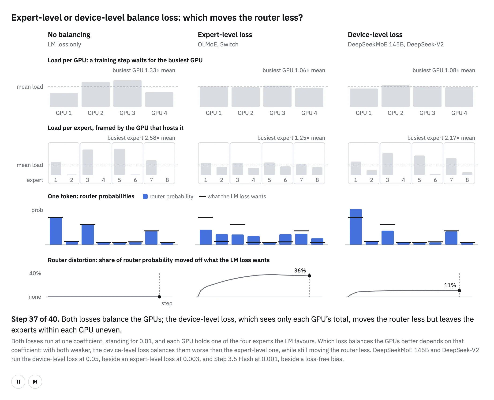

[Figure explanation, controls and captured states](../figures/device-level-balance-loss.md) · [Interactive original](../upstream/app/public/viz/index.html?c=device-level-balance-loss)


Trained on one toy batch with two experts per GPU, one of them among the four the LM favours, both losses balance the GPUs, and the device-level loss pulls the router less far from what the LM wants, since it sees only each GPU's total, which that placement keeps closer to even. The catch is that the experts within each GPU stay uneven, so one expert can still take most of its GPU's tokens. DeepSeekMoE gives the same reason for weighting the two losses unevenly: strict expert-level balance would cost model quality, so it sets a larger device-level factor and keeps a small expert-level one against routing collapse[69](A-appendix.md#ref-2401.06066) [evidence](../citation-evidence.md#dsmoe-device). DeepSeek-V2 runs them at 0.05 against 0.003[70](A-appendix.md#ref-2405.04434) [evidence](../citation-evidence.md#dsv2-coeffs). DeepSeek-V3's report no longer mentions a device-level loss: it balances each expert with a bias and a small sequence-wise loss, both covered later in this section[42](A-appendix.md#ref-2412.19437) [evidence](../citation-evidence.md#dsv3-nodevice).

The same imbalance costs time in serving too, so a frontier MoE in production keeps it small: when DeepSeek serves DeepSeek-V4.1-Flash, its slowest GPU sits at most 1.09 times the mean[71](A-appendix.md#ref-doc-1) [evidence](../citation-evidence.md#deepinfer-eplb).

**Megatron source**

**[`router.py#L1185-L1193`](https://github.com/NVIDIA/Megatron-LM/blob/d6316eb45bf1bfbb6f1f848c0b56e55166564d80/megatron/core/transformer/moe/router.py#L1185-L1193) (force switches in forward)**

```
if self.config.moe_router_force_load_balancing:
    # Apply force load balancing with random logits for benchmark
    logits = apply_random_logits(logits)

if self.config.moe_router_force_biased is not None:
    # Apply biased logits with shared random bias across all ranks
    logits = apply_biased_logits(
        logits, self.config.moe_router_force_biased, self.layer_number
    )
```

**[`moe_utils.py#L1301-L1314`](https://github.com/NVIDIA/Megatron-LM/blob/d6316eb45bf1bfbb6f1f848c0b56e55166564d80/megatron/core/transformer/moe/moe_utils.py#L1301-L1314) (random logits per rank)**

```
@staticmethod
def forward(ctx, logits: torch.Tensor) -> torch.Tensor:
    """
    Forward pass returns random logits with rank-specific seed.

    Args:
        logits (torch.Tensor): The logits.

    Returns:
        torch.Tensor: The random logits.
    """
    with get_cuda_rng_tracker().fork(get_expert_parallel_rng_tracker_name()):
        random_logits = logits.clone().normal_()
    return random_logits
```

**[`moe_utils.py#L1353-L1370`](https://github.com/NVIDIA/Megatron-LM/blob/d6316eb45bf1bfbb6f1f848c0b56e55166564d80/megatron/core/transformer/moe/moe_utils.py#L1353-L1370) (shared per-layer bias)**

```
@staticmethod
def forward(ctx, logits, std, layer_number):
    """Forward pass: apply random bias to logits."""
    # Check cache if reuse mode (negative std)
    if std < 0 and layer_number in RandomSTEShared._cache:
        return logits + RandomSTEShared._cache[layer_number]

    # Generate random bias with shared seed across all ranks
    with get_cuda_rng_tracker().fork(get_data_parallel_rng_tracker_name()):
        bias = torch.empty(logits.shape[-1], device=logits.device, dtype=logits.dtype).normal_(
            std=abs(std)
        )

    # Cache if reuse mode
    if std < 0 and layer_number is not None:
        RandomSTEShared._cache[layer_number] = bias

    return logits + bias
```

Imbalance shows up as a slow step, so the number to watch is TFLOP/s against the forced-even control run. To see where the lost time goes, look at the step profiled in [3.7](3-anatomy-of-moe-training.md#s-3-7): it ran on an unbalanced router, and [3.7](3-anatomy-of-moe-training.md#s-3-7) shows how to tell whether imbalance is what slows its all-to-all.

Use it once per setup, as a control run: `--moe-router-force-load-balancing` gives the balanced throughput to compare every balancer against. Never train with it.

Forced routing shows how fast an even load runs, but it replaces the router's logits with random ones, so it can only serve as a control run, never as a way to train. How do we steer a learned router toward an even load while it trains, starting with the oldest fix, a loss term?

<a id="s-3-3-aux-loss"></a>

#### Aux loss

The oldest fix adds a loss term, the aux loss: the coefficient times the expert count times a sum over experts, each expert's share of the micro-batch's tokens times its mean router probability ([`moe_utils.py#L148-L152`](https://github.com/NVIDIA/Megatron-LM/blob/d6316eb45bf1bfbb6f1f848c0b56e55166564d80/megatron/core/transformer/moe/moe_utils.py#L148-L152)). Its gradient pulls router probabilities away from what the LM wants, toward an even load. Below, four settings route one batch: no balancing, the aux loss at a small and at a large coefficient, and the loss-free bias.


**Figure 3.3.3**

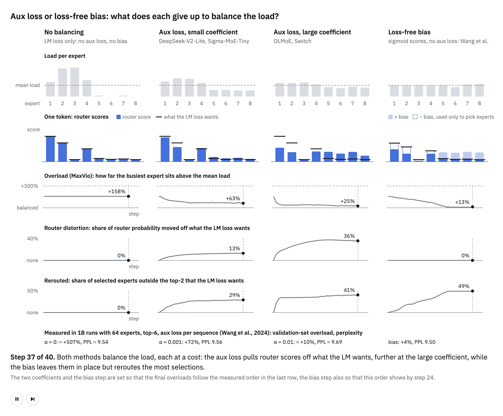

[Figure explanation, controls and captured states](../figures/aux-load-balancing-loss.md) · [Interactive original](../upstream/app/public/viz/index.html?c=aux-load-balancing-loss)


Both balancers spread the load in the figure, in different ways: the aux loss pulls the router's probabilities off what the LM loss wants, further at the larger coefficient, while the loss-free bias only changes which experts are picked and balances best, though it reroutes the most selections. The aux loss's pull makes its coefficient a tradeoff: too large a coefficient costs LM loss, and too small a coefficient leaves the load uneven. Yuan3.0's ablation of DeepSeek-V3's sequence-wise aux loss on a 10B model, plotted in the next figure, shows both sides: test loss rose with the coefficient from 1e-3 to 0.1, while the smallest coefficient, 1e-4, did slightly better than no aux loss at all but still left the busiest expert in a layer with about 13.6 times the tokens of the least used one[72,73](A-appendix.md#ref-2601.14327) [evidence](../citation-evidence.md#yuan3-t1) [evidence](../citation-evidence.md#yuan3-l144).


**Figure 3.3.4**

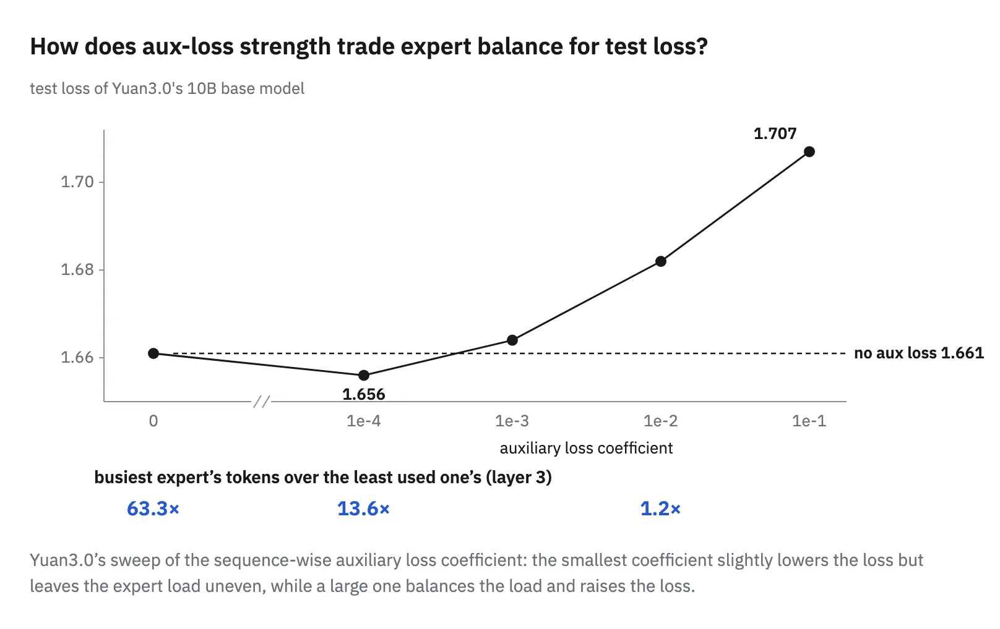

[Figure explanation, controls and captured states](../figures/aux-coeff-sweep.md) · [Interactive original](../upstream/app/public/viz/index.html?c=aux-coeff-sweep)


The smallest coefficient in the figure leaves the load uneven, and the one that balances it, 1e-2, raises the test loss. Megatron sets the coefficient with `--moe-aux-loss-coeff` next to `--moe-router-load-balancing-type aux_loss`, one coefficient per loss type, applied in every layer. Motif 3 found its first MoE layers more susceptible to imbalance and gives them stronger auxiliary loss weights[74](A-appendix.md#ref-2608.09119) [evidence](../citation-evidence.md#motif3-aux). We come back to the first layers later in the chapter.

**Megatron source**

**[`moe_utils.py#L148-L152`](https://github.com/NVIDIA/Megatron-LM/blob/d6316eb45bf1bfbb6f1f848c0b56e55166564d80/megatron/core/transformer/moe/moe_utils.py#L148-L152) (Σ f·P times coefficient)**

```
aggregated_probs_per_expert = probs.sum(dim=0)
aux_loss = torch.sum(aggregated_probs_per_expert * tokens_per_expert) * (
    num_experts * moe_aux_loss_coeff / (topk * total_num_tokens * total_num_tokens)
)
return aux_loss
```

**[`router.py#L515-L536`](https://github.com/NVIDIA/Megatron-LM/blob/d6316eb45bf1bfbb6f1f848c0b56e55166564d80/megatron/core/transformer/moe/router.py#L515-L536) (counts over one micro-batch)**

```
aux_loss_coeff = self.get_aux_loss_coeff("aux_loss")
if aux_loss_coeff == 0:
    return probs

global_tokens_per_expert, local_num_tokens, total_num_tokens = (
    get_tokens_per_expert_and_token_count(
        routing_map=routing_map,
        reduce_group=self.tp_cp_group,
        topk=self.topk,
        with_padding_mask=with_padding_mask,
    )
)

aux_loss = switch_load_balancing_loss_func(
    probs=scores_for_aux_loss,
    tokens_per_expert=global_tokens_per_expert,
    total_num_tokens=total_num_tokens,
    topk=self.topk,
    num_experts=self.config.num_moe_experts,
    moe_aux_loss_coeff=aux_loss_coeff,
    fused=self.config.moe_router_aux_loss_fusion,
)
```

**[`router.py#L459-L472`](https://github.com/NVIDIA/Megatron-LM/blob/d6316eb45bf1bfbb6f1f848c0b56e55166564d80/megatron/core/transformer/moe/router.py#L459-L472) (coefficient per loss type)**

```
def get_aux_loss_coeff(self, aux_loss_type: str) -> float:
    """Return the aux loss coeff for the given auxiliary loss type.
    If the auxiliary loss type is not found, return 0.0.
    """
    if isinstance(self.routing_type, str):
        if self.routing_type == aux_loss_type:
            return self.config.moe_aux_loss_coeff
    if isinstance(self.routing_type, list):
        try:
            idx = self.routing_type.index(aux_loss_type)
            return self.config.moe_aux_loss_coeff[idx]
        except ValueError:
            return 0.0
    return 0.0
```

The measured row under the four-column figure above comes from Wang et al., who proposed the loss-free bias and compared it with a per-sequence aux loss on a 1B MoE with 64 routed experts and top-6. At their baseline coefficient of 1e-3, MaxVio over the validation set was 0.72 at a perplexity of 9.56, against 0.04 and 9.50 with the bias[75](A-appendix.md#ref-2408.15664) [evidence](../citation-evidence.md#lossfree-t2); with no aux loss MaxVio rose to about 5.1, and at 1e-2 it fell to about 0.1 while perplexity rose to about 9.69[76](A-appendix.md#ref-2408.15664) [evidence](../citation-evidence.md#lossfree-f2).

This aux loss, at a coefficient of 1e-3, is the learned router of Cost of imbalance, and by the end of its 120 iterations it had climbed to 125 TFLOP/s.

A coefficient set too high makes the model learn worse, and one set too low leaves the load uneven, so watch the LM loss and the balance together. Balance is best read from MaxVio rather than from the aux loss itself. The loss multiplies each expert's share of the tokens by its mean router probability, so when the router's probabilities are flat the loss reads the same as for an even load, whatever the token shares are, and a perfectly balanced reading can hide a skewed load. Sigma-MoE-Tiny hit this case: in its lower layers the loss went to its minimum by flattening the probabilities while the load stayed uneven[77](A-appendix.md#ref-2512.16248) [evidence](../citation-evidence.md#sigma-early). `--moe-per-layer-logging` logs this value per layer as `load_balancing_loss`, divided by the coefficient.

Use it when the simplest balancer will do: `aux_loss` at a coefficient around 1e-3, as in our first MoE run in [2.5](2-setup-and-your-first-run.md#s-2-5). Raise it if the load stays uneven, lower it if the LM loss suffers[72](A-appendix.md#ref-2601.14327) [evidence](../citation-evidence.md#yuan3-t1).

The aux loss we used so far counts each expert's load within one micro-batch, which leaves a question we have not asked yet: over which tokens should the load be even? You could balance it over each sequence, over each micro-batch, or over the whole global batch, and the next part compares the three.

<a id="s-3-3-scope"></a>

#### Scope

Think about what one micro-batch holds. Pretraining pipelines often pack each micro-batch from a single domain, say all code, so a loss that asks for an even load inside that micro-batch spreads the code tokens over every expert, and no expert gets to specialize in code[78](A-appendix.md#ref-2501.11873) [evidence](../citation-evidence.md#qiu-l57). Balance over the whole global batch instead, which mixes many domains, and the code tokens may crowd onto a few experts as long as tokens from other domains fill the rest. Qiu et al. saw experts specialize by domain only in that second setting, and it also lowered their perplexity[79](A-appendix.md#ref-2501.11873) [evidence](../citation-evidence.md#qiu-t1). The GPUs pay for it: inside each micro-batch the load is no longer even, and their 43B model's step ran about 6% slower, about 1% of that slowdown from communication overhead and the rest mainly from the uneven load[80,81](A-appendix.md#ref-2501.11873) [evidence](../citation-evidence.md#qiu-s42) [evidence](../citation-evidence.md#qiu-t5).

A single sequence is the tightest scope of all. Balancing each sequence on its own spreads every sequence over all the experts, even when a micro-batch mixes domains; DeepSeek-V2-Lite counted its only balance loss, an expert-level one, this way[82](A-appendix.md#ref-2405.04434) [evidence](../citation-evidence.md#dsv2-seq), and DeepSeek-V3 keeps a small one to stop a single sequence from piling onto a few experts while the batch as a whole looks balanced[42](A-appendix.md#ref-2412.19437) [evidence](../citation-evidence.md#dsv3-seqwhy). In the figure below the three scopes run side by side, on GPUs that each hold two sequences from two domains: the tighter the scope, the less the experts can concentrate on one domain, and the looser it is, the more uneven the load each GPU carries.


**Figure 3.3.5**

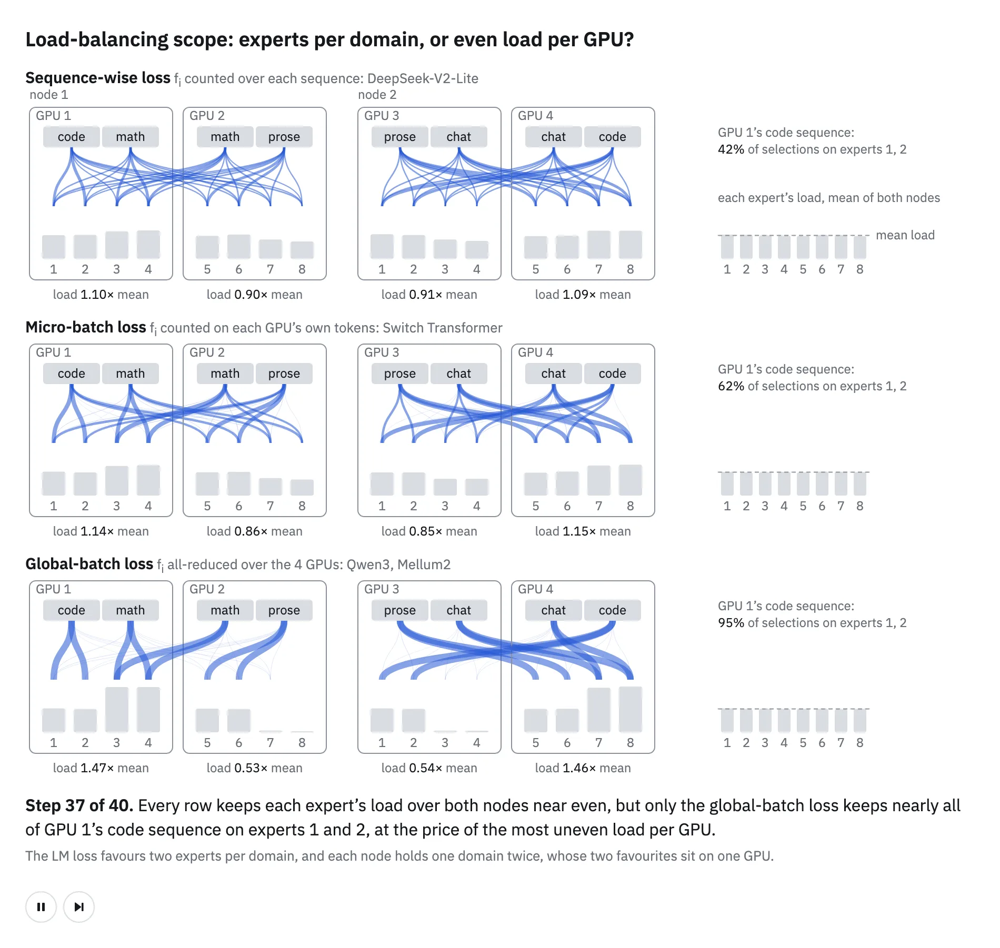

[Figure explanation, controls and captured states](../figures/global-batch-balance-loss.md) · [Interactive original](../upstream/app/public/viz/index.html?c=global-batch-balance-loss)


In that simulation, the sequence-wise loss spreads the code sequence over all the experts, the micro-batch loss lets each GPU's two domains split its experts between them, and the global-batch loss leaves the code tokens mostly on their two favoured experts, at the price of the most uneven load per GPU. Megatron picks the scope through the load-balancing type: `aux_loss` balances per micro-batch, `seq_aux_loss` per sequence and `global_aux_loss` over the global batch. To combine scopes, pass several types and one coefficient for each, in the same order, for example `--moe-router-load-balancing-type aux_loss seq_aux_loss --moe-aux-loss-coeff 1e-3 1e-4`.

**Megatron source**

**[`router.py#L567-L589`](https://github.com/NVIDIA/Megatron-LM/blob/d6316eb45bf1bfbb6f1f848c0b56e55166564d80/megatron/core/transformer/moe/router.py#L567-L589) (per-sequence counts, ÷ bsz)**

```
scores_for_aux_loss = scores_for_aux_loss.reshape(seq_length, -1)
routing_map = routing_map.reshape(seq_length, -1)

global_tokens_per_expert, local_num_tokens, total_num_tokens = (
    get_tokens_per_expert_and_token_count(
        routing_map=routing_map,
        reduce_group=self.tp_cp_group,
        with_padding_mask=with_padding_mask,
        topk=self.topk * bsz,
    )
)

aux_loss = (
    switch_load_balancing_loss_func(
        probs=scores_for_aux_loss,
        tokens_per_expert=global_tokens_per_expert,
        total_num_tokens=total_num_tokens,
        topk=self.topk,
        num_experts=self.config.num_moe_experts,
        moe_aux_loss_coeff=seq_aux_loss_coeff,
        fused=self.config.moe_router_aux_loss_fusion,
    )
    / bsz
```

**[`router.py#L617-L628`](https://github.com/NVIDIA/Megatron-LM/blob/d6316eb45bf1bfbb6f1f848c0b56e55166564d80/megatron/core/transformer/moe/router.py#L617-L628) (global counts, running average)**

```
global_tokens_per_expert, local_num_tokens, total_num_tokens = (
    get_tokens_per_expert_and_token_count(
        routing_map=routing_map,
        reduce_group=self.tp_dp_cp_group,
        with_padding_mask=with_padding_mask,
        topk=self.topk,
    )
)

self.global_tokens_per_expert += global_tokens_per_expert
self.ga_steps += 1
averated_tokens_per_expert = self.global_tokens_per_expert / self.ga_steps
```

**[`router.py#L233-L248`](https://github.com/NVIDIA/Megatron-LM/blob/d6316eb45bf1bfbb6f1f848c0b56e55166564d80/megatron/core/transformer/moe/router.py#L233-L248) (global count buffers)**

```
# Initialize global tokens per expert for global aux loss
if self.get_aux_loss_coeff("global_aux_loss") > 0:
    self.register_buffer(
        'global_tokens_per_expert',
        torch.zeros(
            self.config.num_moe_experts,
            dtype=torch.float32,
            device=torch.cuda.current_device(),
        ),
        persistent=False,
    )
    self.register_buffer(
        'ga_steps',
        torch.tensor(0, dtype=torch.float32, device=torch.cuda.current_device()),
        persistent=False,
    )
```

**[`router.py#L1121-L1125`](https://github.com/NVIDIA/Megatron-LM/blob/d6316eb45bf1bfbb6f1f848c0b56e55166564d80/megatron/core/transformer/moe/router.py#L1121-L1125) (reset per global batch)**

```
def reset_global_aux_loss_tracker(self):
    """Reset the global aux loss tracker."""
    if self.global_tokens_per_expert is not None:
        self.global_tokens_per_expert.zero_()
        self.ga_steps.zero_()
```

Each scope fails in its own way. Balancing per sequence or per micro-batch can keep domain experts from forming, so the model learns worse, while balancing over the global batch leaves the load on each GPU uneven, so the step gets slower. Whichever scope you pick, read balance from MaxVio at that scope, computed per micro-batch from the loads `--save-tokens-per-expert-interval` saves, per global batch from the sum of those loads, and per sequence offline from the routing trace ([A.1](A-appendix.md#s-a-1)).

Use micro-batch (`aux_loss`) by default. Use `global_aux_loss` only for domain-specialized experts, at \+5.8% step time in Qiu et al.[81](A-appendix.md#ref-2501.11873) [evidence](../citation-evidence.md#qiu-t5).

Whichever scope you pick, a balancing loss still steers the router through its gradient, and that gradient competes with the one from the LM loss. Could you balance the load without touching the gradient at all?

<a id="s-3-3-loss-free-bias"></a>

#### Loss-free bias

The aux loss fixes an overloaded expert by pulling the router's probabilities away from what the LM wants. The loss-free bias leaves the probabilities alone and moves the load with no gradient. Each expert gets a bias, added to its score before the top-k and used only to pick experts, while the weights still come from the scores, and once per step Megatron moves each bias by a fixed amount, the update rate: up for underloaded experts, down for overloaded ones. The next figure runs that loop. In DeepSeek-V3's ablation it matched a batch-wise aux loss in validation loss, at 1B and at 3B[83](A-appendix.md#ref-2412.19437) [evidence](../citation-evidence.md#dsv3-s453). Like the aux loss, it reroutes some selections away from the LM's own top-k, and in the four-column toy of the Aux loss part it reroutes the most.


**Figure 3.3.6**

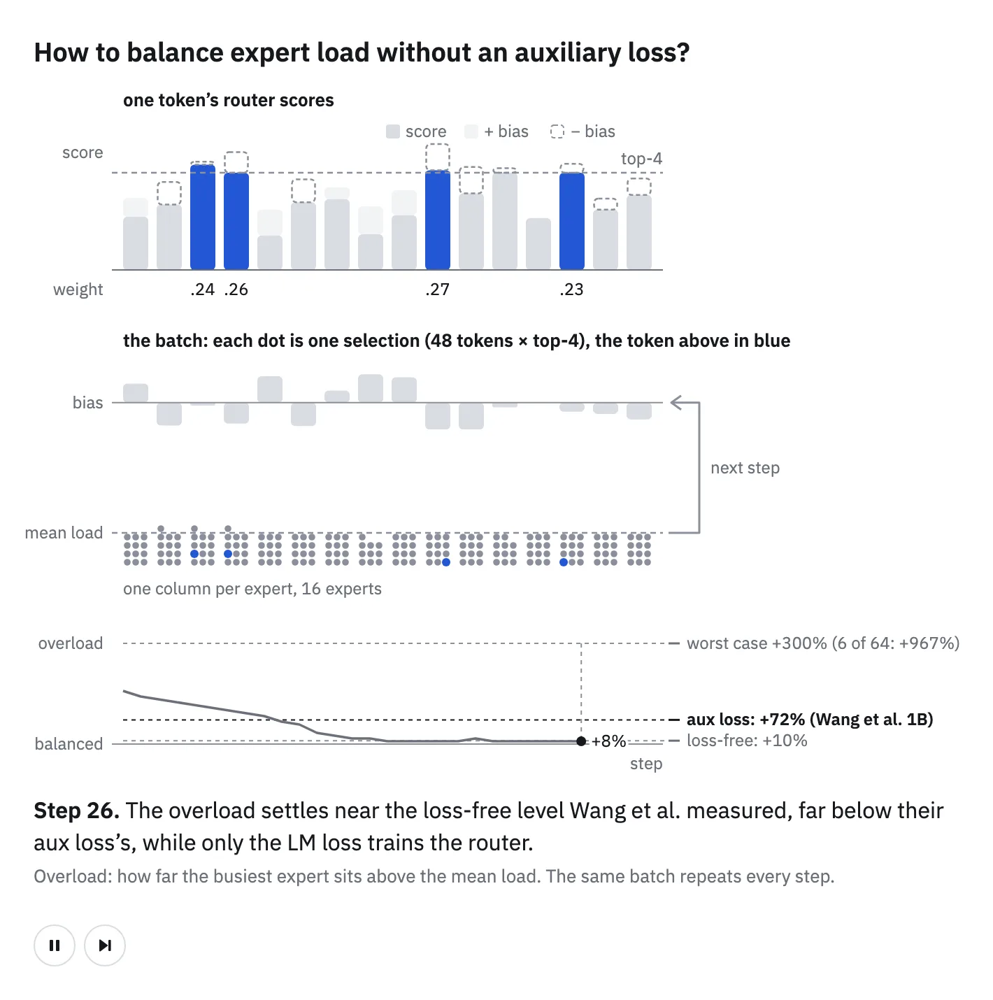

[Figure explanation, controls and captured states](../figures/aux-loss-free-bias.md) · [Interactive original](../upstream/app/public/viz/index.html?c=aux-loss-free-bias)


The figure runs 16 toy experts with a step far larger than Megatron's default, so a few rounds stand in for many: overloaded experts lower their bias and underloaded ones raise it until the load is close to even, and the back-and-forth that the large step leaves is damped once the toy cuts its step tenfold. In real training the catch is the fixed step, which must suit the expert count. Li et al. swept the expert count of small MoEs, and with an update rate of 1e-3 the busiest expert's load grew with it, to about 50 times the mean at 1,024 experts, where an aux loss of 1e-2 alone stayed under about 7 times[84](A-appendix.md#ref-2605.11689) [evidence](../citation-evidence.md#slicing-f12). Above 128 experts the bias also hurt LM quality, and the authors suspect a step too coarse for that many experts[85](A-appendix.md#ref-2605.11689) [evidence](../citation-evidence.md#slicing-s33).

The reference lines on the overload trace in the figure above come from the same 1B runs, measured on each training batch rather than over the validation set: MaxVio settled near 0.72 with the aux loss at 1e-3 and near 0.1 with the bias[86](A-appendix.md#ref-2408.15664) [evidence](../citation-evidence.md#lossfree-f3).

Megatron's rule is the simplest one you could write: every step, each bias moves up or down by the same fixed amount, however far its expert sits from the mean load. That is the sign update, and it is not the only way to run the loop. A linear update moves each bias in proportion to its expert's distance from the mean load, so a badly overloaded expert gets a large correction and a nearly balanced one a small one, while an AdamW update adapts the step for each expert. LongCat-Flash runs a linear update, aimed at the expert loads its compute budget calls for[65](A-appendix.md#ref-2509.01322) [evidence](../citation-evidence.md#balance-longcat), and ZAYA1-8B feeds each expert's load error to AdamW[87](A-appendix.md#ref-src-zaya1-adamw) [evidence](../citation-evidence.md#zaya1-adamw).

The rules also differ in a subtler way: when an update's steps do not sum to zero, the mean of all the biases drifts. That drift changes no selection, since adding the same number to every expert's score leaves the top-k as it was, but it costs precision where the bias is stored in bf16; Megatron keeps it in fp32. Moonlight and Trinity Mini avoid the drift by subtracting the mean of the steps[88,89](A-appendix.md#ref-2502.16982) [evidence](../citation-evidence.md#moonlight-centered) [evidence](../citation-evidence.md#trinity-centered). The released weights differ the same way: DeepSeek-V3's biases sit at a per-layer mean of 2.2 to 8.0, while Moonlight's and ZAYA1-8B's average 0 and LongCat-Flash's sit just below it[90](A-appendix.md#ref-src-ckpt-bias-means) [evidence](../citation-evidence.md#ckpt-bias-means). Below, the sign update, a centered sign update, the linear update and the AdamW update run on the same batch.


**Figure 3.3.7**

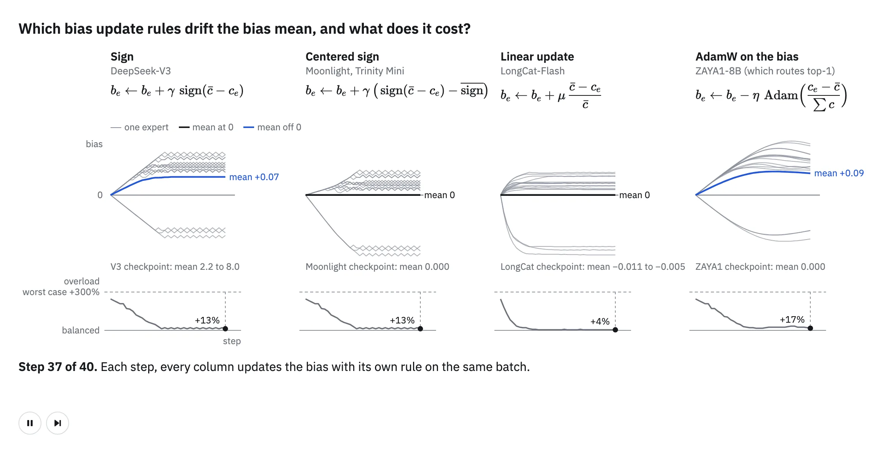

[Figure explanation, controls and captured states](../figures/bias-update-rules.md) · [Interactive original](../upstream/app/public/viz/index.html?c=bias-update-rules)


The figure's toy batch has a few hot experts and many just under the mean load, so most sign steps point up: the sign and AdamW updates lift the mean of the biases while the centered sign and linear updates keep it at zero, yet the sign update balances as well as the centered one at every step, since top-k ignores a shift shared by all experts. Whatever rule moves it, the bias can only balance the tokens it counts. A batch-wide bias is fitted on one batch and applied to the next, so it can make the batch as a whole look even without guaranteeing that each sequence is: a single sequence can still pile onto a few experts. The obvious fix, a second bias computed over each whole sequence, would use tokens that come later in that sequence, and so leak the future into the routing of the earlier ones.

Chang's causal bias avoids the leak by building that second bias only from what the sequence has already routed. It resets at the start of every sequence, and after each token it lowers the bias of the experts just picked and raises the others', so each expert's bias tracks how far its picks so far sit above or below its share, k/N per token, and an expert this sequence has overused is pushed down for the tokens that follow. Like the batch bias, it only changes which experts are picked and is never trained by the gradient[91](A-appendix.md#ref-doc-4) [evidence](../citation-evidence.md#chang-cdb). The next figure routes the same sequence with the global-batch bias alone and with the causal bias from this sequence's past added on top.


**Figure 3.3.8**

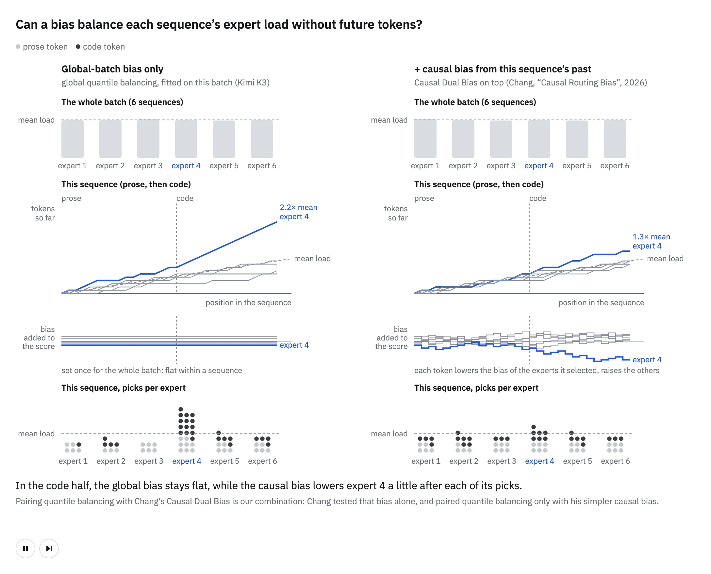

[Figure explanation, controls and captured states](../figures/sequence-level-balance.md) · [Interactive original](../upstream/app/public/viz/index.html?c=sequence-level-balance)


The sequence shown switches to code halfway. With only the global-batch bias, its code tokens pile onto one expert, even though the whole batch stays balanced; with the causal bias added, those code tokens spread over more experts and the sequence's load stays much closer to even. On the other hand, the simulation shows the causal bias sending more of the picks to experts outside the router's own top-k, away from what the router itself prefers, and the evidence for it is small-scale, from Chang's experiments on nanochat and TinyStories[91](A-appendix.md#ref-doc-4) [evidence](../citation-evidence.md#chang-cdb).

Released models handle the single sequence differently. DeepSeek-V3 pairs its bias with the sequence-wise aux loss we saw earlier, at a tiny coefficient of 1e-4[62](A-appendix.md#ref-2412.19437) [evidence](../citation-evidence.md#dsv3-alpha): the bias keeps the batch even, and the small loss guards against extreme imbalance within a single sequence. The figure that follows compares no such loss, a small one and a large one, on an ordinary sequence and on an extreme one.


**Figure 3.3.9**

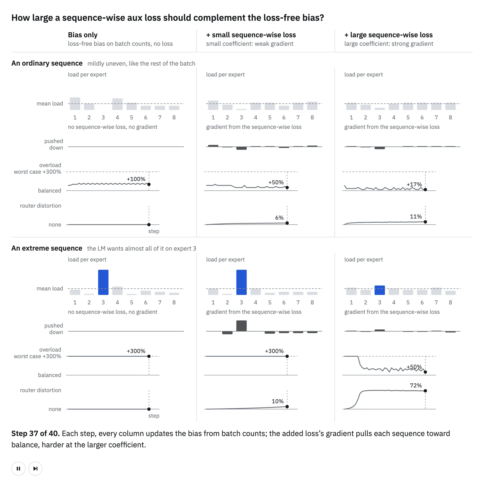

[Figure explanation, controls and captured states](../figures/sequence-wise-aux-complement.md) · [Interactive original](../upstream/app/public/viz/index.html?c=sequence-wise-aux-complement)


In that toy, whose two coefficients are illustrative rather than DeepSeek-V3's, a small coefficient brings an ordinary sequence closer to even while moving the router only a little, but leaves an extreme sequence piled onto one expert; spreading that one takes a large coefficient, which pulls the router much further off the routing the LM loss prefers. A sequence is one way a batch-wide count can hide an imbalance, and a modality is another.

When a batch mixes modalities, a bias counted over all the tokens can balance their sum while the tokens of one modality, taken alone, still crowd onto a few experts. DeepSeek-VL2 and Kimi-VL keep one bias for all tokens[92,93](A-appendix.md#ref-src-dsvl2-bias) [evidence](../citation-evidence.md#dsvl2-bias) [evidence](../citation-evidence.md#kimivl-bias), and DeepSeek-V4.1-Flash keeps one per modality[63](A-appendix.md#ref-2609.19969) [evidence](../citation-evidence.md#balance-dsv41). The figure below compares one shared bias with one bias per modality, each counting only its own modality's tokens.


**Figure 3.3.10**

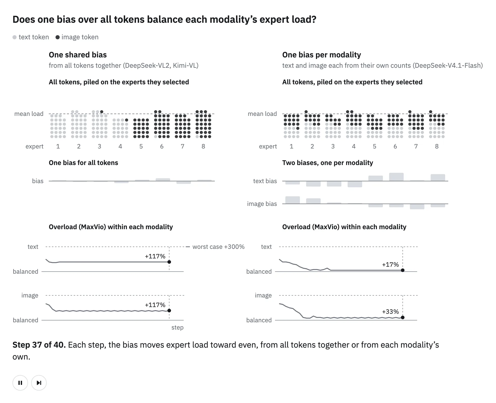

[Figure explanation, controls and captured states](../figures/modality-split-bias.md) · [Interactive original](../upstream/app/public/viz/index.html?c=modality-split-bias)


The toy scripts text to lean toward four of its eight experts and images toward the other four, so a shared bias balances the total while each modality's surplus cancels the other's, and a bias per modality balances each modality on its own. The price of the split is that the bias then pushes every expert to take its share of each modality, away from specializing in images.

To run it in Megatron, turn the bias on with `--moe-router-enable-expert-bias` and set its fixed step with `--moe-router-bias-update-rate`, with sigmoid scores (`--moe-router-score-function sigmoid`), since Megatron accepts the bias only with sigmoid or sqrt(softplus) scores ([`transformer_config.py#L3139-L3147`](https://github.com/NVIDIA/Megatron-LM/blob/d6316eb45bf1bfbb6f1f848c0b56e55166564d80/megatron/core/transformer/transformer_config.py#L3139-L3147)).

**Megatron source**

**[`moe_utils.py#L936-L939`](https://github.com/NVIDIA/Megatron-LM/blob/d6316eb45bf1bfbb6f1f848c0b56e55166564d80/megatron/core/transformer/moe/moe_utils.py#L936-L939) (bias in selection only)**

```
elif expert_bias is not None:
    scores_for_routing = scores + expert_bias.float()
    _, top_indices = compute_topk(scores_for_routing, topk, num_groups, group_topk)
    scores = torch.gather(scores, dim=1, index=top_indices)
```

**[`router.py#L209-L228`](https://github.com/NVIDIA/Megatron-LM/blob/d6316eb45bf1bfbb6f1f848c0b56e55166564d80/megatron/core/transformer/moe/router.py#L209-L228) (int64 counts, fp32 bias)**

```
if self.enable_expert_bias:
    self.register_buffer(
        'local_tokens_per_expert',
        torch.zeros(
            self.config.num_moe_experts,
            # Keep token counts exact through accumulation and cross-rank reduction.
            # Float16Module leaves integer buffers in their original dtype.
            dtype=torch.int64,
            device=torch.cuda.current_device(),
        ),
        persistent=False,
    )
    self.register_buffer(
        'expert_bias',
        torch.zeros(
            self.config.num_moe_experts,
            dtype=torch.float32,
            device=torch.cuda.current_device(),
        ),
    )
```

**[`moe_utils.py#L1253-L1263`](https://github.com/NVIDIA/Megatron-LM/blob/d6316eb45bf1bfbb6f1f848c0b56e55166564d80/megatron/core/transformer/moe/moe_utils.py#L1253-L1263) (sign update, exact compare)**

```
# All Reduce Across TPxCPxDP group
torch.distributed.all_reduce(tokens_per_expert, group=tp_dp_cp_group)
num_experts = tokens_per_expert.shape[-1]
total_tokens = tokens_per_expert.sum(dim=-1, keepdim=True)
# Compare each tokens_per_expert value with the row average without converting the integer
# counts to floating point: tokens_per_expert < total / num_experts iff
# tokens_per_expert * num_experts < total.
update_direction = torch.sign(total_tokens - tokens_per_expert * num_experts)
updated_expert_bias = (
    expert_bias + update_direction.to(dtype=expert_bias.dtype) * expert_bias_update_rate
)
```

**[`finalize_model_grads.py#L726-L731`](https://github.com/NVIDIA/Megatron-LM/blob/d6316eb45bf1bfbb6f1f848c0b56e55166564d80/megatron/core/distributed/finalize_model_grads.py#L726-L731) (update once per step)**

```
if config.moe_router_enable_expert_bias:
    if pg_collection is None:
        tp_dp_cp_group = parallel_state.get_tensor_and_data_parallel_group(
            with_context_parallel=True
        )
    _update_router_expert_bias(model, config, tp_dp_cp_group=tp_dp_cp_group)
```

When the update rate is too coarse for your expert count, the load stays uneven, which slows the step as Cost of imbalance showed, and above 128 experts Li et al.'s sweep also saw LM quality suffer. You can catch it in two places. Every checkpoint saves `expert_bias`, so you can follow how far the biases of each layer spread from one checkpoint to the next, and the token counts that `--save-tokens-per-expert-interval` writes give you MaxVio per global batch ([A.1](A-appendix.md#s-a-1)).

Use it when the balancer must barely pull against the LM loss: the bias adds no gradient at all, and DeepSeek-V3's sequence-wise loss at α \= 1e-4[62](A-appendix.md#ref-2412.19437) [evidence](../citation-evidence.md#dsv3-alpha) adds very little. Run it with sigmoid scores, and tune the update rate to your expert count, since 1e-3 can be too coarse above 128 experts[85](A-appendix.md#ref-2605.11689) [evidence](../citation-evidence.md#slicing-s33).

The bias moves by the same small step whatever the load looks like, so it can take many steps to catch up with a router that keeps changing. Instead of stepping toward the right bias, could you compute it directly from the scores of the current batch?

<a id="s-3-3-quantile"></a>

#### Quantile

Quantile balancing keeps the bias but solves for it. For each expert, it ranks the micro-batch's tokens by their score for that expert and reads off a quantile: the score that only the expert's target share of tokens beats. The bias is set from that quantile instead of moved by a fixed step. Jin et al. compared balancers on a 19B-parameter MoE with 768 experts, and quantile balancing balanced sooner than the sign update at about the same LM loss, halving the average MaxVio, though over the last 1k steps its MaxVio ended slightly higher[94](A-appendix.md#ref-2609.39137) [evidence](../citation-evidence.md#idbal-t1). That precision has a price: in every micro-batch, each expert has to rank all of the micro-batch's tokens by its score to find its quantile, a top-k per expert on top of the usual top-k per token. Side by side below, the sign update and quantile balancing run on the same batch.


**Figure 3.3.11**

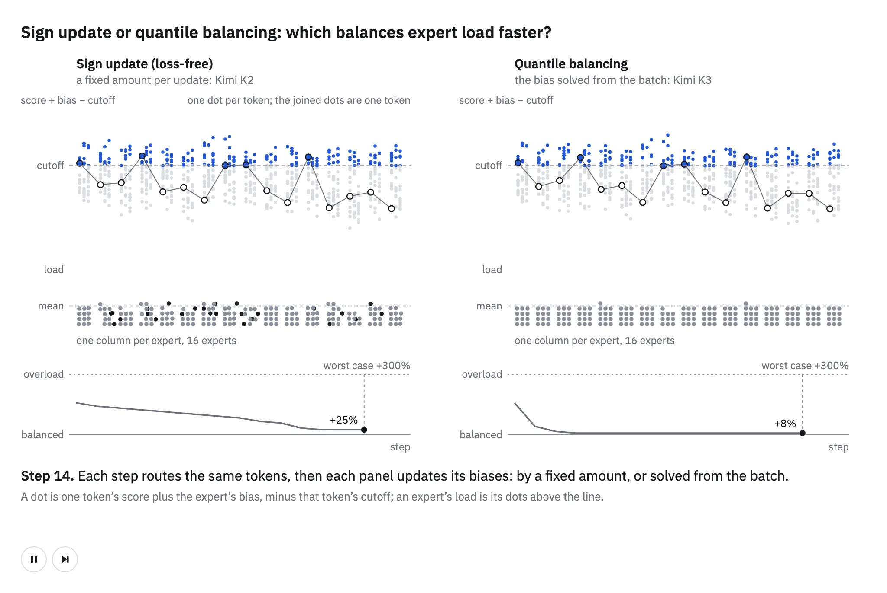

[Figure explanation, controls and captured states](../figures/quantile-balancing.md) · [Interactive original](../upstream/app/public/viz/index.html?c=quantile-balancing)


The toy routes the same batch at every step, so each solved bias routes the very tokens it was solved from: after the last step the sign update still leaves the load uneven, while quantile balancing brings it close to even within a few steps. In Megatron, each micro-batch solves for its own quantiles, and the solutions are averaged over the global batch to route the next one, optionally smoothed by an exponential moving average (EMA, `--moe-router-quantile-balancing-ema`). An EMA keeps most of the previous bias and mixes in only a share of each new solution, so the bias changes slowly from step to step.

**Megatron source**

**[`moe_utils.py#L233-L247`](https://github.com/NVIDIA/Megatron-LM/blob/d6316eb45bf1bfbb6f1f848c0b56e55166564d80/megatron/core/transformer/moe/moe_utils.py#L233-L247) (top-k and per-expert quantile)**

```
topk_result = (scores - beta).topk(k + 1, dim=1)
indices = topk_result.indices[:, :-1]

if not update_beta:
    return indices, beta

assert (num_tokens * k) % num_experts == 0, (
    "Quantile balancing requires the number of routed assignments "
    f"({num_tokens} tokens * top-{k}) to be divisible by "
    f"{num_experts} experts."
)
col_target = num_tokens * k // num_experts
alpha = topk_result.values[:, -1:]
beta_local = (scores - alpha).topk(col_target + 1, dim=0).values[-1].contiguous()
return indices, beta_local
```

**[`finalize_model_grads.py#L441-L457`](https://github.com/NVIDIA/Megatron-LM/blob/d6316eb45bf1bfbb6f1f848c0b56e55166564d80/megatron/core/distributed/finalize_model_grads.py#L441-L457) (average, EMA, re-center)**

```
stacked_beta = torch.stack(qb_beta_list, dim=0)
local_avg_list = [
    accum / count.clamp(min=1).to(accum.dtype)
    for accum, count in zip(qb_beta_accum_list, qb_beta_count_list)
]
stacked_local_avg = torch.stack(local_avg_list, dim=0)

torch.distributed.all_reduce(
    stacked_local_avg, op=torch.distributed.ReduceOp.AVG, group=dp_cp_group
)

ema = config.moe_router_quantile_balancing_ema
stacked_new_beta = ema * stacked_beta + (1.0 - ema) * stacked_local_avg
stacked_new_beta = stacked_new_beta - stacked_new_beta.mean(dim=-1, keepdim=True)

for qb_beta, new_beta in zip(qb_beta_list, stacked_new_beta):
    qb_beta.copy_(new_beta)
```

**[`router.py#L256-L259`](https://github.com/NVIDIA/Megatron-LM/blob/d6316eb45bf1bfbb6f1f848c0b56e55166564d80/megatron/core/transformer/moe/router.py#L256-L259) (aux losses must be 0\)**

```
if self.routing_type == "quantile_balancing":
    assert not self.is_aux_loss_enabled(), (
        "Quantile balancing handles load balance via the bias update; "
        "aux losses must be disabled (set moe_aux_loss_coeff to 0)."
```

**[`router.py#L398-L403`](https://github.com/NVIDIA/Megatron-LM/blob/d6316eb45bf1bfbb6f1f848c0b56e55166564d80/megatron/core/transformer/moe/router.py#L398-L403) (no fusion, no group limit)**

```
assert (
    not self.config.moe_router_fusion
), "Quantile balancing routing does not support moe_router_fusion."
assert (
    self.config.moe_router_num_groups is None and self.config.moe_router_group_topk is None
), "Quantile balancing routing does not support group-limited routing."
```

Kimi K3 runs quantile balancing over its whole global batch, reading each expert's quantile from a histogram summed across GPUs[64](A-appendix.md#ref-2607.24653) [evidence](../citation-evidence.md#balance-k3). It left the fixed-step rule because balancing grew harder once its routed pool reached 896 experts per layer[64](A-appendix.md#ref-2607.24653) [evidence](../citation-evidence.md#k3-qb-why), and Su Jianlin, who proposed quantile balancing[95](A-appendix.md#ref-src-su-qb) [evidence](../citation-evidence.md#su-qb), writes that Kimi K2 had used the sign update[96](A-appendix.md#ref-src-su-k3) [evidence](../citation-evidence.md#su-k3).

Averaging has a price: a bias shared by the whole global batch can balance that batch while each GPU's micro-batch stays uneven. Neitemeier et al. measured how wide that gap gets in a 7.5B run (one seed). The rank-averaged quantile that Megatron uses balanced the global batch to a MaxVio of 0.92, while in the worst layer the busiest expert of an expert-parallel micro-batch still took about 7 times its fair share, a local MaxVio of 5.96. Solving for the exact global-batch quantile lowered both[97](A-appendix.md#ref-2609.28053) [evidence](../citation-evidence.md#eqb-t1). They read local MaxVio as a proxy for dispatch cost rather than as measured throughput[98](A-appendix.md#ref-2609.28053) [evidence](../citation-evidence.md#eqb-lim).

How do the balancers compare in throughput? We ran five router configurations from init on the same model, with one seed, and compared their median throughput over the last 20 of 120 iterations. Quantile balancing reached 139 TFLOP/s, against 125 for the aux loss and 99 for the tested bias-only configuration. The bias-only run used sigmoid scores and an update rate of 1e-3, while the other four used softmax. These runs used an older Megatron commit, which accumulated the bias's token counts in bf16, so a count could round and flip the direction of its bias update; at `d6316eb45` the counts are exact.  With an EMA of 0.9, quantile balancing reached 121 TFLOP/s. That setting gives each new solution 10% of the weight in the bias update ([`transformer_config.py#L910-L913`](https://github.com/NVIDIA/Megatron-LM/blob/d6316eb45bf1bfbb6f1f848c0b56e55166564d80/megatron/core/transformer/transformer_config.py#L910-L913)).

Jin et al. added an EMA to quantile balancing: stronger smoothing kept the bias steadier between checkpoints but corrected the load more slowly early in training[99](A-appendix.md#ref-2609.39137) [evidence](../citation-evidence.md#idbal-f5). All five runs are plotted below.


**Figure 3.3.12**

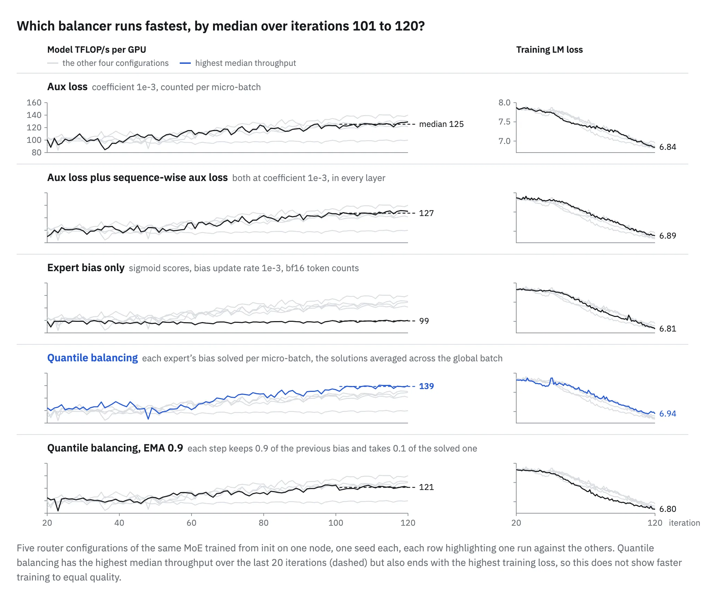

[Figure explanation, controls and captured states](../figures/router-mode-5way.md) · [Interactive original](../upstream/app/public/viz/index.html?c=router-mode-5way)


Of the five runs in the figure, the bias-only one stays flat while the other four climb, with quantile balancing fastest over the final 20 iterations. Throughput is still rising at the end, so the ranking describes these first 120 iterations. Quantile balancing also ends with the highest training LM loss of the five, so its throughput lead alone does not establish faster training to the same quality.

To try quantile balancing, set `--moe-router-load-balancing-type quantile_balancing`. The same flag also accepts `sinkhorn`: Sinkhorn uses a balanced-assignment procedure to choose experts for each token during training.

The risk is a global batch that looks balanced while each GPU's micro-batch is not, which Neitemeier et al. read as a higher dispatch cost. To see the gap, compute MaxVio twice from the token counts that `--save-tokens-per-expert-interval` writes, once per micro-batch and once per global batch, and compare the two ([A.1](A-appendix.md#s-a-1)).

Use it when the sign-update bias balances too slowly: solving for the bias reached a lower average MaxVio than stepping toward it, at about the same LM loss, with 768 experts[94](A-appendix.md#ref-2609.39137) [evidence](../citation-evidence.md#idbal-t1), and it had the highest median throughput over the last 20 of 120 iterations in our five-configuration comparison (one seed). Plan around its limits, since Megatron currently refuses it next to any aux loss, `--moe-router-fusion` or group-limited routing.

#### What to watch

| Part | Symptom | Signal to watch |
| --- | --- | --- |
| Cost of imbalance | `slow`: the GPU holding the busiest experts sets the step. | TFLOP/s against the forced-even control run. |
| Aux loss | `learns badly`: a coefficient set too high makes the model learn worse, and one set too low leaves the load uneven. | LM loss and MaxVio together: with flat router probabilities, the aux loss can look balanced while the load stays uneven[77](A-appendix.md#ref-2512.16248) [evidence](../citation-evidence.md#sigma-early). |
| Scope | `learns badly`: balancing per sequence or per micro-batch keeps domain experts from forming. `slow`: balancing per global batch leaves the load on each GPU uneven; the step took 5.8% longer, mainly from that imbalance and about 1% of that slowdown from communication[81](A-appendix.md#ref-2501.11873) [evidence](../citation-evidence.md#qiu-t5). | MaxVio at the scope you balance: per micro-batch or per global batch from the token counts, per sequence from the routing trace ([A.1](A-appendix.md#s-a-1)). |
| Loss-free bias | `slow`: with a fixed step of 1e-3, the busiest expert still gets about 20 times the mean load at 128 experts[84](A-appendix.md#ref-2605.11689) [evidence](../citation-evidence.md#slicing-f12). `learns badly`: above 128 experts, that step is too coarse[85](A-appendix.md#ref-2605.11689) [evidence](../citation-evidence.md#slicing-s33). | How far `expert_bias` spreads in each layer across checkpoints, and MaxVio per global batch from the token counts ([A.1](A-appendix.md#s-a-1)). |
| Quantile | `slow`: smoothing the bias with a moving average makes it lag the router's scores. The bias is shared by the global batch, so each GPU's load can stay uneven, as in Scope. | MaxVio per micro-batch alongside MaxVio per global batch, from the saved token counts ([A.1](A-appendix.md#s-a-1)), to detect a globally balanced batch hiding local imbalance[97](A-appendix.md#ref-2609.28053) [evidence](../citation-evidence.md#eqb-t1). |

Every balancer in this section spreads tokens over a set of experts that was fixed before training started, and we have not yet asked what that set should look like. How many experts should a layer have, how wide should each one be, and should some of them see every token?

<a id="s-3-4"></a>

### 3.4 Experts: how many, how big, shared or not


**hero-anatomy-zoom**


[Figure explanation, controls and captured states](../figures/hero-anatomy-zoom.md) · [Interactive original](../upstream/app/public/viz/index.html?c=hero-anatomy-zoom&stage=5&mini=1)


Once the router has picked a token's experts, what those experts look like decides both what the layer can learn and what it costs to run. You choose how many experts a layer has and how wide each one is, how to keep the network traffic of many small experts in check, whether one expert should see every token, and which activation runs inside each of them.

Expert choices in leading open MoEs, plus Nemotron for LatentMoE and ReLU² and LongCat-Flash for variable compute. Count and size gives the routed experts each token uses out of the total, then each expert's FFN width; shared experts are listed separately. Latent dimensions show token width before and after projection. "No limit specified" refers to the published configuration.

| Model | Count and size | Latent MoE | Shared experts | Variable compute | Activation |
| --- | --- | --- | --- | --- | --- |
| DeepSeek-V4.1-Flash[100](A-appendix.md#ref-2609.19969) [evidence](../citation-evidence.md#shape-dsv41) | 6 of 384, width 2,304 | Full-width experts | 1, width 2,304 | Fixed top-k, equal widths | SwiGLU, limit 10 |
| GLM-5.3[101](A-appendix.md#ref-src-shape-glm53) [evidence](../citation-evidence.md#shape-glm53) | 8 of 256, width 2,048 | Full-width experts | 1, width 2,048 | Fixed top-k, equal widths | SiLU gate; no limit specified |
| Kimi K3[102](A-appendix.md#ref-2607.24653) [evidence](../citation-evidence.md#shape-k3) | 16 of 896, width 3,072 | 7,168 to 3,584; norm before up-projection | 2, width 3,072 each | Fixed top-k, equal widths | SiTU-GLU, caps 4 and 25 |
| LongCat-Flash[103](A-appendix.md#ref-2509.01322) [evidence](../citation-evidence.md#shape-longcat) | 12 of 768, width 2,048 | Full-width experts | None | 256 of the 768 are identity experts: 18.6B to 31.3B active parameters per token, 27B on average | SiLU gate; no limit specified |
| MiMo-V2.6-Pro-RL[104](A-appendix.md#ref-src-shape-mimo26) [evidence](../citation-evidence.md#shape-mimo26) | 8 of 384, width 2,048 | Full-width experts | None | Fixed top-k, equal widths | SiLU gate; no limit specified |
| Nemotron 3 Ultra[105](A-appendix.md#ref-src-shape-nemotron-ultra) [evidence](../citation-evidence.md#shape-nemotron-ultra) | 22 of 512, width 5,120 | 8,192 to 2,048 | 1, width 10,240 | Fixed top-k, equal widths | ReLU² |
| Qwen3.8 2.4T-A95B[106](A-appendix.md#ref-src-shape-qwen38) [evidence](../citation-evidence.md#shape-qwen38) | 10 of 512, width 2,048 | Full-width experts | 1, width 2,048 | Fixed top-k, equal widths | SiLU gate; no limit specified |
| Step 5 Preview[107](A-appendix.md#ref-src-shape-step5) [evidence](../citation-evidence.md#shape-step5) | 8 of 352, width 1,536 | Full-width experts | 1, width 1,536 | Fixed top-k, equal widths | SwiGLU, limit 7 |

With the parameter budget fixed, adding more experts means making each one narrower. Which split gives you a better model for the same compute?

<a id="s-3-4-count-and-size"></a>

#### Count and size

Picture one MoE layer with a fixed budget of parameters and compute, and cut its experts finer: twice as many experts at half the width, with twice the top-k, keeps both budgets the same. Figure 3.4.1 draws that ladder: coarse, then 16 experts of d/2 with top-4, then 32 of d/4 with top-8. Liew et al. ran the ablation in an 18-layer model with total and active parameters fixed, and loss fell with each finer cut up to 128 experts of d/4 with top-8, from 2.334 to 2.297, while finer cuts did not improve it further[108](A-appendix.md#ref-2601.08215) [evidence](../citation-evidence.md#liew-t6). In this experiment, then, segmenting stopped paying past 128 experts, while every finer step still ran smaller GEMMs and dispatched more copies of each token.


**Figure 3.4.1**

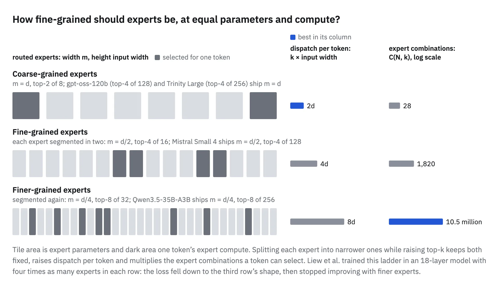

[Figure explanation, controls and captured states](../figures/expert-granularity.md) · [Interactive original](../upstream/app/public/viz/index.html?c=expert-granularity)


Released models sit on different rungs of that ladder. gpt-oss-120b and Trinity Large keep each expert as wide as the model, with top-4 of 128 and top-4 of 256 experts, Mistral Small 4 halves that width with top-4 of 128, and Qwen3.5-35B-A3B quarters it with top-8 of 256[109](A-appendix.md#ref-src-cfg-granularity) [evidence](../citation-evidence.md#cfg-granularity).

In the figure, you can see that splitting the experts changes their number and width while keeping the total parameters and compute per token fixed. The total tile area represents the parameters, and the dark area represents the expert computation for one token. What you are changing is the granularity. Granularity describes how finely you divide the expert capacity: finer granularity means more, narrower experts. To keep the same compute per token, each token uses more of the narrower experts.  You can also increase sparsity: add more parameters while keeping the number used by each token fixed. Two ways to spend those extra parameters are compared next: more routed experts, or n-gram embedding tables looked up by token id.


**Figure 3.4.2**

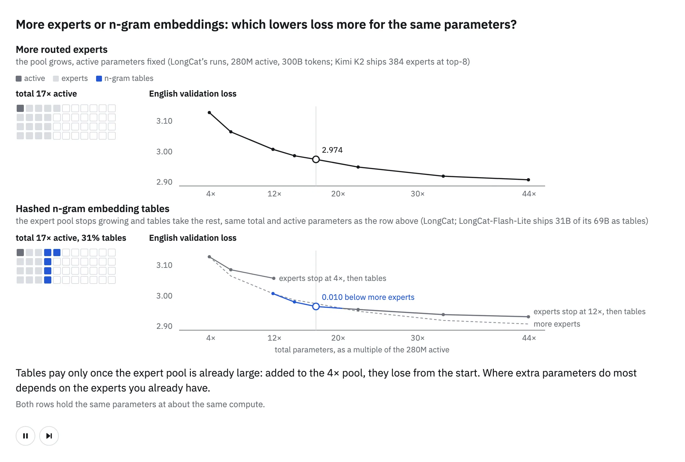

[Figure explanation, controls and captured states](../figures/sparse-param-budget.md) · [Interactive original](../upstream/app/public/viz/index.html?c=sparse-param-budget)


The figure plots LongCat's comparison at 280M active parameters. There, n-gram tables lowered the loss more than the same parameters spent on more experts (by about 0.01 at 17 times the active parameters) once the experts already held about 12 times the active parameters, while tables added when the experts stopped at about 4 times lost from the start. The gain had a limit: on English validation loss, more experts won again once tables held a little over 40% of the parameters, and LongCat's rule, read from that crossing, is to put no more than 50% of the parameters in tables[110](A-appendix.md#ref-src-longcat-ngram-f2) [evidence](../citation-evidence.md#longcat-ngram-f2). In that comparison, expanding the experts paid off first, and once they were large enough, part of the next parameters did more in lookup tables. Where you spend extra parameters therefore depends on how much expert capacity you already have.

Both ways of spending ship in released models: Kimi K2 grows its pool to 384 experts with top-8, and LongCat-Flash-Lite puts 31.4B of its 68.5B parameters in n-gram embedding tables[111](A-appendix.md#ref-src-flashlite-ngram) [evidence](../citation-evidence.md#flashlite-ngram).

Whether you add more experts or divide the existing capacity into narrower ones, the resulting shape also affects training speed. Narrower experts run smaller GEMMs, which use the GPU less efficiently.

For a dense model, compute-optimal scaling laws help you choose how to divide a fixed FLOP budget between model size and training tokens: a larger model leaves room for fewer tokens, while a smaller one can train on more[112](A-appendix.md#ref-2203.15556) [evidence](../citation-evidence.md#chinchilla-allocation). An MoE adds another choice. You can increase its total parameters without increasing the parameters used by each token, so you also need to choose its sparsity. For either kind of model, choosing under a time limit also means accounting for how efficiently each configuration uses your hardware[113](A-appendix.md#ref-2608.10605) [evidence](../citation-evidence.md#mosaic-f1).

Sarkar et al. combined a fitted loss scaling law with a training-throughput model to compare the sparsity that minimizes loss at fixed model FLOPs with the sparsity that minimizes loss at fixed cluster time. Their predictions for one cluster and training window are plotted below[113](A-appendix.md#ref-2608.10605) [evidence](../citation-evidence.md#mosaic-f1). Sparsity here is the fraction of the model's parameters that a token does not use.


**Figure 3.4.3**

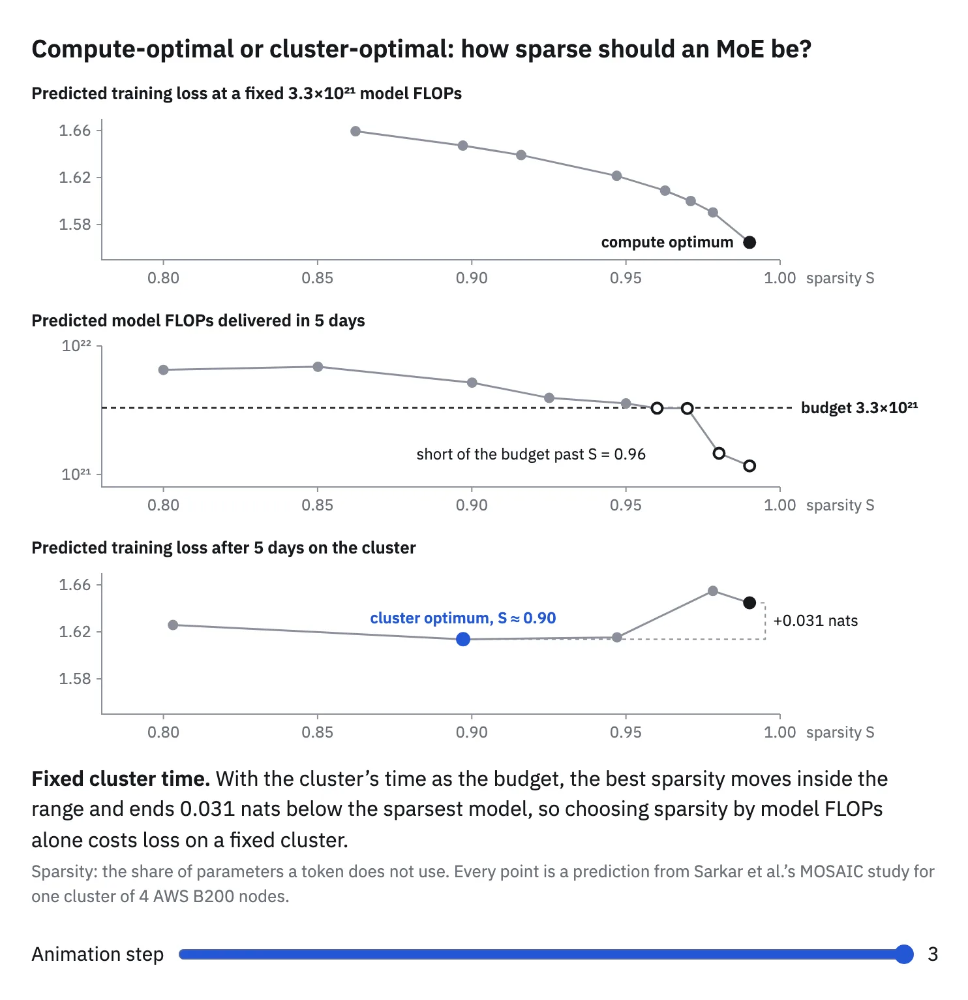

[Figure explanation, controls and captured states](../figures/cluster-optimal-sparsity.md) · [Interactive original](../upstream/app/public/viz/index.html?c=cluster-optimal-sparsity)


In their predictions, choosing by model FLOPs alone points you toward the sparsest model in the grid. Once the authors account for training speed on their cluster, the lowest predicted loss moves to a less sparse configuration, 0.031 nats below the sparsest one. As in dense scaling, you are balancing model capacity against how many tokens you can train on. With an MoE, increasing sparsity can lower hardware utilization without increasing model FLOPs per token, so extra capacity can still cost training time[113](A-appendix.md#ref-2608.10605) [evidence](../citation-evidence.md#mosaic-f1).

[Megatron](https://github.com/NVIDIA/Megatron-LM) sets the shape with three flags: `--num-experts` for the count, `--moe-ffn-hidden-size` for each expert's width and `--moe-router-topk` for how many experts each token picks.

**Megatron source**

**[`experts.py#L262-L293`](https://github.com/NVIDIA/Megatron-LM/blob/d6316eb45bf1bfbb6f1f848c0b56e55166564d80/megatron/core/transformer/moe/experts.py#L262-L293) (grouped fc1, fc2 shapes)**

```
# Double the output width with gated linear unit, see https://arxiv.org/pdf/2002.05202.pdf
ffn_hidden_size = not_none(self.config.moe_ffn_hidden_size)
if self.config.gated_linear_unit:
    ffn_hidden_size *= 2

self.linear_fc1 = submodules.linear_fc1(
    self.num_local_experts,
    self.input_size if self.config.moe_latent_size is None else self.config.moe_latent_size,
    ffn_hidden_size,
    config=self.config,
    init_method=not_none(self.config.init_method),
    bias=self.config.add_bias_linear,
    skip_bias_add=False,
    is_expert=True,
    tp_comm_buffer_name='fc1',
    pg_collection=pg_collection,
    name=(name + ".linear_fc1") if name is not None else None,
)

if self.config.use_te_activation_func and not (submodules.activation_func is None):
    self.activation_func = apply_module(submodules.activation_func(config=self.config))
else:
    self.activation_func = self.config.activation_func

self.linear_fc2 = submodules.linear_fc2(
    self.num_local_experts,
    not_none(self.config.moe_ffn_hidden_size),
    (
        self.config.hidden_size
        if self.config.moe_latent_size is None
        else self.config.moe_latent_size
    ),
```

**[`router.py#L77-L81`](https://github.com/NVIDIA/Megatron-LM/blob/d6316eb45bf1bfbb6f1f848c0b56e55166564d80/megatron/core/transformer/moe/router.py#L77-L81) (router weight N x d)**

```
# Initialize the gate weights.
# TODO: Add support for GPU initialization, which requires updating the golden values.
self.weight = torch.nn.Parameter(
    torch.empty((self.config.num_moe_experts, self.config.hidden_size), dtype=torch.float32)
)
```

Cut the experts too fine and each expert's GEMMs get small enough to lower TFLOP/s per GPU, and with the wrong granularity the model learns worse. To see what a shape costs you, read the grouped-GEMM time per MoE layer from the profiler next to TFLOP/s per GPU from `--log-throughput`. The token counts that `--save-tokens-per-expert-interval` writes also show dead experts that receive no tokens ([A.1](A-appendix.md#s-a-1)), but an expert can also die while it keeps its tokens, which shows in its output norm instead ([3.6](3-anatomy-of-moe-training.md#s-3-6))[114](A-appendix.md#ref-2602.10604) [evidence](../citation-evidence.md#step35-dead).

Use finer experts at equal total and active parameters, up to a point: in one 18-layer model, the loss fell until 128 experts of d/4 with top-8, and finer splits gained nothing[108](A-appendix.md#ref-2601.08215) [evidence](../citation-evidence.md#liew-t6). Stop going finer once small GEMMs and token copies start to dominate your step.

Finer experts help the loss only up to a point, and each finer step sends more copies of every token over the network. Could you keep the many small experts and send less data for each copy?

<a id="s-3-4-latent-moe"></a>

#### Latent MoE

Each copy of a token carries its full hidden state, d numbers, sent once for every expert it picked. LatentMoE shrinks that copy. It projects each token down to a smaller latent ℓ before dispatch, runs the experts on ℓ, and projects back up after combine. Every copy shrinks from d to ℓ, and the savings pay for more experts: at the same expert parameters, expert compute and traffic, the layer can afford α \= d/ℓ times more experts and an α times larger top-k[115](A-appendix.md#ref-2601.18089) [evidence](../citation-evidence.md#latentmoe-alpha). Below, a standard layer sits next to its latent counterpart, keeping the parameters and compute inside the experts fixed.


**Figure 3.4.4**

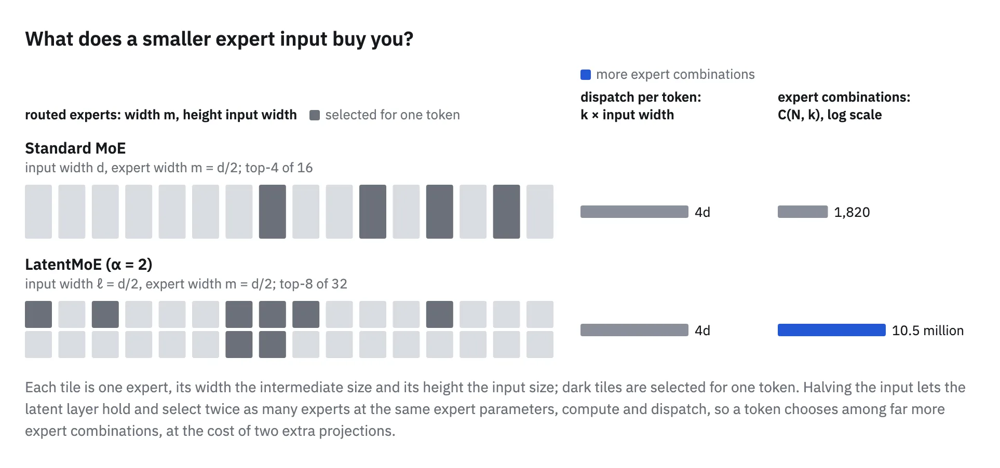

[Figure explanation, controls and captured states](../figures/latent-moe.md) · [Interactive original](../upstream/app/public/viz/index.html?c=latent-moe)


Drawn as tiles, the standard layer selects four of sixteen experts, each receiving a full-width token vector. The latent layer selects eight of thirty-two, but each receives only half as many values. Both send the same amount of data per token. Their total tile area and dark area are also equal, showing unchanged expert parameters and compute; the two projections add work outside those areas[115](A-appendix.md#ref-2601.18089) [evidence](../citation-evidence.md#latentmoe-alpha).

Does the trade pay off in quality? In NVIDIA's 73B-A8B ablation, at equal total and active parameters, LatentMoE scored 4.6 points higher on MMLU-Pro than a standard MoE[116](A-appendix.md#ref-2601.18089) [evidence](../citation-evidence.md#latentmoe-t4), and a small-scale replication also lowered perplexity[117](A-appendix.md#ref-2602.04870) [evidence](../citation-evidence.md#mhlatent-t1). Nemotron 3 Super, Nemotron 3 Ultra and Kimi K3 ship it[118](A-appendix.md#ref-src-cfg-latent) [evidence](../citation-evidence.md#cfg-latent). In return, every token runs through two d x ℓ projections, and serving throughput ranged from 12% lower at concurrency 1 to slightly higher at some concurrencies[119](A-appendix.md#ref-2601.18089) [evidence](../citation-evidence.md#latentmoe-t5). In Megatron, the latent size is `--moe-latent-size`.

**Megatron source**

**[`moe_layer.py#L304-L335`](https://github.com/NVIDIA/Megatron-LM/blob/d6316eb45bf1bfbb6f1f848c0b56e55166564d80/megatron/core/transformer/moe/moe_layer.py#L304-L335) (two projections, optional norm)**

```
self.fc1_latent_proj = linear_cls(
    self.config.hidden_size,
    self.config.moe_latent_size,
    parallel_mode="duplicated",
    config=self.config,
    init_method=self.config.init_method,
    bias=self.config.add_bias_linear,
    skip_bias_add=False,
    skip_weight_param_allocation=False,
    is_expert=False,
    name=(name + ".fc1_latent_proj") if name is not None else None,
    **linear_gtp_kwargs,
)
if self.config.moe_use_norm_before_up_proj:
    self.fc2_norm = TENorm(
        config=self.config,
        hidden_size=self.config.moe_latent_size,
        eps=self.config.layernorm_epsilon,
    )
self.fc2_latent_proj = linear_cls(
    self.config.moe_latent_size,
    self.config.hidden_size,
    parallel_mode="duplicated",
    config=self.config,
    init_method=self.config.output_layer_init_method,
    bias=self.config.add_bias_linear,
    skip_bias_add=False,
    skip_weight_param_allocation=False,
    is_expert=False,
    name=(name + ".fc2_latent_proj") if name is not None else None,
    **linear_gtp_kwargs,
)
```

**[`moe_layer.py#L554-L556`](https://github.com/NVIDIA/Megatron-LM/blob/d6316eb45bf1bfbb6f1f848c0b56e55166564d80/megatron/core/transformer/moe/moe_layer.py#L554-L556) (project down before dispatch)**

```
# Project the hidden_states from hidden dimension down to latent dimension.
if self.config.moe_latent_size:
    hidden_states, _ = self.fc1_latent_proj(hidden_states)
```

**[`moe_layer.py#L662-L666`](https://github.com/NVIDIA/Megatron-LM/blob/d6316eb45bf1bfbb6f1f848c0b56e55166564d80/megatron/core/transformer/moe/moe_layer.py#L662-L666) (norm, project up after combine)**

```
output = self.token_dispatcher.combine_postprocess(output)
if self.config.moe_latent_size:
    if self.config.moe_use_norm_before_up_proj:
        output = apply_module(self.fc2_norm)(output)
    output, _ = self.fc2_latent_proj(output)
```

**[`experts.py#L269-L269`](https://github.com/NVIDIA/Megatron-LM/blob/d6316eb45bf1bfbb6f1f848c0b56e55166564d80/megatron/core/transformer/moe/experts.py#L269-L269) (experts read ℓ)**

```
self.input_size if self.config.moe_latent_size is None else self.config.moe_latent_size,
```

A latent MoE can go wrong in two ways: it runs slow, or its activations blow up. When it runs slow, look past the traffic, since the all-to-all now carries ℓ numbers per copy instead of d, to the two extra projections and the smaller expert GEMMs. LatentMoE's NVIDIA authors propose small-GEMM kernels and a separate stream for the shared expert as fixes[120](A-appendix.md#ref-2601.18089) [evidence](../citation-evidence.md#latentmoe-opt). When it blows up, as Kimi K3 reports for the activations of its routed branch at its 2.8-trillion-parameter scale[102](A-appendix.md#ref-2607.24653) [evidence](../citation-evidence.md#k3-latent), one place to look is the output norm of the up-projection, `fc2_latent_proj`, which you can compute per layer offline from the `--save-activations-interval` dumps ([A.1](A-appendix.md#s-a-1)). K3's fix was an RMSNorm before the up-projection, `--moe-use-norm-before-up-proj`, which it ships with a routed scaling factor of 1.0[121](A-appendix.md#ref-src-cfg-k3) [evidence](../citation-evidence.md#cfg-k3).

Use a latent when you want more experts and a larger top-k without sending more data per token: shrinking each copy to ℓ \= d/α affords α times more of both[115](A-appendix.md#ref-2601.18089) [evidence](../citation-evidence.md#latentmoe-alpha), and it scored higher at matched size[116](A-appendix.md#ref-2601.18089) [evidence](../citation-evidence.md#latentmoe-t4), at the cost of two projections.

Every expert so far sits behind the router and sees only the tokens sent to it. What would you gain by putting one expert outside the router, where it sees every token, and is it worth its compute?

<a id="s-3-4-shared-experts"></a>

#### Shared experts

A shared expert sits outside the router: it processes every token, next to whichever routed experts the token picked. DeepSeekMoE introduced shared experts to learn common patterns, reducing duplicated knowledge across routed experts and giving them room to specialize[122](A-appendix.md#ref-2401.06066) [evidence](../citation-evidence.md#dsmoe-shared-purpose). In its ablation at equal compute, adding a shared expert improved results on most benchmarks[123](A-appendix.md#ref-2401.06066) [evidence](../citation-evidence.md#dsmoe-f3). Qwen's models show how open the question is: the Qwen3 MoE models in the Qwen3 report dropped it[124](A-appendix.md#ref-2505.09388) [evidence](../citation-evidence.md#qwen3-moe), Qwen3-Next brought it back behind a sigmoid gate[125](A-appendix.md#ref-src-cfg-qwen3next) [evidence](../citation-evidence.md#cfg-qwen3next), and Qwen3.5 kept it[126](A-appendix.md#ref-src-cfg-qwen35) [evidence](../citation-evidence.md#cfg-qwen35).

Measured by loss in models trained from scratch at equal compute, the gain is small and not consistent. A shared expert lowered loss by about 0.01 to 0.02 in Pangu Ultra MoE and in Sun et al.'s expert-threshold models[127,128](A-appendix.md#ref-2505.04519) [evidence](../citation-evidence.md#pangu-ultra-f2) [evidence](../citation-evidence.md#et-t8), while in OLMoE and in Li et al.'s sweep of small MoEs it did nothing or slightly worse[129,130](A-appendix.md#ref-2409.02060) [evidence](../citation-evidence.md#olmoe-f6) [evidence](../citation-evidence.md#slicing-shared).

Sharing also reduces the router's freedom. With 32 experts and 4 active, reserving one slot for a shared expert leaves 4,495 ways to choose the other 3, compared with 35,960 ways to choose 4 from all 32\. If you instead add the shared expert without reducing routed top-k, its always-on FFN increases compute per token: Mellum2 added a shared expert without reducing routed top-k and found no quality gain and slower inference[131](A-appendix.md#ref-2605.31268) [evidence](../citation-evidence.md#mellum2-shared).

If you do add one, you still have to decide how its output mixes with the routed experts'. The figure below lines up five designs at equal compute per token: routed only, a shared expert at fixed weight (DeepSeek-V3)[30](A-appendix.md#ref-src-cfg-dsv3) [evidence](../citation-evidence.md#cfg-dsv3), a gated one (Qwen3-Next)[125](A-appendix.md#ref-src-cfg-qwen3next) [evidence](../citation-evidence.md#cfg-qwen3next), one normalized jointly with the routed experts (Inkling)[19](A-appendix.md#ref-src-tf-inkling) [evidence](../citation-evidence.md#tf-inkling) and a parallel dense FFN (Grok 2\)[132](A-appendix.md#ref-src-grok2-parallel) [evidence](../citation-evidence.md#grok2-parallel).


**Figure 3.4.5**

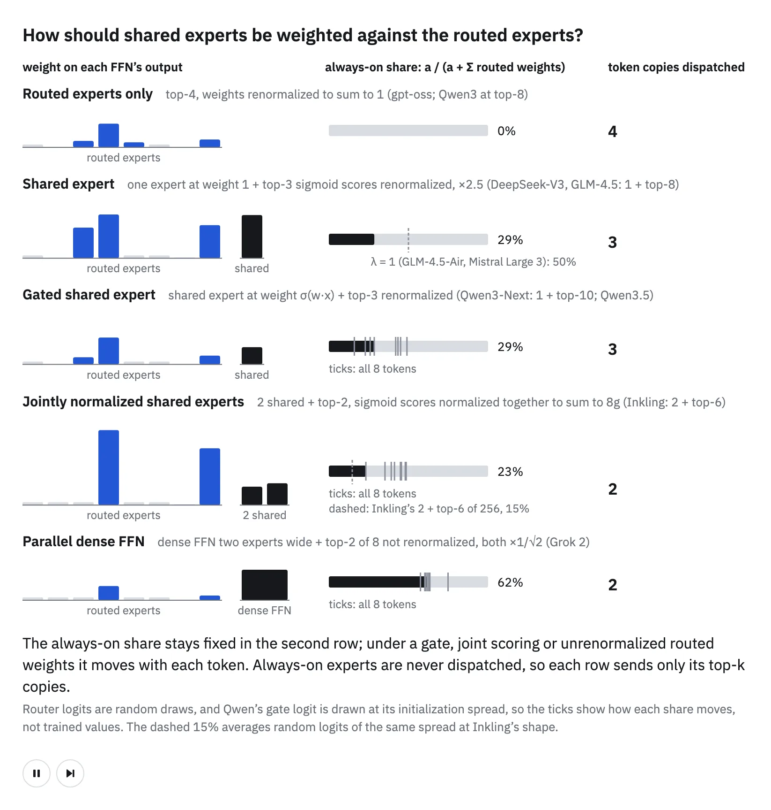

[Figure explanation, controls and captured states](../figures/shared-expert-weight.md) · [Interactive original](../upstream/app/public/viz/index.html?c=shared-expert-weight)


Lined up this way, a shared expert at fixed weight holds the same share of every token's weight, Qwen's gate moves that share between 0 and 50%, Inkling's router learns it per token by scoring the shared experts with the routed ones, and a parallel dense FFN without renormalization holds over half of it whatever the router scores.

Megatron's flags are `--moe-shared-expert-intermediate-size`, `--moe-shared-expert-gate` (a sigmoid gate on its output) and `--use-grouped-gemm-for-shared-expert`. Without the gate, Megatron adds the shared output at weight 1 ([`moe_layer.py#L668-L669`](https://github.com/NVIDIA/Megatron-LM/blob/d6316eb45bf1bfbb6f1f848c0b56e55166564d80/megatron/core/transformer/moe/moe_layer.py#L668-L669)), while the routed weights sum to the routed scaling factor when normalized over the selected experts ([`moe_utils.py#L942-L947`](https://github.com/NVIDIA/Megatron-LM/blob/d6316eb45bf1bfbb6f1f848c0b56e55166564d80/megatron/core/transformer/moe/moe_utils.py#L942-L947), [3.1](3-anatomy-of-moe-training.md#s-3-1)). Megatron does this with sigmoid routing, or by applying softmax after selecting the top-k experts. For the latter, leave `--moe-router-pre-softmax` disabled.  The shared expert therefore takes 1/(1 \+ factor) of each token's output weight, 29% at a factor of [2.5](2-setup-and-your-first-run.md#s-2-5), and the larger the factor, the smaller its share; GLM-4.5-Air and Mistral Large 3 set the factor to 1, which gives it half[133,134](A-appendix.md#ref-src-cfg-glm45air) [evidence](../citation-evidence.md#cfg-glm45air) [evidence](../citation-evidence.md#cfg-mistral-large3).

**Megatron source**

**[`shared_experts.py#L128-L128`](https://github.com/NVIDIA/Megatron-LM/blob/d6316eb45bf1bfbb6f1f848c0b56e55166564d80/megatron/core/transformer/moe/shared_experts.py#L128-L128) (width from shared size)**

```
config.ffn_hidden_size = config.moe_shared_expert_intermediate_size
```

**[`shared_experts.py#L201-L208`](https://github.com/NVIDIA/Megatron-LM/blob/d6316eb45bf1bfbb6f1f848c0b56e55166564d80/megatron/core/transformer/moe/shared_experts.py#L201-L208) (sigmoid gate on output)**

```
def forward(self, hidden_states: torch.Tensor) -> torch.Tensor:
    """Forward function"""
    output, _ = super().forward(hidden_states)
    if self.use_shared_expert_gate:
        logits = torch.nn.functional.linear(hidden_states, self.gate_weight)
        gate_score = torch.nn.functional.sigmoid(logits)
        output = output * gate_score
    return output
```

**[`moe_layer.py#L668-L669`](https://github.com/NVIDIA/Megatron-LM/blob/d6316eb45bf1bfbb6f1f848c0b56e55166564d80/megatron/core/transformer/moe/moe_layer.py#L668-L669) (added at weight 1\)**

```
if shared_expert_output is not None:
    output = output + shared_expert_output
```

To track how much the shared expert contributes to each token's output during training, compare the shared branch after its gate with the routed branch after combine and any latent up-projection, using the sparse forward hook in [A.1](A-appendix.md#s-a-1).

A shared expert is a common starting choice in leading MoEs, including GLM-5.3, Kimi K3 and DeepSeek V4.1 Flash[135,136,137](A-appendix.md#ref-2602.15763) [evidence](../citation-evidence.md#shared-glm53) [evidence](../citation-evidence.md#shared-k3) [evidence](../citation-evidence.md#shared-dsv41). MiMo-V2.6 ships without one[138](A-appendix.md#ref-2610.11959) [evidence](../citation-evidence.md#shared-mimo26). To compare with and without one at equal compute, give it the routed experts' width and replace one routed slot with it.

Shared or not, every expert so far has the same width and every token gets the same top-k, so every token gets the same compute. Could the router give some tokens less compute and others more, while the average stays fixed?

<a id="s-3-4-variable-compute"></a>

#### Variable compute

Two designs let the compute per token vary while the mean stays fixed. LongCat-Flash adds zero-computation experts that pass the input through unchanged. Its router selects 12 experts per token from a pool of 512 FFN experts and 256 of these identity paths. A bias adjusts how often the FFN experts are selected, targeting an average of 8 per token while allowing individual tokens to use more or fewer[139](A-appendix.md#ref-2509.01322) [evidence](../citation-evidence.md#longcat-budget); the standard deviation of that count rose to about [2.5](2-setup-and-your-first-run.md#s-2-5) during pre-training[140](A-appendix.md#ref-2509.01322) [evidence](../citation-evidence.md#longcat-f3c). Xiaomi's AI Lab takes a different approach in MoDSE (Mixture of Diverse Size Experts): they mix expert widths, letting the router choose larger or smaller experts for each token[141](A-appendix.md#ref-2409.12210) [evidence](../citation-evidence.md#modse-f2). The figure below simulates the active width per token for homogeneous experts, as in Mixtral[142](A-appendix.md#ref-src-cfg-mixtral) [evidence](../citation-evidence.md#cfg-mixtral), and both designs.


**Figure 3.4.6**

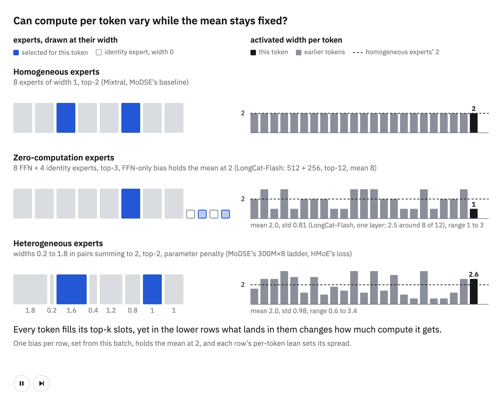

[Figure explanation, controls and captured states](../figures/variable-compute-experts.md) · [Interactive original](../upstream/app/public/viz/index.html?c=variable-compute-experts)


In the simulation, where one bias per design holds the mean active width at that of the homogeneous experts, some tokens get more of it and others less, and every token still fills all its top-k slots, since only what lands in them varies. In LongCat-Flash's ablation, zero-computation experts reached lower loss at matched compute[143](A-appendix.md#ref-2509.01322) [evidence](../citation-evidence.md#longcat-f3a). Mixed expert sizes can improve quality, but may cost throughput. Xiaomi's AI Lab and Wang et al. each put one router over mixed-size experts in small models and report gains[141,144](A-appendix.md#ref-2409.12210) [evidence](../citation-evidence.md#modse-f2) [evidence](../citation-evidence.md#hmoe-3b). Li et al. found none, but in their setup the experts sit in two pools, each with a fixed top-k, so every token still gets the same compute[145](A-appendix.md#ref-2605.11689) [evidence](../citation-evidence.md#slicing-pools). In GroveMoE, the cost showed at inference: its mixed sizes ran about 30% slower than Qwen3-30B-A3B, which its authors attribute to processing the two expert sizes with separate MoE kernels in each layer[146](A-appendix.md#ref-2508.07785) [evidence](../citation-evidence.md#grove-infer).

**Megatron source**

none: a grep of Megatron-LM main (megatron/ tree) finds neither zero-computation experts nor mixed expert widths; each grouped linear has one `moe_ffn_hidden_size`

Track the mean and spread of compute per token in each layer: the number of selected FFN experts for zero-computation routing, or the sum of selected expert widths for mixed-size routing. Compare the mean with the target budget, and log token counts per expert alongside compute per expert-parallel rank and step time.

Start with routed experts of one width and a fixed top-k, as MiMo-V2.6-Pro-RL, GLM-5.3 and Kimi K3 do[138,135,136](A-appendix.md#ref-2610.11959) [evidence](../citation-evidence.md#shared-mimo26) [evidence](../citation-evidence.md#shared-glm53) [evidence](../citation-evidence.md#shared-k3). This also fits Megatron's grouped linear layers, which use a single `moe_ffn_hidden_size`.

With the count, width and compute of the experts settled, one choice remains inside each expert: the function between its two projections. How much does that choice matter for an MoE?

<a id="s-3-4-activation"></a>

#### Activation

As in a dense Transformer, each expert uses an activation function such as SwiGLU, as in DeepSeek-V3, Qwen3 and Kimi K2[147](A-appendix.md#ref-src-cfg-swiglu) [evidence](../citation-evidence.md#cfg-swiglu), or ReLU² between its input and output projections. In an MoE, you also need to watch how activations behave across experts: Step [3.5](3-anatomy-of-moe-training.md#s-3-5) Flash found that one or two experts could develop rapidly growing output norms while the others stayed stable and the training loss barely changed[15](A-appendix.md#ref-2602.10604) [evidence](../citation-evidence.md#step35-f4). The activation function, and any clamp applied to it, helps control that growth. The figure below shows how the output of SwiGLU, ReLU² and Expert-Specific PolyNorm grows as the input scale rises.


**Figure 3.4.7**

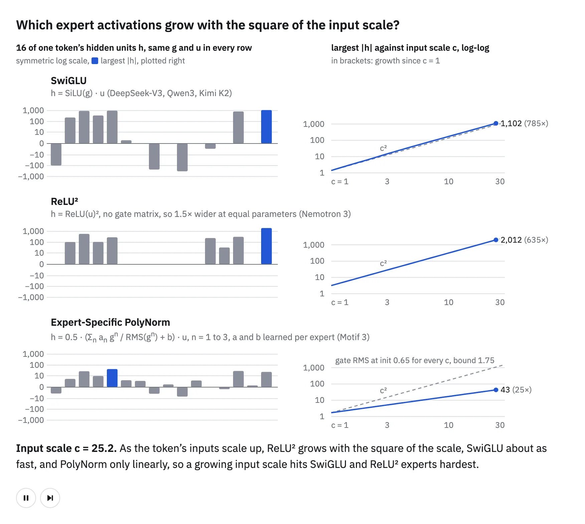

[Figure explanation, controls and captured states](../figures/expert-activations.md) · [Interactive original](../upstream/app/public/viz/index.html?c=expert-activations)


Scaled up, SwiGLU and ReLU² outputs grow with the square of the input scale, while Expert-Specific PolyNorm normalizes its gate, so its output grows only linearly. A clamp can bound that growth. Two studies found similar quality with and without clipping in their tested settings. In a 7.9B MoE ablation by Ant Group's Ling team, SwiGLU with clipping matched plain SwiGLU's average over 17 benchmarks[148](A-appendix.md#ref-2605.25704) [evidence](../citation-evidence.md#powlu-t2). Step [3.5](3-anatomy-of-moe-training.md#s-3-5) Flash's activation clipping held its outlier experts' norms down at indistinguishable loss, although that branch started mid-run from the unclipped run[15](A-appendix.md#ref-2602.10604) [evidence](../citation-evidence.md#step35-f4). Clipping did not eliminate loss spikes in the Ling team's [FP8](https://huggingface.co/spaces/nanotron/ultrascale-playbook?section=fp8_pretraining) run, the clipped SwiGLU delayed the loss spikes, yet one still came around step 77,000[149](A-appendix.md#ref-2605.25704) [evidence](../citation-evidence.md#powlu-f4). The next figure sweeps the input scale through plain SwiGLU, a hard clamp and SiTU-GLU's smooth cap at the same bound, so you can see how each one bends.


**Figure 3.4.8**

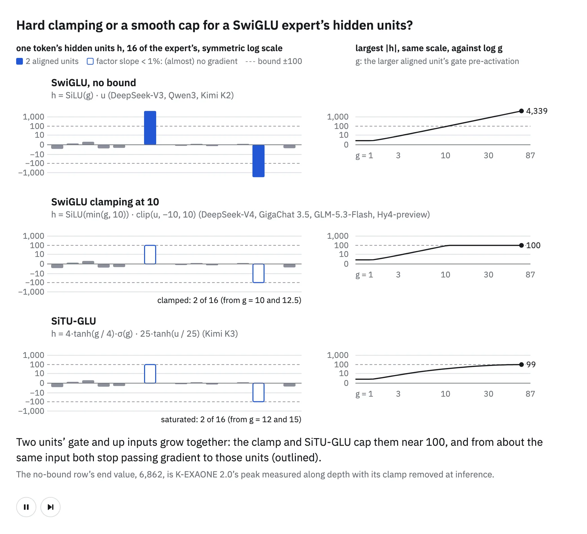

[Figure explanation, controls and captured states](../figures/activation-bounds.md) · [Interactive original](../upstream/app/public/viz/index.html?c=activation-bounds)


Through that sweep, plain SwiGLU's largest hidden unit keeps growing with the square of the gate input up to 6,862, the peak K-EXAONE 2.0 measured at its last layer with its clamp disabled at inference[150](A-appendix.md#ref-src-kexaone-peak) [evidence](../citation-evidence.md#kexaone-peak), the hard clamp follows it up to the bound and stops there, and SiTU-GLU bends away well before the bound. The sweep sets both to stop a hidden unit at about 100, the clamp at 10 and SiTU-GLU with a gate cap of 4 and an up cap of 25, and from about the same input both pass almost no gradient to those units' gate weights. Replacing the activation altogether rests on thinner evidence. Zhuo et al.'s PolyNorm lowered average validation loss by 0.02 against SwiGLU in OLMoE-1B-7B[151](A-appendix.md#ref-2411.03884) [evidence](../citation-evidence.md#polynorm-t2), while Motif 3 compares its Expert-Specific PolyNorm with SwiGLU only on effective rank[152](A-appendix.md#ref-2608.09119) [evidence](../citation-evidence.md#motif3-f6a). Kimi K3 states that SiTU-GLU's smooth cap gives better training behavior than hard clamping[153](A-appendix.md#ref-2607.24653) [evidence](../citation-evidence.md#k3-appb).

In Megatron, `--activation-func-clamp-value` sets the hard-clipping limit for SwiGLU in MoE layers; a value of 10 matches DeepSeek V4.1 Flash's limit[154](A-appendix.md#ref-2609.19969) [evidence](../citation-evidence.md#dsv41-activation), which GigaChat [3.5](3-anatomy-of-moe-training.md#s-3-5) and Hy4-preview also use[155](A-appendix.md#ref-src-cfg-clamp10) [evidence](../citation-evidence.md#cfg-clamp10). Kimi K3's smooth cap, SiTU-GLU, is `--activation-func-tanh-clamp-scale 4 --activation-func-tanh-clamp-scale-linear 25`, available from [Megatron Core v0.20](https://github.com/NVIDIA/Megatron-LM/releases/tag/core_v0.20.0) on, and Nemotron 3's ReLU² is `--squared-relu`[118](A-appendix.md#ref-src-cfg-latent) [evidence](../citation-evidence.md#cfg-latent).

**Megatron source**

**[`experts.py#L1100-L1118`](https://github.com/NVIDIA/Megatron-LM/blob/d6316eb45bf1bfbb6f1f848c0b56e55166564d80/megatron/core/transformer/moe/experts.py#L1100-L1118) (SiTU-GLU or clamped SwiGLU)**

```
if tanh_clamp_scale is not None:
    intermediate_parallel = situ_glu(
        intermediate_parallel,
        tanh_clamp_scale,
        self.config.activation_func_tanh_clamp_scale_linear,
        self.config.glu_linear_offset,
    )
else:

    def glu(x):
        x_glu, x_linear = torch.chunk(x, 2, dim=-1)
        if (val := self.config.activation_func_clamp_value) is not None:
            x_glu = x_glu.clamp(min=None, max=val)
            x_linear = x_linear.clamp(min=-val, max=val)
        return self.config.activation_func(x_glu) * (
            x_linear + self.config.glu_linear_offset
        )

    intermediate_parallel = glu(intermediate_parallel)
```

**[`activations.py#L17-L39`](https://github.com/NVIDIA/Megatron-LM/blob/d6316eb45bf1bfbb6f1f848c0b56e55166564d80/megatron/core/activations.py#L17-L39) (soft clamp and SiTU-GLU)**

```
def tanh_soft_clamp(x: torch.Tensor, scale: float) -> torch.Tensor:
    """Tanh Soft Clamp to precondition activation inputs."""
    return (scale * torch.tanh(x.float() / scale)).to(x.dtype)


@jit_fuser
def situ(x: torch.Tensor, scale: float) -> torch.Tensor:
    """Sigmoid-Tanh Unit from Kimi K3: ``s * tanh(x / s) * sigmoid(x)``"""
    return tanh_soft_clamp(x, scale) * torch.sigmoid(x)


@jit_fuser
def situ_glu(
    x: torch.Tensor,
    gate_scale: float,
    linear_scale: Optional[float] = None,
    linear_offset: float = 0.0,
) -> torch.Tensor:
    """SiTU-GLU: ``situ(x_gate, gate_scale) * (x_linear + linear_offset)``."""
    x_gate, x_linear = torch.chunk(x, 2, dim=-1)
    if linear_scale is not None:
        x_linear = tanh_soft_clamp(x_linear, linear_scale)
    return situ(x_gate, gate_scale) * (x_linear + linear_offset)
```

**[`transformer_config.py#L2993-L3013`](https://github.com/NVIDIA/Megatron-LM/blob/d6316eb45bf1bfbb6f1f848c0b56e55166564d80/megatron/core/transformer/transformer_config.py#L2993-L3013) (clamp: MoE only, offset 0\)**

```
if (
    self.activation_func_clamp_value is not None
    and self.activation_func == F.silu
    and self.gated_linear_unit
):
    if (
        not math.isfinite(self.activation_func_clamp_value)
        or self.activation_func_clamp_value <= 0
    ):
        raise ValueError(
            "activation_func_clamp_value for SwiGLU must be finite and greater than zero."
        )
    if self.num_moe_experts is None:
        raise ValueError(
            "activation_func_clamp_value for SwiGLU is only supported with MoE."
        )
    if self.glu_linear_offset != 0.0:
        raise ValueError(
            "glu_linear_offset must be zero when activation_func_clamp_value "
            "is set for SwiGLU."
        )
```

Outlier activations in the experts can blow up a run. To catch them, compute Step [3.5](3-anatomy-of-moe-training.md#s-3-5) Flash's signal, the max-to-median ratio of expert output norms per layer[156](A-appendix.md#ref-2602.10604) [evidence](../citation-evidence.md#step35-ratio), offline from the `--save-activations-interval` dumps ([A.1](A-appendix.md#s-a-1)): one expert pulling away from the others shows as a rising ratio. Each dump keeps only the last micro-batch and copies it to the CPU, so sample sparsely.

Start from your reference model's activation recipe. Leading MoEs use different ways to bound activations: Step 5 Preview clips SwiGLU at 7, DeepSeek V4.1 Flash at 10, and Kimi K3 uses SiTU-GLU's smooth caps[107,154,153](A-appendix.md#ref-src-shape-step5) [evidence](../citation-evidence.md#step5-activation) [evidence](../citation-evidence.md#dsv41-activation) [evidence](../citation-evidence.md#k3-appb). For a new architecture, SwiGLU is a reasonable baseline. If expert norms diverge, test clipping and compare training loss as well as the norms before choosing a limit.

#### What to watch

| Part | Symptom | Signal to watch |
| --- | --- | --- |
| Count and size | `slow`: the expert GEMMs are small. Some experts may also get no tokens. | Grouped-GEMM time per MoE layer from the profiler, TFLOP/s per GPU (`--log-throughput`), and tokens per expert (`--save-tokens-per-expert-interval`, [A.1](A-appendix.md#s-a-1)). |
| Latent MoE | `slow`: the two extra projections and the smaller expert GEMMs add time. `blows up`: Kimi K3 reports exploding activations in the routed branch[102](A-appendix.md#ref-2607.24653) [evidence](../citation-evidence.md#k3-latent). | For speed, profile the two latent projections and smaller expert GEMMs alongside the reduced all-to-all. For instability, one place to look is the up-projection output norm (`fc2_latent_proj`) from activation dumps ([A.1](A-appendix.md#s-a-1)); Kimi K3 reports routed-branch activation growth[102](A-appendix.md#ref-2607.24653) [evidence](../citation-evidence.md#k3-latent). |
| Shared experts | `slow` at inference, when it adds compute: Mellum2 found inference slower[131](A-appendix.md#ref-2605.31268) [evidence](../citation-evidence.md#mellum2-shared). | Shared output after its gate against routed output after combine and any latent up-projection, from the sparse forward hook in [A.1](A-appendix.md#s-a-1). |
| Variable compute | `slow`: each expert size runs its own kernels, and GroveMoE reports about 30% slower inference than Qwen3-30B-A3B[146](A-appendix.md#ref-2508.07785) [evidence](../citation-evidence.md#grove-infer). | Per layer, mean and spread of selected FFN count or summed expert width against the target compute budget. Log token counts per expert alongside compute per EP rank and step time. |
| Activation | `blows up`: outlier activations. | The max-to-median ratio of expert output norms per layer, Step [3.5](3-anatomy-of-moe-training.md#s-3-5) Flash's signal[156](A-appendix.md#ref-2602.10604) [evidence](../citation-evidence.md#step35-ratio), from the activation dumps ([A.1](A-appendix.md#s-a-1)). |

Everything in this section happened inside one MoE layer, while a model stacks many of them, which raises two questions we have not asked yet. Should every layer be an MoE layer, and how should the block around each one be wired?

<a id="s-3-5"></a>

### 3.5 Block layout


**hero-anatomy-zoom**


[Figure explanation, controls and captured states](../figures/hero-anatomy-zoom.md) · [Interactive original](../upstream/app/public/viz/index.html?c=hero-anatomy-zoom&stage=6&mini=1)


Picture the model as a stack of blocks, each one attention followed by either a dense MLP or an MoE layer. Every MoE layer sends its tokens out to their experts and back with an all-to-all, so where the MoE layers sit decides how many all-to-alls a step makes, and also which layers end up balancing worst. How each block is wired then decides how much of every all-to-all can hide behind attention.

Where models put their MoE layers and how they connect them to attention. Dense-layer counts refer to the backbone, excluding prediction modules.

| Model | Dense layers | Block wiring |
| --- | --- | --- |
| DeepSeek-V3[157](A-appendix.md#ref-2412.19437) [evidence](../citation-evidence.md#layout-dsv3) | First 3 dense, remaining 58 MoE | Attention followed by FFN |
| DeepSeek-V4.1-Flash[158](A-appendix.md#ref-2609.19969) [evidence](../citation-evidence.md#layout-dsv41) | All 40 blocks use MoE | Single-Pass mHC residual connections |
| GLM-5.3[101](A-appendix.md#ref-src-shape-glm53) [evidence](../citation-evidence.md#layout-glm53) | First 3 dense, remaining 75 MoE | Attention followed by FFN[18](A-appendix.md#ref-src-tf-glm-moe-dsa) [evidence](../citation-evidence.md#tf-glm-moe-dsa) |
| Kimi K3[159](A-appendix.md#ref-2607.24653) [evidence](../citation-evidence.md#layout-k3) | First layer dense, remaining 92 MoE | Attention followed by Stable LatentMoE; Attention Residuals |
| Llama 4 Maverick[160](A-appendix.md#ref-src-cfg-maverick) [evidence](../citation-evidence.md#cfg-maverick) | Alternating dense and MoE, starting dense | MoE every second layer |
| LongCat-Flash[161](A-appendix.md#ref-2509.01322) [evidence](../citation-evidence.md#layout-longcat) | Dense FFNs and MoE coexist within each macro-block | Shortcut-connected MoE overlaps with later attention and FFN work |
| MiMo-V2.6-Pro[138](A-appendix.md#ref-2610.11959) [evidence](../citation-evidence.md#layout-mimo26) | First layer dense, remaining 69 MoE | Hybrid attention blocks followed by FFNs |

The first layout decision is which layers get experts at all, since you can put an MoE in every layer, keep a few layers dense, or alternate the two. Which of these should you pick?

<a id="s-3-5-dense-layers"></a>

#### Dense layers

A dense layer has no router and no experts, so it makes no all-to-all. Figure 3.5.1 counts the all-to-alls of three layouts side by side: MoE in every layer, as in Qwen3, gpt-oss, MiniMax M2 and Llama 4 Scout[162](A-appendix.md#ref-src-cfg-moe-every) [evidence](../citation-evidence.md#cfg-moe-every), leading dense layers, and MoE every other layer. Leading dense layers replace only the earliest MoE layers, as in DeepSeek-V3, which keeps its first three dense[163](A-appendix.md#ref-2412.19437) [evidence](../citation-evidence.md#dsv3-dense). Putting an MoE in every other layer halves the all-to-alls instead, as in Llama 4 Maverick, which alternates dense and MoE layers[160](A-appendix.md#ref-src-cfg-maverick) [evidence](../citation-evidence.md#cfg-maverick). Either way, you give up some MoE capacity in exchange for fewer all-to-alls and fewer parameters.


**Figure 3.5.1**

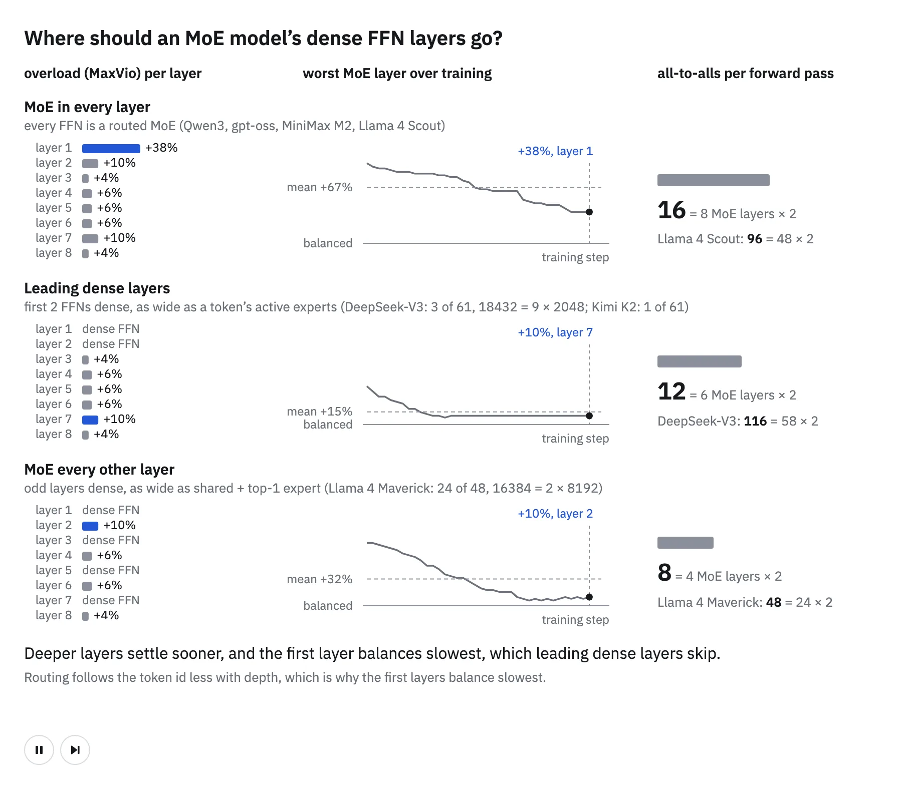

[Figure explanation, controls and captured states](../figures/dense-layer-placement.md) · [Interactive original](../upstream/app/public/viz/index.html?c=dense-layer-placement)


The figure's toy scripts its routing to follow the token id less with depth, so its first layer balances slowest: leading dense layers remove its two slowest layers but cut only 4 of 16 all-to-alls, while MoE every other layer halves the all-to-alls but keeps the second slowest layer. In Ling's 60-layer models, leading dense layers cost little: making the first 1 to 3 layers dense barely changed efficiency at matched FLOPs, an efficiency leverage close to 1[164](A-appendix.md#ref-2507.17702) [evidence](../citation-evidence.md#ling-el).

The other argument for them is balance, and it rests on less evidence. DeepSeekMoE observed that the first layer's balance converges more slowly[165](A-appendix.md#ref-2401.06066) [evidence](../citation-evidence.md#dsmoe-early), and Ling says leading dense layers ease early-layer imbalance[166](A-appendix.md#ref-2507.17702) [evidence](../citation-evidence.md#ling-early), though its ablation of those layers reports only loss[164](A-appendix.md#ref-2507.17702) [evidence](../citation-evidence.md#ling-el). Later reports pull in different directions. Some keep the first layers away from a learned router: Nucleus-Image, an image-generation MoE, diverged without its three leading dense layers[167](A-appendix.md#ref-2604.12163) [evidence](../citation-evidence.md#nucleus-dense), and DeepSeek-V4 hashes its first 3 MoE layers[53](A-appendix.md#ref-2606.19348) [evidence](../citation-evidence.md#dsv4-s41).

Others keep routing there and treat the imbalance instead. Solar Open uses MoE in every layer and fixes its early-layer imbalance with a sequence-wise auxiliary loss[168](A-appendix.md#ref-2601.07022) [evidence](../citation-evidence.md#solar-early). Sigma-MoE-Tiny routes each token to only 1 of 96 experts, and with an aux loss alone its lower layers collapsed: the loss took a shortcut by making the router's probabilities uniform, while some experts still got almost no tokens. Its fix was to activate more experts per token in the first 8 layers early in training, then drop back to one[77](A-appendix.md#ref-2512.16248) [evidence](../citation-evidence.md#sigma-early). Dense layers do not always end the problem either: Motif 3, whose first two layers are dense, saw its earliest MoE layers balance worst early in training[74](A-appendix.md#ref-2608.09119) [evidence](../citation-evidence.md#motif3-aux), while ERNIE 5.0 found no severe imbalance in its first layer on text[169](A-appendix.md#ref-2602.04705) [evidence](../citation-evidence.md#ernie5-first).

[Megatron](https://github.com/NVIDIA/Megatron-LM) takes the layout as a list in [`--moe-layer-freq`](https://github.com/NVIDIA/Megatron-LM/blob/d6316eb45bf1bfbb6f1f848c0b56e55166564d80/megatron/core/models/gpt/gpt_layer_specs.py#L635-L645), one entry per layer, 0 for dense and 1 for MoE: `"([0]+[1]*15)"` gives one leading dense layer, and `"([0,1]*8)"` a dense-first interleave like Maverick's. The flag also takes an integer, and that form puts an MoE at layer 0, so `--moe-layer-freq 2` starts with an MoE rather than with a dense layer as Maverick does. The dense layers take their width from `--ffn-hidden-size`, separately from the expert size.

**Megatron source**

**[`gpt_layer_specs.py#L635-L645`](https://github.com/NVIDIA/Megatron-LM/blob/d6316eb45bf1bfbb6f1f848c0b56e55166564d80/megatron/core/models/gpt/gpt_layer_specs.py#L635-L645) (integer or list pattern)**

```
if isinstance(config.moe_layer_freq, int):
    moe_layer_pattern = [
        1 if (i % config.moe_layer_freq == 0) else 0 for i in range(config.num_layers)
    ]
elif isinstance(config.moe_layer_freq, list):
    moe_layer_pattern = config.moe_layer_freq
    assert len(moe_layer_pattern) == config.num_layers, (
        f"Invalid length of moe_layer_pattern: {len(moe_layer_pattern)}, "
        f"expected {config.num_layers}, "
        f"current moe layer pattern: {config.moe_layer_freq}"
    )
```

**[`gpt_layer_specs.py#L652-L659`](https://github.com/NVIDIA/Megatron-LM/blob/d6316eb45bf1bfbb6f1f848c0b56e55166564d80/megatron/core/models/gpt/gpt_layer_specs.py#L652-L659) (dense or MoE per layer)**

```
layer_specs = []
for layer_number in range(config.num_layers):
    if moe_layer_pattern[layer_number] == 1:
        layer_specs.append(moe_layer_spec)
    elif moe_layer_pattern[layer_number] == 0:
        layer_specs.append(dense_layer_spec)
    else:
        raise ValueError(f"Invalid layer pattern: {moe_layer_pattern}")
```

The reports above saw imbalance in the early layers, and with dense layers in those places, the first MoE layers after them can still balance worst, as they did in Motif 3\. Those first MoE layers are the ones to watch. Follow their aux loss with [`--moe-per-layer-logging`](https://github.com/NVIDIA/Megatron-LM/blob/d6316eb45bf1bfbb6f1f848c0b56e55166564d80/megatron/core/transformer/moe/moe_logging.py#L382-L405), whose per-layer values the launcher from [2.4](2-setup-and-your-first-run.md#s-2-4) sends to [Trackio](https://huggingface.co/docs/trackio), and their MaxVio from the routing trace ([A.1](A-appendix.md#s-a-1)). The dense layers have no router to watch. The [z-loss](https://github.com/NVIDIA/Megatron-LM/blob/d6316eb45bf1bfbb6f1f848c0b56e55166564d80/megatron/core/transformer/moe/moe_utils.py#L155-L172) measures how large the router logits grow, not how evenly tokens spread.

Use leading dense layers when you want fewer all-to-alls at little cost: one to three of them barely changed efficiency at matched FLOPs in Ling's 60-layer models[164](A-appendix.md#ref-2507.17702) [evidence](../citation-evidence.md#ling-el). Do not count on them to fix early-layer imbalance: neither DeepSeekMoE nor Ling shows data for it[165,166](A-appendix.md#ref-2401.06066) [evidence](../citation-evidence.md#dsmoe-early) [evidence](../citation-evidence.md#ling-early), and Motif 3 still saw it in its first MoE layers after two dense ones[74](A-appendix.md#ref-2608.09119) [evidence](../citation-evidence.md#motif3-aux).

Every MoE layer you keep still sends its tokens out and back, and in an MoE block, where the MoE runs on attention's output, the GPUs spend much of that time waiting. Could you rewire the block so that some of that traffic moves while attention computes?

<a id="s-3-5-block-wiring"></a>

#### Block wiring

In an MoE block, each all-to-all is tied to compute on both sides. The router reads attention's output, so dispatch cannot start until attention is done, and the next layer reads the MoE's output, so nothing after the MoE can start until combine is done. The [Ultra-Scale Playbook](https://huggingface.co/spaces/nanotron/ultrascale-playbook?section=a3:_math_for_compute/communication_overlap) covers how to overlap communication with compute in general.


**Figure 3.5.2**

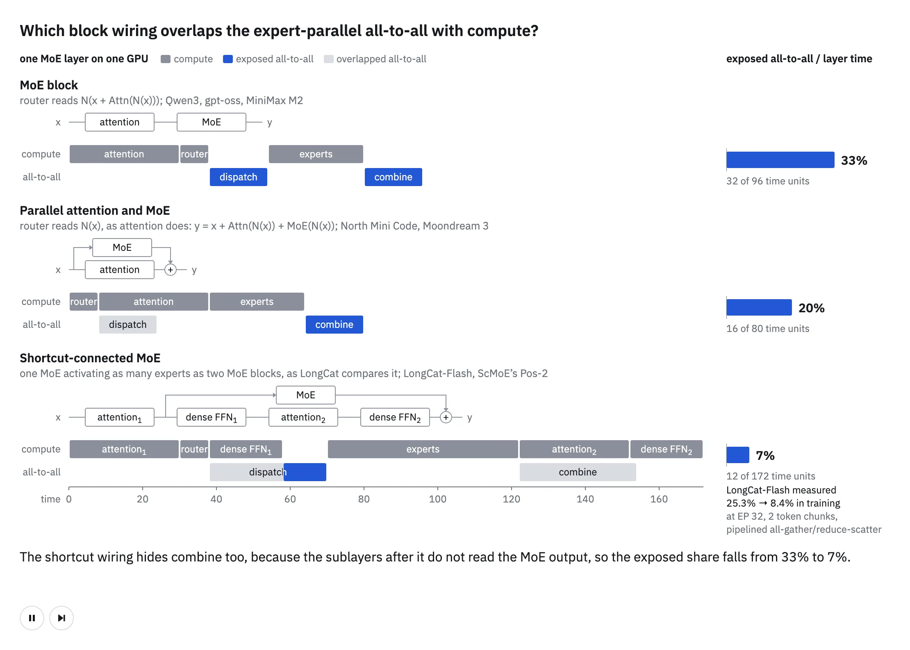

[Figure explanation, controls and captured states](../figures/all-to-all-overlap.md) · [Interactive original](../upstream/app/public/viz/index.html?c=all-to-all-overlap)


Rewiring the block removes one of these dependencies or both, and the communication it frees can then overlap with compute. A parallel block feeds attention and the MoE the same input, as Cohere's North Mini Code and Moondream 3 do[170](A-appendix.md#ref-src-parallel-block) [evidence](../citation-evidence.md#parallel-block), so dispatch runs while attention computes. Combine is harder to hide, because it can only overlap with work left in the same layer, which in [Megatron's shortcut block](https://github.com/NVIDIA/Megatron-LM/blob/d6316eb45bf1bfbb6f1f848c0b56e55166564d80/megatron/core/models/hybrid/shortcut_block.py#L547-L593) is attention's output projection and the shared expert; with neither, it stays exposed. A shortcut-connected MoE hides combine too, behind the dense compute that runs beside it, as in LongCat-Flash[171](A-appendix.md#ref-2509.01322) [evidence](../citation-evidence.md#longcat-scmoe) and in Pos-2, the preferred variant of ScMoE, Cai et al.'s shortcut-connected MoE[172](A-appendix.md#ref-2404.05019) [evidence](../citation-evidence.md#scmoe-pos). Figure 3.5.2 compares the three wirings inside one micro-batch, and in its illustrative durations the exposed all-to-all share of the layer falls from 33% in the MoE block to 7% with the shortcut.

**Megatron source**

**[`shortcut_block.py#L102-L127`](https://github.com/NVIDIA/Megatron-LM/blob/d6316eb45bf1bfbb6f1f848c0b56e55166564d80/megatron/core/models/hybrid/shortcut_block.py#L102-L127) (attention paired with next MoE)**

```
compute_layer = layers[physical_index]
paired_type = layer_type_list[physical_index]
if paired_type not in SUPPORTED_SHORTCUT_PREDECESSORS:
    raise ValueError(
        "Shortcut MoE must be preceded by a Mamba, GDN, or supported attention layer"
    )

supports_two_stage = (
    isinstance(compute_layer, TwoStageAttentionLayer)
    and compute_layer.supports_two_stage_attention()
)
if not supports_two_stage:
    raise ValueError(
        f"Shortcut attention layer {paired_type!r} does not support two-stage attention"
    )
moe_layer = layers[physical_index + 1]
grouped_layers.append(
    ShortcutMoEBlock(
        compute_layer,
        moe_layer,
        overlap_a2a=config.moe_shortcut_parallel,
        attn_local_idx=physical_index,
        moe_local_idx=physical_index + 1,
    )
)
physical_index += 2
```

**[`shortcut_block.py#L490-L502`](https://github.com/NVIDIA/Megatron-LM/blob/d6316eb45bf1bfbb6f1f848c0b56e55166564d80/megatron/core/models/hybrid/shortcut_block.py#L490-L502) (router reads the pair's input)**

```
# Launch the moe_router
with quant_context_factory(moe_config, self.moe_layer_idx):
    moe_hidden_states = self._read_shortcut_hidden(
        moe_hidden_states, recompute_context=attn_recompute_context
    )
    route_input, route_probs = self._moe_router_preprocess(
        shortcut_hidden=moe_hidden_states,
        padding_mask=padding_mask,
        packed_seq_params=moe_packed_seq_params,
        recompute_context=attn_recompute_context,
    )
    if overlap:
        self.route_ready_event.record(torch.cuda.current_stream())
```

**[`shortcut_block.py#L362-L368`](https://github.com/NVIDIA/Megatron-LM/blob/d6316eb45bf1bfbb6f1f848c0b56e55166564d80/megatron/core/models/hybrid/shortcut_block.py#L362-L368) (dispatch on a side stream)**

```
dispatch_stream = self._get_a2a_overlap_stream()
dispatch_stream.wait_event(self.route_ready_event)
hidden_states.record_stream(dispatch_stream)
probs.record_stream(dispatch_stream)

with torch.cuda.stream(dispatch_stream):
    return self.moe_layer.mlp.dispatch(hidden_states, probs)
```

**[`shortcut_block.py#L534-L547`](https://github.com/NVIDIA/Megatron-LM/blob/d6316eb45bf1bfbb6f1f848c0b56e55166564d80/megatron/core/models/hybrid/shortcut_block.py#L534-L547) (dispatch, experts, combine before attention ends)**

```
# Launch the dispatch, experts, and combine
with quant_context_factory(moe_config, self.moe_layer_idx):
    dispatched_input, dispatched_probs = self._launch_dispatch(
        route_input, route_probs, async_op=overlap
    )
    if overlap:
        dispatched_input, dispatched_probs = self._wait_dispatch(
            dispatched_input, dispatched_probs
        )

    output, _ = self.moe_layer.mlp.routed_experts_compute(
        dispatched_input, dispatched_probs
    )
    combined_output = self._launch_combine(output, async_op=overlap)
```

The parallel block in the figure overlaps dispatch with attention while combine stays exposed, and the shortcut-connected MoE covers most of dispatch and combine with the layers around it. The price falls on the router, which now reads the stream from before the compute it overlaps and never sees that compute's output.

Does the model learn worse for it? Cai et al. and the LongCat-Flash team saw it learn about as well. Cai et al. put an MoE in every block of a LLaMA2-style model, wired as Pos-1, the ScMoE variant that Megatron implements, and it averaged slightly higher on zero-shot benchmarks than a standard top-2 MoE[173](A-appendix.md#ref-2404.05019) [evidence](../citation-evidence.md#scmoe-t2). In LongCat-Flash, the loss curves with and without the shortcut were virtually indistinguishable[174](A-appendix.md#ref-2509.01322) [evidence](../citation-evidence.md#longcat-shortcut). AMD's FarSkip-Collective rewires the block so that computation goes on with a residual that does not yet hold the latest communicated output. Shipped in Instella-MoE, it matched the MoE block's benchmark average after 200B training tokens[175,176](A-appendix.md#ref-2609.00791) [evidence](../citation-evidence.md#instella-t13) [evidence](../citation-evidence.md#farskip-t3), although the tables of both AMD reports show it losing on MMLU and HumanEval\+.

What you get in return is speed. ScMoE trained 1.12x to 1.14x faster on one node of 8 GPUs over NVLink, with the paper's standard top-2 MoE as the baseline[173](A-appendix.md#ref-2404.05019) [evidence](../citation-evidence.md#scmoe-t2), and Instella-MoE gained 12.7% in pre-training throughput[177](A-appendix.md#ref-2609.00791) [evidence](../citation-evidence.md#instella-tput). LongCat-Flash measured the exposed communication itself: with its shortcut-connected MoE, the share of time spent in dispatch and combine that is not overlapped fell from 25.3% to 8.4%[178](A-appendix.md#ref-2509.01322) [evidence](../citation-evidence.md#longcat-overlap), in expert-parallel groups of 32 accelerators that use pipelined [all-gather](https://huggingface.co/spaces/nanotron/ultrascale-playbook?section=gather_%26_allgather) and [reduce-scatter](https://huggingface.co/spaces/nanotron/ultrascale-playbook?section=scatter_%26_reducescatter) instead of all-to-all.

In Megatron, the figure's parallel row (ScMoE's Pos-1) is [`--moe-shortcut-connection`](https://github.com/NVIDIA/Megatron-LM/blob/d6316eb45bf1bfbb6f1f848c0b56e55166564d80/megatron/core/transformer/transformer_config.py#L796-L813), which makes each MoE read the input of the attention layer just before it, so its router no longer waits for that attention. The shared expert still reads attention's output, a detail the figure's row does not draw, and the routed experts run on the main stream [after attention's core and before its output projection](https://github.com/NVIDIA/Megatron-LM/blob/d6316eb45bf1bfbb6f1f848c0b56e55166564d80/megatron/core/models/hybrid/shortcut_block.py#L517-L558), as the row's experts follow its attention. The rewiring alone overlaps nothing: the all-to-alls overlap only once `--moe-shortcut-parallel` puts them on a side CUDA stream. An optional extra norm on the merged output comes with `--moe-shortcut-post-norm`. All three flags are only on upstream main, and they work only in the hybrid stack, not together with [FSDP](https://github.com/NVIDIA/Megatron-LM/blob/d6316eb45bf1bfbb6f1f848c0b56e55166564d80/megatron/training/arguments.py#L984-L990), CUDA graphs, full recompute or `--moe-shared-expert-overlap`. Without a block change, Megatron can also hide the all-to-all behind another micro-batch ([3.7 Overlap](3-anatomy-of-moe-training.md#s-3-7-overlap)).

An exposed all-to-all makes the step slow, and a trace shows how much of it is exposed. Take an nsys timeline (`--profile` with `--profile-step-start` and `--profile-step-end`, see [3.7 Profiling](3-anatomy-of-moe-training.md#s-3-7-profiling)) and compare the all-to-all kernels on the side stream with the compute on the main stream: the stretches where the all-to-all runs alone are the exposed share.

Use Megatron's shortcut block (the figure's parallel row) when dispatch is exposed and you can move to Megatron's hybrid stack: ScMoE's Pos-1 design trained 1.14x faster than a standard top-2 MoE on one 8-GPU NVLink node[173](A-appendix.md#ref-2404.05019) [evidence](../citation-evidence.md#scmoe-t2). Set both `--moe-shortcut-connection` and `--moe-shortcut-parallel`, since only the second makes the all-to-alls overlap, and leave out FSDP, CUDA graphs, full recompute and `--moe-shared-expert-overlap`, which do not run with it.

#### What to watch

| Part | Symptom | Signal to watch |
| --- | --- | --- |
| Dense layers | `learns badly`: the first MoE layers balance poorly or their routing collapses. `blows up`: an image-generation MoE diverged without its leading dense layers[167](A-appendix.md#ref-2604.12163) [evidence](../citation-evidence.md#nucleus-dense). `slow`: an MoE in every layer means more all-to-alls. | Aux loss (`--moe-per-layer-logging`) and MaxVio (routing trace, [A.1](A-appendix.md#s-a-1)) in the first MoE layers after the dense block. |
| Block wiring | `slow`: the all-to-all is not hidden behind compute. | How much of the all-to-all is exposed: in an nsys timeline ([3.7 Profiling](3-anatomy-of-moe-training.md#s-3-7-profiling)), compare the all-to-all kernels on the side stream with the compute on the main stream. |

With the router, the balancer, the experts and the block layout chosen, the architecture is complete, and what remains is training it. Where should training start, which optimizer should you use, and how will you know when something goes wrong?

<a id="s-3-6"></a>

### 3.6 Training: start, optimizer, stability


**hero-anatomy-zoom**


[Figure explanation, controls and captured states](../figures/hero-anatomy-zoom.md) · [Interactive original](../upstream/app/public/viz/index.html?c=hero-anatomy-zoom&stage=7&mini=1)


Training an MoE adds failure modes that a dense model does not have, and the teams behind large MoEs have run into several of them. A Switch Transformer diverged in bfloat16[40](A-appendix.md#ref-2101.03961) [evidence](../citation-evidence.md#switch-t2), and two of six baseline ST-MoE runs went unstable[41](A-appendix.md#ref-2202.08906) [evidence](../citation-evidence.md#stmoe-t4). Routing can also collapse onto a few experts, an imbalance that feeds itself[179](A-appendix.md#ref-1701.06538) [evidence](../citation-evidence.md#shazeer-collapse). What makes these runs fail, and how would you notice early that yours is about to?

Training choices reported by model authors. Initialization and optimizer entries highlight the choice relevant to this section; MTP entries describe training, which can differ from the released inference configuration.

| Model | Initialization | Optimizer | MTP | Stability choices |
| --- | --- | --- | --- | --- |
| DeepSeek-V3[163](A-appendix.md#ref-2412.19437) [evidence](../citation-evidence.md#train-dsv3) | Random initialization | AdamW | 1 MTP layer | Gradient clipping at norm 1.0; embedding, output head, MoE gating, normalization and attention kept in BF16 or FP32 during FP8 training |
| DeepSeek-V4.1-Flash[180](A-appendix.md#ref-2609.19969) [evidence](../citation-evidence.md#train-dsv41) | From scratch | Muon for linear weights, AdamW for normalization and non-matrix parameters | No backbone MTP during pretraining; DSpark trained separately afterward | SwiGLU clipping at 10; modality-specific balancing |
| Kimi K3[181](A-appendix.md#ref-2607.24653) [evidence](../citation-evidence.md#train-k3) | From scratch, language and vision trained jointly from the start | Muon for matrix parameters, with per-head updates for attention projections | 1 MTP layer | Weight clipping, attention output in FP32, normalized LatentMoE, SiTU-GLU and quantile balancing |
| LongCat-Flash[182](A-appendix.md#ref-2509.01322) [evidence](../citation-evidence.md#train-longcat) | A trained 14-layer model, stacked into 28 layers | Adam-family, with hyperparameters transferred by Adam's scaling rules | MTP used as an auxiliary objective | Hidden-state z-loss, router-gradient monitoring, Adam epsilon of 1e-16 and deterministic computation |
| Step [3.5](3-anatomy-of-moe-training.md#s-3-5) Flash[183](A-appendix.md#ref-2602.10604) [evidence](../citation-evidence.md#train-step35) | Not reported | Muon, with its Polar Express iteration in FP16 | 3 MTP heads | Gradient clipping at 1.0; expert activation clipping; monitor expert norms alongside loss |

The first decision is where training starts, from random weights or from the dense model we already trained in [2.4](2-setup-and-your-first-run.md#s-2-4). What does starting from the dense checkpoint buy you, and what does it cost?

<a id="s-3-6-upcycling"></a>

#### Upcycling

Upcycling starts the MoE from a trained dense checkpoint by copying its MLP into the experts. An expert as wide as the dense MLP gets a full copy, and a narrower one gets a slice: in our run, with a dense MLP 8192 wide and experts of 1024, [Megatron](https://github.com/NVIDIA/Megatron-LM) splits the dense MLP into 8 slices and copies each slice into 8 of the 64 experts. Either way, the MoE starts where the dense run stopped.

Copying the weights leaves a second choice: whether the optimizer state and the learning-rate schedule carry over too. Komatsuzaki et al. continued the dense run's schedule where it left off[184](A-appendix.md#ref-2212.05055) [evidence](../citation-evidence.md#sparse-upcycle-lr), but reused the optimizer state only for vision models, because on language it gave no improvement[185](A-appendix.md#ref-2212.05055) [evidence](../citation-evidence.md#sparse-upcycle-opt). Megatron's upcycling step saves the MoE at iteration 1 without optimizer state ([`training.py#L3069-L3083`](https://github.com/NVIDIA/Megatron-LM/blob/d6316eb45bf1bfbb6f1f848c0b56e55166564d80/megatron/training/training.py#L3069-L3083)), so the MoE run starts with a fresh optimizer and a new schedule.

The head start is not free: it is the compute already spent on the dense run, and a run from scratch eventually catches up with the upcycled run. How soon varies a lot. In OLMoE, a run from scratch caught up after 500B tokens, 25% of the 2T tokens the dense model had been trained on[186](A-appendix.md#ref-2409.02060) [evidence](../citation-evidence.md#olmoe-upcycle), while in Komatsuzaki et al.'s sparse upcycling runs it took 120% of the dense checkpoint's compute[187](A-appendix.md#ref-2212.05055) [evidence](../citation-evidence.md#sparse-upcycle). The figure below redraws OLMoE's comparison from its public training logs: an MoE upcycled from the dense OLMo-1B after 2T tokens of training, against the same MoE trained from scratch, each for 610B tokens.


**Figure 3.6.1**

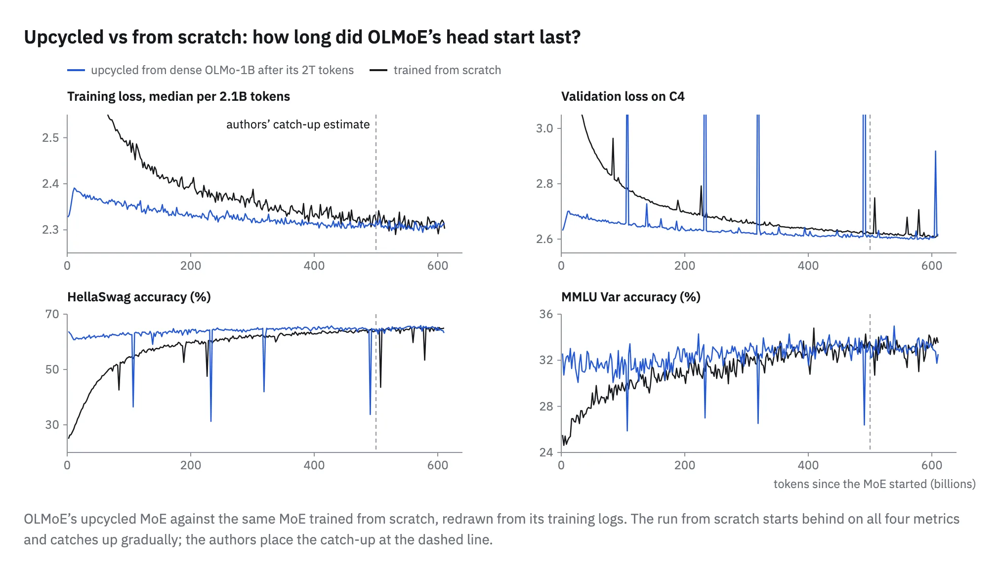

[Figure explanation, controls and captured states](../figures/olmoe-upcycling.md) · [Interactive original](../upstream/app/public/viz/index.html?c=olmoe-upcycling)


In the figure, the upcycled run starts ahead on all four metrics, and the run from scratch narrows the gap only gradually. Its HellaSwag and MMLU accuracies come level with the upcycled run's around 500B tokens, where the authors place the catch-up, while its training and validation losses stay slightly higher until about 600B tokens.

A trained MoE can grow the same way, by copying its own experts instead of a dense MLP. The figure below turns an 8-expert MoE into a 16-expert one and shows what the copies do to routing.


**Figure 3.6.2**

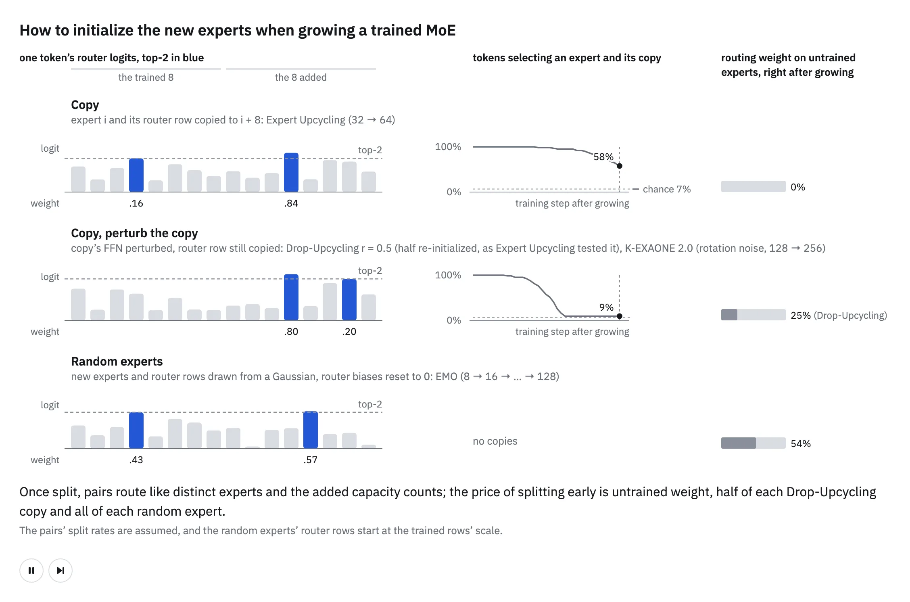

[Figure explanation, controls and captured states](../figures/expert-upcycling.md) · [Interactive original](../upstream/app/public/viz/index.html?c=expert-upcycling)


With top-2 routing and each copy inheriting its original's router row, the figure's exact copies tie: every token picks an expert and its copy at equal weight, so it runs one distinct expert instead of two. Perturbing the copy gives the router a gradient between the pair, and random new experts avoid the tie but put routing weight on untrained experts. All three have been used to grow MoEs: Expert Upcycling copies each expert with its router row, going from 32 to 64 experts[188](A-appendix.md#ref-src-expup-copy) [evidence](../citation-evidence.md#expup-copy), K-EXAONE 2.0 adds a random rotation to each copy, going from 128 to 256[189](A-appendix.md#ref-src-kexaone-grow) [evidence](../citation-evidence.md#kexaone-grow), Expert Upcycling also tested Drop-Upcycling, which re-initializes part of each copy's weights, half in the setting its authors found best[190,191](A-appendix.md#ref-src-expup-drop) [evidence](../citation-evidence.md#expup-drop) [evidence](../citation-evidence.md#dropup-r), and EMO draws the new experts and router rows from a Gaussian[192](A-appendix.md#ref-src-emo-init) [evidence](../citation-evidence.md#emo-init). In Megatron, upcycling from a dense checkpoint is `--moe-use-upcycling` with `--moe-upcycling-granularity`, and at the pin it needs the two local fixes described in [2.5](2-setup-and-your-first-run.md#s-2-5).

**Megatron source**

**[`training.py#L3043-L3083`](https://github.com/NVIDIA/Megatron-LM/blob/d6316eb45bf1bfbb6f1f848c0b56e55166564d80/megatron/training/training.py#L3043-L3083) (build dense, upcycle, save)**

```
if args.moe_use_upcycling:
    torch.distributed.barrier()
    assert not checkpoint_exists(args.save), (
        "The upcycling destination directory already exists. "
        "Please check if --moe-use-upcycling is mistakenly enabled. "
        "Upcycling should only be set for the first run when converting the dense model. "
        "All subsequent runs should remove this flag. "
    )
    # before changing moe related global args, save them in local variables
    num_experts = args.num_experts
    expert_model_parallel_size = args.expert_model_parallel_size
    moe_ffn_hidden_size = args.ffn_hidden_size

    # set dense model related args in to global args before getting dense model
    args.num_experts = None
    args.expert_model_parallel_size = 1
    args.ffn_hidden_size = moe_ffn_hidden_size * args.moe_upcycling_granularity

    # get dense model
    dense_model_for_upcycling = _build_model_wrapper(wrap_with_ddp=True)

    # recover moe upcycling related args in global args before executing upcycling
    args.num_experts = num_experts
    args.expert_model_parallel_size = expert_model_parallel_size
    args.ffn_hidden_size = moe_ffn_hidden_size

    # execute upcycling
    _, args.num_floating_point_operations_so_far = upcycling_utils.load_and_upcycle_model(
        load_checkpoint,
        unwrapped_model,
        dense_model_for_upcycling,
        load_kwargs={
            'model': dense_model_for_upcycling,
            'optimizer': None,
            'opt_param_scheduler': None,
        },
    )
    args.iteration = 1
    save_checkpoint(
        args.iteration, model, None, None, args.num_floating_point_operations_so_far
    )
```

**[`upcycling_utils.py#L145-L178`](https://github.com/NVIDIA/Megatron-LM/blob/d6316eb45bf1bfbb6f1f848c0b56e55166564d80/megatron/core/transformer/moe/upcycling_utils.py#L145-L178) (scale, split, copy per expert)**

```
def _get_moe_activation_scale():
    """
    Calc moe activation scale factor relative to dense activation.
    For more detail please refer to https://arxiv.org/abs/2410.07524.
    """
    if moe_router_pre_softmax:
        moe_activation_scale = (expansion_rate * granularity * granularity) / moe_router_topk
    else:
        moe_activation_scale = granularity
    return moe_activation_scale

def _get_weight_scale():
    moe_activation_scale = _get_moe_activation_scale()
    if gated_linear_unit == True:
        scale = moe_activation_scale ** (1 / 3)
    elif activation_func_name == ActivationFuncName.squared_relu:
        scale = moe_activation_scale ** (1 / 3)
    else:
        scale = moe_activation_scale ** (1 / 2)
    return scale

def _process_fc1_weight_param(param):
    param = param.clone()
    scale = _get_weight_scale()
    param = param * scale
    if activation_func_name == ActivationFuncName.silu and gated_linear_unit == True:
        param_1, param_2 = torch.chunk(param, 2, dim=0)
        params_1 = torch.tensor_split(param_1, granularity, dim=0)
        params_2 = torch.tensor_split(param_2, granularity, dim=0)
        params = [torch.cat([params_1[i], params_2[i]], dim=0) for i in range(granularity)]
    else:
        params = torch.tensor_split(param, granularity, dim=0)
    params = params * expansion_rate
    return params
```

At the pin (d6316eb45), the path ran for us only with two local fixes ([2.5](2-setup-and-your-first-run.md#s-2-5)). Pass the model to `load_checkpoint` under its parameter name, `ddp_model`:

**[`checkpointing.py#L2632-L2635`](https://github.com/NVIDIA/Megatron-LM/blob/d6316eb45bf1bfbb6f1f848c0b56e55166564d80/megatron/training/checkpointing.py#L2632-L2635) (the `ddp_model` parameter)**

```
def load_checkpoint(
    ddp_model,
    optimizer,
    opt_param_scheduler,
```

Then build the dense model from the arguments with `num_experts` unset, rather than from the config container that `pretrain_gpt.py` made once at start-up, so that the dense checkpoint loads into a dense model:

**[`training.py#L2917-L2925`](https://github.com/NVIDIA/Megatron-LM/blob/d6316eb45bf1bfbb6f1f848c0b56e55166564d80/megatron/training/training.py#L2917-L2925) (the model built from the config container)**

```
def _build_model_wrapper(wrap_with_ddp: bool):
    if cfg_container is not None and getattr(cfg_container, "model", None) is not None:
        from megatron.training.utils import start_memory_history_recording

        start_memory_history_recording(cfg_container.profiling)

        cfg = cfg_container
        model_config = cfg.model
        builder_cls = model_config.get_builder_cls()
```

An upcycle that went wrong loses its head start, so compare its loss with the dense run continued for the same tokens. Since the experts start as identical copies, also watch MaxVio per layer while they drift apart, computed offline from the routing trace ([A.1](A-appendix.md#s-a-1)).

Use it when a dense checkpoint exists and the MoE run is short, since a run from scratch caught up after 25% of the dense model's training tokens in OLMoE and 120% of its compute in Komatsuzaki et al.'s runs[186,187](A-appendix.md#ref-2409.02060) [evidence](../citation-evidence.md#olmoe-upcycle) [evidence](../citation-evidence.md#sparse-upcycle). Upcycling is an initialization, so set it on the first run only, and at the pin apply the two local fixes from [2.5](2-setup-and-your-first-run.md#s-2-5) first.

Whether you upcycle or start from random weights only decides where the weights begin; from the first step on, the optimizer decides where they go. Each expert, though, sees only the tokens routed to it, so should your optimizer move an expert that got a handful of tokens as far as a busy one?

<a id="s-3-6-optimizer"></a>

#### Optimizer

AdamW, the optimizer DeepSeek-V3 trained with[163](A-appendix.md#ref-2412.19437) [evidence](../citation-evidence.md#dsv3-adamw), scales each weight's update by that weight's own gradient history, so how far an expert moves follows the gradients its tokens produced. Muon, an optimizer for weight matrices used by several recent MoEs, sizes the step another way. It orthogonalizes each update, pushing its nonzero singular values toward one, and then multiplies it by a scale set by the matrix's shape alone, so the size of the step no longer depends on how large the gradient behind it is.

Megatron orthogonalizes each expert's matrix on its own ([`transformer_engine.py#L2665-L2668`](https://github.com/NVIDIA/Megatron-LM/blob/d6316eb45bf1bfbb6f1f848c0b56e55166564d80/megatron/core/extensions/transformer_engine.py#L2665-L2668), [`transformer_config.py#L956`](https://github.com/NVIDIA/Megatron-LM/blob/d6316eb45bf1bfbb6f1f848c0b56e55166564d80/megatron/core/transformer/transformer_config.py#L956), [`emerging_optimizers.py#L147-L149`](https://github.com/NVIDIA/Megatron-LM/blob/d6316eb45bf1bfbb6f1f848c0b56e55166564d80/megatron/core/optimizer/emerging_optimizers.py#L147-L149)), as DeepSeek-V4 does[193](A-appendix.md#ref-2606.19348) [evidence](../citation-evidence.md#dsv4-muon), so an expert the router rarely picks can move about as far as the busiest one, only in its own direction, and it keeps moving even in a step where it got no tokens, along its momentum. The figure below shows what that means over 49 toy experts, plotting update size against tokens per step for AdamW, for Muon applied to each expert separately, and for Muon over all experts as one matrix.


**Figure 3.6.3**

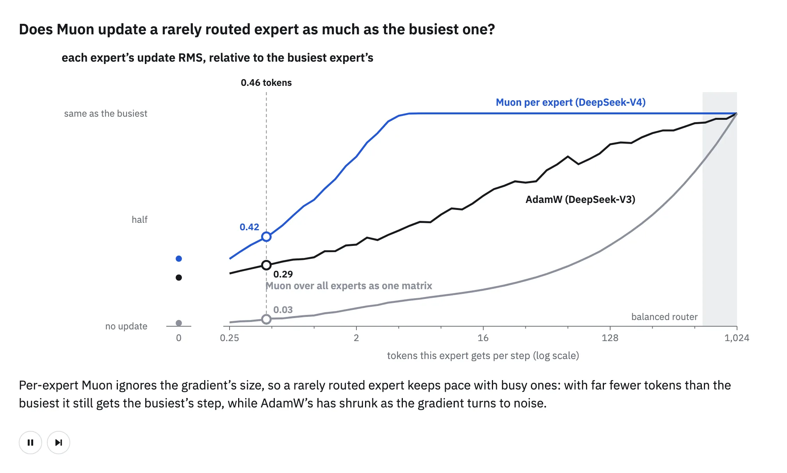

[Figure explanation, controls and captured states](../figures/muon-expert-steps.md) · [Interactive original](../upstream/app/public/viz/index.html?c=muon-expert-steps)


As an expert's tokens fall in the toy, its update shrinks under AdamW as the gradient turns to noise and, under Muon over all experts as one matrix, with the size of its gradient, while per-expert Muon keeps the busiest expert's step down to a few tokens per step. Below that, the per-expert step shrinks too: each token adds a single direction to the gradient, and with so few tokens even the momentum of recent steps no longer fills the expert's matrix.

The figure shows how Muon moves each expert; whether that trains a better MoE has been measured on whole models. Moonlight, an MoE with 3B active and 16B total parameters, performed significantly better with Muon than its twin trained with AdamW under the same settings, compared at about 1.2T tokens[194](A-appendix.md#ref-2502.16982) [evidence](../citation-evidence.md#moonlight-t4).

Once you are on Muon, one choice remains that adopters make differently: which optimizer updates the router. DeepSeek-V4 keeps it on Muon[193](A-appendix.md#ref-2606.19348) [evidence](../citation-evidence.md#dsv4-muon), while Qwen3.8-Next moved it to AdamW after Muon destabilized the router early in training[195](A-appendix.md#ref-2608.30320) [evidence](../citation-evidence.md#qwen38-router). Lau and Su compared router optimizers on two small MoEs, one shaped like OLMoE-1B-7B and a downsized gpt-oss: with Muon on the hidden matrices, AdamW on the router ended slightly worse than row-normalized or left-spectral router updates[196](A-appendix.md#ref-2605.18106) [evidence](../citation-evidence.md#symcompat-router).

In Megatron, Muon is `--optimizer muon`, and to put the router on Adam instead, add `--moe-router-skip-muon`, available from [Megatron Core v0.20](https://github.com/NVIDIA/Megatron-LM/releases/tag/core_v0.20.0) on.

**Megatron source**

**[`emerging_optimizers.py#L147-L154`](https://github.com/NVIDIA/Megatron-LM/blob/d6316eb45bf1bfbb6f1f848c0b56e55166564d80/megatron/core/optimizer/emerging_optimizers.py#L147-L154) (which params go to Adam)**

```
def _is_nonlinear_or_embedding(param):
    """True for parameters that should NOT use the emerging optimizer."""
    return getattr(param, 'is_embedding_or_output_parameter', False) or len(param.shape) != 2


def _is_muon_excluded(param):
    """True for parameters that should use the scalar optimizer instead of Muon."""
    return not getattr(param, 'use_muon', True) or _is_nonlinear_or_embedding(param)
```

**[`router.py#L88-L91`](https://github.com/NVIDIA/Megatron-LM/blob/d6316eb45bf1bfbb6f1f848c0b56e55166564d80/megatron/core/transformer/moe/router.py#L88-L91) (router off Muon)**

```
if self.config.moe_router_skip_muon:
    setattr(self.weight, 'use_muon', False)
    if self.bias is not None:
        setattr(self.bias, 'use_muon', False)
```

**[`emerging_optimizers.py#L303-L324`](https://github.com/NVIDIA/Megatron-LM/blob/d6316eb45bf1bfbb6f1f848c0b56e55166564d80/megatron/core/optimizer/emerging_optimizers.py#L303-L324) (orthogonalize, then shape scale)**

```
if scale_shape is None:
    size = [grad.size(-2), grad.size(-1)]
    if partition_dim is not None:
        size[partition_dim] *= get_pg_size(tp_group)
else:
    # This overrides only the final Muon scalar; NS still uses grad's physical
    # shape and partition metadata for its collectives.
    size = scale_shape
# Only forward the kwarg when enabled; older emerging_optimizers do not
# accept it at all, and __init__ has already rejected use_syrk on those.
ns_kwargs = {"use_syrk": True} if use_syrk else {}
orth_grad = newton_schulz_tp(
    grad,
    steps=num_ns_steps,
    coefficient_type=coefficient_type,
    tp_group=tp_group,
    partition_dim=partition_dim,
    tp_mode="duplicated" if tp_mode_this_group == "blockwise" else tp_mode_this_group,
    **ns_kwargs,
)
scale_factor = get_muon_scale_factor(size[0], size[1], mode=scale_mode)
return orth_grad * scale_factor * extra_scale_factor
```

**[`arguments.py#L1792-L1798`](https://github.com/NVIDIA/Megatron-LM/blob/d6316eb45bf1bfbb6f1f848c0b56e55166564d80/megatron/training/arguments.py#L1792-L1798) (stacked experts: undefined)**

```
assert not (
    args.use_layer_wise_distributed_optimizer and args.moe_single_grouped_weight
), (
    "The LayerWise distributed optimizer does not support --moe-single-grouped-weight: "
    "Muon semantics for a single grouped [E, N, K] expert weight are not defined. "
    "Disable --moe-single-grouped-weight or use Adam/DistributedOptimizer."
)
```

Under Muon, experts can collapse[197](A-appendix.md#ref-2605.27605) [evidence](../citation-evidence.md#laguna-collapse), and too large an update scale can make the run diverge[198](A-appendix.md#ref-2605.31268) [evidence](../citation-evidence.md#mellum2-muon). Track what each expert receives and produces: tokens per expert per step, offline from the routing trace ([A.1](A-appendix.md#s-a-1)), and, per layer, the largest and the smallest expert output norm, each divided by the layer's median, from a forward hook of ours ([A.1](A-appendix.md#s-a-1)).

Use Muon when you can afford to tune it. Start at `--muon-extra-scale-factor 0.2`, since Megatron's default of 1.0 diverged on a dense 7B in Mellum2's tests[198](A-appendix.md#ref-2605.31268) [evidence](../citation-evidence.md#mellum2-muon), and choose the router's optimizer with `--moe-router-skip-muon`, a call adopters make both ways. It does not run with Megatron-FSDP or Torch-FSDP2.

However the optimizer moves the weights, each step still learns only from predicting the next token. Could you get more signal out of each step by predicting further ahead, and what would that cost in step time?

<a id="s-3-6-mtp"></a>

#### MTP

Multi-token prediction adds one transformer layer per extra token to predict. That layer takes the main model's hidden state together with the next token's embedding, and predicts the token after next through the shared output head. DeepSeek-V3 found it better on most benchmarks at both of its test scales, and the extra layer can be discarded at inference[199](A-appendix.md#ref-2412.19437) [evidence](../citation-evidence.md#dsv3-mtp). The figure below follows one position of the sequence through that wiring.


**Figure 3.6.4**

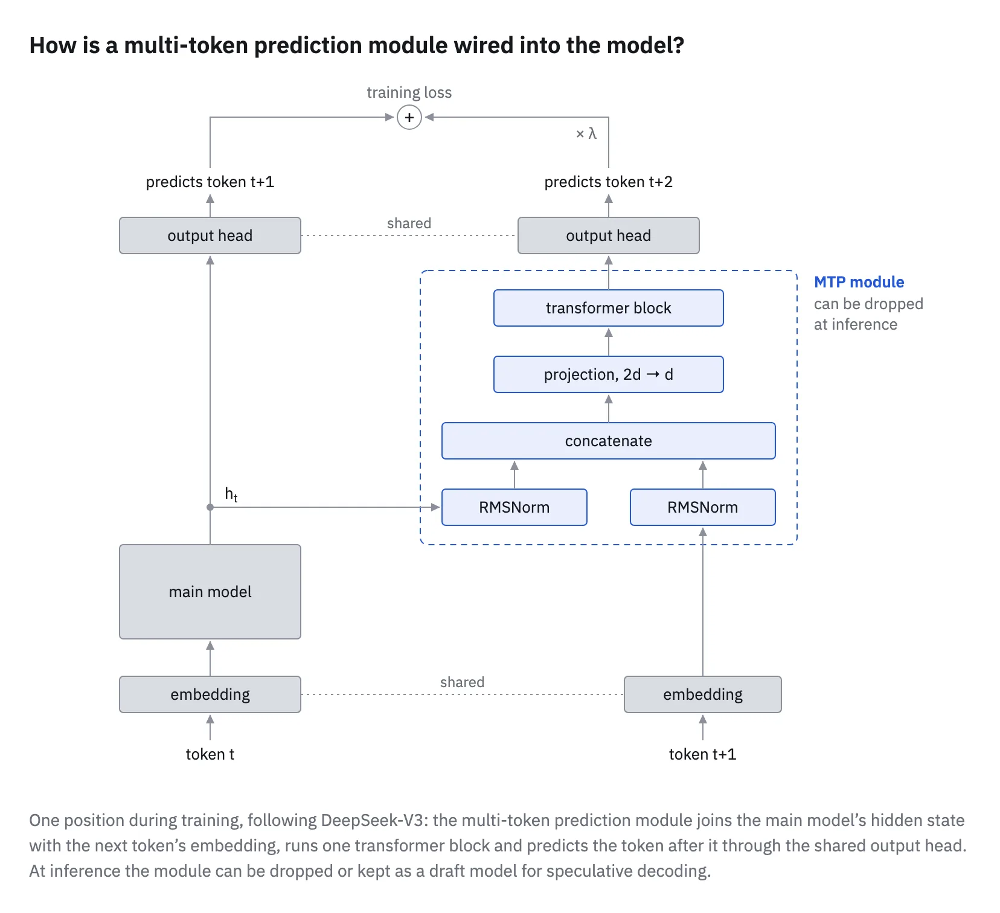

[Figure explanation, controls and captured states](../figures/mtp-layer.md) · [Interactive original](../upstream/app/public/viz/index.html?c=mtp-layer)


On their way in, the two inputs each go through their own RMSNorm, and the MTP layer concatenates them and projects the result from twice the hidden size back to it before its transformer block. Both predictions come out of the same output head, and the MTP loss is weighted and added to the main loss[199](A-appendix.md#ref-2412.19437) [evidence](../citation-evidence.md#dsv3-mtp).

The extra layer costs step time, and under [pipeline parallelism](https://huggingface.co/spaces/nanotron/ultrascale-playbook?section=pipeline_parallelism) that cost lands in one place: unless the layout moves it, Megatron puts the MTP layer on the last stage ([`multi_token_prediction.py#L886-L905`](https://github.com/NVIDIA/Megatron-LM/blob/d6316eb45bf1bfbb6f1f848c0b56e55166564d80/megatron/core/transformer/multi_token_prediction.py#L886-L905)), which already holds the output head the MTP layer reuses. On our 256-node runs, early steps took about 37% longer with one MTP layer than without, and spreading the model over 8 pipeline stages did not close that gap. Mellum2 reports 7% extra training time for a 14B MoE[200](A-appendix.md#ref-2605.31268) [evidence](../citation-evidence.md#mellum2-mtp).

**Megatron source**

**[`multi_token_prediction.py#L1709-L1714`](https://github.com/NVIDIA/Megatron-LM/blob/d6316eb45bf1bfbb6f1f848c0b56e55166564d80/megatron/core/transformer/multi_token_prediction.py#L1709-L1714) (hidden plus next-token embedding)**

```
hidden_states = apply_module(self.hnorm)(hidden_states)
hidden_states = make_viewless_tensor(
    inp=hidden_states, requires_grad=True, keep_graph=True
)
hidden_states = torch.cat((decoder_input, hidden_states), -1)
hidden_states, _ = self.eh_proj(hidden_states)
```

**[`multi_token_prediction.py#L1276-L1276`](https://github.com/NVIDIA/Megatron-LM/blob/d6316eb45bf1bfbb6f1f848c0b56e55166564d80/megatron/core/transformer/multi_token_prediction.py#L1276-L1276) (loss times factor over depth)**

```
mtp_loss_scale = config.mtp_loss_scaling_factor / config.mtp_num_layers
```

**[`multi_token_prediction.py#L932-L937`](https://github.com/NVIDIA/Megatron-LM/blob/d6316eb45bf1bfbb6f1f848c0b56e55166564d80/megatron/core/transformer/multi_token_prediction.py#L932-L937) (no layout: last stage)**

```
# without custom PP layout, we only support put all of MTP layers on the last pipeline stage
if mtp_num_layers is not None:
    if pp_size is None:
        # Compatibility fallback for callers without explicit pipeline metadata.
        pp_size = parallel_state.get_pipeline_model_parallel_world_size()
    mtp_on_this_rank = pp_rank == pp_size - 1
```

**[`multi_token_prediction.py#L2598-L2599`](https://github.com/NVIDIA/Megatron-LM/blob/d6316eb45bf1bfbb6f1f848c0b56e55166564d80/megatron/core/transformer/multi_token_prediction.py#L2598-L2599) (detach cuts trunk gradient)**

```
if self.config.mtp_detach_heads:
    hidden_states = hidden_states.detach()
```

Much of that gap may come from where the layer sits. A pipeline step waits for its slowest stage, so a layer added to one stage slows the step by its share of that stage's work, not by its much smaller share of the whole model. Ling 2.0's team ran into the same imbalance: they measured an MTP layer at about 1.7 times the compute of a standard MoE layer, and repartitioning the pipeline around it gained 40% end to end[201](A-appendix.md#ref-2510.22115) [evidence](../citation-evidence.md#ling2-mtp).

Megatron turns MTP on with `--mtp-num-layers`, the number of extra depths to add, and `--mtp-loss-scaling-factor` weights the MTP loss: DeepSeek-V3 used 0.3 for its first 10T tokens and 0.1 after[163](A-appendix.md#ref-2412.19437) [evidence](../citation-evidence.md#dsv3-mtp-lambda), and Mellum2 used 0.1[200](A-appendix.md#ref-2605.31268) [evidence](../citation-evidence.md#mellum2-mtp). To choose which stage holds the MTP layer, written `m`, use `--pipeline-model-parallel-layout`. If you want the MTP layer only as a draft model for speculative decoding, `--mtp-detach-heads` detaches its inputs, so the MTP loss trains the MTP layer and leaves the main model alone.

Megatron logs an `mtp_1 loss` next to the lm loss whenever MTP is on, while the MTP layer's cost shows elsewhere, in step time and in the memory of the stage that holds it. To find the slow stage, log forward and backward compute time per pipeline rank with `--timing-log-level 2 --timing-log-option all` ([A.1](A-appendix.md#s-a-1)); the stage holding the MTP layer should show up as the slowest rank.

Use it when the denser training signal DeepSeek-V3 reports[199](A-appendix.md#ref-2412.19437) [evidence](../citation-evidence.md#dsv3-mtp) is worth the step time. Under pipeline parallelism, place the MTP layer with `--pipeline-model-parallel-layout`, or the last stage carries it.

Each part so far has told you what to watch for its own choice. Some failures, though, belong to no single choice and can start anywhere in the model, so what should every run have in place to catch them?

<a id="s-3-6-stability"></a>

#### Stability

An MoE run can fail loudly or quietly. A loud failure shows in the loss, which spikes or turns into NaN, while a quiet one, such as routing collapse[76](A-appendix.md#ref-2408.15664) [evidence](../citation-evidence.md#lossfree-f2) or a rogue expert[15](A-appendix.md#ref-2602.10604) [evidence](../citation-evidence.md#step35-f4), can leave the loss flat.

The loudest failure is also the easiest to catch, since Megatron checks every step's loss and gradients for a NaN by default ([3.0](3-anatomy-of-moe-training.md#s-3-0)). What you want to know next is whether to blame the hardware, so when the check fires, Megatron reruns the step (`--rerun-mode validate_results`, also on by default). The first rerun, on the same GPU, tells a transient error from one that repeats. If the NaN repeats, Megatron exits with code 16 so that the job restarts from a checkpoint on another GPU, where the second rerun tells a faulty GPU from a NaN that the data or the model really produced.

Bad hardware and bad batches do not always end in a NaN, because they can also return a finite loss or gradient with a far too large exponent. Megatron catches those with `--check-for-spiky-loss` and `--check-for-large-grads`: each flags a value 10x the largest of the first 100 it has seen, reruns the step once on the same GPU, logs whether the value came back, and keeps training.

All of these checks react to a step that has already gone wrong. To stop the loss from breaking in the first place, [3.1](3-anatomy-of-moe-training.md#s-3-1) already protects the router, with fp32 math and a z-loss that holds its logits down, and recent large MoEs add guards of their own. Some cap a value before it can grow: DeepSeek-V3 and Step [3.5](3-anatomy-of-moe-training.md#s-3-5) Flash clip the gradient norm[163,183](A-appendix.md#ref-2412.19437) [evidence](../citation-evidence.md#train-dsv3) [evidence](../citation-evidence.md#train-step35), DeepSeek-V4.1-Flash clamps the experts' SwiGLU activations[180](A-appendix.md#ref-2609.19969) [evidence](../citation-evidence.md#train-dsv41), and Step [3.5](3-anatomy-of-moe-training.md#s-3-5) Flash clips expert activations as well[183](A-appendix.md#ref-2602.10604) [evidence](../citation-evidence.md#train-step35). Others keep the most sensitive operations in higher precision: DeepSeek-V3 kept its embedding, output head, MoE gating, normalization and attention in BF16 or FP32 during FP8 training[163](A-appendix.md#ref-2412.19437) [evidence](../citation-evidence.md#train-dsv3), and Kimi K3 keeps the attention output in FP32[181](A-appendix.md#ref-2607.24653) [evidence](../citation-evidence.md#train-k3). LongCat-Flash carries the z-loss idea over to the hidden states[182](A-appendix.md#ref-2509.01322) [evidence](../citation-evidence.md#train-longcat).

The quiet failures may not show in the loss at all, so you have to look for them elsewhere. The figure below simulates three of them next to a healthy run: routing collapse, a dead expert and a rogue expert.


**Figure 3.6.5**

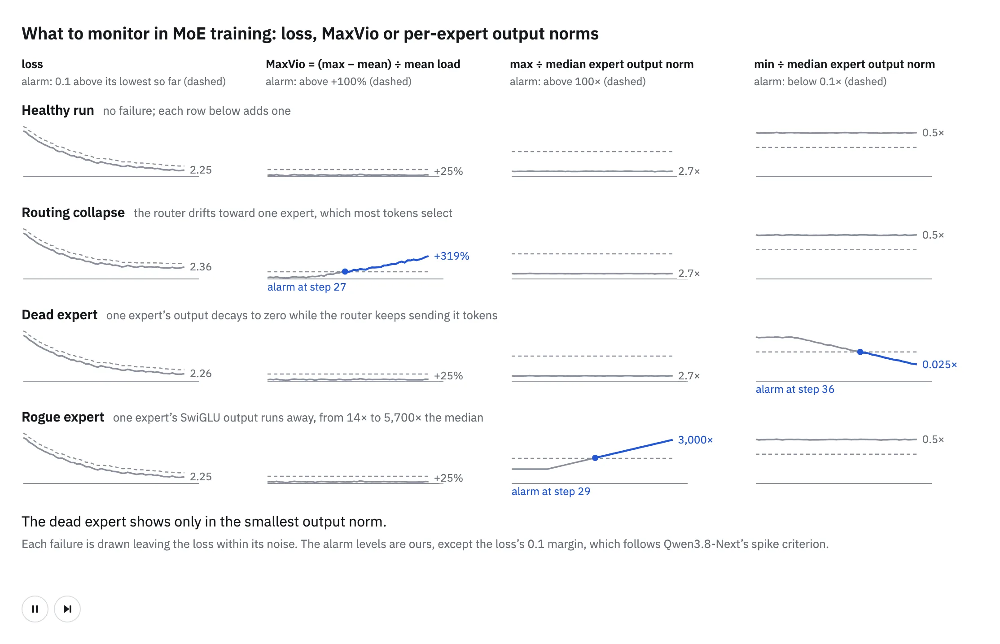

[Figure explanation, controls and captured states](../figures/moe-failure-signals.md) · [Interactive original](../upstream/app/public/viz/index.html?c=moe-failure-signals)


Since the simulation keeps the loss flat through all three failures, only the other signals tell them apart from the healthy run. Routing collapse drives MaxVio up. A dead expert pulls the smallest expert output norm far below the layer's median, and a rogue expert pushes the largest far above it, from about 14 to about 5,700 times the median as in Step [3.5](3-anatomy-of-moe-training.md#s-3-5) Flash's layer 45[15](A-appendix.md#ref-2602.10604) [evidence](../citation-evidence.md#step35-f4). The loss alarm, 0.1 above the lowest loss so far, borrows the margin of Qwen3.8-Next's spike criterion[202](A-appendix.md#ref-2608.30320) [evidence](../citation-evidence.md#qwen38-spike).

**Megatron source**

**[`pretrain_gpt.py#L263-L292`](https://github.com/NVIDIA/Megatron-LM/blob/d6316eb45bf1bfbb6f1f848c0b56e55166564d80/pretrain_gpt.py#L263-L292) (NaN, Inf, spiky loss)**

```
# Check individual rank losses are not NaN prior to DP all-reduce.
rerun_state_machine = get_rerun_state_machine()
if args.check_for_nan_in_loss_and_grad:
    rerun_state_machine.validate_result(
        result=loss,
        rejection_func=torch.isnan,
        message="found NaN in local forward loss calculation",
        tolerance=0.0,  # forward pass calculations are deterministic
        fatal=True,
    )
    rerun_state_machine.validate_result(
        result=loss,
        rejection_func=torch.isinf,
        message="found Inf in local forward loss calculation",
        tolerance=0.0,  # forward pass calculations are deterministic
        fatal=True,
    )
# Check for spiky loss
if args.check_for_spiky_loss:
    rerun_state_machine.validate_result(
        result=loss,
        rejection_func=partial(
            rerun_state_machine.is_unexpectedly_large,
            threshold=SPIKY_LOSS_FACTOR,
            context="loss",
        ),
        message="Spiky loss",
        tolerance=0.0,  # forward pass calculations are deterministic
        fatal=False,
    )
```

**[`param_and_grad_buffer.py#L389-L425`](https://github.com/NVIDIA/Megatron-LM/blob/d6316eb45bf1bfbb6f1f848c0b56e55166564d80/megatron/core/distributed/param_and_grad_buffer.py#L389-L425) (per-bucket grad norm checks)**

```
def check_grads(self, check_for_nan_or_inf, check_for_large):
    """
    Make sure norm of grads in bucket are not NaN prior to data-parallel
    all-reduce / reduce-scatter.
    """
    rerun_state_machine = get_rerun_state_machine()
    for i in range(len(self.buckets)):
        grad_norm = self.buckets[i].grad_data.norm(p=2)
        # check for NaN, Inf and unexpectedly large grads
        if check_for_nan_or_inf:
            rerun_state_machine.validate_result(
                result=grad_norm,
                rejection_func=torch.isnan,
                message=f"found NaN in local grad norm for bucket #{i} "
                f"in backward pass before data-parallel communication collective",
                tolerance=0.001,  # 0.1% tolerance to account for non-deterministic FA backward
                fatal=True,
            )
            rerun_state_machine.validate_result(
                result=grad_norm,
                rejection_func=torch.isinf,
                message=f"found Inf in local grad norm for bucket #{i} "
                f"in backward pass before data-parallel communication collective",
                tolerance=0.001,  # 0.1% tolerance to account for non-deterministic FA backward
                fatal=True,
            )
        if check_for_large:
            rerun_state_machine.validate_result(
                result=grad_norm,
                rejection_func=partial(
                    rerun_state_machine.is_unexpectedly_large, threshold=10, context="grads"
                ),
                message=f"found unexpected large grads in bucket #{i} "
                f"in backward pass before data-parallel communication collective",
                tolerance=0.001,  # 0.1% tolerance to account for non-deterministic FA backward
                fatal=False,
            )
```

**[`rerun_state_machine.py#L752-L766`](https://github.com/NVIDIA/Megatron-LM/blob/d6316eb45bf1bfbb6f1f848c0b56e55166564d80/megatron/core/rerun_state_machine.py#L752-L766) (10x the early maximum)**

```
value: float = math.fabs(result.item())
# Ignore NaNs and Infs. They should be checked separately.
if math.isnan(value) or math.isinf(value):
    return False

if resample or context not in self.large_value_counts:
    self.large_value_counts[context] = 0
if self.large_value_counts[context] < num_samples:
    self.large_value_counts[context] += 1
    self.max_values[context] = max(self.max_values.get(context, 0.0), value)
    if self.large_value_counts[context] == num_samples:
        logger.warning(f"Max value for {context}: {self.max_values[context]}")
    return False

return value >= self.max_values[context] * threshold
```

**[`rerun_state_machine.py#L622-L694`](https://github.com/NVIDIA/Megatron-LM/blob/d6316eb45bf1bfbb6f1f848c0b56e55166564d80/megatron/core/rerun_state_machine.py#L622-L694) (rerun here, then elsewhere)**

```
if self.state == RerunState.RERUNNING_IN_PLACE:
    if comparison > tolerance:
        if not fatal:
            self.continue_requested = True
        log_failure(
            "First rerun: unexpected result is not reproducible within the tolerance "
            f"({result} != {self.initial_result})",
            fatal=fatal,
        )
        self._log_validation_error_to_file(
            status=RerunValidationStatus.FIRST_RERUN_NOT_REPRODUCIBLE,
            result=result,
            message=message,
        )
        log_failure("Possible transient error!", fatal=fatal)

    else:
        if fatal:
            self.checkpoint_requested = True
        else:
            self.continue_requested = True
        # Remember the node and device we're running on so that we can check we're not
        # rerunning on the same GPU when we resume from the checkpoint.
        self.suspicious_node = os.uname()[1]
        self.suspicious_device = torch.cuda.current_device()
        self._log_validation_error_to_file(
            status=RerunValidationStatus.FIRST_RERUN_REPRODUCIBLE,
            result=result,
            message=message,
        )
        log_failure(
            "First rerun: unexpected result is reproducible within the tolerance "
            f"({result} = {self.initial_result}). "
            "Need to rerun on a different GPU to verify correctness.",
            fatal=fatal,
        )
# This is the second re-run.
elif self.state == RerunState.RERUNNING_FROM_CHECKPOINT:
    # Ensure we're not on the same GPU as the first rerun.
    node = os.uname()[1]
    device = torch.cuda.current_device()
    if node == self.suspicious_node and device == self.suspicious_device:
        logger.error(
            f"Got rescheduled on the same GPU. Need to resume again from the same "
            f"checkpoint (node: {self.suspicious_node}, gpu: {self.suspicious_device})"
        )
        self.restart_again_requested = True
    elif comparison > tolerance:
        self._log_validation_error_to_file(
            status=RerunValidationStatus.SECOND_RERUN_NOT_REPRODUCIBLE,
            result=result,
            message=message,
        )
        logger.warning(
            "Second rerun: unexpected result is not reproducible on a different GPU, "
            f"therefore was likely incorrect ({result} != {self.initial_result})"
        )
        log_failure("Possible persistent error!")
        if not fatal:
            self.continue_requested = True
```

For spikes, watch the router's logits through the z-loss ([3.1](3-anatomy-of-moe-training.md#s-3-1)). The failures that leave the loss flat need signals of their own: for routing collapse, MaxVio per layer, computed offline from the routing trace ([A.1](A-appendix.md#s-a-1)), next to the load-balancing loss, and for dead and rogue experts, the largest and the smallest expert output norm in each layer over the layer's median, from a hook of ours ([A.1](A-appendix.md#s-a-1)).

Use it always: keep the default NaN check and `--rerun-mode validate_results`.

#### What to watch

| Part | Symptom | Signal to watch |
| --- | --- | --- |
| Upcycling | `learns badly`: the loss falls slowly at first. | Loss against the dense run continued for the same tokens. While the copied experts drift apart, also MaxVio per layer (routing trace, [A.1](A-appendix.md#s-a-1)). |
| Optimizer | `learns badly`: experts collapse. `blows up`: when orthogonalization runs in bf16, or when the update scale is too large. | Tokens per expert per step (routing trace, [A.1](A-appendix.md#s-a-1)). Per layer, the largest and smallest expert output norm, each over the median (forward hook, [A.1](A-appendix.md#s-a-1)). |
| MTP | `slow`: one pipeline stage takes longer than the others. `OOM`: MTP with 53 layers on 4 pipeline stages ran out of memory. | `mtp_1 loss` alongside LM loss; step time and peak memory; forward and backward compute time per pipeline rank (`--timing-log-level 2 --timing-log-option all`, [A.1](A-appendix.md#s-a-1)), especially the stage holding MTP[201](A-appendix.md#ref-2510.22115) [evidence](../citation-evidence.md#ling2-mtp). |
| Stability | `blows up`: NaNs and loss spikes. `learns badly`: routing collapse, dead experts or rogue experts. | The router z-loss ([3.1](3-anatomy-of-moe-training.md#s-3-1)), for the router logits ST-MoE traced its instabilities to[38](A-appendix.md#ref-2202.08906) [evidence](../citation-evidence.md#stmoe-s34). Per layer, MaxVio (routing trace) and the largest and smallest expert output norm over the median ([A.1](A-appendix.md#s-a-1)). |

A run that trains cleanly can still spend a large share of each step waiting on communication rather than computing. Where does the time in an MoE step go, and how much of it can you get back?

<a id="s-3-7"></a>

### 3.7 Systems: where the time goes and how to get it back


**hero-anatomy-zoom**


[Figure explanation, controls and captured states](../figures/hero-anatomy-zoom.md) · [Interactive original](../upstream/app/public/viz/index.html?c=hero-anatomy-zoom&stage=8&mini=1)


Every MoE layer sends its tokens to their experts and brings them back, and on a real run that traffic can take much of the step. In the one step we traced on one node, half the time was exposed all-to-all, while the router was still unbalanced. The figure below zooms in on those two transfers, dispatch out to the experts and combine back, which run over NVLink inside a node and over the fabric across nodes.

You can place the experts so that less traffic crosses the slower network between nodes, and hide the traffic that remains behind other compute. You can keep the memory that costs in check, cap how many nodes each token reaches, and trade dropped tokens or precision for speed. Each part comes from its own setup, so do not add their gains together; test them as alternatives, one at a time.

Systems choices documented in model reports. Parallelism and overlap describe training; post-training quantization is labeled separately. These are model-specific implementations, not interchangeable Megatron flag settings.

| Model | Interconnect and overlap | Memory and precision | Routing constraints |
| --- | --- | --- | --- |
| DeepSeek-V3[203](A-appendix.md#ref-2412.19437) [evidence](../citation-evidence.md#systems-dsv3) | EP64 across 8 nodes; DualPipe overlaps computation and communication | FP8 [mixed-precision](https://huggingface.co/spaces/nanotron/ultrascale-playbook?section=mixed_precision_training) training; recompute RMSNorm, MLA up-projections and SwiGLU outputs | At most 4 target nodes per token; no token dropping |
| DeepSeek-V4[204](A-appendix.md#ref-2606.19348) [evidence](../citation-evidence.md#systems-dsv4) | Fused MoE pipeline schedules expert groups in waves to overlap dispatch, GEMMs and combine | Tensor-level checkpointing and selective recomputation | Removes V3's target-node limit |
| Kimi K3[205,21](A-appendix.md#ref-2607.24653) [evidence](../citation-evidence.md#systems-k3) [evidence](../citation-evidence.md#k3-qat) | Optimizer fetches only locally owned parameter shards; communication pipelined with computation | Avoids a full-parameter gather buffer; SFT/RL use MXFP4 expert weights and MXFP8 activations | One expert group in the released config[206](A-appendix.md#ref-src-hub-kimi-k3-route) [evidence](../citation-evidence.md#hub-kimi-k3-route) |
| LongCat-Flash[178,207](A-appendix.md#ref-2509.01322) [evidence](../citation-evidence.md#longcat-overlap) [evidence](../citation-evidence.md#systems-longcat) | EP groups of 32 accelerators; pipelined all-gather/reduce-scatter and shortcut-connected MoE | BF16 training with deterministic kernels | Identity experts require no expert communication |

Before reaching for any of these levers, you need to see where your own step spends its time, since each kind of waste calls for a different fix. What does one profiled step on a single node show?

<a id="s-3-7-profiling"></a>

#### Profiling

[Megatron](https://github.com/NVIDIA/Megatron-LM) can record a trace of any step for you. With `--profile` alone it records an nsys trace, and `--use-pytorch-profiler` switches it to a torch profiler trace ([`argument_utils.py#L706-L709`](https://github.com/NVIDIA/Megatron-LM/blob/d6316eb45bf1bfbb6f1f848c0b56e55166564d80/megatron/training/argument_utils.py#L706-L709)). In either case, `--profile-step-start`, `--profile-step-end` and `--profile-ranks` pick which steps and ranks to trace. The step we traced comes from a 7B-A1B MoE, with 7B parameters in total and 1B active per token. Its 16 layers hold 64 experts each with top-8 routing, and it trained on one node of 8 H100s. Tracing it cost one short job, which traced iteration 4 and had moved past it within about six minutes of launch. The figures below break that step down and annotate its trace.


**Figure 3.7.1**

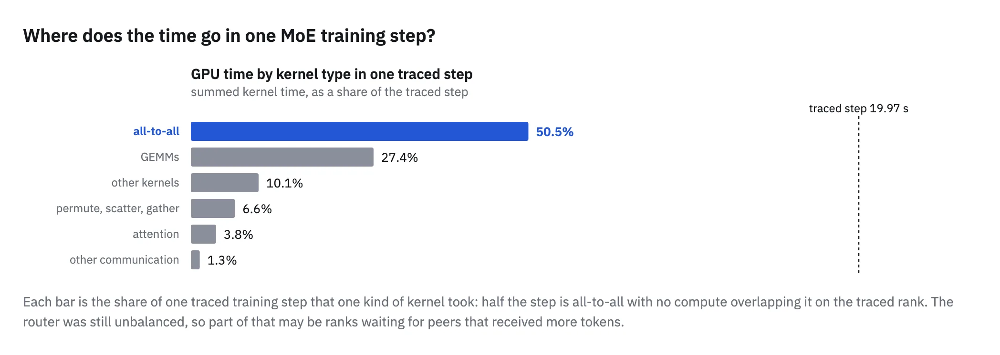

[Figure explanation, controls and captured states](../figures/step-breakdown.md) · [Interactive original](../upstream/app/public/viz/index.html?c=step-breakdown)


**Figure 3.7.2**

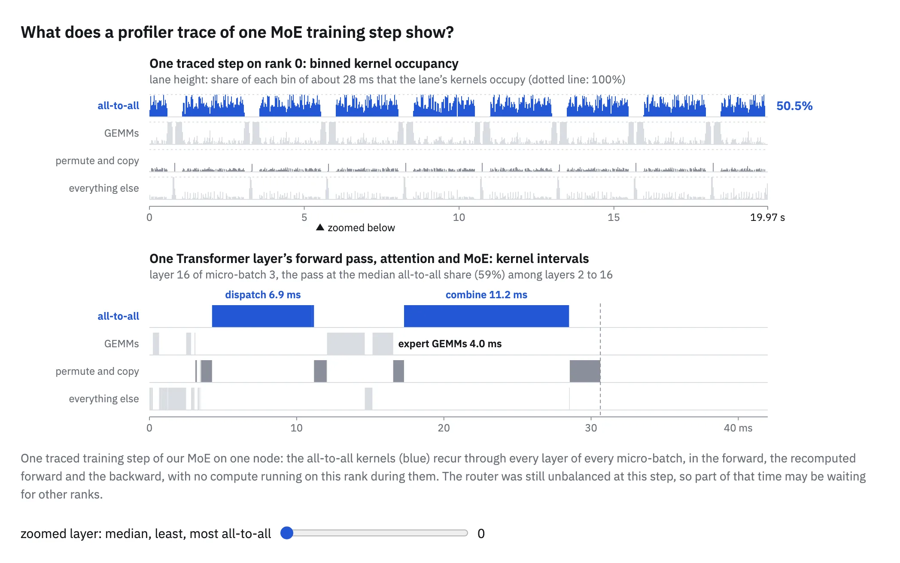

[Figure explanation, controls and captured states](../figures/annotated-trace.md) · [Interactive original](../upstream/app/public/viz/index.html?c=annotated-trace)


The all-to-all took half of that step, but how much of that half was the network actually moving data? When one GPU's experts get more tokens than the rest, that GPU finishes its expert compute late, and NVIDIA's Megatron Core team reports that the other ranks then wait for it at synchronization points[208](A-appendix.md#ref-2603.07685) [evidence](../citation-evidence.md#mcore-s437). In an MoE layer the all-to-all can be one of those points, so part of its time in a trace can be waiting rather than moving data. Our step had a load-balancing loss of [3.2](3-anatomy-of-moe-training.md#s-3-2), where 1 is balanced, so its router was still unbalanced. A separate run of the same config, with routing forced even, ran that same iteration 40% faster.

**Megatron source**

**[`training.py#L4955-L4982`](https://github.com/NVIDIA/Megatron-LM/blob/d6316eb45bf1bfbb6f1f848c0b56e55166564d80/megatron/training/training.py#L4955-L4982) (torch profiler window per rank)**

```
if (
    cfg.profiling.use_pytorch_profiler
    and (len(cfg.profiling.profile_ranks) == 0 or
         torch.distributed.get_rank() in cfg.profiling.profile_ranks)
):
    if cfg.profiling.pytorch_profiler_collect_chakra:
        et_dir = Path(f"{cfg.logger.tensorboard_dir}/../chakra")
        et_dir.mkdir(parents=True, exist_ok=True)
        et = torch.profiler.ExecutionTraceObserver().register_callback(f"{et_dir}/rank-{torch.distributed.get_rank()}.json.gz")
    else:
        et = None
    def trace_handler(p):
        profile_dir = Path(f"{cfg.logger.tensorboard_dir}/../torch_profile")
        profile_dir.mkdir(parents=True, exist_ok=True)
        p.export_chrome_trace(f"{profile_dir}/rank-{torch.distributed.get_rank()}.json.gz")
    prof = torch.profiler.profile(
        schedule=torch.profiler.schedule(
            wait=max(cfg.profiling.profile_step_start - 1, 0),
            warmup=1 if cfg.profiling.profile_step_start > 0 else 0,
            active=cfg.profiling.profile_step_end - cfg.profiling.profile_step_start,
            repeat=1,
        ),
        on_trace_ready=trace_handler,
        record_shapes=cfg.profiling.pytorch_profiler_collect_shapes,
        with_stack=cfg.profiling.pytorch_profiler_collect_callstack,
        execution_trace_observer=et,
    )
    prof.start()
```

**[`training.py#L5041-L5053`](https://github.com/NVIDIA/Megatron-LM/blob/d6316eb45bf1bfbb6f1f848c0b56e55166564d80/megatron/training/training.py#L5041-L5053) (nsys start at step)**

```
if ((cfg.profiling.use_nsys_profiler or cfg.profiling.use_pytorch_profiler)
    and (len(cfg.profiling.profile_ranks) == 0 or
         torch.distributed.get_rank() in cfg.profiling.profile_ranks)):
    # Enable NVTX range when profiling starts and nvtx_ranges is set.
    if iteration == cfg.profiling.profile_step_start and cfg.profiling.nvtx_ranges:
        configure_nvtx_profiling(True)
    if cfg.profiling.use_pytorch_profiler:
        prof.step()
    elif iteration == cfg.profiling.profile_step_start:
        torch.cuda.check_error(torch.cuda.cudart().cudaProfilerStart())
        if cfg.profiling.record_shapes:
            nsys_nvtx_context = torch.autograd.profiler.emit_nvtx(record_shapes=cfg.profiling.record_shapes)
            nsys_nvtx_context.__enter__()
```

On your own run, start with the balance signals of [3.2](3-anatomy-of-moe-training.md#s-3-2). MaxVio, computed from the token counts that `--save-tokens-per-expert-interval` writes, shows how uneven the load is across experts. Summing those counts over each GPU's experts shows which rank receives the most tokens, and so which rank the others most likely wait for. To see how much of the all-to-all that imbalance costs, re-trace with `--moe-router-force-load-balancing`, which swaps the router's logits for random ones so that every expert gets about the same load ([`router.py#L1185-L1187`](https://github.com/NVIDIA/Megatron-LM/blob/d6316eb45bf1bfbb6f1f848c0b56e55166564d80/megatron/core/transformer/moe/router.py#L1185-L1187)). If the all-to-all shrinks under forced balance, imbalance is costing you time that better balancing ([3.3](3-anatomy-of-moe-training.md#s-3-3)) can win back, and what remains is mostly the transfer, which the rest of this section works on.

Traces also show which MoE kernels are worth fusing. Before dispatch, Megatron reorders the tokens so that each expert's tokens sit together ([`token_dispatcher.py#L668-L682`](https://github.com/NVIDIA/Megatron-LM/blob/d6316eb45bf1bfbb6f1f848c0b56e55166564d80/megatron/core/transformer/moe/token_dispatcher.py#L668-L682)), and after combine it puts them back in order ([`#L893-L900`](https://github.com/NVIDIA/Megatron-LM/blob/d6316eb45bf1bfbb6f1f848c0b56e55166564d80/megatron/core/transformer/moe/token_dispatcher.py#L893-L900)). With `--moe-permute-fusion`, the permute and copy kernels that do this fall from 11.45% to 7.14% of the step, and step time drops [3.3](3-anatomy-of-moe-training.md#s-3-3)%.

Judge each change by step time or TFLOP/s. A trace then tells you why the number moved: read the share of the step that the all-to-all leaves exposed.

Use it once for every new config: trace one step at the node count you will run. If the all-to-all takes a large share of it, check MaxVio and re-trace with `--moe-router-force-load-balancing`: fix balancing first ([3.3](3-anatomy-of-moe-training.md#s-3-3)) if the all-to-all shrinks, and work on Interconnect and Overlap below if it does not. If permute and copy kernels take a large share, try `--moe-permute-fusion`.

The step we traced kept its all-to-all inside one node, on NVLink, and a larger run cannot always do that. What happens to the step when an expert-parallel group spans two nodes and its all-to-all has to cross the network between them?

<a id="s-3-7-interconnect"></a>

#### Interconnect

Between nodes, the all-to-all leaves NVLink for the cluster's network fabric, InfiniBand or AWS's EFA for instance, so the first thing to check is that [NCCL](https://huggingface.co/spaces/nanotron/ultrascale-playbook?section=nccl) uses that fabric at all. It can fall back to plain TCP sockets even when the fabric is requested: two of our runs set `FI_PROVIDER=efa` and named an OFI plugin, NCCL still logged "Using network Socket", and they ran about 25x slower than our EP16 run on EFA. The next figure shows the settings we tried, in order.


**Figure 3.7.3**

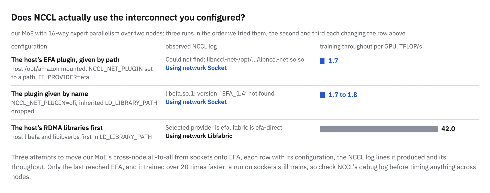

[Figure explanation, controls and captured states](../figures/efa-settings.md) · [Interactive original](../upstream/app/public/viz/index.html?c=efa-settings)


In the figure, NCCL reached EFA only once the host's RDMA libraries came first on the library path; naming the plugin, by path or by name, left it on sockets. With the fabric working, what is left to choose is the expert-parallel size, `--expert-model-parallel-size`, which decides how far the all-to-all has to travel. With expert tensor parallelism at 1 and the default rank order, Megatron forms each EP group from consecutive ranks ([`parallel_state.py#L921-L929`](https://github.com/NVIDIA/Megatron-LM/blob/d6316eb45bf1bfbb6f1f848c0b56e55166564d80/megatron/core/parallel_state.py#L921-L929)). An EP size that divides the number of GPUs in a node then keeps the all-to-all inside that node, on NVLink, and a larger one spreads it over several nodes. Our nodes hold eight H100s each, so the figure below compares EP8 in one node with EP16 across two.


**Figure 3.7.4**

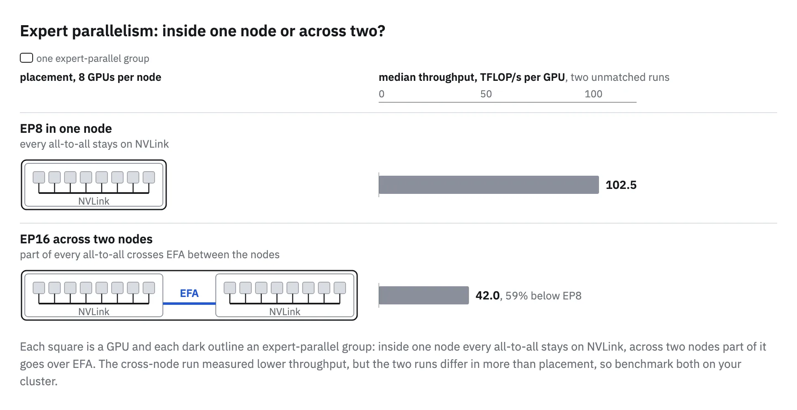

[Figure explanation, controls and captured states](../figures/ep-placement.md) · [Interactive original](../upstream/app/public/viz/index.html?c=ep-placement)


Spread over two nodes, EP16 ran 59% below EP8 in one node, even with EFA working, although the two runs also differ in their nodes and in how many micro-batches each step accumulates.

**Megatron source**

**[`parallel_state.py#L920-L930`](https://github.com/NVIDIA/Megatron-LM/blob/d6316eb45bf1bfbb6f1f848c0b56e55166564d80/megatron/core/parallel_state.py#L920-L930) (expert grid, EP after TP)**

```
expert_order = _inject_gtp_remat_axis(order, after="ep")
expert_decoder_rank_generator = RankGenerator(
    tp=expert_tensor_parallel_size,
    ep=expert_model_parallel_size,
    dp=expert_data_parallel_size,
    pp=pipeline_model_parallel_size,
    cp=1,
    order=expert_order,
    rank_offset=rank_offset,
    gtp_remat=expert_gtp_remat_size,
)
```

**[`parallel_state.py#L1419-L1428`](https://github.com/NVIDIA/Megatron-LM/blob/d6316eb45bf1bfbb6f1f848c0b56e55166564d80/megatron/core/parallel_state.py#L1419-L1428) (consecutive ranks form EP)**

```
for ranks in expert_decoder_rank_generator.get_ranks('ep'):
    group = create_group(
        ranks,
        timeout=timeout,
        pg_options=get_nccl_options("ep", nccl_comm_cfgs),
        group_desc="EXPERT_MODEL_PARALLEL_GROUP",
    )
    if rank in ranks:
        _EXPERT_MODEL_PARALLEL_GROUP = group
        _EXPERT_MODEL_PARALLEL_RANKS = ranks
```

A fallback to sockets slowed our two-node run by the factor above, so check the startup log first. With `NCCL_DEBUG=INFO`, NCCL prints "Using network" and the transport it picked. You want your fabric's transport there, such as Libfabric for the OFI plugin on EFA, while "Using network Socket" means the fallback. Once the fabric is confirmed, compare alltoall bus bandwidth inside and across nodes from [nccl-tests](https://github.com/NVIDIA/nccl-tests) ([2.1](2-setup-and-your-first-run.md#s-2-1)). Then measure TFLOP/s per GPU at an EP size that fits in one node and at one that spans two.

Use [expert parallelism](https://huggingface.co/spaces/nanotron/ultrascale-playbook?section=expert_parallelism) inside a node when the model fits that way: start there, add nodes as [data-parallel](https://huggingface.co/spaces/nanotron/ultrascale-playbook?section=data_parallelism) replicas, and time both placements at your node count before you commit.

Even on a working interconnect, the tokens that cross it still sit on the critical path while the GPUs wait. Is there other work the GPUs could do while the tokens are in flight?

<a id="s-3-7-overlap"></a>

#### Overlap

We've already seen in [3.5 Block wiring](3-anatomy-of-moe-training.md#s-3-5-block-wiring) how changing the architecture hides the all-to-all inside one micro-batch. A parallel block can run dispatch while attention computes, and a shortcut-connected MoE can also hide combine behind the dense compute that runs beside it. Rewiring changes what the router sees, however, and you may not want to touch an architecture you have already settled on. Without rewiring, the exposed all-to-all is hard to hide inside one micro-batch. A training step, however, runs many micro-batches, and the work of one does not wait on another until their gradients are summed.

Megatron borrows that work: `--overlap-moe-expert-parallel-comm` runs one micro-batch's forward beside another's backward, so the all-to-all of one hides behind the compute of the other ([`model_parallel_config.py#L349-L352`](https://github.com/NVIDIA/Megatron-LM/blob/d6316eb45bf1bfbb6f1f848c0b56e55166564d80/megatron/core/model_parallel_config.py#L349-L352)). Pipeline schedules also pair one micro-batch's forward with another's backward, as the [Ultra-Scale Playbook](https://huggingface.co/spaces/nanotron/ultrascale-playbook?section=zero_bubble_and_dualpipe) describes, and DeepSeek-V3's DualPipe uses that pairing to hide its all-to-alls[209](A-appendix.md#ref-2412.19437) [evidence](../citation-evidence.md#dsv3-dualpipe). The figure below draws one MoE layer with and without that interleaving.


**Figure 3.7.5**

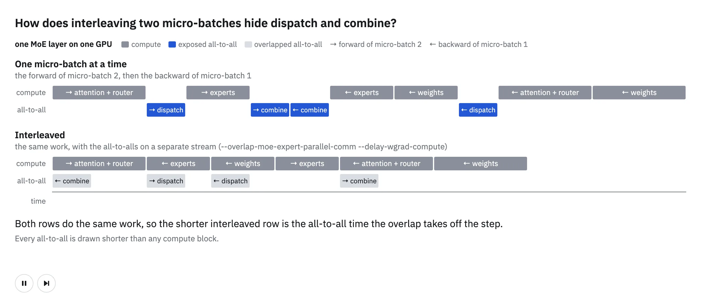

[Figure explanation, controls and captured states](../figures/combined-1f1b.md) · [Interactive original](../upstream/app/public/viz/index.html?c=combined-1f1b)


Drawn with one micro-batch after the other, the layer leaves all four all-to-alls exposed. The interleaved drawing also sets `--delay-wgrad-compute`, which Megatron's MoE guide pairs with the overlap ([`README.md#L434`](https://github.com/NVIDIA/Megatron-LM/blob/d6316eb45bf1bfbb6f1f848c0b56e55166564d80/megatron/core/transformer/moe/README.md?plain=1#L434)). That flag computes the weight gradients later, so the backward dispatch waits only for the experts' input gradients and runs under that micro-batch's own delayed expert weight gradients ([`model_chunk_schedule_plan.py#L266-L268`](https://github.com/NVIDIA/Megatron-LM/blob/d6316eb45bf1bfbb6f1f848c0b56e55166564d80/megatron/core/models/common/model_chunk_schedule_plan.py#L266-L268)), while the other three all-to-alls run under compute from the other micro-batch. On our runs, which set the overlap flag alone, the overlap raised throughput by up to 35% on two nodes. It also costs memory: rank 0 reserved 5 to 10 GB more, while its peak allocated memory barely moved.

**Megatron source**

**[`combined_1f1b.py#L54-L67`](https://github.com/NVIDIA/Megatron-LM/blob/d6316eb45bf1bfbb6f1f848c0b56e55166564d80/megatron/core/pipeline_parallel/combined_1f1b.py#L54-L67) (one forward beside one backward)**

```
"""Scheduler for 1f1b with no pipelining.

This function schedules micro-batches in a way that the forward pass of Transformer layers
for one micro-batch runs in parallel with the backward pass of another.
Each layer's forward and backward operations are co-scheduled to maximize the overlap of
their computations and communications.
EP A2A in forward step is hidden by the attention/mlp computation in the backward step,
and vice versa.
Assuming we have 4 microbatches, the schedule is as follows:
Phases 0: 1st microbatch forward
Phases 1: 1st microbatch backward + 2nd microbatch forward
Phases 2: 2nd microbatch backward + 3rd microbatch forward
Phases 3: 3rd microbatch backward + 4th microbatch forward
Phases 4: 4th microbatch backward
```

**[`model_chunk_schedule_plan.py#L226-L294`](https://github.com/NVIDIA/Megatron-LM/blob/d6316eb45bf1bfbb6f1f848c0b56e55166564d80/megatron/core/models/common/model_chunk_schedule_plan.py#L226-L294) (dispatch hidden behind MLP backward)**

```
def run(f_layer, b_layer, f_input=None, b_grad=None, is_last_layer_in_bwd=False):
    """Schedule one-forward-one-backward operations for a single transformer layer.

    This function interleaves forward and backward operations, overlapping the communications
    (dispatch or combine) of one with the computations (pre_dispatch or mlp) of the other
    to maximize parallelism and efficiency.

    When f_layer and b_layer are not None, forward and backward pass are overlapped as follows:
    comm_stream: combine_bwd       | dispatch_fwd->dispatch_bwd  | combine_fwd
    comp_stream: pre_dispatch_fwd  | mlp_bwd->mlp_bwd_dw->mlp_fwd| pre_dispatch_bwd
    For MTP, mtp_post_process_fwd is executed after the combine_fwd in the comp_stream,
    and mtp_post_process_bwd is executed before the combine_bwd in the comp_stream.

    Args:
        f_layer (TransformerLayerSchedulePlan): Forward layer (for current microbatch)
        b_layer (TransformerLayerSchedulePlan): Backward layer (for previous microbatch)
        f_input (Tensor): Input for forward computation
        b_grad (Tensor): Gradient for backward computation
        is_last_layer_in_bwd (bool):
            Whether the current layer is the last layer in the backward pass.

    Returns:
        Functions or values for next iteration's computation
    """

    if b_layer is not None:
        b_grad = b_layer.mtp_post_process.backward(b_grad)
        b_grad = b_layer.moe_combine.backward(b_grad)

    if f_layer is not None:
        with f_layer.get_low_precision_context():
            f_input = f_layer.pre_dispatch_computation.forward(f_input)

    if b_layer is not None:
        b_grad = b_layer.mlp.backward(b_grad)

    if f_layer is not None:
        with f_layer.get_low_precision_context():
            f_input = f_layer.moe_dispatch.forward(f_input)

    if b_layer is not None:
        b_layer.mlp.backward_dw()
        b_grad = b_layer.moe_dispatch.backward(b_grad)

    if b_layer is not None and b_layer.config.ep_overlap_early_attn_memory_release:
        b_grad = b_layer.pre_dispatch_computation.backward(b_grad)

    if f_layer is not None:
        with f_layer.get_low_precision_context():
            f_input = f_layer.mlp.forward(f_input)

    if f_layer is not None:
        with f_layer.get_low_precision_context():
            f_input = f_layer.moe_combine.forward(f_input)

    if b_layer is not None and not b_layer.config.ep_overlap_early_attn_memory_release:
        b_grad = b_layer.pre_dispatch_computation.backward(b_grad)

    if f_layer is not None:
        with f_layer.get_low_precision_context():
```

Log TFLOP/s per GPU (`--log-throughput`) before and after turning the overlap on, and keep it only if the step gets faster. Then look at a trace to see which all-to-alls are overlapped with compute.

Use it when the all-to-all is exposed and memory allows: add `--overlap-moe-expert-parallel-comm --delay-wgrad-compute`, the pair Megatron's MoE guide recommends ([`README.md#L434`](https://github.com/NVIDIA/Megatron-LM/blob/d6316eb45bf1bfbb6f1f848c0b56e55166564d80/megatron/core/transformer/moe/README.md?plain=1#L434)), instead of `--moe-shared-expert-overlap`. `--delay-wgrad-compute` runs only with the overlap on and with Transformer Engine layers ([`transformer_config.py#L3631-L3635`](https://github.com/NVIDIA/Megatron-LM/blob/d6316eb45bf1bfbb6f1f848c0b56e55166564d80/megatron/core/transformer/transformer_config.py#L3631-L3635), [`arguments.py#L1956-L1958`](https://github.com/NVIDIA/Megatron-LM/blob/d6316eb45bf1bfbb6f1f848c0b56e55166564d80/megatron/training/arguments.py#L1956-L1958)). With pipeline parallelism, the overlap also needs virtual pipeline stages ([`transformer_config.py#L3565-L3599`](https://github.com/NVIDIA/Megatron-LM/blob/d6316eb45bf1bfbb6f1f848c0b56e55166564d80/megatron/core/transformer/transformer_config.py#L3565-L3599)).

The overlap wins back time but costs memory. How can you keep a run's memory in check without giving that time away again?

<a id="s-3-7-memory"></a>

#### Memory

An MoE changes memory use in two ways, through its weights and through its activations. Its weights hold every expert, although each token uses only k of them, and expert parallelism spreads those experts so that each GPU keeps only its own. Its activations, the intermediate results a layer keeps for the backward pass, grow with top-k. The dispatcher copies each token's hidden state once per selected expert ([`token_dispatcher.py#L559`](https://github.com/NVIDIA/Megatron-LM/blob/d6316eb45bf1bfbb6f1f848c0b56e55166564d80/megatron/core/transformer/moe/token_dispatcher.py#L559)), and every copy keeps its own expert activations, so a GPU whose experts receive more tokens also holds more of them.

The usual answer is activation recomputation, which discards activations after the forward pass and recreates them when the backward pass needs them. The [Ultra-Scale Playbook](https://huggingface.co/spaces/nanotron/ultrascale-playbook?section=activation_recomputation) covers its two classic forms, full recompute of every layer and selective recompute of attention. Full recompute runs each layer's forward twice, which at micro-batch 2 cost us 24% of throughput, and the overlap from [3.7 Overlap](3-anatomy-of-moe-training.md#s-3-7-overlap) needs it turned off ([`transformer_config.py#L3579-L3581`](https://github.com/NVIDIA/Megatron-LM/blob/d6316eb45bf1bfbb6f1f848c0b56e55166564d80/megatron/core/transformer/transformer_config.py#L3579-L3581)).

A finer approach starts from what each module of a layer saves for its backward. Some of those tensors are cheap to recreate, such as the outputs of the normalizations and of the experts' activation function, which take a few elementwise operations. Others are large and costly to recompute: the query, key and value that enter attention, and the dispatched tokens that enter the experts' first matrix multiply, k copies of each token. Megatron treats the two kinds differently[210](A-appendix.md#ref-doc-6) [evidence](../citation-evidence.md#mcore-fgo-doc), and the next figure marks which saved tensor each of its options acts on.


**Figure 3.7.6**

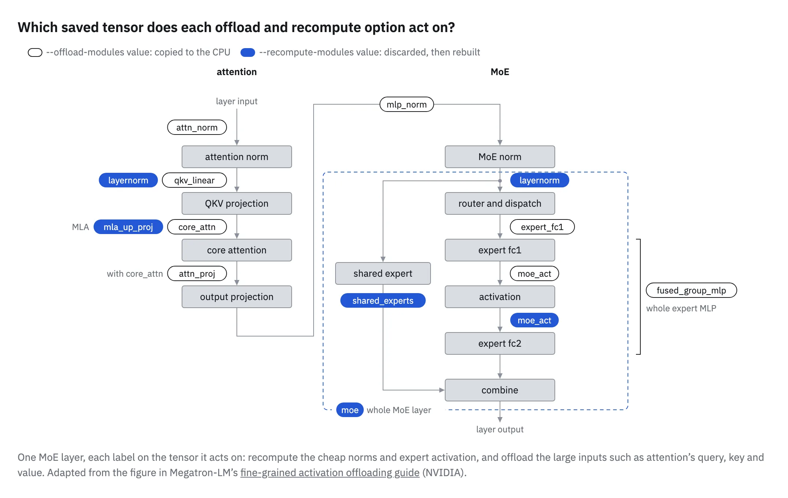

[Figure explanation, controls and captured states](../figures/offload-recompute-map.md) · [Interactive original](../upstream/app/public/viz/index.html?c=offload-recompute-map)


The blue labels are recomputation options. Megatron's guide recomputes the norms and the expert activation (`--recompute-granularity selective --recompute-modules layernorm moe_act`): it discards their cheap outputs and recreates them just before the backward that reads them ([`random.py#L1042-L1064`](https://github.com/NVIDIA/Megatron-LM/blob/d6316eb45bf1bfbb6f1f848c0b56e55166564d80/megatron/core/tensor_parallel/random.py#L1042-L1064)). The outlined labels belong to fine-grained activation offloading, and the guide offloads attention's inputs and output and the experts' first input (`--fine-grained-activation-offloading --offload-modules core_attn attn_proj expert_fc1`).

Offloading copies the inputs of those large modules to pinned CPU memory on a separate CUDA stream while later modules compute ([`fine_grained_activation_offload.py#L1262-L1269`](https://github.com/NVIDIA/Megatron-LM/blob/d6316eb45bf1bfbb6f1f848c0b56e55166564d80/megatron/core/pipeline_parallel/fine_grained_activation_offload.py#L1262-L1269)). Each time the backward finishes an offloaded module, it starts copying back, on a second stream, the tensors of the next one, so they are on the GPU before they are needed ([`#L1332-L1342`](https://github.com/NVIDIA/Megatron-LM/blob/d6316eb45bf1bfbb6f1f848c0b56e55166564d80/megatron/core/pipeline_parallel/fine_grained_activation_offload.py#L1332-L1342)). Recomputation pays in compute, while offloading pays in bandwidth between host and GPU, which these copies hide behind compute. The figure below runs three layers through a forward and a backward pass with every saved input kept, with full recompute, and with that split, and tracks the saved inputs each setting holds on the GPU.


**Figure 3.7.7**

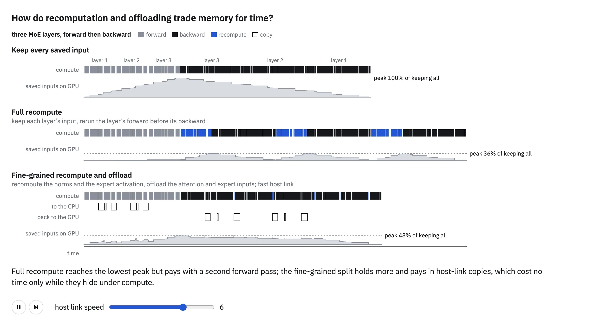

[Figure explanation, controls and captured states](../figures/offload-recompute.md) · [Interactive original](../upstream/app/public/viz/index.html?c=offload-recompute)


With only three layers, one micro-batch and illustrative durations, full recompute reaches the lowest peak but adds a second forward pass, while the fine-grained split holds more and adds only a few small recomputes, because its copies run under compute. The last layer keeps its large inputs on the GPU, since its backward starts as soon as its forward ends and a reload would stall it ([`fine_grained_activation_offload.py#L630-L637`](https://github.com/NVIDIA/Megatron-LM/blob/d6316eb45bf1bfbb6f1f848c0b56e55166564d80/megatron/core/pipeline_parallel/fine_grained_activation_offload.py#L630-L637)). Slow the host link in the simulation and the copies to the CPU finish late, so the peak rises; slow it further and the backward waits for its reloads.

**Megatron source**

**[`experts.py#L319-L322`](https://github.com/NVIDIA/Megatron-LM/blob/d6316eb45bf1bfbb6f1f848c0b56e55166564d80/megatron/core/transformer/moe/experts.py#L319-L322) (moe\_act needs selective)**

```
self.activation_recompute = (
    self.config.recompute_granularity == 'selective'
    and "moe_act" in self.config.recompute_modules
)
```

**[`experts.py#L1130-L1141`](https://github.com/NVIDIA/Megatron-LM/blob/d6316eb45bf1bfbb6f1f848c0b56e55166564d80/megatron/core/transformer/moe/experts.py#L1130-L1141) (activation recomputed, output discarded)**

```
if self.activation_recompute:
    self.activation_checkpoint = tensor_parallel.CheckpointWithoutOutput()
    with moe_act_manager as fc1_output:
        bias_act_output = self.activation_checkpoint.checkpoint(
            bias_act_func, fc1_output, bias_parallel, permuted_probs
        )
else:
    with moe_act_manager as fc1_output:
        bias_act_output = bias_act_func(fc1_output, bias_parallel, permuted_probs)
output, output_bias = apply_module(self.linear_fc2)(bias_act_output, tokens_per_expert)
if self.activation_recompute:
    self.activation_checkpoint.discard_output_and_register_recompute(output)
```

**[`fine_grained_activation_offload.py#L1262-L1269`](https://github.com/NVIDIA/Megatron-LM/blob/d6316eb45bf1bfbb6f1f848c0b56e55166564d80/megatron/core/pipeline_parallel/fine_grained_activation_offload.py#L1262-L1269) (offload on the D2H stream after a module's forward)**

```
def on_group_commit_forward(self, name, forced_released_tensors):
    """Called at the end of a layer group's forward pass to trigger offloading."""
    if not self.do_offload:
        return
    debug_rank(f"--on_group_commit_forward {name}")
    # Wait for compute to finish before starting offload
    self.d2h_stream.wait_stream(torch.cuda.current_stream())
    self.bulk_offload(name, forced_released_tensors)
```

**[`fine_grained_activation_offload.py#L1332-L1341`](https://github.com/NVIDIA/Megatron-LM/blob/d6316eb45bf1bfbb6f1f848c0b56e55166564d80/megatron/core/pipeline_parallel/fine_grained_activation_offload.py#L1332-L1341) (reload issued at the start of a group's backward)**

```
def on_group_start_backward(self):
    """
    Called at the start of a layer group's backward pass.
    Triggers reloading of tensors from CPU.
    """
    if not self.do_offload:
        return
    debug_rank(f"--on_group_start_backward {self}")
    # Wait for compute to finish before starting reload
    self.h2d_stream.wait_stream(torch.cuda.current_stream())
```

**[`fine_grained_activation_offload.py#L630-L639`](https://github.com/NVIDIA/Megatron-LM/blob/d6316eb45bf1bfbb6f1f848c0b56e55166564d80/megatron/core/pipeline_parallel/fine_grained_activation_offload.py#L630-L639) (the last group of each name stays on the GPU)**

```
# Mark the last group with the same name as not offloadable to make sure
# the reloading won't block the main stream.
for name, group in last_group_with_same_name.items():
    if self._offload_margin > 0:
        group.offload = False
        self._offload_margin -= 1
        debug_rank(f"setting offload to false for group {name} at chunk index {chunk_idx}")
    else:
        break
assert self._offload_margin == 0, "Offload margin is not 0"
```

**[`transformer_config.py#L2601-L2660`](https://github.com/NVIDIA/Megatron-LM/blob/d6316eb45bf1bfbb6f1f848c0b56e55166564d80/megatron/core/transformer/transformer_config.py#L2601-L2660) (offload validation: attn\_proj needs core\_attn, no offload inside a recomputed `moe`, not with `cpu_offloading`)**

```
if self.fine_grained_activation_offloading:
    assert (
        not self.cpu_offloading
    ), "fine_grained_activation_offloading cannot be enabled with cpu_offloading."
    assert self.offload_modules is not None and len(self.offload_modules) > 0
    allowed_modules = {
        "core_attn",
        "attn_proj",
        "expert_fc1",
        "fused_group_mlp",
        "moe_act",
        "attn_norm",
        "mlp_norm",
        "qkv_linear",
        "gdp_qkv",
        "shortcut_post_norm",
    }
    invalid_modules = set(self.offload_modules) - allowed_modules
    assert not invalid_modules, (
        f'Invalid choices for offload_modules: {invalid_modules}. '
        f'Allowed modules are: {allowed_modules}'
    )
    if "attn_proj" in self.offload_modules and "core_attn" not in self.offload_modules:
        raise ValueError(
            "attn_proj cannot be set to offload_modules alone without core_attn "
            "because the input of attn_proj is the output of core_attn, "
            "which is needed in core_attn.backward()."
        )
    if (
        "gdp_qkv" in self.offload_modules
        and self.recompute_granularity == "selective"
        and "gdp_in_proj" in self.recompute_modules
    ):
        raise ValueError(
            "gdp_qkv cannot be set in offload_modules together with gdp_in_proj in "
            "recompute_modules, because gdp_in_proj discards the input of the causal "
            "conv and rematerializes it at the start of the mixer backward, leaving "
            "nothing for the gdp_qkv offload group to keep on the host."
        )
    if self.recompute_granularity == "selective" and "moe" in self.recompute_modules:
        offload_inside_moe = {"moe_act", "expert_fc1", "fused_group_mlp"} & set(
            self.offload_modules
        )
        assert not offload_inside_moe, (
            f"Cannot offload {offload_inside_moe} while recomputing the entire MoE layer. "
            f"'moe' in recompute_modules wraps the full MoE forward in a checkpoint, "
            f"so offloading activations inside it is redundant and will cause errors. "
            f"Either remove 'moe' from --recompute-modules or remove "
            f"{offload_inside_moe} from --offload-modules."
        )
    assert (
        self.min_offloaded_tensor_size >= 0
    ), "min_offloaded_tensor_size must be non-negative."
    assert (
        self.activation_offload_fraction >= 0 and self.activation_offload_fraction <= 1
    ), "activation_offload_fraction must be in range [0, 1]."
    assert (
        self.delta_offload_bytes_across_pp_ranks >= 0
    ), "delta_offload_bytes_across_pp_ranks must be non-negative."
```

**[`experts.py#L860-L876`](https://github.com/NVIDIA/Megatron-LM/blob/d6316eb45bf1bfbb6f1f848c0b56e55166564d80/megatron/core/transformer/moe/experts.py#L860-L876) (paged stash, fused path only)**

```
if self.config.moe_paged_stash:
    permuted_local_hidden_states = paged_stash_group_start(permuted_local_hidden_states)
    max_num_tokens = permuted_local_hidden_states.shape[0]
    # Average/expected tokens is a pre-padding estimate used by paged stashing heuristics.
    # moe_expert_rank_capacity_factor is required when moe_paged_stash is enabled.
    cap_factor = self.config.moe_expert_rank_capacity_factor
    avg_num_tokens = (
        int(max_num_tokens // cap_factor)
        if cap_factor is not None and cap_factor > 0
        else None
    )
    stash_context = get_paged_stash_context(
        name="grouped_mlp",
        max_num_tokens=max_num_tokens,
        num_tokens_tensor=tokens_per_expert.sum(),
        avg_num_tokens=avg_num_tokens,
    )
```

NVIDIA measured the trade when it added the feature. On H100s, a 14-layer model with DeepSeek-V3's layer shapes, offloading its normalization inputs and both expert inputs, reserved 18% less memory at its peak and lost 2% of throughput[211](A-appendix.md#ref-doc-6) [evidence](../citation-evidence.md#mcore-fgo-pr1913).

Offloading saves memory only while its copies stay hidden, and three settings decide how much it moves. `--activation-offload-fraction` offloads only a first share of the eligible groups in forward order, and `--min-offloaded-tensor-size` skips small tensors, under a million elements by default. A later pipeline stage holds fewer micro-batches in flight and needs less memory, so `--delta-offload-bytes-across-pp-ranks` lets each stage offload less than the one before it.

Recomputation and offloading shrink the activations each layer keeps. A layer can also reserve far more memory than its activations need, and that happens once you capture the step in CUDA graphs, which replay a recorded sequence of kernels without the CPU and so need every buffer's size fixed in advance. In a dropless MoE the number of tokens a rank receives changes from step to step, so each layer has to reserve its expert buffers for the largest load you allow: with `--moe-expert-rank-capacity-factor` and the HybridEP or NCCL EP backend, that is the factor times a perfectly balanced load. Every layer holds its reservation until its backward runs, yet [NVIDIA's Megatron Core MoE report](https://arxiv.org/html/2603.07685v2#S4.SS3.SSS7.Px3) notes that the activations a layer actually keeps for its backward are often more than ten times smaller[212](A-appendix.md#ref-2603.07685) [evidence](../citation-evidence.md#mcore-paged-stash).

Megatron's experimental paged stash, `--moe-paged-stash`, separates the space a layer computes in from the space it stores. All layers compute in one shared buffer of the reserved size, and after each layer's forward a separate stream copies only its real tokens into small fixed-size pages, much as offloading copies tensors to the CPU. It needs `--use-transformer-engine-op-fuser` and FP8 or NVFP4 experts, and since it already holds the expert activations, Megatron refuses to combine it with offloading `expert_fc1` or `moe_act`[212](A-appendix.md#ref-2603.07685) [evidence](../citation-evidence.md#mcore-paged-stash).

Compare peak memory and step time before and after each change, since a run short of memory fails with an out-of-memory error on its busiest rank, and offload copies that outlast compute show up as a longer backward. The peak memory to watch is therefore the busiest rank's. Megatron prints the peak of data-parallel rank 0 ([`common_utils.py#L407-L427`](https://github.com/NVIDIA/Megatron-LM/blob/d6316eb45bf1bfbb6f1f848c0b56e55166564d80/megatron/training/utils/common_utils.py#L407-L427)) and sends the last rank's peak to [Trackio](https://huggingface.co/docs/trackio) through the launcher from [2.4](2-setup-and-your-first-run.md#s-2-4). To find the busiest rank, take the maximum of `torch.cuda.max_memory_allocated()` across ranks at each log interval, or record per-rank `--record-memory-history` snapshots.

Use it when the overlap does not fit in memory: recompute the cheap modules (`--recompute-granularity selective --recompute-modules layernorm moe_act`) and offload the large inputs (`--fine-grained-activation-offloading --offload-modules core_attn attn_proj expert_fc1`) instead of recomputing every layer, which blocks the overlap. If step time grows, lower `--activation-offload-fraction`. Recomputing `layernorm` or `moe_act` does not run with FP8's delayed recipe ([`transformer_config.py#L2422-L2433`](https://github.com/NVIDIA/Megatron-LM/blob/d6316eb45bf1bfbb6f1f848c0b56e55166564d80/megatron/core/transformer/transformer_config.py#L2422-L2433)), and with the `ncclep` backend the overlap does not run with `expert_fc1` offloading ([`#L3606-L3618`](https://github.com/NVIDIA/Megatron-LM/blob/d6316eb45bf1bfbb6f1f848c0b56e55166564d80/megatron/core/transformer/transformer_config.py#L3606-L3618)).

So far you have tuned the system around the router's choices without touching them. What if the router took the network into account, at a price paid in training?

<a id="s-3-7-group-limited-routing"></a>

#### Group-limited routing

A token's top-k experts can sit anywhere in the expert-parallel group. Once that group spans several nodes, one token may need experts on many of them, and its copies cross the slower network between nodes, both when the token is dispatched and when its outputs are combined. Plain top-k routing ignores where the experts live, so nothing keeps a token's experts on few nodes.

DeepSeek-V3 adds the missing constraint with group-limited routing, which restricts where a token may look before it picks, "to limit communication costs during training". Its experts sit on 8 nodes, and for every token it scores each node by summing the token's top-2 expert scores there, including the balancing bias of [3.3](3-anatomy-of-moe-training.md#s-3-3). It keeps the best 4 nodes and then takes the top-k among the experts on them, so a token reaches at most 4 nodes[42](A-appendix.md#ref-2412.19437) [evidence](../citation-evidence.md#dsv3-s212). On devices instead of nodes, the figure below draws the same rule next to standard top-k and MoGE. MoGE (Mixture of Grouped Experts), the routing behind Huawei's Pangu Pro MoE, splits the experts into one equal group per device and takes the same number of experts from each group[213](A-appendix.md#ref-2505.21411) [evidence](../citation-evidence.md#pangu-pro-moge). Intern-S1-Pro, trained with expert parallelism over 8 GPUs, takes one expert from each of 8 groups in the same way[214](A-appendix.md#ref-src-interns1pro-s21) [evidence](../citation-evidence.md#interns1pro-s21).


**Figure 3.7.8**

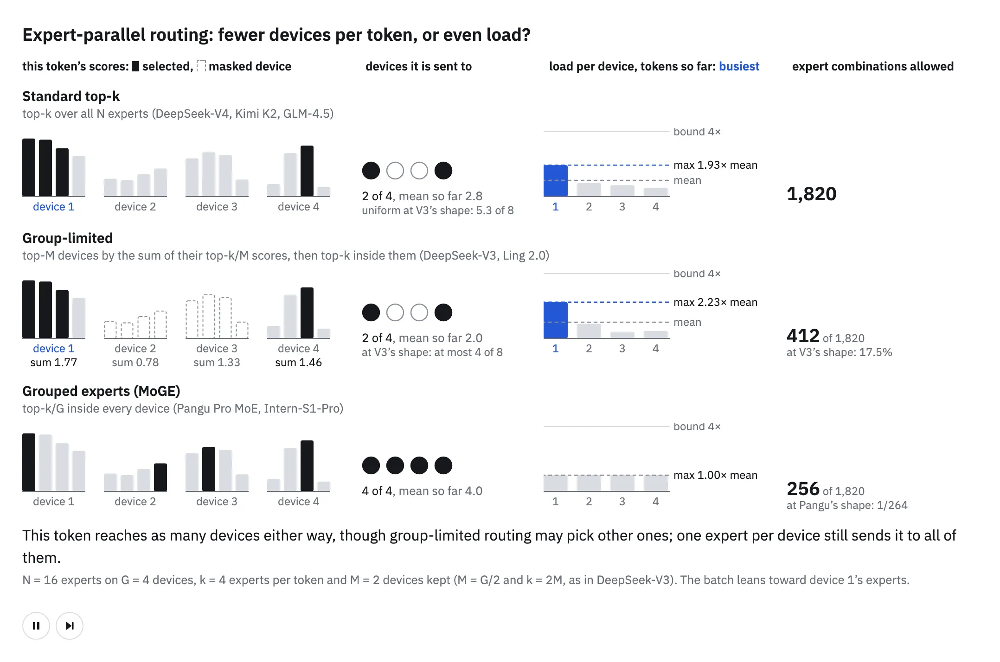

[Figure explanation, controls and captured states](../figures/device-groups.md) · [Interactive original](../upstream/app/public/viz/index.html?c=device-groups)


Compared device by device, group-limited routing caps how many devices each token reaches, while MoGE loads every device evenly and sends each token to all of them.

**Megatron source**

**[`moe_utils.py#L713-L718`](https://github.com/NVIDIA/Megatron-LM/blob/d6316eb45bf1bfbb6f1f848c0b56e55166564d80/megatron/core/transformer/moe/moe_utils.py#L713-L718) (rank the groups, keep the best ones)**

```
group_scores = (
    scores.view(num_tokens, num_groups, -1).topk(topk // group_topk, dim=-1)[0].sum(dim=-1)
)
group_idx = torch.topk(group_scores, k=group_topk, dim=-1, sorted=False)[1]
group_mask = torch.zeros_like(group_scores)
group_mask.scatter_(1, group_idx, 1)
```

**[`moe_utils.py#L721-L728`](https://github.com/NVIDIA/Megatron-LM/blob/d6316eb45bf1bfbb6f1f848c0b56e55166564d80/megatron/core/transformer/moe/moe_utils.py#L721-L728) (top-k inside kept groups)**

```
score_mask = (
    group_mask.unsqueeze(-1)
    .expand(num_tokens, num_groups, num_experts // num_groups)
    .reshape(num_tokens, -1)
)

masked_scores = scores.masked_fill(~score_mask.bool(), float('-inf'))
probs, top_indices = torch.topk(masked_scores, k=topk, dim=-1)
```

What the cap saves in traffic depends on the dispatcher. Megatron's `alltoall` dispatcher sends one copy of the token per expert, while the `flex` dispatcher with [DeepEP](https://github.com/deepseek-ai/DeepEP), whose kernels follow DeepSeek-V3's group-limited routing, sends one copy per node and forwards it inside the node over NVLink[215,216](A-appendix.md#ref-2412.19437) [evidence](../citation-evidence.md#dsv3-s322) [evidence](../citation-evidence.md#deepep-readme). For a layer of our 7B-A1B model, 64 experts with top-8 and a 2,048-wide hidden state in bf16, spread over 2 to 8 nodes, the following figure counts what crosses the network with and without the cap, under both dispatchers.


**Figure 3.7.9**

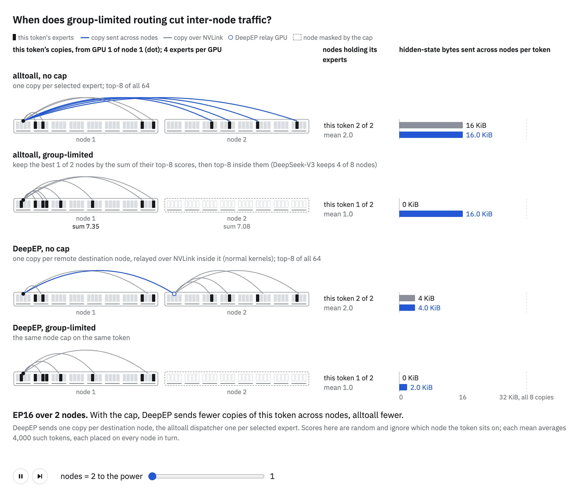

[Figure explanation, controls and captured states](../figures/group-limited-bytes.md) · [Interactive original](../upstream/app/public/viz/index.html?c=group-limited-bytes)


With `alltoall`, the cap only moves a token's copies onto fewer nodes, since every selected expert outside the token's own node still gets its own copy; the figure's router scores experts at random, ignoring which node the token sits on, and then as many bytes cross the network on average as without the cap. With DeepEP, each node a token reaches costs one copy, so capping the nodes caps the bytes. Reaching fewer nodes also leaves each token fewer experts to choose from, a cost paid in quality rather than in time, though a small one: when Xue et al. trained a 13B model with the group limit, its loss came out only slightly higher[217](A-appendix.md#ref-2608.27874) [evidence](../citation-evidence.md#terrace-t8).

Recent MoEs tend to drop the cap. DeepSeek, whose V3 used it, dropped it in DeepSeek-V4[27](A-appendix.md#ref-2606.19348) [evidence](../citation-evidence.md#dsv4-s21), and GLM, Kimi, Nemotron, MiMo and Hy4 also let each token reach any expert. InclusionAI's Ling and Ring models still keep it in the same form as DeepSeek-V3, with 8 groups of which each token keeps 4, and SK Telecom's A.X-K2 keeps a looser version of it.

When tokens fan out across many nodes the step gets slow, so watch two numbers. The first is nodes reached per token, computed offline from the routing trace and the map of which rank holds which expert ([A.1](A-appendix.md#s-a-1)). The second is tokens received per EP rank, summed from the token counts that `--save-tokens-per-expert-interval` writes ([A.1](A-appendix.md#s-a-1)).

Try the recommendations above first, since they leave training unchanged, and turn to the cap only if the all-to-all across nodes still takes a large share of the step: the cap changes which experts a token can pick, and so what the model learns. It helps only when expert parallelism spans several nodes and the dispatcher sends a token once per node, as the `flex` dispatcher with DeepEP does. Then set `--moe-router-num-groups` to the number of nodes and `--moe-router-group-topk` to how many of them a token may reach, and pair it with a balancer other than `quantile_balancing`, which does not run with the cap. Otherwise leave it off: on one node it saves no traffic, and with `alltoall` it saves none on average.

The node cap limits where a token's copies go, but an expert the router favors still takes every token sent to it, and the rank that holds it finishes last. Should you turn that expert's extra tokens away, or copy the expert onto a quieter rank, and what does each choice cost?

<a id="s-3-7-capacity-and-replicas"></a>

#### Capacity and replicas

The rank that holds a hot expert finishes its share of the step last, and the other ranks wait for it at the next synchronization point[208](A-appendix.md#ref-2603.07685) [evidence](../citation-evidence.md#mcore-s437). By default, Megatron accepts that wait and keeps every token: with `--moe-expert-capacity-factor` unset, routing is dropless ([`transformer_config.py#L1009-L1011`](https://github.com/NVIDIA/Megatron-LM/blob/d6316eb45bf1bfbb6f1f848c0b56e55166564d80/megatron/core/transformer/transformer_config.py#L1009-L1011)), and an expert takes however many tokens the router sends it.

A capacity factor caps that number. Each expert keeps its highest-probability tokens up to its capacity ([`transformer_config.py#L1024-L1028`](https://github.com/NVIDIA/Megatron-LM/blob/d6316eb45bf1bfbb6f1f848c0b56e55166564d80/megatron/core/transformer/transformer_config.py#L1024-L1028)), and the tokens past it skip the expert. That buys some speed, since no expert can hold up the step with more tokens than its capacity[218](A-appendix.md#ref-2505.04519) [evidence](../citation-evidence.md#pangu-s32), and it caps memory too, since no expert ever holds activations for more tokens than its capacity[219](A-appendix.md#ref-2202.08906) [evidence](../citation-evidence.md#stmoe-cf-mem). For static shapes, add `--moe-pad-expert-input-to-capacity` as well.

The memory a capacity factor frees can also buy a better parallel layout. Vavre et al. at NVIDIA upcycled Llama 3-8B into an MoE with 8 experts and top-2 routing, and on 128 GPUs capacity factor 1 ran without [tensor parallelism](https://huggingface.co/spaces/nanotron/ultrascale-playbook?section=tensor_parallelism) at 463 TFLOP/s per GPU, against 392 for dropless training with a tensor-parallel size of 2\. The authors put the gain down to the smaller memory footprint, which let them use less model parallelism[220](A-appendix.md#ref-2412.09952) [evidence](../citation-evidence.md#vavre-t2).

The other answer keeps every token and copies the hot expert instead. Three ways to handle a hot expert appear in the figure below: dropless routing, a capacity factor, and a replica of the hot expert placed the way ECHO places it, a method from the Megatron Core team's report that copies hot experts during training[208](A-appendix.md#ref-2603.07685) [evidence](../citation-evidence.md#mcore-s437).


**Figure 3.7.10**

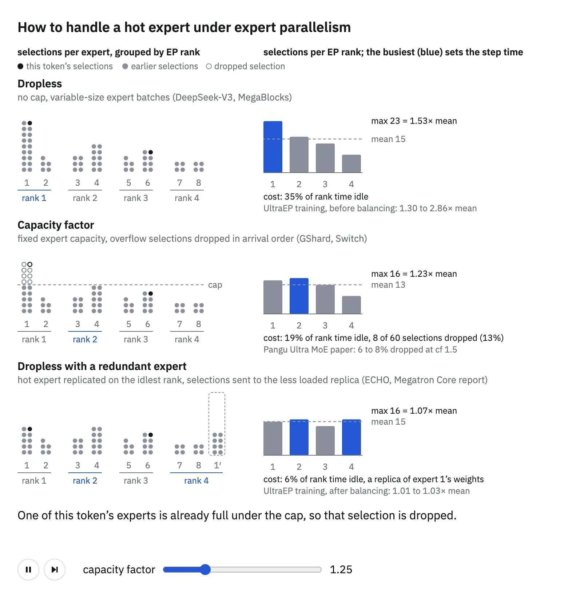

[Figure explanation, controls and captured states](../figures/capacity-and-redundancy.md) · [Interactive original](../upstream/app/public/viz/index.html?c=capacity-and-redundancy)


On one skewed toy batch of 8 experts over 4 ranks, the capacity factor drops the selections that overflow an expert, mostly the hot expert's, and drops them in arrival order, where Megatron's default would keep the highest-probability ones. Each dropped selection skips its expert, so the drawn step gets shorter and the model's output changes. A replica placed on the idlest rank brings the toy's busiest rank closer to the mean with nothing dropped.

**Megatron source**

**[`router.py#L1029-L1038`](https://github.com/NVIDIA/Megatron-LM/blob/d6316eb45bf1bfbb6f1f848c0b56e55166564d80/megatron/core/transformer/moe/router.py#L1029-L1038) (drop after top-k)**

```
# Apply token dropping to probs and routing_map.
if self.config.moe_expert_capacity_factor is not None:
    probs, routing_map = apply_router_token_dropping(
        probs,
        routing_map,
        router_topk=self.topk,
        capacity_factor=self.config.moe_expert_capacity_factor,
        drop_policy=self.config.moe_token_drop_policy,
        pad_to_capacity=self.config.moe_pad_expert_input_to_capacity,
    )
```

**[`moe_utils.py#L1079-L1112`](https://github.com/NVIDIA/Megatron-LM/blob/d6316eb45bf1bfbb6f1f848c0b56e55166564d80/megatron/core/transformer/moe/moe_utils.py#L1079-L1112) (capacity per expert, keep highest probabilities)**

```
# Calculate expert capacity
expert_capacity = get_capacity(
    num_tokens=num_tokens * router_topk,
    num_experts=num_experts,
    capacity_factor=capacity_factor,
)

# Create capacity mask based on drop policy
if expert_capacity > num_tokens:
    # No need to drop tokens if capacity exceeds the number of tokens
    capacity_mask = torch.ones_like(routing_probs).bool()
else:
    if drop_policy == "probs":
        _, capacity_indices = torch.topk(routing_probs, k=expert_capacity, dim=0, sorted=False)
        capacity_mask = torch.zeros_like(routing_probs).scatter(0, capacity_indices, 1).bool()
    elif drop_policy == "position":
        _, capacity_indices = torch.topk(
            routing_map.int(), k=expert_capacity, dim=0, sorted=False
        )
        capacity_mask = torch.zeros_like(routing_probs).scatter(0, capacity_indices, 1).bool()
    else:
        raise ValueError(f"Invalid drop_policy: {drop_policy}")

# Apply capacity constraints
if pad_to_capacity:
    final_map = capacity_mask
    final_probs = routing_probs * final_map
else:
    # Get exceed mask and maskout exceeded probs and indices
    final_map = torch.logical_and(routing_map, capacity_mask)
    final_probs = routing_probs * final_map

return final_probs, final_map
```

Real runs drop less than the toy: at a capacity factor of 1.5, Huawei's Pangu team saw about 6% of tokens dropped in a 20B MoE and about 8% in their 718B[218](A-appendix.md#ref-2505.04519) [evidence](../citation-evidence.md#pangu-s32). Replicas can balance the ranks almost exactly. Wei et al.'s UltraEP, which re-plans replicas for every micro-batch and layer, took the busiest rank of three training runs, DeepSeek-V3, Qwen3-235B and GLM-4.5-Air, from 1.30 to 2.86 times the mean load in plain Megatron-LM down to 1.01 to 1.03[221](A-appendix.md#ref-src-ultraep-f11) [evidence](../citation-evidence.md#ultraep-f11).

A copy costs more in training than in serving. Each one needs the expert's weights sent to its rank in the forward pass and its gradients reduced back to the original in the backward pass, so ECHO's planner makes as few copies as it can: it counts each expert's tokens above the mean load per rank, finds the spare room on the quieter ranks, and packs the first into the second, then discards the copies once they have computed. Balanced ranks pay back twice, in less waiting and in smaller buffers, since CUDA graphs size their static buffers for the worst case, the same worst-case buffers the paged stash in [3.7 Memory](3-anatomy-of-moe-training.md#s-3-7-memory) works around[222](A-appendix.md#ref-2603.07685) [evidence](../citation-evidence.md#mcore-echo).

Serving has the same problem without the gradients, so its copies stay in place far longer than ECHO's, which are planned anew in every forward pass. DeepSeek-V3 re-chooses its redundant experts from the load of its online service at an interval of about 10 minutes[223](A-appendix.md#ref-2412.19437) [evidence](../citation-evidence.md#dsv3-redundant). DeepInfer, the engine DeepSeek serves V4.1-Flash with, gives every GPU spare slots for copies of the busiest experts, counts each expert's load over a recent window, and re-places the copies every 1,000 steps in prefill and every 10,000 in decode, and with it the slowest GPU stays within 1.09 times the mean, as quoted in 3.3[71](A-appendix.md#ref-doc-1) [evidence](../citation-evidence.md#deepinfer-eplb).

Does dropping cost quality? Published comparisons say it costs some loss. Huawei's Pangu team trained a 20B MoE with a capacity factor of 1.5 and dropless, and the dropless run kept a lower loss throughout, by a gap that grew with the number of experts[218](A-appendix.md#ref-2505.04519) [evidence](../citation-evidence.md#pangu-s32). Gale et al. found the same when they built MegaBlocks: the loss was lowest when no token was dropped[224](A-appendix.md#ref-2211.15841) [evidence](../citation-evidence.md#megablocks-f2).

A downstream benchmark can hide that gap: the upcycled Llama 3 MoE of Vavre et al. scored within a point on MMLU at every capacity factor they tried and with dropless routing[225](A-appendix.md#ref-2412.09952) [evidence](../citation-evidence.md#vavre-t4). Where the dropped tokens fall matters too. Meta's MobileMoE pretrained with a capacity factor and switched to dropless routing for fine-tuning, where dropping would cut tokens out of instruction-response pairs[226](A-appendix.md#ref-2605.27358) [evidence](../citation-evidence.md#mobilemoe-sft).

A model trained with a cap need not be served with one. When Zoph et al. evaluated their ST-MoE models at a higher capacity factor than the one they were trained with, every model in their comparison scored better[227](A-appendix.md#ref-2202.08906) [evidence](../citation-evidence.md#stmoe-t8). DeepSeek-V2 was built for that switch: it dropped tokens on each device during training but never from about 10% of its training sequences, so that at inference it could choose whether to drop tokens at all and still match how it was trained[228](A-appendix.md#ref-2405.04434) [evidence](../citation-evidence.md#dsv2-s224).

With a capacity factor on, tokens are dropped silently, so watch how often they are dropped alongside the validation loss. The routing trace that `--moe-routing-trace-path` writes skips every record where a token was dropped ([`router_trace.py#L353-L360`](https://github.com/NVIDIA/Megatron-LM/blob/d6316eb45bf1bfbb6f1f848c0b56e55166564d80/megatron/core/transformer/moe/router_trace.py#L353-L360)). To count the drops, compute the share of dropped token-expert assignments per layer with a forward hook on the router: `1 - kept / (tokens * topk)`, where `kept` counts the assignments left in the routing map.

Keep dropless as the default. When one hot expert holds the step back and the quieter ranks have memory to spare, a replica of that expert would balance the ranks without touching the loss, although ECHO's replication is still an open pull request[208](A-appendix.md#ref-2603.07685) [evidence](../citation-evidence.md#mcore-s437). Use a capacity factor when memory is short and you can accept a slightly higher loss; static shapes also need `--moe-pad-expert-input-to-capacity`. Go back to dropless for fine-tuning, where dropped tokens fall inside instruction-response pairs.

Whether you drop tokens or keep them all, every token an expert keeps runs through its GEMMs, which so far have run in bf16. Could a lower precision such as FP8 make that work cheaper, and the activations it saves smaller, without hurting the loss?

<a id="s-3-7-precision"></a>

#### Precision

Most of an MoE layer's computation sits in its matrix multiplications, and much of its activation memory in the inputs those multiplications save for the backward pass. FP8 halves the bytes of both against bf16, and its Tensor Core operations run faster on Hopper and Blackwell GPUs[229](A-appendix.md#ref-2603.07685) [evidence](../citation-evidence.md#mcore-fp8-why). How much of that reaches the step depends on how much of the step the multiplications take and on what quantizing their tensors costs, and for large MoE training the Megatron Core team reports about 10 to 25% end to end[229](A-appendix.md#ref-2603.07685) [evidence](../citation-evidence.md#mcore-fp8-e2e).

Not every operation can take the lower precision. The figure below shows where FP8 runs in one layer, forward and backward, following the split DeepSeek-V3 trained with: each linear layer runs its forward multiplication and both of its backward ones in FP8, while the embedding, the output head, the norms, the attention core and the router keep BF16 or FP32[230](A-appendix.md#ref-2412.19437) [evidence](../citation-evidence.md#dsv3-fp8).


**Figure 3.7.11**

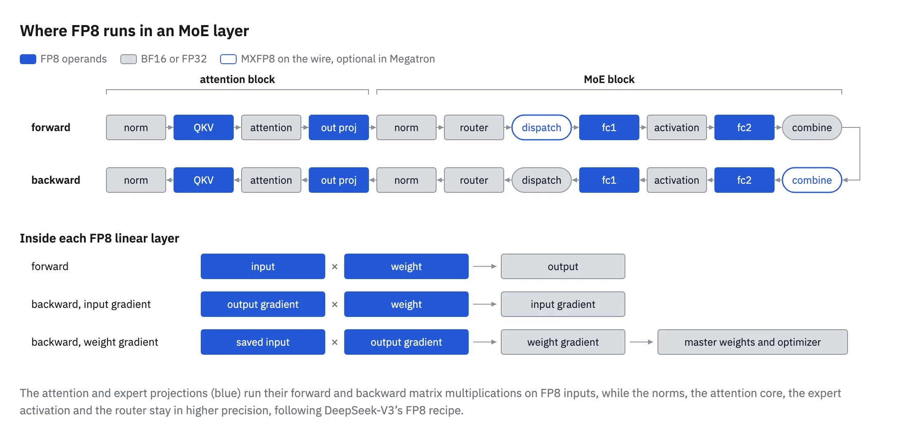

[Figure explanation, controls and captured states](../figures/fp8-layer.md) · [Interactive original](../upstream/app/public/viz/index.html?c=fp8-layer)


The memory saving comes from the backward pass. The weight-gradient multiplication reads the input the forward pass saved, so keeping that input in FP8 halves it, which for DeepSeek-V3 comes to about 16 GB of activations per GPU[231](A-appendix.md#ref-2603.07685) [evidence](../citation-evidence.md#mcore-fp8-mem). The master weights, the weight gradients and the optimizer states stay in higher precision[230](A-appendix.md#ref-2412.19437) [evidence](../citation-evidence.md#dsv3-fp8).

The router is the part to protect. Its scores pick each token's experts, so quantization noise there can change the selection and destabilize training, which is why the Megatron Core report keeps it in FP32[232](A-appendix.md#ref-2603.07685) [evidence](../citation-evidence.md#mcore-s51). In Megatron the router is not a [Transformer Engine](https://github.com/NVIDIA/TransformerEngine) layer, so FP8 never reaches it, and `--moe-router-dtype fp32` sets the precision of its math ([`router.py#L125-L130`](https://github.com/NVIDIA/Megatron-LM/blob/d6316eb45bf1bfbb6f1f848c0b56e55166564d80/megatron/core/transformer/moe/router.py#L125-L130), [3.1 Precision](3-anatomy-of-moe-training.md#s-3-1-precision)). The quantized grouped GEMM needs each expert's token count padded to an aligned size, which `--moe-router-padding-for-quantization` gives it ([`transformer_config.py#L851-L854`](https://github.com/NVIDIA/Megatron-LM/blob/d6316eb45bf1bfbb6f1f848c0b56e55166564d80/megatron/core/transformer/transformer_config.py#L851-L854)).

**Megatron source**

**[`fp8_utils.py#L779-L829`](https://github.com/NVIDIA/Megatron-LM/blob/d6316eb45bf1bfbb6f1f848c0b56e55166564d80/megatron/core/fp8_utils.py#L779-L829) (format and recipe to TE)**

```
if config.fp8 == "e4m3":
    fp8_format = transformer_engine.common.recipe.Format.E4M3
elif config.fp8 == "hybrid":
    fp8_format = transformer_engine.common.recipe.Format.HYBRID
else:
    raise ValueError("E4M3 and HYBRID are the only supported FP8 formats.")

# Select fp8 recipe (TE version >= 2.1.0).
fp8_recipe = None
if is_te_min_version("2.1.0"):
    if config.fp8_recipe == Fp8Recipe.delayed:
        fp8_recipe = TEDelayedScaling(
            config=config,
            fp8_format=fp8_format,
            override_linear_precision=(False, False, not config.fp8_wgrad),
        )
    elif config.fp8_recipe == Fp8Recipe.tensorwise and is_te_min_version("2.2.0.dev0"):
        fp8_recipe = transformer_engine.common.recipe.Float8CurrentScaling(
            fp8_format=fp8_format, fp8_dpa=config.fp8_dot_product_attention
        )
    elif config.fp8_recipe == Fp8Recipe.blockwise and is_te_min_version("2.3.0.dev0"):
        fp8_recipe = transformer_engine.common.recipe.Float8BlockScaling(
            fp8_format=fp8_format
        )
    elif config.fp8_recipe == Fp8Recipe.mxfp8:
        fp8_recipe = transformer_engine.common.recipe.MXFP8BlockScaling(
            fp8_format=fp8_format, fp8_dpa=config.fp8_dot_product_attention
        )
    elif config.fp8_recipe == Fp8Recipe.custom:
        assert config.fp8_quantizer_factory is not None
        fp8_recipe = _get_custom_recipe(config.fp8_quantizer_factory)
    else:
        raise ValueError(
            "Float8CurrentScaling, MXFP8BlockScaling, Float8BlockwiseScaling and "
            "DelayedScaling are the only supported FP8 recipes. Please also make sure "
            "you are using a compatible TE version."
        )
else:
    # Assert that the user is using delayed scaling.
    assert config.fp8_recipe == Fp8Recipe.delayed, (
        "Please make sure to use TransformerEngine version >= 2.2.0.dev0 for "
        "Float8CurrentScaling, >= 2.1.0 for MXFP8BlockScaling, and >= 2.3.0.dev0 for "
        "Float8BlockScaling."
    )
    fp8_recipe = TEDelayedScaling(
        config=config,
        fp8_format=fp8_format,
        override_linear_precision=(False, False, not config.fp8_wgrad),
    )
return fp8_recipe
```

**[`token_dispatcher.py#L652-L657`](https://github.com/NVIDIA/Megatron-LM/blob/d6316eb45bf1bfbb6f1f848c0b56e55166564d80/megatron/core/transformer/moe/token_dispatcher.py#L652-L657) (pad routing for quantization)**

```
if self.config.moe_router_padding_for_quantization:
    pad_multiple = get_align_size_for_quantization(self.config)
    if is_experimental_enabled() and self.config.moe_permute_fusion:
        self.routing_map = fused_pad_routing_map(self.routing_map, pad_multiple)
    else:
        self.routing_map = pad_routing_map(self.routing_map, pad_multiple)
```

The recipe sets how finely the scales follow the data. With one scale per tensor, the largest outlier sets the range for every other value, so DeepSeek-V3 and Ling 2.0 scale activations and gradients per tile of 1×128 elements and weights per block of 128×128[233,234](A-appendix.md#ref-2412.19437) [evidence](../citation-evidence.md#dsv3-fp8-tiles) [evidence](../citation-evidence.md#ling-fp8). The Megatron Core report recommends this blockwise recipe on Hopper, and MXFP8, with one scale per 32 elements, on Blackwell[235](A-appendix.md#ref-2603.07685) [evidence](../citation-evidence.md#mcore-fp8-recipes). You pick them with `--fp8-format` and `--fp8-recipe`, and the blockwise recipe needs Transformer Engine 2.3 or newer ([`fp8_utils.py#L799`](https://github.com/NVIDIA/Megatron-LM/blob/d6316eb45bf1bfbb6f1f848c0b56e55166564d80/megatron/core/fp8_utils.py#L799)).

FP8 can also cross the network. DeepSeek-V3 quantizes the tokens to FP8 before dispatch, since the experts' first layer reads them in FP8 anyway; "a similar strategy is applied to the activation gradient before MoE down-projections", while "both the forward and backward combine components" stay in BF16[236](A-appendix.md#ref-2412.19437) [evidence](../citation-evidence.md#dsv3-fp8-comm). In Megatron, `--moe-dispatch-fwd-dtype mxfp8` and `--moe-combine-bwd-dtype mxfp8` send the dispatch payload and the gradient going back through combine in MXFP8. Both need the `ncclep` backend of the flex dispatcher ([`transformer_config.py#L2150-L2158`](https://github.com/NVIDIA/Megatron-LM/blob/d6316eb45bf1bfbb6f1f848c0b56e55166564d80/megatron/core/transformer/transformer_config.py#L2150-L2158)), and MXFP8 itself needs Blackwell-class GPUs ([`#L656-L661`](https://github.com/NVIDIA/Megatron-LM/blob/d6316eb45bf1bfbb6f1f848c0b56e55166564d80/megatron/core/transformer/transformer_config.py#L656-L661)).

Long runs report the loss holding. DeepSeek trained a 16B and a 230B MoE in FP8 for about a trillion tokens each, and both stayed within 0.25% relative error of their BF16 baselines[237](A-appendix.md#ref-2412.19437) [evidence](../citation-evidence.md#dsv3-fp8-val). Ling-1T held within the same bound, about 0.1% on average, over 900B tokens, while FP8 raised its MFU by about 15%[234](A-appendix.md#ref-2510.22115) [evidence](../citation-evidence.md#ling-fp8).

Four bits is the next step down, and the first large MoEs have been pretrained there. NVIDIA trained Nemotron 3 Super, 120B parameters with 12B active, on 25T tokens in NVFP4 A 4-bit floating-point format with one FP8 scale per block of 16 elements and a second, per-tensor FP32 scale. , running all three multiplications of most linear layers in it. The exceptions show where 4 bits are too few: the last 15% of the network, the attention projections, the embeddings and the multi-token prediction layers stay in BF16, and the Mamba output projection runs in MXFP8 because it underflowed in NVFP4. The recipe also scales weights in two-dimensional blocks, so the forward and backward passes see the same quantized weights, applies random Hadamard transforms to the inputs of the weight-gradient multiplication and rounds gradients stochastically[238](A-appendix.md#ref-2604.12374) [evidence](../citation-evidence.md#nemotron3s-nvfp4). Nemotron 3 Ultra, 550B with 55B active, followed on 20T tokens with the same recipe, and when NVIDIA branched BF16 runs off its checkpoints, the loss gap to them stayed below 0.4% on average[239](A-appendix.md#ref-2606.15007) [evidence](../citation-evidence.md#nemotron3u-nvfp4).

FP4 shrinks the saved inputs to a quarter of their BF16 size, against half for FP8[231](A-appendix.md#ref-2603.07685) [evidence](../citation-evidence.md#mcore-fp4-mem), and native FP4 multiplications need Blackwell-class GPUs[240](A-appendix.md#ref-2509.25149) [evidence](../citation-evidence.md#nvfp4-hw). Hopper has no 4-bit Tensor Core instructions, yet Zhang et al. at Zhejiang Lab stored the activations and the forward dispatch traffic of a 671B MoE in software-emulated MXFP4 while its multiplications stayed in FP8, and cut peak activation memory by 14.8% while matching the convergence of a strong FP8 baseline. The memory it freed let the run recompute less, and it ran 12.5% faster than the best FP8 setting that fit[241](A-appendix.md#ref-2603.02731) [evidence](../citation-evidence.md#fp4-hopper).

An FP8 run's loss should stay close to BF16's for the whole run, so compare it with a BF16 run of the same config as a relative difference. DeepSeek's 16B and 230B runs and Ling-1T all stayed under 0.25%, so a gap well past that, or one that keeps growing, points at the recipe. Under NVFP4, also count the weight-gradient elements that are exactly zero in the expert layers. In Nemotron 3 Super they grew to 7% of all parameters by the end of pretraining, as low-norm channels in some experts shrank toward zero, and in a smaller ablation on Nemotron 3 Nano, switching back to BF16 brought the count back to its baseline[242](A-appendix.md#ref-2604.12374) [evidence](../citation-evidence.md#nemotron3s-zeros).

Use FP8 when the linear layers take most of the step, with the blockwise recipe on Hopper and MXFP8 on Blackwell, and keep the router, the norms and the attention core in higher precision. On a large MoE, expect about 10 to 25% more throughput and a loss within a fraction of a percent of BF16. On Blackwell, NVFP4 is the next step down, with the Nemotron 3 recipe keeping the last layers, the attention projections and the embeddings in BF16.

#### What to watch

| Part | Symptom | Signal to watch |
| --- | --- | --- |
| Profiling | `slow`: the step takes longer than it should. | Step time or TFLOP/s first. Then, from a trace, how much of the step the all-to-all leaves exposed. |
| Interconnect | `slow` on several nodes: when NCCL falls back to TCP sockets, our EP16 proxy ran about 25 times slower, 1.7 against 42.0 TFLOP/s. | With `NCCL_DEBUG=INFO`, check "Using network" for the intended transport: IB for InfiniBand or Libfabric for the OFI plugin on EFA; Socket indicates fallback. Then compare nccl-tests alltoall bus bandwidth inside and across nodes ([2.1](2-setup-and-your-first-run.md#s-2-1)), and TFLOP/s at node-local versus cross-node EP. |
| Overlap | `slow`: the all-to-all is not hidden behind compute. | TFLOP/s per GPU (`--log-throughput`) before and after. Use the exposed all-to-all share only to explain the change. |
| Memory | `OOM`: one rank runs out of memory. `slow`: recomputation, or offload reloads that outlast compute, add step time. | Compare step time and peak memory after each change. Use the busiest rank's peak: maximum `torch.cuda.max_memory_allocated()` across ranks or per-rank `--record-memory-history` snapshots. Longer backward can expose offload reloads that outlast compute. |
| Group-limited routing | `slow`: each token fans out across nodes. | How many nodes each token reaches (routing trace and the map of experts to ranks), and the tokens each EP rank receives (token counts), [A.1](A-appendix.md#s-a-1). |
| Capacity and replicas | `learns badly`: tokens are dropped silently. `OOM`: one rank runs out of memory. | Share of dropped token-expert assignments per layer, `1 - kept / (tokens * topk)`, from a router forward hook, alongside validation loss. The routing trace skips records with drops. |
| Precision | `slow`: no speedup over bf16. `learns badly`: a higher loss than bf16. | Relative loss difference against a BF16 run of the same config across training; DeepSeek's 16B and 230B runs and Ling-1T stayed below 0.25%[237,234](A-appendix.md#ref-2412.19437) [evidence](../citation-evidence.md#dsv3-fp8-val) [evidence](../citation-evidence.md#ling-fp8). Under NVFP4, also count exactly zero expert weight-gradient elements: these reached 7% of all parameters in Nemotron 3 Super[242](A-appendix.md#ref-2604.12374) [evidence](../citation-evidence.md#nemotron3s-zeros). |

You now have every part of an MoE layer, from the router that picks the experts to the precision they compute in. Once training ends, which of those choices still matter when the model is served?
