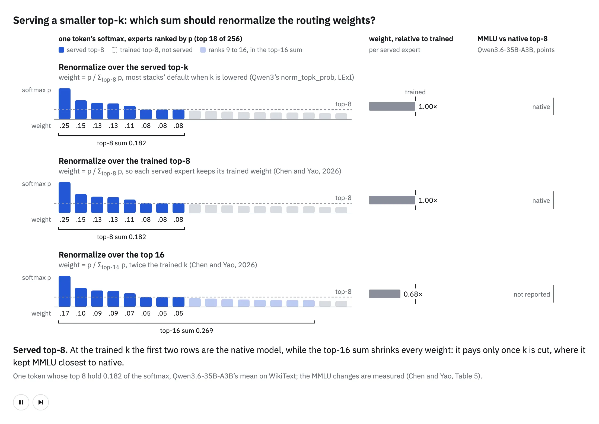
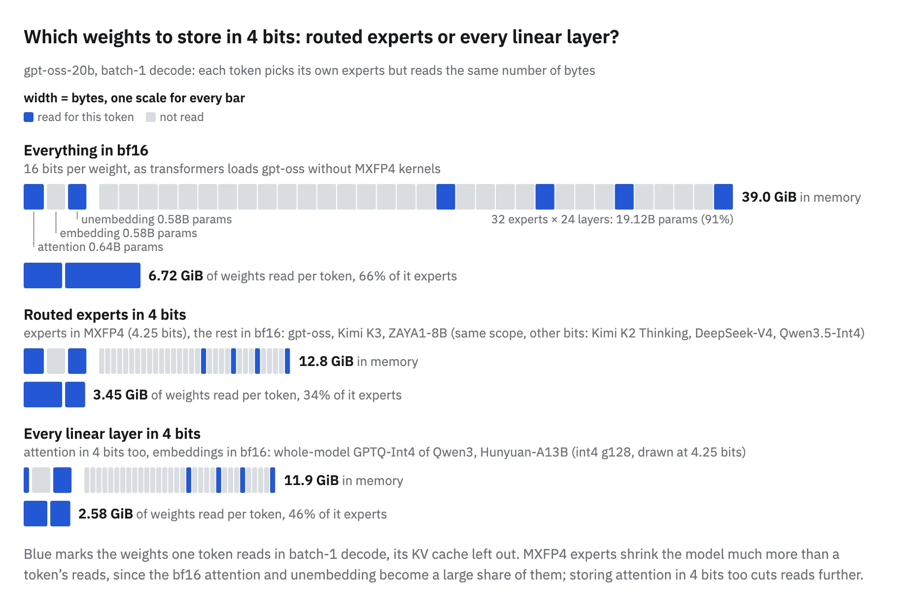
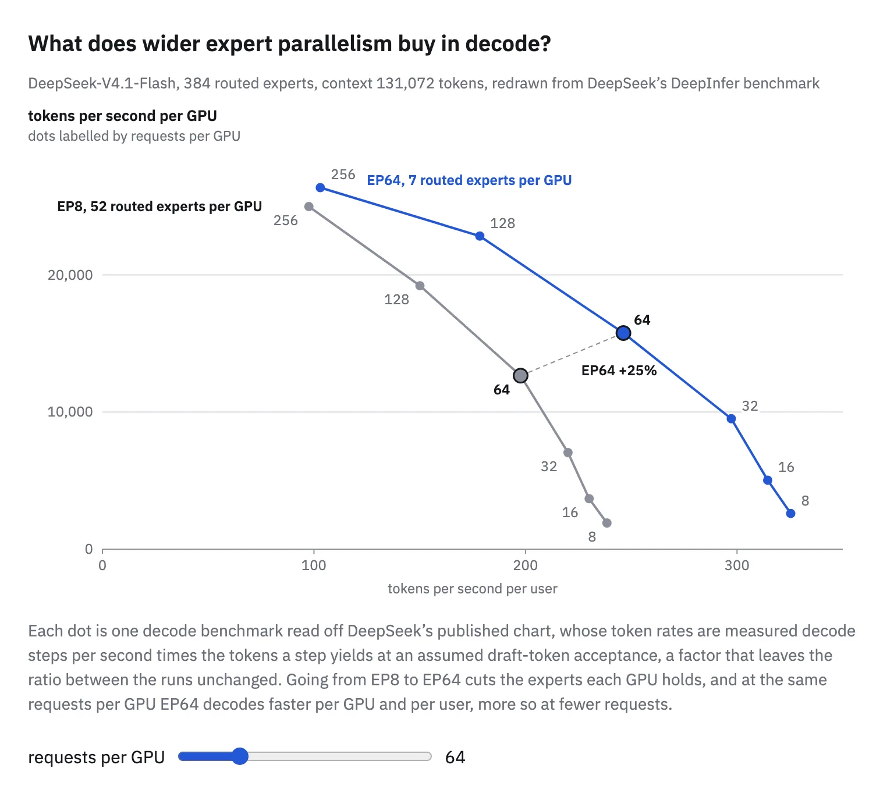
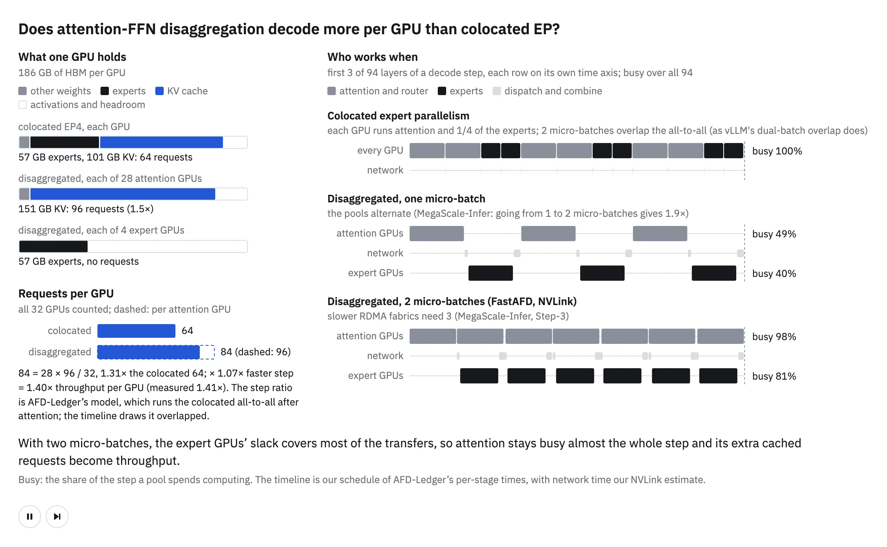
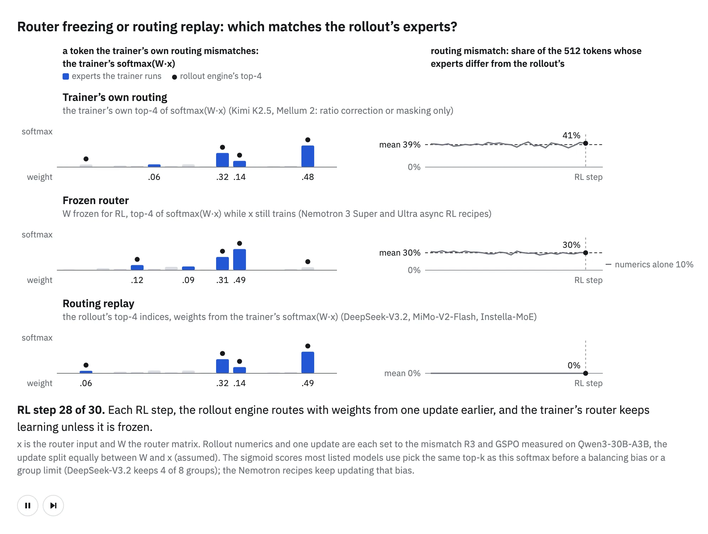

> Source: [Hugging Face handbook](https://huggingface.co/spaces/huggingface/moe-blogpost/blob/ef70726e6f8b99d74298a16a4894340f288a58c2/app/src/content/chapters/4-from-training-to-serving.mdx), revision `ef70726e6f8b99d74298a16a4894340f288a58c2`.


<a id="s-4"></a>

## 4\. From training to serving

A model is trained once, but it is served for as long as anyone uses it. So far, this handbook has been about the first part: getting an MoE to train fast and well. This chapter is about the second.

Serving judges the model by different numbers. A training run is measured in step time and in loss; a serving system is measured in how quickly each request gets its answer and in how many GPUs it takes to answer them all. The model is the same in both, but the goals are not, so some choices that were right for training deserve a second look once the run is over.

An MoE has more to revisit than a dense model. Each token runs through only a few experts, yet every expert is usually kept in memory in case some token picks it, so the model is cheap in compute per token and expensive in memory. Once requests are decoded one token at a time, each expert also sees only a few tokens per step, which makes the number of GPUs the experts are spread over a serving decision of its own. Attention and the experts, which share each GPU in the layout used so far, make different demands on the hardware as well.

This chapter takes those differences one at a time. We start with k, the size of the expert set the router picks for a token. Next, we look at how much memory the experts take, how many GPUs to spread them over, and where attention and the experts should run. We end with RL post-training, where a serving engine writes the samples a trainer learns from, and the two can disagree on which experts each token went through.

The first of these changes is a single number you set at serving time. If you serve each token with a different number of experts than it was trained with, what happens to its output?

<a id="s-4-serving-a-different-k"></a>

### Serving a different k

Training fixes how many experts each token uses, but nothing stops you from serving fewer. Each routed expert you drop from a token's top k is compute saved, while every expert stays resident for the tokens that do pick it, so memory does not change[243](A-appendix.md#ref-2609.04575) [evidence](../citation-evidence.md#kcut-cost). The difficulty lies in the routing weights. A router that renormalizes ([3.1](3-anatomy-of-moe-training.md#s-3-1)) divides the chosen experts' probabilities by their sum, so the scale of the expert branch's output, its gain, is set for the trained k. When you serve fewer experts, the survivors share that same total among themselves, and each one gets a larger weight than it had at the trained k. A smaller k therefore changes two things at once: which experts run, and how much each one contributes.

Chen and Yao separate those two effects with one integer. They keep the top k1 experts but divide their weights by the softmax mass of the top k2, chosen at serving with no training. Setting k2 \= k1 is the usual renormalization over the survivors, which LExI, a method that picks a different k for each layer, also uses[244](A-appendix.md#ref-src-lexi-gate) [evidence](../citation-evidence.md#lexi-gate), setting it to the number of experts removes renormalization, and setting it to the trained k anchors the gain to the value the model was trained with.

The figure below routes one simulated token through a softmax shaped like the router of Qwen3.6-35B-A3B, 256 routed experts trained at top-8, and serves it at smaller k, with one row per denominator. Follow the middle panel as k falls: over the survivors, each served expert weighs more than at top-8; over the trained top 8, it keeps its trained weight; over the top 16, it weighs less. The right panel gives the MMLU change measured for each row.


**Figure 4.1**



[Figure explanation, controls and captured states](../figures/serving-smaller-k.md) · [Interactive original](../upstream/app/public/viz/index.html?c=serving-smaller-k)


That router is flat, its top 8 experts holding on average only 0.182 of the softmax mass over WikiText[245](A-appendix.md#ref-2609.04575) [evidence](../citation-evidence.md#kcut-t3), so the denominator moves the gain a long way. Against 81.65% MMLU at the trained top-8, top-4 renormalized over the four survivors scores 4.65 points lower, and divided by the top-8 mass 3.10 lower. Divided by the top-16 mass, it scores 0.35 points lower, a drop that is not significant (p \= 0.66). With no renormalization at all, top-6 loses 27.45 points[246](A-appendix.md#ref-2609.04575) [evidence](../citation-evidence.md#kcut-t5). In return, top-4 halves the activated routed parameters per token, from 1.006B to 0.503B, a saving of 17% of all the parameters each token uses[243](A-appendix.md#ref-2609.04575) [evidence](../citation-evidence.md#kcut-cost).

How much the denominator matters depends on how flat the router is. On Gemma-4-26B-A4B, whose top 8 of 128 experts hold 0.302 of the mass, dropping renormalization at top-6 raised perplexity by 0.7%, against 356% on the Qwen model. Both results come from softmax routers[247](A-appendix.md#ref-2609.04575) [evidence](../citation-evidence.md#kcut-appa).

Serving more experts than the model trained with costs more compute per token, and the quality need not follow. In Gu et al.'s fine-tuning runs on OLMoE-1B-7B, which trains at top-8, serving top-16 moved the average over nine benchmarks from 41.35 to 41.09, inside the error bars they report. The extra experts form combinations the model never trained together, so in their runs a larger k did not help when it was changed only at serving[248](A-appendix.md#ref-2509.21892) [evidence](../citation-evidence.md#emoe-s32).

[Megatron](https://github.com/NVIDIA/Megatron-LM) serves whatever `--moe-router-topk` says, and the weights follow the router you trained. By default, a softmax router takes its softmax over the top-k logits, so a smaller k renormalizes over the survivors, Chen and Yao's k2 \= k1. With `--moe-router-pre-softmax`, the weights come from the full softmax and are never renormalized. A sigmoid router divides by its top-k sum when k is above 1, and any router multiplies by `--moe-router-topk-scaling-factor` if set. In transformers' Qwen3-MoE, the served k is `num_experts_per_tok`, and the routing weights are divided by their top-k sum only if `norm_topk_prob` is set. Any other denominator needs a patch of a few lines in either router that keeps the top k1 experts and divides by the top-k2 mass.

**Megatron source**

**[`moe_utils.py#L913-L947`](https://github.com/NVIDIA/Megatron-LM/blob/d6316eb45bf1bfbb6f1f848c0b56e55166564d80/megatron/core/transformer/moe/moe_utils.py#L913-L947) (top-k weights: softmax before or after top-k, sigmoid divided by its top-k sum, then scaled)**

```
if score_function == "softmax":
    if use_pre_softmax:
        scores = torch.softmax(logits, dim=-1, dtype=torch.float32)
        if precomputed_indices is not None:
            top_indices = precomputed_indices
            probs = torch.gather(scores, dim=1, index=top_indices)
        else:
            probs, top_indices = compute_topk(scores, topk, num_groups, group_topk)
    else:
        if precomputed_indices is not None:
            top_indices = precomputed_indices
            scores = torch.gather(logits, dim=1, index=top_indices)
        else:
            scores, top_indices = compute_topk(logits, topk, num_groups, group_topk)
        probs = torch.softmax(scores, dim=-1, dtype=torch.float32)
elif score_function in ("sigmoid", "sqrtsoftplus"):
    if score_function == "sigmoid":
        scores = torch.sigmoid(logits.float())
    else:
        scores = torch.nn.functional.softplus(logits.float()).sqrt()
    if precomputed_indices is not None:
        top_indices = precomputed_indices
        scores = torch.gather(scores, dim=1, index=top_indices)
    elif expert_bias is not None:
        scores_for_routing = scores + expert_bias.float()
        _, top_indices = compute_topk(scores_for_routing, topk, num_groups, group_topk)
        scores = torch.gather(scores, dim=1, index=top_indices)
    else:
        scores, top_indices = compute_topk(scores, topk, num_groups, group_topk)
    probs = scores / (scores.sum(dim=-1, keepdim=True) + 1e-20) if topk > 1 else scores
else:
    raise ValueError(f"Invalid score_function: {score_function}")

if scaling_factor:
    probs = probs * scaling_factor
```

proposed: a patch of a few lines that keeps the top k1 experts and divides by the top-k2 mass, there or in transformers' router; then the served-k sweep below.

Score each served k on a labeled task as well as on perplexity, because the two can disagree: at top-6 on the 35B model, perplexity was lowest with the trained top-8 mass as the denominator, while MMLU was highest with the top-16 mass[249](A-appendix.md#ref-2609.04575) [evidence](../citation-evidence.md#kcut-ppl).

Use it when you need less routed-expert compute per token and can keep every expert in memory: serve a smaller k, and divide the survivors' weights by a larger mass than their own. At top-4 on Qwen3.6-35B-A3B, dividing by the top-16 mass kept MMLU within 0.35 points of the trained model[246](A-appendix.md#ref-2609.04575) [evidence](../citation-evidence.md#kcut-t5). Check the denominator on your own model, since how much it matters depends on how flat your router is[247](A-appendix.md#ref-2609.04575) [evidence](../citation-evidence.md#kcut-appa).

Cutting k saves compute but leaves every expert in memory. When memory rather than compute is what limits your serving, how can you make the experts take up less of it?

<a id="s-4-low-bit-experts"></a>

### Low-bit experts

Once training ends, the weights stop moving, and two numbers describe what they cost at serving: the bytes they take in memory and the bytes each decoded token reads. In an MoE the routed experts hold most of the parameters, so their precision sets most of the model's size, and storing only them in 4 bits, with the rest in a wider format, captures most of the saving.

Some frontier MoEs already ship this way. OpenAI post-trained gpt-oss with its MoE weights quantized to MXFP4, at 4.25 bits per parameter. Those weights hold more than 90% of the parameters, so the 120b model fits on one 80 GB GPU[250](A-appendix.md#ref-2508.10925) [evidence](../citation-evidence.md#gptoss-mxfp4). Moonshot quantized Kimi K3's routed experts to MXFP4 through SFT and RL and kept everything else in higher precision[21](A-appendix.md#ref-doc-5) [evidence](../citation-evidence.md#k3-qat). DeepSeek-V4 trains its MoE expert weights with MXFP4 quantization-aware training Training with the weights rounded to the target format in the forward pass.  in post-training[251](A-appendix.md#ref-2606.19348) [evidence](../citation-evidence.md#dsv4-fp4qat), and the GLM team applies INT4 quantization-aware training in GLM-5's SFT stage[252](A-appendix.md#ref-2602.15763) [evidence](../citation-evidence.md#glm5-int4). In all four, the quantization happens after pretraining, so your pretraining config stays as it is.

The figure below compares three ways to store gpt-oss-20b, one decoded token at a time: everything in bf16, only the routed experts in 4 bits, and every linear layer in 4 bits. Each bar is the model's size in memory, and its blue blocks are the weights one token reads. From the first row to the second, compare how much the model shrinks with how much a token's reads shrink, then see what attention in 4 bits adds in the third.


**Figure 4.2**



[Figure explanation, controls and captured states](../figures/low-bit-experts.md) · [Interactive original](../upstream/app/public/viz/index.html?c=low-bit-experts)


Storing the experts in 4 bits shrinks gpt-oss-20b from 39.0 GiB to 12.8 GiB, three times smaller, but the weight bytes one decoded token reads fall only from 6.72 GiB to 3.45 GiB, about half. In batch-1 decoding, a token reads only 4 of the 32 experts in each layer but all of attention and the unembedding, so once the experts are small, those bf16 weights make up two thirds of the weights it reads. Putting attention in 4 bits as well cuts those reads by another quarter while freeing only 0.9 GiB of memory, because attention holds few of the parameters.

Released checkpoints take both scopes. ZAYA1-8B's MXFP4 release quantizes only the routed experts, and so do Kimi K2 Thinking and Qwen's GPTQ-Int4 builds of Qwen3.5, in int4 rather than MXFP4[253](A-appendix.md#ref-src-lowbit-experts-cfg) [evidence](../citation-evidence.md#lowbit-experts-cfg). Qwen's GPTQ-Int4 build of Qwen3's 30B MoE and Tencent's of Hunyuan-A13B put attention in int4 as well, leaving only the router, embeddings and output head unquantized[254](A-appendix.md#ref-src-lowbit-all-cfg) [evidence](../citation-evidence.md#lowbit-all-cfg).

Megatron exports through ModelOpt: `examples/post_training/modelopt/quantize.py` takes a ModelOpt config name in `--export-quant-cfg`, `FP8_DEFAULT_CFG` for an FP8 export, with `--weight-only` and `--sync-expert-weight-amax` among its options. To train in 4 bits, set `--fp4-format e2m1`, NVFP4 through [Transformer Engine](https://github.com/NVIDIA/TransformerEngine) on Blackwell, which needs Transformer Engine 2.7 or newer and does not combine with `--fp8-format`.

**Megatron source**

**[`post_training/arguments.py#L56-L61`](https://github.com/NVIDIA/Megatron-LM/blob/d6316eb45bf1bfbb6f1f848c0b56e55166564d80/megatron/post_training/arguments.py#L56-L61) (`--export-quant-cfg`)**

```
group.add_argument(
    "--export-quant-cfg",
    type=str,
    default=None,
    # TODO replace choices with mtq.config.choices after deprecating the shorter aliases
    help="Specify a quantization config from mtq.config.choices.",
```

**[`quantize.py#L159-L176`](https://github.com/NVIDIA/Megatron-LM/blob/d6316eb45bf1bfbb6f1f848c0b56e55166564d80/examples/post_training/modelopt/quantize.py#L159-L176) (export options: `--weight-only`, `--sync-expert-weight-amax`)**

```
group.add_argument("--weight-only", action="store_true", help="Disable input quantization.")
group.add_argument(
    "--recipe",
    type=str,
    default=None,
    help=(
        "PTQ recipe YAML file or name without suffix (e.g. "
        "'general/ptq/nvfp4_default-fp8_kv', "
        "'models/Nemotron-3-Super-120B-A12B/super-nvfp4'). "
        "When set, --export-quant-cfg / --export-kv-cache-quant are ignored; "
        "the recipe is authoritative for quant_cfg, algorithm, and KV cache config."
    ),
)
group.add_argument(
    "--sync-expert-weight-amax",
    action="store_true",
    help="Synchronize expert weight amax across experts.",
)
```

**[`transformer_config.py#L735-L743`](https://github.com/NVIDIA/Megatron-LM/blob/d6316eb45bf1bfbb6f1f848c0b56e55166564d80/megatron/core/transformer/transformer_config.py#L735-L743) (`--fp4-format`, NVFP4 through Transformer Engine)**

```
fp4: Optional[Literal['e2m1']] = field(
    default=None, metadata={"argparse_meta": {"arg_names": ["--fp4-format"]}}
)
"""If set, enables the use of FP4 precision through Transformer Engine. Currently only 
supports 'nvfp4' which uses NVFP4BlockScaling recipe (requires TE >= 2.7.0.dev0)."""

fp4_recipe: Optional[Literal['nvfp4', 'custom']] = "nvfp4"
"""If set, enables the use of FP4 precision through Transformer Engine. Currently only
'nvfp4' is supported which uses NVFP4BlockScaling recipe for Blackwell+ architecture."""
```

**[`arguments.py#L1060-L1070`](https://github.com/NVIDIA/Megatron-LM/blob/d6316eb45bf1bfbb6f1f848c0b56e55166564d80/megatron/training/arguments.py#L1060-L1070) (FP4 needs Transformer Engine 2.7, not with `--fp8-format`)**

```
# FP4 and FP8 are mutually exclusive
if args.fp4 and args.fp8:
    raise ValueError("--fp4-format and --fp8-format cannot be used simultaneously. Please choose one.")

# FP4 param requires FP4 mode
if args.fp4_param_gather and not args.fp4:
    raise ValueError("--fp4-param-gather must be used together with --fp4-format.")

# FP4 requires TE >= 2.7.0.dev0
if args.fp4 and not is_te_min_version("2.7.0.dev0"):
    raise ValueError("--fp4-format requires Transformer Engine >= 2.7.0.dev0 for NVFP4BlockScaling support.")
```

proposed: our t56 chain, collapsed: PTQ export on one GPU at EP1, 24 iterations of QAT, then the per-expert distortion script.

Plot each expert's quantization error against its token count, using the per-expert token counts from [3.0](3-anatomy-of-moe-training.md#s-3-0), so an expert that suffers for being rarely routed stands out. Then compare the quantized export's loss with Megatron's on the same text.

Use it when serving is bound by memory or by the bytes each token reads: quantize the routed experts to 4 bits in post-training, and keep everything else in higher precision as Kimi K3 does.

Storing the experts in fewer bits shrinks what each GPU holds, but it leaves open how many GPUs to spread them over. Once requests arrive one token at a time, should you spread them over as many GPUs as training did?

<a id="s-4-expert-parallelism-at-serving"></a>

### Expert parallelism at serving

Training picks an expert-parallel size for one kind of step: a large batch of tokens processed together. Serving runs two kinds. A prefill step processes prompts, and DeepSeek's engine lets one such step carry up to 32,768 tokens per GPU[255](A-appendix.md#ref-doc-2) [evidence](../citation-evidence.md#deepinfer-qa-chunk). A decode step carries only the next token or few of each request in flight, so each expert sees few tokens per step. Putting the experts on more GPUs helps there: each GPU holds fewer experts and reads fewer weights per step, while the all-to-all gathers a larger batch for each expert[256](A-appendix.md#ref-doc-2) [evidence](../citation-evidence.md#deepinfer-qa-par).

When DeepSeek serves DeepSeek-V4.1-Flash, it sizes the two phases in opposite directions. Prefill runs at EP2 to EP8, the smallest size whose GPUs have enough memory, and decode at EP64 to EP128, the largest the available GPUs allow. In both, attention is [data-parallel](https://huggingface.co/spaces/nanotron/ultrascale-playbook?section=data_parallelism) with one rank per EP rank, and neither phase uses tensor or [context parallelism](https://huggingface.co/spaces/nanotron/ultrascale-playbook?section=context_parallelism)[256](A-appendix.md#ref-doc-2) [evidence](../citation-evidence.md#deepinfer-qa-par).

The figure below redraws DeepSeek's own comparison of the two settings in decode, one dot per number of requests per GPU. With 64 requests per GPU, EP64 holds 7 routed experts per GPU and decodes about 15,700 tokens per second per GPU at about 246 tokens per second per user, while EP8 holds 52 routed experts per GPU and reaches about 12,600 and 198, so both numbers are about 25% higher at EP64. With 256 requests per GPU, the two settings nearly meet, at about 26,300 and 24,900 tokens per second per GPU[257](A-appendix.md#ref-doc-2) [evidence](../citation-evidence.md#deepinfer-qa-wideep).


**Figure 4.3**



[Figure explanation, controls and captured states](../figures/wide-ep-decode.md) · [Interactive original](../upstream/app/public/viz/index.html?c=wide-ep-decode)


The width has a price. DeepSeek gives prefill and decode roughly equal numbers of GPUs, so with decode at EP64 or more, the smallest deployment worth running is 64 GPUs for prefill plus 64 for decode[258](A-appendix.md#ref-doc-2) [evidence](../citation-evidence.md#deepinfer-qa-unit). All the GPUs of one EP instance also form a single communication domain, so one failed GPU takes the whole instance down, and on restart DeepSeek re-sizes the EP group to the GPUs that are still healthy[259](A-appendix.md#ref-doc-1) [evidence](../citation-evidence.md#deepinfer-ft).

Megatron serves with [expert parallelism](https://huggingface.co/spaces/nanotron/ultrascale-playbook?section=expert_parallelism) in its coordinator mode, the default; direct mode refuses an EP size above 1\. Under expert parallelism, a step runs as a CUDA graph only when every EP rank is decoding: if any rank has a prefill in its batch, all ranks fall back to eager mode. In RL, `--rl-inference-expert-model-parallel-size` gives the rollout engine its own EP size, built as a separate inference model that the trainer's weights are refit into.

**Megatron source**

**[`mcore-inference-user-guide.md#L277-L278`](https://github.com/NVIDIA/Megatron-LM/blob/d6316eb45bf1bfbb6f1f848c0b56e55166564d80/docs/mcore-inference-user-guide.md#L277-L278) (EP needs coordinator mode)**

```
- *Required* for: HTTP serving (`serve`), expert parallelism (`EP > 1`),
  multimodal inputs, streaming, and the lifecycle controls
```

**[`batch_dimensions_utils.py#L156-L161`](https://github.com/NVIDIA/Megatron-LM/blob/d6316eb45bf1bfbb6f1f848c0b56e55166564d80/megatron/core/inference/batch_dimensions_utils.py#L156-L161) (one prefill rank sends the EP group to eager)**

```
"""Adjust CUDA graph batch dimensions for expert parallelism.

All-reduce-max the token count and non-decode flag across the EP group.
If any rank has a prefill (non-decode) step, all ranks fall back to eager
mode (return None) — the non-CG path handles variable token counts via
use_allgather_v. Otherwise return adjusted dims with the max token count.
```

**[`rl_config.py#L140-L141`](https://github.com/NVIDIA/Megatron-LM/blob/d6316eb45bf1bfbb6f1f848c0b56e55166564d80/megatron/training/config/rl_config.py#L140-L141) (rollout EP size)**

```
rl_inference_expert_model_parallel_size: int | None = None
"""Degree of expert model parallelism for inference for RL."""
```

**[`training.py#L1965-L1993`](https://github.com/NVIDIA/Megatron-LM/blob/d6316eb45bf1bfbb6f1f848c0b56e55166564d80/megatron/training/training.py#L1965-L1993) (separate inference model with its own parallelism)**

```
if args.perform_rl_step:
    # RL inference doesn't support CP; when training uses CP>1, always build a
    # separate CP=1 inference model (CP ranks become extra DP replicas, dp*=cp).
    force_cp1_inference_model = args.context_parallel_size > 1
    if (
        args.rl_inference_tensor_model_parallel_size is not None
        or args.rl_inference_pipeline_model_parallel_size is not None
        or args.rl_inference_expert_model_parallel_size is not None
        or args.rl_inference_expert_tensor_model_parallel_size is not None
        or force_cp1_inference_model
    ):
        from megatron.core.inference.shards import build_inference_pg_collection

        print_rank_0(
            "Building separate RL inference model with custom parallelism: "
            f"TP={args.rl_inference_tensor_model_parallel_size}, "
            f"PP={args.rl_inference_pipeline_model_parallel_size}, "
            f"CP={1 if force_cp1_inference_model else None}, "
            f"EP={args.rl_inference_expert_model_parallel_size}, "
            f"ExptTP={args.rl_inference_expert_tensor_model_parallel_size}"
        )
        inference_pg_collection = build_inference_pg_collection(
            args.world_size,
            tp_size=args.rl_inference_tensor_model_parallel_size,
            pp_size=args.rl_inference_pipeline_model_parallel_size,
            cp_size=1 if force_cp1_inference_model else None,
            ep_size=args.rl_inference_expert_model_parallel_size,
            expt_tp_size=args.rl_inference_expert_tensor_model_parallel_size,
            use_tp_pp_dp_mapping=args.use_tp_pp_dp_mapping,
```

**[`rl_utils.py#L810-L822`](https://github.com/NVIDIA/Megatron-LM/blob/d6316eb45bf1bfbb6f1f848c0b56e55166564d80/megatron/rl/rl_utils.py#L810-L822) (weights refit into it)**

```
# If we have separate training and inference models we to refit weights from the training model to the inference model.
has_separate_inference_model = inference_model is not None
if has_separate_inference_model:
    # If the separate inference model weights were prefetched to CPU while idle, bring them
    # back to GPU before refit/copy and before any CUDA-graph'd inference.
    with nvtx_range("rl/prefetch-weights-to-gpu", time=True):
        inf_core = unwrap_model(inference_model[0])
        _maybe_prefetch_separate_inference_model_weights(inf_core, to_cpu=False)
    swap_model_weights(
        model,
        inference_model,
        args.refit_method,
        execution_batch_bytes=args.refit_execution_batch_bytes,
```

DeepSeek credits wide EP's gain in decode partly to "good EPLB support"[256](A-appendix.md#ref-doc-2) [evidence](../citation-evidence.md#deepinfer-qa-par), its expert-parallel load balancer, so track the slowest EP rank's load over the mean, which DeepSeek reports as `moe_lb`. With redundant copies of hot experts, DeepSeek holds it at 1.090 in decode[71](A-appendix.md#ref-doc-1) [evidence](../citation-evidence.md#deepinfer-eplb).

Use it when decode speed is what you need and you have the GPUs for a wide deployment: serve decode at the widest expert parallelism your GPUs allow and prefill at the narrowest that fits in memory, as DeepSeek does for V4.1-Flash, and give the wide decode group redundant experts so its slowest rank stays close to the mean[256,71](A-appendix.md#ref-doc-2) [evidence](../citation-evidence.md#deepinfer-qa-par) [evidence](../citation-evidence.md#deepinfer-eplb).

A wider expert group changes how much expert work each GPU does, but each GPU still runs attention and the experts side by side, even though the two make different demands on it. At inference time, is sharing GPUs still the right way for you to place them?

<a id="s-4-attention-ffn-disaggregation"></a>

### Attention-FFN disaggregation

In a colocated layout, each GPU in an expert-parallel group runs both halves of each layer, attention and experts, but during decoding the two halves need different resources. Attention holds few parameters but has to keep the key-value cache of every request in flight, while the experts hold most of the parameters and keep no per-request state[260](A-appendix.md#ref-2507.19427) [evidence](../citation-evidence.md#step3-s3). Serving can therefore put attention and experts on separate GPUs, one pool each, and pass micro-batches back and forth so that each pool computes while the other one works on the previous micro-batch. Megatron's `megatron/core/inference/disaggregation` splits along a different line: it hands KV and SSM state from prefill engines to decode engines.  MegaScale-Infer, which disaggregates attention and FFN modules within each layer this way, reports up to 1.90× the per-GPU throughput of earlier serving systems[261](A-appendix.md#ref-2504.02263) [evidence](../citation-evidence.md#msi-abs).

**Megatron source**

**[`mcore-inference-user-guide.md#L130`](https://github.com/NVIDIA/Megatron-LM/blob/d6316eb45bf1bfbb6f1f848c0b56e55166564d80/docs/mcore-inference-user-guide.md#L130) (Megatron's disaggregation: prefill to decode, not attention to FFN)**

```
| **Disaggregation** | KV and SSM state handoff between prefill and decode engines over NIXL or NCCL, with resharding across mismatched TP/PP layouts. Refer to [Disaggregated Prefill and Decode](#disaggregated-prefill-and-decode) for what is and is not turnkey today |
```

The figure below draws FastAFD's deployment of Qwen3-235B-A22B, 28 attention GPUs plus 4 expert GPUs, next to colocated expert parallelism over 4 GPUs[262](A-appendix.md#ref-2608.04502) [evidence](../citation-evidence.md#afd-ledger). On the left, compare what one GPU holds in each layout: an attention GPU without experts has room for more requests' caches, but the expert GPUs hold no request's cache, and the requests-per-GPU bars count both pools. On the right, follow a decode step to see how a second micro-batch keeps the attention pool busy while the first is away at the experts. The colocated row overlaps its all-to-all with two micro-batches as well, which vLLM offers as dual-batch overlap[263](A-appendix.md#ref-src-vllm-dbo) [evidence](../citation-evidence.md#vllm-dbo).


**Figure 4.4**



[Figure explanation, controls and captured states](../figures/attention-ffn-disaggregation.md) · [Interactive original](../upstream/app/public/viz/index.html?c=attention-ffn-disaggregation)


How much this buys depends on what you compare it with. As published, FastAFD's layout gives 1.41× the per-GPU throughput of colocated EP4. Qiu et al. at Meituan reconstructed that gain with an analytical model, then re-provisioned both layouts in that model for the same budget of 72 GPUs, and the ratio fell to 0.99×. Across all their modelled settings, homogeneous AFD raised fixed-budget throughput in only a minority of them[262](A-appendix.md#ref-2608.04502) [evidence](../citation-evidence.md#afd-ledger). Step-3's headline number, 4,039 tokens per GPU per second against 2,324 for DeepSeek-V3 under the same decoding target of 20 tokens/s, sets two different models against each other, so it does not isolate the layout[264](A-appendix.md#ref-2507.19427) [evidence](../citation-evidence.md#step3-t8).

Training decides one thing here: how sparse a model the expert pool has to serve. Step-3 measures sparsity as activated experts, shared included, over routed experts, and derives the sparsest MoE an expert pool can serve while staying compute-bound and overlapping communication with computation. The bound rises with the model's width and depth; at DeepSeek-V3's width and depth on H800 it is 0.058, and Step-3 trained at about 0.08[265](A-appendix.md#ref-2507.19427) [evidence](../citation-evidence.md#step3-s54). A sparser model falls back on large expert parallelism or on routing restrictions such as the group-limited routing of 3.7[266](A-appendix.md#ref-2507.19427) [evidence](../citation-evidence.md#step3-s55).

Use it when your inference engine can run attention and the experts as separate GPU pools, as MegaScale-Infer and Step-3's serving system do, and when that layout beats a colocated expert-parallel layout re-provisioned for the same number of GPUs, since that is the comparison under which the published gain shrank to parity in Qiu et al.'s model[262](A-appendix.md#ref-2608.04502) [evidence](../citation-evidence.md#afd-ledger). If you plan to serve this way, compute Step-3's bound for your width, depth and hardware before you fix the expert count and top-k, and keep the activated fraction above it[265](A-appendix.md#ref-2507.19427) [evidence](../citation-evidence.md#step3-s54).

Where attention and the experts run is a serving decision, but in RL post-training the serving engine also writes the rollouts the trainer learns from. Can you count on the trainer sending each token to the same experts the rollout engine did?

<a id="s-4-rl-routing"></a>

### RL routing

RL post-training separates sample generation from gradient computation. A rollout engine generates the samples with its own kernels and, in off-policy or async RL, with weights one update or more behind the trainer's, and the trainer recomputes each token to take the gradient. These differences can shift token probabilities, but in an MoE they can also change which experts a token runs through, so the trainer differentiates a path the sample never took[267,268](A-appendix.md#ref-2510.11370) [evidence](../citation-evidence.md#r3-engines) [evidence](../citation-evidence.md#gspo-drift).

Each cause has been measured on its own. Ma et al. generated responses with [SGLang](https://github.com/sgl-project/sglang) on Qwen3-30B-A3B and fed them through Megatron: about 10% of the routers chose different experts, and 94% of tokens differed in at least one layer[267,269](A-appendix.md#ref-2510.11370) [evidence](../citation-evidence.md#r3-engines) [evidence](../citation-evidence.md#r3-mismatch). Zheng et al., the authors of GSPO, measured the other cause on Qwen3-30B-A3B-Base: after one gradient update, about 10% of the experts activated for the same rollout had changed[268](A-appendix.md#ref-2507.18071) [evidence](../citation-evidence.md#gspo-drift). The two 10%s count different things: routers that disagree across engines, and activated experts that change in one update.

Ma et al.'s fix, R3, records the experts the rollout picked and replays them in the trainer. That removes the routing share of the gap but not the rest of it: the train-inference KL fell from 1.5e-3 to 7.5e-4, near the dense Qwen3-8B's 6.4e-4[270](A-appendix.md#ref-2510.11370) [evidence](../citation-evidence.md#r3-kl). In Megatron, `--moe-enable-routing-replay` makes the inference engine record each request's top-k. Your RL framework then hands those indices back to the trainer with `set_replay_data` before a `REPLAY_FORWARD` pass. A third action, `REPLAY_BACKWARD`, replays the indices again when [activation recomputation](https://huggingface.co/spaces/nanotron/ultrascale-playbook?section=activation_recomputation) repeats the forward pass during backpropagation.  Record with the engine's async scheduling off, since the engine refuses the two together. Replay does not freeze the router: in `REPLAY_FORWARD` it gathers its own current scores at the replayed indices, so its gradient flows through the experts the rollout chose rather than the ones it would pick itself.

**Megatron source**

**[`inference_request.py#L786-L787`](https://github.com/NVIDIA/Megatron-LM/blob/d6316eb45bf1bfbb6f1f848c0b56e55166564d80/megatron/core/inference/inference_request.py#L786-L787) (rollout's indices per request)**

```
# routing_indices is reconstructed from per-block storage when a request finishes.
routing_indices: Optional[np.ndarray] = None
```

**[`router_replay.md#L70-L80`](https://github.com/NVIDIA/Megatron-LM/blob/d6316eb45bf1bfbb6f1f848c0b56e55166564d80/docs/api-guide/router_replay.md#L70-L80) (`set_replay_data`, then `REPLAY_FORWARD`)**

```
1.  **Enable & Instantiate**
    - Create one `RouterReplay` instance per MoE router layer when building the model.
    - Optionally use the global helpers to set/clear actions across all layers.
2.  **Record Routing Decisions**
    - Set action: `RouterReplay.set_global_router_replay_action(RouterReplayAction.RECORD)`.
    - Run the model; retrieve per-layer indices via `RouterReplay.get_recorded_data()` and persist.
3.  **Forward Replay**
    - Load indices and distribute: `RouterReplay.set_replay_data(list_of_tensors)`.
    - Set action: `RouterReplay.set_global_router_replay_action(RouterReplayAction.REPLAY_FORWARD)`.
    - Run the model; dynamic top‑k is bypassed and target indices are used.
4.  **Backward Replay**
```

**[`router_replay.py#L13-L15`](https://github.com/NVIDIA/Megatron-LM/blob/d6316eb45bf1bfbb6f1f848c0b56e55166564d80/megatron/core/transformer/moe/router_replay.py#L13-L15) (`REPLAY_BACKWARD` under recomputation)**

```
RECORD = "record"  # Record the topk indices for replay
REPLAY_FORWARD = "replay_forward"  # Replay the recorded topk indices for forward pass
REPLAY_BACKWARD = "replay_backward"  # Replay topk indices for re-compute during backward pass
```

**[`router_replay.py#L161-L182`](https://github.com/NVIDIA/Megatron-LM/blob/d6316eb45bf1bfbb6f1f848c0b56e55166564d80/megatron/core/transformer/moe/router_replay.py#L161-L182) (record, or gather replayed indices)**

```
if self.router_replay_action == RouterReplayAction.RECORD:
    probs, top_indices = default_compute_topk(
        scores, topk, num_groups=num_groups, group_topk=group_topk
    )
    self.record_indices(top_indices)
    return probs, top_indices
elif self.router_replay_action == RouterReplayAction.REPLAY_FORWARD:
    top_indices = self.target_topk_idx
    # Ensure indices are on the correct device
    top_indices = top_indices.to(scores.device)
    # Gather the scores for the replayed indices to get the probabilities
    probs = scores.gather(1, top_indices)
    return probs, top_indices
elif self.router_replay_action == RouterReplayAction.REPLAY_BACKWARD:
    top_indices = self.replay_backward_list.pop(0)
    # Ensure indices are on the correct device
    top_indices = top_indices.to(scores.device)
    # Gather the scores for the replayed indices to get the probabilities
    probs = scores.gather(1, top_indices)
    return probs, top_indices
else:
    return default_compute_topk(scores, topk, num_groups, group_topk)
```

**[`moe_utils.py#L899-L907`](https://github.com/NVIDIA/Megatron-LM/blob/d6316eb45bf1bfbb6f1f848c0b56e55166564d80/megatron/core/transformer/moe/moe_utils.py#L899-L907) (top-k hands off to replay)**

```
def compute_topk(scores, topk, num_groups=None, group_topk=None):
    # Default behavior if no replay is active

    if router_replay is None:
        return _compute_topk(scores, topk, num_groups=num_groups, group_topk=group_topk)
    else:
        return router_replay.get_replay_topk(
            scores, topk, num_groups, group_topk, _compute_topk
        )
```

**[`dynamic_engine.py#L1863-L1864`](https://github.com/NVIDIA/Megatron-LM/blob/d6316eb45bf1bfbb6f1f848c0b56e55166564d80/megatron/core/inference/engines/dynamic_engine.py#L1863-L1864) (recording refused with async scheduling)**

```
if model_config.moe_enable_routing_replay:
    raise ValueError("Async scheduling does not support routing replay.")
```

**[`mcore-inference-user-guide.md#L133-L149`](https://github.com/NVIDIA/Megatron-LM/blob/d6316eb45bf1bfbb6f1f848c0b56e55166564d80/docs/mcore-inference-user-guide.md#L133-L149) (batch-invariant mode for the train-inference mismatch)**

```
> **Batch-invariant kernels (training and inference log-prob consistency).** Standard
> GEMM, attention, and norm kernels can produce slightly different numerics depending
> on batch composition, which shows up as log-prob mismatch between training and
> inference. This mismatch is a real source of error and instability in RL. Megatron Inference
> offers *batch-invariant kernels* whose outputs do not depend on how requests are
> batched, so per-token log-probs match between the training and inference forward
> passes.
>
> Enable it with `batch_invariant_mode` on the model's `TransformerConfig` — it
> is *not* an `InferenceConfig` field, so it must be set when you build the
> model, not on the engine config. Two companion fields tune it:
> `batch_invariant_backend` (`te_native` by default, or `deepgemm` / `triton`)
> selects the GEMM backend, and `batch_invariant_collective` (`ordered` by
> default, or `multimem`) selects the cross-rank expert-combine reduction.
>
> Both dense and MoE models are supported. Batch-invariant MoE supports BF16 and
> MXFP8 squared-ReLU/SwiGLU experts, requires unfused permute/unpermute, and under
```

**[`transformer_config.py#L3770-L3803`](https://github.com/NVIDIA/Megatron-LM/blob/d6316eb45bf1bfbb6f1f848c0b56e55166564d80/megatron/core/transformer/transformer_config.py#L3770-L3803) (batch-invariant requirements)**

```
assert self.params_dtype == torch.bfloat16, (
    "Batch invariant mode supports BF16 model parameters only; "
    f"got {self.params_dtype}."
)
assert (
    self.attention_backend == AttnBackend.flash
), "Batch invariant mode only supports FlashAttention (--attention-backend flash)"
# The training (TransformerEngine) and inference attention paths must run
# the same FlashAttention kernel, so the version cannot be left to each
# path's autodetection. FlashAttention-2 is excluded because it does not
# expose the fixed num_splits schedule the batch-invariant kernels require.
assert self.flash_attention_version in (3, 4), (
    "Batch invariant mode requires --flash-attention-version 3 or 4 so the "
    "training and inference attention paths run the same batch-invariant "
    f"FlashAttention kernel (got {self.flash_attention_version})."
)
# Context parallelism routes through TE's FA2 fwd/bwd kernels directly, which
# cannot be pinned to another version; dropout is not batch-invariant.
assert (
    self.context_parallel_size == 1
), "Batch invariant mode does not support context parallelism"
assert (
    self.attention_dropout == 0.0
), "Batch invariant mode does not support attention dropout"
if (self.num_moe_experts or 0) > 0:
    from megatron.core.transformer.custom_layers.batch_invariant_kernels import (
        HAVE_DEEPGEMM_BF16,
    )

    if self.transformer_impl != "inference_optimized":
        assert self.moe_token_dispatcher_type == "alltoall", (
            "Batch-invariant MoE training requires "
            "moe_token_dispatcher_type='alltoall'."
        )
```

**[`transformer_config.py#L1337-L1341`](https://github.com/NVIDIA/Megatron-LM/blob/d6316eb45bf1bfbb6f1f848c0b56e55166564d80/megatron/core/transformer/transformer_config.py#L1337-L1341) ("will significantly affect speed")**

```
batch_invariant_mode: bool = False
"""If true, uses batch-invariant kernels that provide deterministic forward execution regardless
   of batch size. This ensures bitwise identical results when the same inputs are processed
   in different batch configurations. This will significantly affect speed of 
   training and inference as the kernels are not full optimized.
```

**[`rl_utils.py#L521-L533`](https://github.com/NVIDIA/Megatron-LM/blob/d6316eb45bf1bfbb6f1f848c0b56e55166564d80/megatron/rl/rl_utils.py#L521-L533) (train-inference probability metrics)**

```
    group_stats: Statistics object to update with computed metrics
"""
n_elems = mask.sum()
if n_elems > 0:
    ratios = (old_logprobs - inference_logprobs).exp()[mask]
    abs_diffs = (old_logprobs.exp() - inference_logprobs.exp()).abs()[mask]

    group_stats.min_piold_to_inf_prob = ratios.min().item()
    group_stats.max_piold_to_inf_prob = ratios.max().item()
    group_stats.mean_piold_to_inf_prob = (ratios.sum() / n_elems).item()
    group_stats.min_inf_train_prob_abs_diff = abs_diffs.min().item()
    group_stats.max_inf_train_prob_abs_diff = abs_diffs.max().item()
    group_stats.mean_inf_train_prob_abs_diff = (abs_diffs.sum() / n_elems).item()
```

**[`rl_utils.py#L1991-L2001`](https://github.com/NVIDIA/Megatron-LM/blob/d6316eb45bf1bfbb6f1f848c0b56e55166564d80/megatron/rl/rl_utils.py#L1991-L2001) (train-inference gap logged)**

```
metrics = {
    'min_piold_to_inf_prob': group_stats.min_piold_to_inf_prob,
    'max_piold_to_inf_prob': group_stats.max_piold_to_inf_prob,
    'mean_piold_to_inf_prob': group_stats.mean_piold_to_inf_prob,
    'min_inf_train_prob_abs_diff': group_stats.min_inf_train_prob_abs_diff,
    'max_inf_train_prob_abs_diff': group_stats.max_inf_train_prob_abs_diff,
    'mean_inf_train_prob_abs_diff': group_stats.mean_inf_train_prob_abs_diff,
    'min_inf_prob': group_stats.min_inf_prob,
    'max_inf_prob': group_stats.max_inf_prob,
    'mean_inf_prob': group_stats.mean_inf_prob,
}
```

The figure below simulates one toy MoE layer, 4 of 16 experts over 512 tokens, whose rollout routes with its own numerics and one update behind the trainer, each cause scaled to match its measurement above. Between a trainer that routes on its own and one that replays, a middle row freezes the router matrix. On the left, compare the experts the trainer runs for a token with the rollout's picks; on the right, follow the share of tokens whose experts differ from the rollout's: in the toy it stays high when the trainer routes on its own, a frozen router still leaves the share that comes from numerics and from the router's changing input, and replay brings it to zero by construction.


**Figure 4.5**



[Figure explanation, controls and captured states](../figures/router-drift.md) · [Interactive original](../upstream/app/public/viz/index.html?c=router-drift)


Released RL recipes sit on both sides of that choice. DeepSeek-V3.2, MiMo-V2-Flash and Instella-MoE replay the rollout's routing in the trainer[271,272,273](A-appendix.md#ref-src-v32-keep-routing) [evidence](../citation-evidence.md#v32-keep-routing) [evidence](../citation-evidence.md#mimo-r3) [evidence](../citation-evidence.md#instella-r3), while Kimi K2.5 and Mellum 2 describe no replay and handle the mismatch in the loss, by masking the gradient of tokens whose probability ratio drifts too far[274,275](A-appendix.md#ref-src-k25-mask) [evidence](../citation-evidence.md#k25-mask) [evidence](../citation-evidence.md#mellum2-icepop).

Whether replay pays off in reward is still contested. In Ma et al.'s comparison on Qwen3-30B-A3B, GRPO without replay crashed in all three settings, GRPO with truncated importance sampling in one of two, and no run with replay crashed[276](A-appendix.md#ref-2510.11370) [evidence](../citation-evidence.md#r3-t1), and they report significant improvements in training stability and performance[267](A-appendix.md#ref-2510.11370) [evidence](../citation-evidence.md#r3-gains). A later Qwen study by Zheng et al. saw no gain from R3 in on-policy training[277](A-appendix.md#ref-2512.01374) [evidence](../citation-evidence.md#qwen-rl-r3), and in He et al.'s runs replay scored below plain GRPO on Moonlight-16B-A3B, though not on Qwen's 30B-A3B model[278](A-appendix.md#ref-2609.13058) [evidence](../citation-evidence.md#esrl-t1). The overhead is small in rollout, under 3% added latency for storing the routing[279](A-appendix.md#ref-2510.11370) [evidence](../citation-evidence.md#r3-overhead). The GSPO authors, who had used replay, list extra memory and communication and a possible limit on the model's capacity, and dropped it for sequence-level importance ratios[268](A-appendix.md#ref-2507.18071) [evidence](../citation-evidence.md#gspo-replay).

TRL handles the same mismatch without replay. In its `GRPOConfig`, `importance_sampling_level="sequence"` gives GSPO's sequence-level ratios, and `vllm_importance_sampling_correction`, on by default, applies importance-sampling ratios between the trainer's and [vLLM](https://github.com/vllm-project/vllm)'s probabilities and masks out sequences whose ratio falls outside a set range[280](A-appendix.md#ref-src-trl-is) [evidence](../citation-evidence.md#trl-is).

Part of what replay leaves is the kernels' own share of the gap, which Megatron targets with `--batch-invariant-mode`: it documents batch-invariant kernels as the fix for log-probability mismatch between training and inference, "a real source of error and instability in RL". It needs flash attention 3 or 4 and, for MoE training, the `alltoall` dispatcher, and Megatron warns that it "will significantly affect speed". On our 64-expert MoE, at an older Megatron commit, two runs with it printed identical losses and grad norms at all 12 iterations, and its cost in iteration time could not be separated from run-to-run spread. Rollout weights one update behind the trainer's are a separate cause, which batch-invariant mode leaves in place[268](A-appendix.md#ref-2507.18071) [evidence](../citation-evidence.md#gspo-drift).

DeepInfer, DeepSeek's production serving engine, ships the same option: it keeps model results identical across batch compositions when `DEEPINFER_BATCH_INVARIANT=1` is set, and with `DEEPINFER_ENABLE_MTP_VARLEN=0` and a fixed seed per request, it samples deterministically, on NVIDIA GPUs only[281](A-appendix.md#ref-doc-3) [evidence](../citation-evidence.md#deepinfer-bi).

StepFun's RL for Step 5 Preview uses both remedies. With rollouts on the current weights, it aligned the training and inference operators until their log-probabilities matched bitwise, at under 10% overhead. With stale rollouts, it replays the routed experts, both their indices and their coefficients, with the router frozen, for the actor and the reference policy alike. That goes further than Megatron's replay, which recomputes the weights at the replayed indices from the router's current scores[282](A-appendix.md#ref-doc-8) [evidence](../citation-evidence.md#step5-rl).

NVIDIA's NeMo-RL recipes for Nemotron 3 Super and Ultra freeze the router matrix in async RL whose rollouts lag the trainer by at most one update, and keep updating the balancing bias that Megatron adds to the scores only to select experts[283](A-appendix.md#ref-src-nemorl-freeze) [evidence](../citation-evidence.md#nemorl-freeze). That bias moves every step, so selection still changes under the frozen matrix, a drift the frozen row in the figure leaves out.

Quantized rollout activations widen the same gap. Zhuge et al. at Qwen ran NVFP4 rollouts, with weights and activations both in 4 bits, against a BF16 trainer, and training collapsed after about 150 steps. Comparing rollouts that quantized only the weights with rollouts that quantized only the activations, they traced the collapse to the quantized activations rather than the weights[284](A-appendix.md#ref-2607.15810) [evidence](../citation-evidence.md#quads).

A mismatch that hurts shows up as an RL run that learns badly or crashes[276](A-appendix.md#ref-2510.11370) [evidence](../citation-evidence.md#r3-t1). The signal is the train-inference probability gap, in two metrics Megatron's RL loop logs to W\&B: `mean_inf_train_prob_abs_diff`, the mean absolute difference between trainer and rollout probabilities, and `max_piold_to_inf_prob`, the largest ratio of trainer over rollout probability. To see the routing share alone, compare the `routing_indices` that Megatron's inference engine records with the trainer's own top-k offline.

Use it when the trainer and the rollout engine of an MoE's RL run disagree on routing, whether from separate engines or, in off-policy or async RL, from rollout weights that lag the trainer's. Replay removes that disagreement, but its reward gains are contested: Ma et al. report gains, while the Qwen on-policy study saw none. Measure how many routers disagree, then compare learning with and without replay before you keep it. If you also quantize the rollouts, try quantizing only the weights first, since in Zhuge et al.'s runs the quantized activations drove the collapse.

You have now carried an MoE from its first dense baseline through serving and into an RL loop. Which of the choices along the way can you take as settled, and which are still open?
